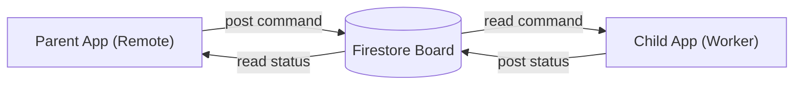
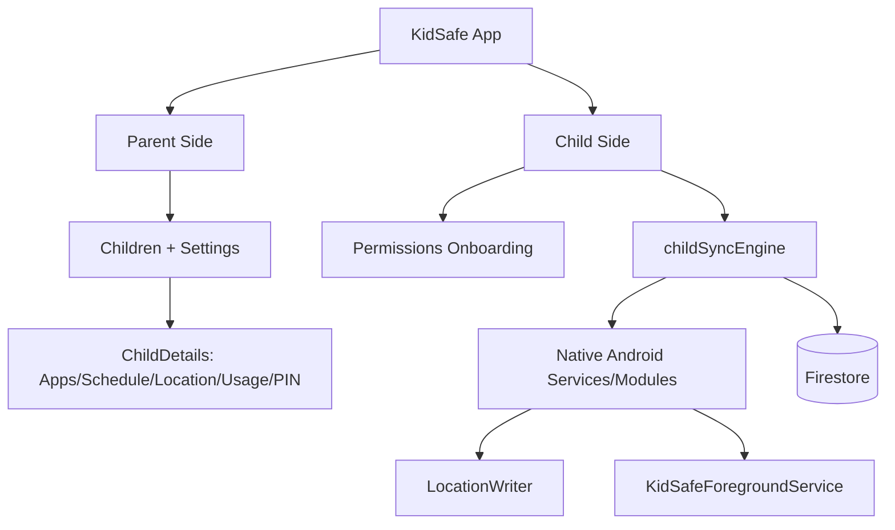
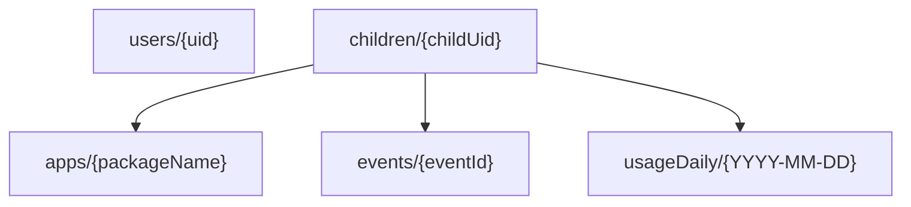
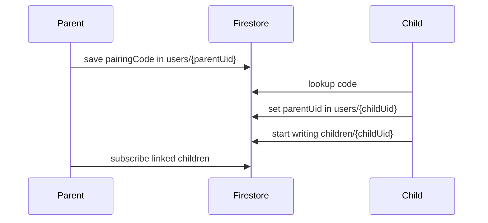
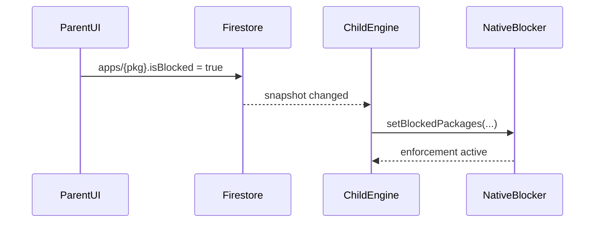
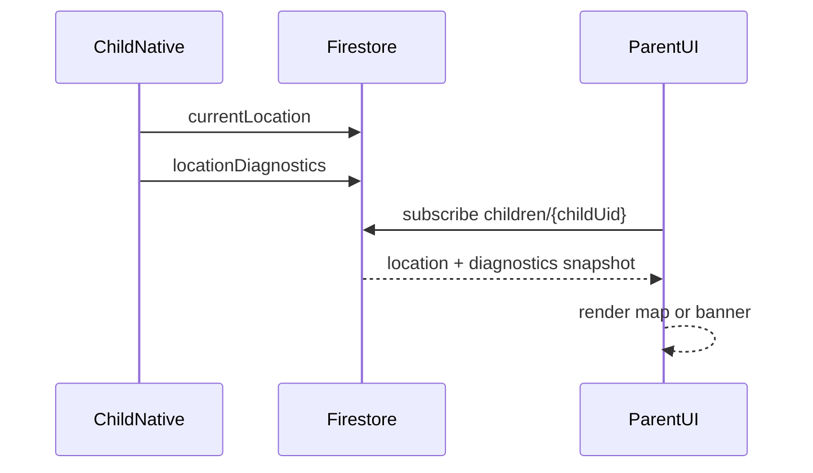
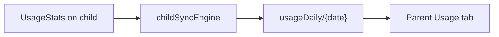
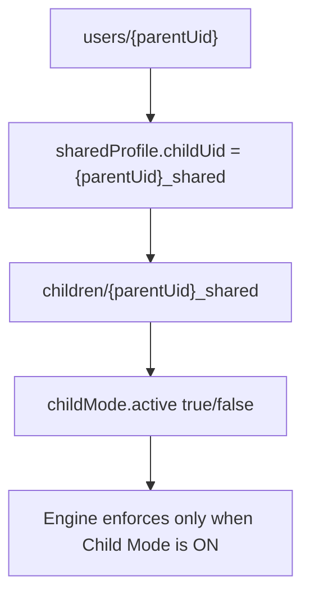

# KidSafe Beginner App Flow

If you just finished `SETUP.md`, read this next.

Goal: understand the whole app in 15-20 minutes, even if you are new to this codebase.

---

## 0) One Analogy (Remember This)

Think of KidSafe like a **smart home system**:

- **Parent app** = remote control panel (turn things ON/OFF).
- **Child app** = device inside the house (does the real work).
- **Firestore** = cloud message board in the middle.

Parent posts commands to board.  
Child reads commands and acts.  
Child posts live status back.  
Parent reads live status and shows UI.



---

## 1) 30-Second App Map



---

## 2) Who Does What?

```text
Parent app:
  - set rules (block app, schedule, lock, etc.)
  - read child live state (location, usage, current app)

Child app:
  - apply parent rules on device
  - send live state back
  - keep running in background with native foreground service
```

---

## 3) Firestore Schema (Super Easy)

Main collections:

```text
users/{uid}
children/{childUid}
children/{childUid}/apps/{packageName}
children/{childUid}/events/{eventId}
children/{childUid}/usageDaily/{YYYY-MM-DD}
```

Diagram:



---

## 4) Live Schema Example (Realistic)

### `children/{childUid}` (main live doc)

```json
{
  "status": "online",
  "lockState": {"locked": false, "until": null},
  "screenTime": {"limitMins": 120, "usedTodayMins": 43, "resetAt": 1778994600000},
  "schedule": {
    "enabled": true,
    "daysOfWeek": [1, 2, 3, 4, 5],
    "startMinutes": 1260,
    "endMinutes": 420,
    "allowedPackages": ["com.android.dialer", "com.whatsapp"]
  },
  "currentLocation": {"lat": 12.9716, "lng": 77.5946, "accuracy": 18.4, "updatedAt": 1779052085000},
  "locationDiagnostics": {"evaluatedAt": 1779052087000, "ok": true},
  "currentApp": {"packageName": "com.whatsapp", "state": "foreground", "updatedAt": 1779052090000}
}
```

### `children/{childUid}/apps/com.whatsapp`

```json
{
  "appName": "WhatsApp",
  "isBlocked": true
}
```

### `children/{childUid}/usageDaily/2026-05-20`

```json
{
  "date": "2026-05-20",
  "totalMins": 132,
  "perApp": {
    "com.whatsapp": 41,
    "com.google.android.youtube": 35
  }
}
```

---

## 5) Parent-Child Connect Flow (Pairing)



---

## 6) Day-To-Day Feature Flows

## A) Block App flow



## B) Location flow



## C) Usage flow



---

## 7) Location Diagnostics (Meaning In Plain English)

When location has issue, child writes reason and parent shows banner.

```text
fine_permission_missing      -> app location permission OFF
background_permission_missing-> not "Allow all the time"
system_location_off          -> phone GPS master switch OFF
fg_service_not_running       -> background service killed
first_fix_timeout            -> no first GPS fix yet
firestore_write_failing      -> child can't sync to Firestore
```

---

## 8) Shared Mode (One Phone) In One Diagram



---

## 9) What To Open In Code (Beginner Path)

Follow this exact order:

1. `src/navigation/ParentNavigator.tsx`
2. `src/screens/parent/ChildDetailsScreen.tsx`
3. `src/screens/parent/LocationTab.tsx`
4. `src/services/childSyncEngine.ts`
5. `src/modules/native.ts`
6. `android/app/src/main/java/com/kidsafe/services/KidSafeForegroundService.kt`
7. `android/app/src/main/java/com/kidsafe/services/LocationWriter.kt`
8. `src/firebase/types.ts`
9. `src/firebase/firestore.ts`
10. `firestore.rules`

---

## 10) Quick Debug Commands

Child device (native reliability):

```bash
adb -s <childSerial> logcat -v time -s KidSafe.Location KidSafe.LocationWriter KidSafeFgService KidSafe.LocToggleRecv
```

Parent device/emulator (UI snapshots/errors):

```bash
adb -s <parentSerial> logcat -v time ReactNativeJS:* *:S
```

---

## 11) First KT Demo Script (Use This In Session)

Do this live with the new developer:

1. Open parent `ChildDetails`.
2. Toggle one app block.
3. Show child getting blocked.
4. Open parent Location tab.
5. Show current location or diagnostics banner.
6. Explain where that data appears in Firestore (`children/{childUid}`).
7. Open logs and show one parent snapshot + one child writer line.

That single demo teaches the full architecture loop.

---

## 12) Related Docs

- `SETUP.md` (must-do first)
- `docs/FIRESTORE_SCHEMA_EXPLAINED.md` (deeper Firestore explanation)
- `docs/SYSTEM_DESIGN_KT.md` (full technical deep-dive)
- `docs/RELEASE_CHECKLIST.md` (release/QA)
