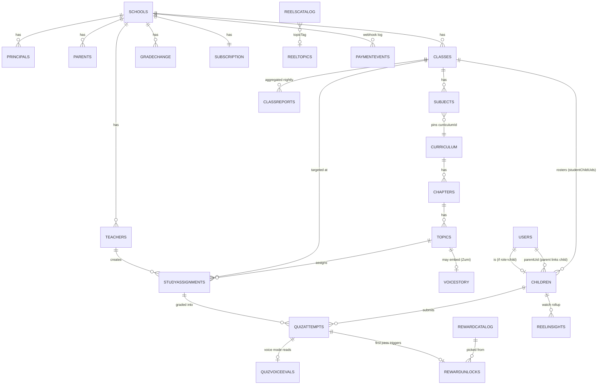
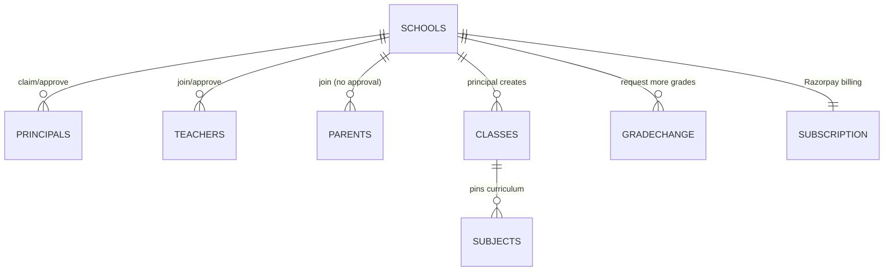
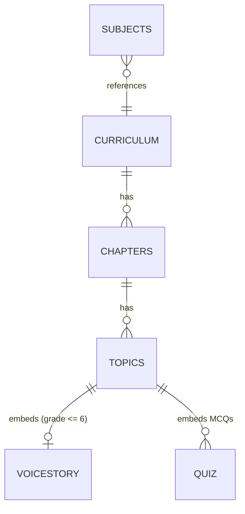
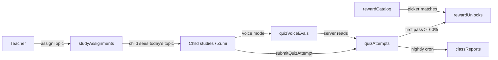

# Zerebro / KidSafe — Data Model (ER Diagram + Every Collection Explained)

> A plain-English map of the whole Firestore database: every collection, what it
> stores, who writes it, who reads it, and how the pieces connect.
>
> Source of truth for the shapes: `packages/shared-types/src/*.ts`.
> Source of truth for access rules: `firestore/rules`.

Firestore is a **document database** (not SQL), so there are no real "tables" or
JOINs. Instead we have **collections** (≈ tables) that hold **documents** (≈ rows).
This doc treats each collection like a table so it's easy to reason about.

Two big rules to keep in mind everywhere:

1. **Server-only collections** — most education data (assignments, quiz scores,
   rewards, reports) can ONLY be written by Cloud Functions (Admin SDK).
   Clients can read (if allowed) but never write. This stops a kid from forging
   a quiz score, a teacher from editing another teacher's data, etc.
2. **Denormalization** — Firestore can't JOIN, so we copy a few fields
   (like `topicName`, `schoolId`, `teacherIds`) onto child docs so a screen can
   render with ONE read instead of many.

---

## 1. The Two Product Areas

The database serves two products that share one user table:

| Area | What it does | Main collections |
|------|--------------|------------------|
| **Parental Control** (original KidSafe) | Parent monitors child's phone — app blocking, screen time, location | `users`, `children` (+ subcollections) |
| **Education Platform** (Zerebro) | School → class → curriculum → assign topic → quiz → rewards → reports. Includes the **Zumi** voice tutor and **Reels**. | `schools`, `curriculum`, `studyAssignments`, `quizAttempts`, etc. |

---

## 2. High-Level ER Diagram

---

## 3. Identity & Parental Control

### `users/{uid}` — the master account table

Every human (admin, principal, teacher, parent, child) has exactly one row here,
keyed by their Firebase Auth UID.

| Field | Meaning |
|-------|---------|
| `roles[]` | Every role the user holds, e.g. `['parent','teacher']`. **Client can never edit this** — only Cloud Functions append roles (anti-escalation). |
| `primaryRole` | Which role drives the current app UI. Self-editable, but only to a role you already hold. |
| `phone` / `email` / `displayName` | Identity basics. |
| `pairingCode` | (Parent only) 6-digit code a child enters to link. |
| `parentUid` | (Child only) UID of the linked parent. |
| `schoolIds[]` | Every school this user belongs to. |
| `deviceMode` | `two_device` (parent + child phones) or `shared` (one phone). |

**Who writes:** the user themselves (limited fields) + Cloud Functions (roles/schoolIds).
**Who reads:** any signed-in user (needed so a child can look up a parent's pairing code).

### `children/{childUid}` — live state of a monitored child phone

This is the parental-control heart. One doc per child device.

| Field | Meaning |
|-------|---------|
| `status` / `lastSeenAt` | online/offline heartbeat. |
| `classId` | `{schoolId, classId}` pointer — set once the child joins a school. Links parental-control world → education world. |
| `lockState` | Is the phone locked right now (+ optional auto-release time). |
| `screenTime` | Daily limit + minutes used. |
| `currentLocation` / `geofence` | GPS + safe-zone circle. |
| `schedule` | Allowed-apps time windows. |
| `currentApp` | Live "what app is open right now". |
| `locationDiagnostics` | Why location might not be updating (drives parent banner). |

**Who writes:** the child (most fields) + the parent (only "command" fields:
`lockState`, `geofence`, `screenTime`, `schedule`, `pinResetRequest`).
**Who reads:** the child + their linked parent.

**Subcollections under `children/{childUid}`:**

| Subcollection | Doc id | Holds |
|---------------|--------|-------|
| `apps/{packageName}` | package name | Installed app + `isBlocked` flag (parent flips block). |
| `events/{eventId}` | auto | Append-only tamper/geofence events. |
| `usageDaily/{YYYY-MM-DD}` | date | One day's screen-time breakdown (`totalMins`, `perApp`). |
| `reelInsights/{YYYY-MM-DD}` | date | One day's Reels watch time per topic. |

---

## 4. School Structure (Education)

### `schools/{schoolId}` — the top-level school

| Field | Meaning |
|-------|---------|
| `name`, `city` | Basic info. |
| `principalUid` | Set when admin approves a principal. `null` until then. |
| `inviteCode` | 8-char code shared admin→principal, then principal→parents/kids. |
| `teacherCode` | 6-char code principal shares with teachers. |
| `activeGrades[]` | Grades this school teaches, e.g. `[1..8]`. |
| `studentCount` | Used as Razorpay billing quantity (₹99/student/month). |

**Who writes:** admin only. **Who reads:** admin, the school's principal, and a
pending principal (to see the "waiting for verification" screen).

### School subcollections

| Subcollection | Doc id trick | Purpose | Approval? |
|---------------|--------------|---------|-----------|
| `principals/{principalId}` | `principalId == userId` | Principal claim record (`pending`/`active`/`rejected`). Approval appends `'principal'` to the user's roles. | Yes (admin approves) |
| `teachers/{teacherId}` | `teacherId == userId` | Teacher join record. Approval array-unions `'teacher'` into roles. | Yes (principal approves) |
| `parents/{parentId}` | `parentId == userId` | Parent membership. **No approval** — presence of doc = membership. | No |
| `classes/{classId}` | auto | A class section (grade + section). | — |
| `classes/.../subjects/{subjectId}` | auto | A subject in a class; pins one `curriculumId`. | — |
| `gradeChangeRequests/{requestId}` | auto | Principal asks to add grades; admin approves. | Yes (admin) |
| `subscription/{docId}` | single doc | Razorpay billing state for the school. | server-only |

The `{docId} == {userId}` trick (used by principals/teachers/parents) guarantees
one record per person per school AND lets a user find their own record across all
schools with a collection-group query (`where userId == me`) without knowing the
schoolId first.

### `classes/{classId}` key fields

| Field | Meaning |
|-------|---------|
| `grade`, `section`, `className` | e.g. grade 8, section A, "8A". |
| `academicYear` | e.g. "2026-27" — new doc per year so old rosters survive. |
| `teacherIds[]` | Teachers assigned to this class. |
| `subjectTeachers` | Map `curriculumId → teacher UID` (one teacher per subject). |
| `studentChildUids[]` | Child UIDs rostered (array-unioned by `joinSchool`). |

---

## 5. Curriculum & Content

### `curriculum/{curriculumId}` — a book/subject

`curriculumId` is a readable slug like `cbse_8_science`.

| Field | Meaning |
|-------|---------|
| `board` | `cbse` / `icse` / `state` / ... |
| `grade` | Class number. |
| `subject` | e.g. "Science". |

### `curriculum/.../chapters/{chapterId}`

| Field | Meaning |
|-------|---------|
| `chapterNo`, `chapterName` | Ordering + title. |
| `status` | `draft` or `published` (publish gate for kids). |

### `curriculum/.../chapters/.../topics/{topicId}` — the real content

This is the richest content doc. It holds the full curated lesson:

| Field | Meaning |
|-------|---------|
| `explanation`, `examples[]` | Main lesson text (simple words + examples). |
| `videoUrl` | Curated YouTube intro video. |
| `brainstorming[]` | Curiosity Q&A cards (each may have its own `videoUrl`). |
| `misconceptions[]` | Common wrong belief → correct understanding. |
| `realLifeConnections[]` | Real-world uses (+ video queries). |
| `activities[]` | Hands-on experiment/activity. |
| `workedProblems[]` | Step-by-step solved problems. |
| `sections[]` | Collapsible PDF-style sections. |
| `quiz[]` | MCQ questions (`correctIndex` is the source of truth for grading). |
| `voiceStory?` | **Zumi voice layer** — present only for grade ≤ 6 "Fun" topics (see §6). |
| `status`, `curatedBy`, `publishedAt` | Publish workflow + audit. |

> This maps directly to your "7 sections per topic" idea: explanation, video,
> curiosity (brainstorming), real-life connections, misconceptions, activity, quiz.

**Who writes:** admin / content import script. **Who reads:** any signed-in user.

---

## 6. Zumi Voice Story (embedded in a topic)

`voiceStory` is NOT its own collection — it's an **object embedded inside a topic
doc**. It carries the full 10-stage voice lesson for young kids (nursery–5th).

| Group | Fields | Mode |
|-------|--------|------|
| Hook / Predict | `hookContext`, `predictContext` | AI (real-time) |
| Trap | `wrongAnswerTrapScript`, `trapLottieKey` | Scripted (pre-stored audio) |
| Experiment | `experimentInstruction`, `experimentWaitSeconds`, `experimentFollowUp` | Scripted + wait + STT |
| Visualization | `visualizationScript`, `visualizationLottieKey` | Scripted + Lottie |
| Discovery | `discoveryLeadQuestion`, `discoveryCelebration` | AI + STT |
| Concept reveal | `conceptRevealScript`, `conceptRevealRiveKey` | Scripted + Rive |
| Exam mode | `examModeIntro`, `ncertDefinition`, `keyPoints[]`, `keywords[]`, `memoryTrick` | Scripted |
| Quiz | `voiceQuiz[]` (each: `questionText`, `expectedConcepts[]`, `correctIndicator`, `responseCorrect/Partial/Incorrect`, optional `questionAudioUrl`) | STT + server eval |
| Closing | `closingHighScoreContext`, `closingMidScoreContext`, `closingLowScoreContext`, `parentTryTonight` | AI |
| Animations | `animations[]` (Lottie/Rive cues) | — |

This is exactly the **hybrid** design: scripted parts can play pre-generated audio
(₹0 per play), AI parts run live.

---

## 7. Assignment → Quiz → Reward Flow

This is the core daily loop. Follow the arrows:

### `studyAssignments/{classId}_{topicId}_{date}` — teacher assigns a topic

Deterministic id prevents duplicate same-day assignments.

| Field | Meaning |
|-------|---------|
| `schoolId`, `classId`, `curriculumId`, `chapterId`, `topicId` | What + where. |
| `topicName`, `subjectName` | Denormalized for fast list rendering. |
| `assignedByTeacherUid` | Drives the teacher's self-read rule. |
| `assignedDate` (YYYY-MM-DD) | School timezone (Asia/Kolkata). |
| `dueAt` | Epoch ms; must be now … now+30d. |
| `status` | `active` / `cancelled`. |

**Who writes:** `assignTopic` Cloud Function only.
**Who reads:** the assigning teacher, kids in that class, the principal, admin.

### `quizAttempts/{assignmentId}_{childUid}` — one row per (assignment, child)

Idempotent upsert: retakes bump `attemptCount`, keep `best*` high-water mark,
flip `passed` sticky-true once any attempt clears 60%.

| Field group | Fields |
|-------------|--------|
| Identity | `assignmentId`, `childUid`, `parentUid`, `schoolId`, `classId`, `assignedByTeacherUid` |
| Denormalized content | `chapterName`, `topicName`, `subjectName`, `grade` |
| Latest attempt | `lastScore`, `lastPercentage`, `lastAnswers[]` |
| Best | `bestScore`, `bestPercentage`, `passed`, `firstPassedAt` |
| Counters | `attemptCount`, `total` |
| Voice | `isVoice`, `voiceResults[]` |

**Who writes:** `submitQuizAttempt` only.
**Who reads:** the child, their parent, the assigning teacher, principal, admin.

### `quizVoiceEvals/{assignmentId}_{childUid}` — Zumi's authoritative verdicts

Written per-question by `zumiEvaluateAnswer`. `submitQuizAttempt` reads THIS
server-side to compute the voice score, so a kid can't forge a score.

**Who writes:** `zumiEvaluateAnswer` only. **Who reads:** the child (own record) + admin.

### `rewardCatalog/{rewardId}` — admin-curated reward pool

| Field | Meaning |
|-------|---------|
| `type` | `youtube_link` / `game_link` / `article_link`. |
| `title`, `url` | Reward display + destination. |
| `subjectTags[]` | Lowercased subjects this reward matches. |
| `grades[]` | Grades this reward can unlock for. |
| `moderationStatus` | `pending` / `approved` / `rejected`. Kids only see `approved`. |

### `rewardUnlocks/{attemptId}` — what a child actually earned

Written by the `onQuizAttemptWrite` trigger the first time a child passes.
Doc id = attempt id (idempotent). Reward fields are denormalized for fast render.

**Who writes:** trigger only. **Who reads:** the child + their parent + admin.

---

## 8. Reports

### `classReports/{classId}/daily/{YYYY-MM-DD}` — nightly rollup

Pre-computed by the `aggregateClassReports` cron so dashboards read ONE tiny doc
instead of scanning all `quizAttempts`.

| Field | Meaning |
|-------|---------|
| `schoolId`, `classId`, `teacherIds[]` | Denormalized for the read rules. |
| `rosterSize`, `attemptedStudents`, `passedStudents`, `totalAttempts` | Class counts. |
| `avgBestPercentage` | Class mean. |
| `topics[]` | Per-topic stats, sorted weakest-first (`weak = avg < 60`). |

Plus a `classReports/{classId}` **pointer doc** (latest date + `weakTopics`) so a
UI can find the newest report without a scan.

**Who writes:** cron only. **Who reads:** the class's principal + teachers + admin.

---

## 9. Reels

| Collection | Doc id | Holds | Write / Read |
|------------|--------|-------|--------------|
| `reelsCatalog/{reelId}` | reel id | Video (`videoUrl`, `kind: topic\|fun`, `topicTag`, `gradeBand[]`). | admin / any signed-in |
| `reelTopics/{topicTag}` | topic tag | Topic metadata + `parentQuestions[]` ("ask tonight"). | admin / any signed-in |
| `children/{childUid}/reelInsights/{date}` | date | Daily watch time per topic. | child / child + parent |

---

## 10. Billing (Razorpay)

| Collection | Doc id | Holds | Write / Read |
|------------|--------|-------|--------------|
| `schools/{schoolId}/subscription/{docId}` | single | Razorpay subscription state: `status`, `quantity`, `totalAmount`, grace period, manual override. | server-only / principal + admin |
| `paymentEvents/{eventId}` | auto | Append-only Razorpay webhook log. | webhook fn / admin only |

---

## 11. Who-Writes-What Cheat Sheet

| Collection | Client can write? | Written by |
|------------|-------------------|-----------|
| `users` | Partial (self, no `roles`) | user + Cloud Functions |
| `children` (+ apps/events/usageDaily/reelInsights) | Yes (scoped) | child + parent (command fields) |
| `schools` | No | admin |
| `schools/.../principals` `teachers` `parents` `gradeChangeRequests` `subscription` | **No** | Cloud Functions (Admin SDK) |
| `schools/.../classes` `subjects` | No | admin / principal |
| `curriculum` (+ chapters/topics) | No | admin / import script |
| `studyAssignments` | **No** | `assignTopic` |
| `quizAttempts` | **No** | `submitQuizAttempt` |
| `quizVoiceEvals` | **No** | `zumiEvaluateAnswer` |
| `rewardCatalog` | No | admin |
| `rewardUnlocks` | **No** | `onQuizAttemptWrite` trigger |
| `classReports` | **No** | `aggregateClassReports` cron |
| `reelsCatalog` `reelTopics` | No | admin / seed script |
| `paymentEvents` | **No** | `razorpayWebhook` |

**Rule of thumb:** if a value affects money, scores, roles, or cross-user trust,
it is **server-only write**. Clients read; Cloud Functions write.

---

## 12. Key Relationships Recap (in words)

- A **user** with role `child` has a matching **children** doc; their **parent**
  (another user) links via `parentUid`.
- A **child** joins a **school** → gets stamped with `classId` → appears in that
  **class**'s `studentChildUids[]`.
- A **class** has **subjects**; each subject pins a **curriculum**; a curriculum
  has **chapters**; chapters have **topics**; a topic may embed a Zumi **voiceStory**.
- A **teacher** assigns a **topic** to a **class** → creates a **studyAssignment**.
- A **child** does the assignment → **submitQuizAttempt** writes a **quizAttempt**
  (voice mode first reads **quizVoiceEvals**).
- First time they pass → a **rewardUnlock** is created from the **rewardCatalog**.
- Every night the cron rolls attempts into **classReports** for principal/teacher
  dashboards.

---

## 13. Cloud Functions Map (which function touches which collection)

All sensitive writes go through Cloud Functions (Admin SDK), which **bypass**
security rules. Region: `asia-south1`. Below, **R** = reads, **W** = writes.

### Principal onboarding

| Function | Trigger | Collections |
|----------|---------|-------------|
| `claimSchool` | callable | **R** `schools` (find by inviteCode) · **W** `schools/.../principals` (pending) |
| `approvePrincipal` | callable | **R/W** `schools/.../principals` · **W** `schools` (`principalUid`, `activeGrades`) · **W** `users` (+role) |
| `rejectPrincipal` | callable | **W** `schools/.../principals` (rejected) |
| `rotateInviteCode` | callable | **R/W** `schools` (`inviteCode`) |

### Teacher onboarding

| Function | Trigger | Collections |
|----------|---------|-------------|
| `rotateTeacherCode` | callable | **R/W** `schools` (`teacherCode`) |
| `lookupSchoolClasses` | callable | **R** `schools` (by teacherCode) · **R** `schools/.../classes` · **R** `curriculum` |
| `requestTeacherJoin` | callable | **R** `schools` · **R** `schools/.../classes` · **W** `schools/.../teachers` (pending) |
| `approveTeacher` | callable | **R/W** `schools/.../teachers` · **W** `users` (+role) · **W** `schools/.../classes` (`teacherIds`, `subjectTeachers`) |
| `rejectTeacher` | callable | **W** `schools/.../teachers` (rejected) |

### Parent + child school link (no approval gate)

| Function | Trigger | Collections |
|----------|---------|-------------|
| `joinSchoolAsParent` | callable | **R** `schools` (by inviteCode) · **W** `schools/.../parents` · **W** `users` (+role, +schoolIds) |
| `joinSchool` (child) | callable | **R** `schools` · **R** `schools/.../classes` · **W** `users` · **W** `children` (`classId`) · **W** `classes` (`studentChildUids`) |

### Grade management

| Function | Trigger | Collections |
|----------|---------|-------------|
| `requestGradeChange` | callable | **R** `schools` · **W** `schools/.../gradeChangeRequests` (pending) |
| `approveGradeChange` | callable | **R/W** `schools/.../gradeChangeRequests` · **W** `schools` (`activeGrades`) · **W** `schools/.../classes` (auto-create) |
| `rejectGradeChange` | callable | **W** `schools/.../gradeChangeRequests` (rejected) |

### Study loop

| Function | Trigger | Collections |
|----------|---------|-------------|
| `assignTopic` | callable | **R** `schools`, `classes`, `teachers`, `curriculum/.../topics` · **W** `studyAssignments` |
| `submitQuizAttempt` | callable | **R** `studyAssignments`, `children`, `curriculum/.../topics`, `quizVoiceEvals` (voice), `users` · **W** `quizAttempts` |
| `onQuizAttemptWrite` | **trigger** on `quizAttempts` write | **R** `rewardCatalog` · **W** `rewardUnlocks` (first pass only) |
| `aggregateClassReports` | **cron** 02:00 IST | **R** `quizAttempts`, `schools/.../classes` · **W** `classReports/{classId}/daily/{date}` + pointer |

### Zumi voice (AI/speech proxies — keys stay server-side)

| Function | Trigger | Collections / External |
|----------|---------|------------------------|
| `zumiConverse` | callable | **R** context (`studyAssignments`, `children`, `curriculum/.../topics`) · → OpenAI |
| `zumiTeach` | callable | **R** same context · → OpenAI |
| `zumiEvaluateAnswer` | callable | **R** context · → OpenAI · **W** `quizVoiceEvals` |
| `zumiSpeak` | callable | → ElevenLabs TTS · **W** Storage `zumi_tts/` (cache) |
| `zumiTranscribe` | callable | **R** Storage `zumi_stt/` · → ElevenLabs STT |

> `resolveVoiceContext` (in `lib/zumiSession.ts`) is the shared reader the three
> Zumi AI callables use: it reads `studyAssignments` → `children` → the topic's
> `voiceStory`, and validates the child belongs to the assignment's class.

### Billing (Razorpay)

| Function | Trigger | Collections |
|----------|---------|-------------|
| `createSubscription` | callable | **R** `schools` · **W** `schools/.../subscription` |
| `getSubscriptionStatus` | callable | **R** `schools`, `schools/.../subscription` |
| `updateStudentCount` | callable | **R/W** `schools/.../subscription` |
| `cancelSubscription` | callable | **R/W** `schools/.../subscription` |
| `adminActivateSubscription` | callable | **R/W** `schools/.../subscription` (manual override) |
| `getPaymentHistory` | callable | **R** `schools` · **R** `paymentEvents` |
| `razorpayWebhook` | **HTTP** (Razorpay POST) | **W** `paymentEvents` · **W** `schools/.../subscription` |

### Seed / import scripts (run locally, not deployed)

| Script | Writes |
|--------|--------|
| `importCurriculum` | `curriculum` + `chapters` + `topics` |
| `seedVoiceStories` | `topics.voiceStory` (Class 3 Science) |
| `seedReels` | `reelsCatalog`, `reelTopics` |
| `seedStaging` | demo schools/classes/users |
| `oneTimeMigration_v1_to_v2` | `users` (backfill `roles[]`) |
| `grantRole` / `setSchoolGrades` | `users` / `schools` |

---

## 14. Collection → Functions Reverse Index

Quick "who can change this collection?" lookup:

| Collection | Functions that WRITE it |
|------------|--------------------------|
| `users` | `approvePrincipal`, `approveTeacher`, `joinSchoolAsParent`, `joinSchool`, migration/grantRole scripts (+ the user self-writes limited fields) |
| `children` | `joinSchool` (+ the child/parent client writes per rules) |
| `schools` | `approvePrincipal`, `rotateInviteCode`, `rotateTeacherCode`, `approveGradeChange` (+ admin web) |
| `schools/.../principals` | `claimSchool`, `approvePrincipal`, `rejectPrincipal` |
| `schools/.../teachers` | `requestTeacherJoin`, `approveTeacher`, `rejectTeacher` |
| `schools/.../parents` | `joinSchoolAsParent` |
| `schools/.../classes` | `approveTeacher`, `joinSchool`, `approveGradeChange` (+ principal web) |
| `schools/.../gradeChangeRequests` | `requestGradeChange`, `approveGradeChange`, `rejectGradeChange` |
| `schools/.../subscription` | all `*Subscription*` callables + `razorpayWebhook` |
| `curriculum` / `chapters` / `topics` | `importCurriculum`, `seedVoiceStories` (+ admin) |
| `studyAssignments` | `assignTopic` |
| `quizAttempts` | `submitQuizAttempt` |
| `quizVoiceEvals` | `zumiEvaluateAnswer` |
| `rewardCatalog` | admin web / seed |
| `rewardUnlocks` | `onQuizAttemptWrite` trigger |
| `classReports` | `aggregateClassReports` cron |
| `reelsCatalog` / `reelTopics` | `seedReels` (+ admin) |
| `paymentEvents` | `razorpayWebhook` |

---

*Generated from the live types in `packages/shared-types/src/`, the access
rules in `firestore/rules`, and the Cloud Functions in `apps/functions/src/`.
If a shape here disagrees with those files, the code wins — update this doc.*

