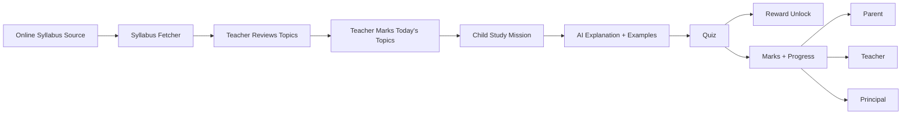
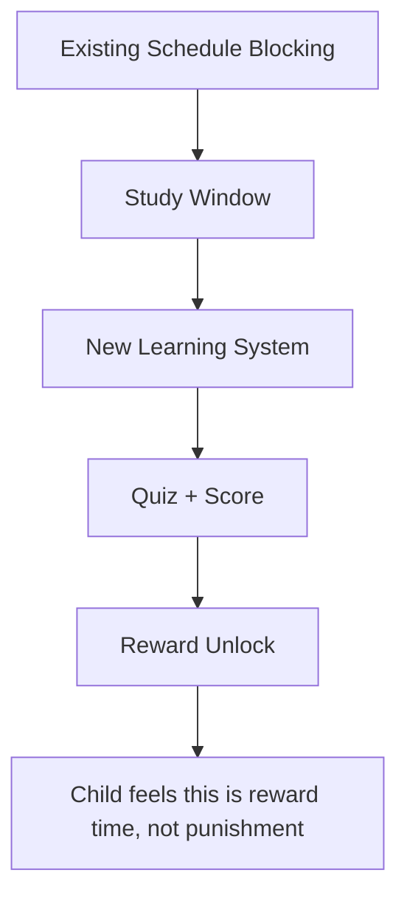
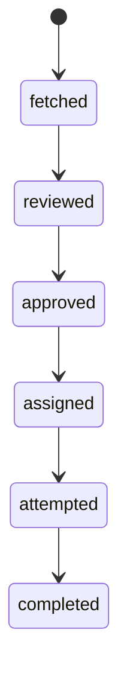
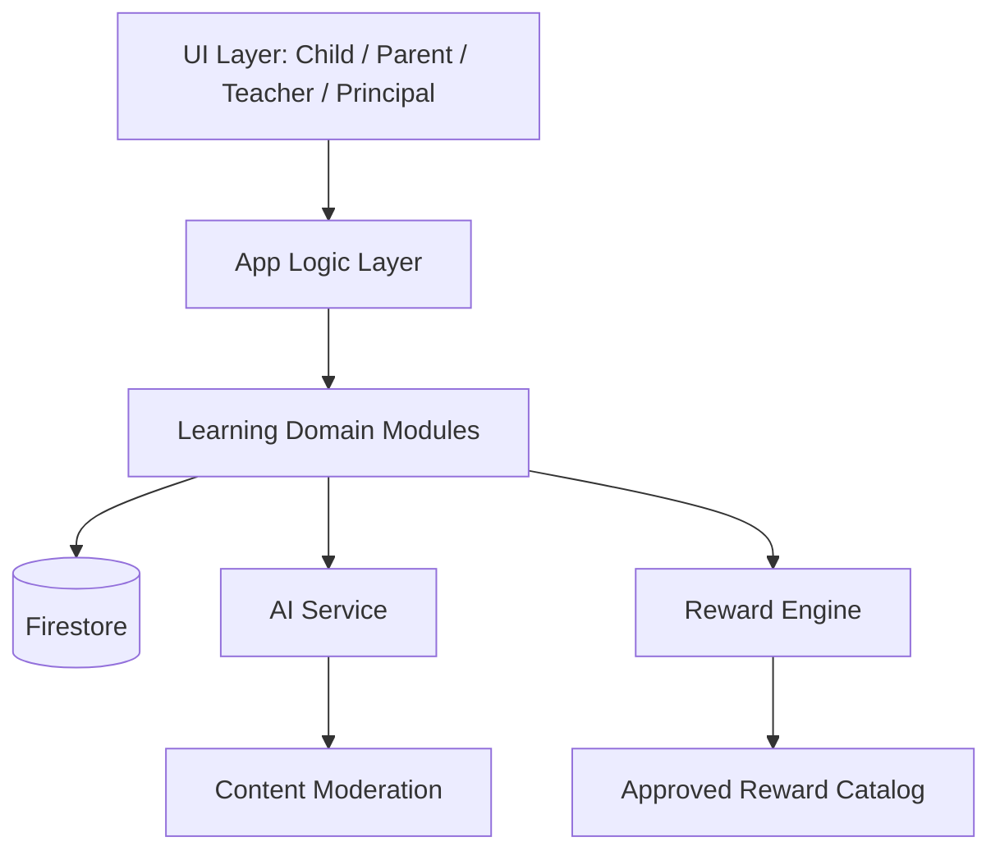
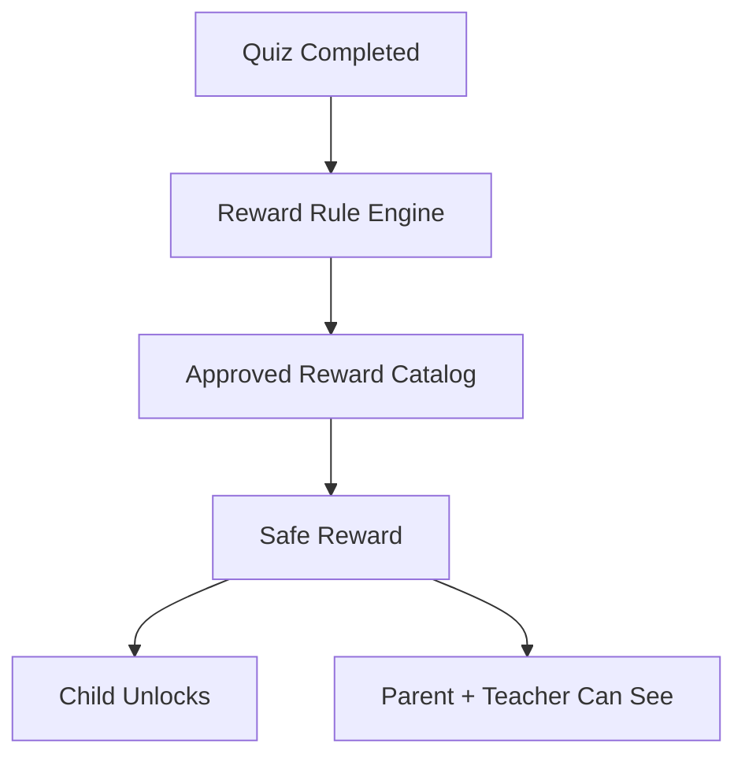
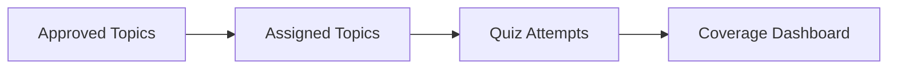
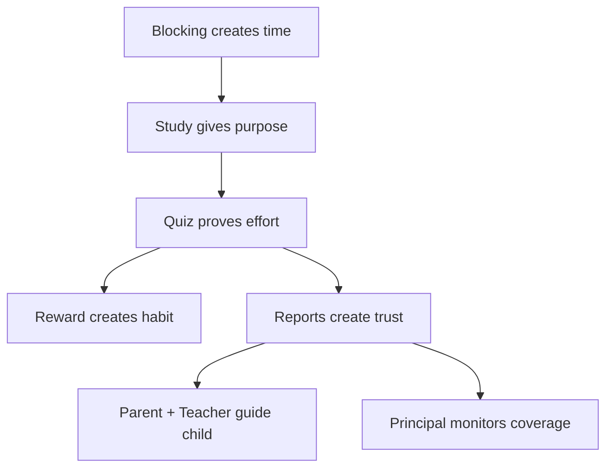

# Education AI Ecosystem Plan

Goal: reduce tuition dependency by turning blocked phone time into **reward-based study time**.

In simple words:

> Schedule blocking says: "Phone nahi chalega."
>
> Education AI says: "Ab 20 min padh lo, quiz do, phir reward unlock hoga."

This document explains how to connect syllabus, teachers, children, AI explanations, quizzes, parents, rewards, and principal reports into one maintainable system.

---

## 1) Product Idea In One Diagram



---

## 2) Analogy For Beginner Developer

Think of this system like a **school homework machine**:

- **Online syllabus source** = book library
- **Teacher** = person who picks today's homework
- **AI** = friendly tutor who explains the topic
- **Quiz** = quick test
- **Reward** = chocolate/game/funny video after completing study
- **Parent** = sees if child studied
- **Principal** = sees if every class is covering syllabus

```text
Library -> Teacher picks topic -> AI explains -> Child gives quiz -> Reward -> Reports
```

---

## 3) How This Connects With Current KidSafe

Current KidSafe already has:

- app blocking
- schedule window
- parent-child Firestore sync
- child foreground service
- parent child-details screen

New education feature should sit **beside** blocking, not inside blocking.



Why separate?

- Blocking can continue working even if AI is down.
- Learning can grow into school dashboards later.
- Rewards/quiz/AI can change without touching app-blocking engine.

---

## 4) Roles

| Role | What they do |
|---|---|
| Child | Reads AI explanation, attempts quiz, unlocks reward |
| Parent | Sees quiz marks, completion, reward unlocked |
| Teacher | Reviews topics, assigns topics, checks class performance |
| Principal | Sees syllabus coverage by class/subject/teacher |
| System/Admin | Fetches syllabus, moderates rewards, manages AI rules |

---

## 5) First Version Flow (Online Fetch First)

You selected: **online syllabus source first**.

Important rule:

> Online fetched topics should NOT go directly to children.
>
> Teacher must review/approve/assign first.



---

## 6) Main Screens Wireframe

## 6.1 Child App: Study Mission

```text
+------------------------------------------------+
| Today Study Mission                            |
|------------------------------------------------|
| Science                                        |
| Topic: Types of Forces                         |
| Status: Not started                            |
|                                                |
| [Learn with AI]                                |
| [Start Quiz]                                   |
|                                                |
| Reward locked                                  |
| Complete quiz to unlock: Funny video / game    |
+------------------------------------------------+
```

## 6.2 AI Explanation Screen

```text
+------------------------------------------------+
| Types of Forces                                |
|------------------------------------------------|
| Simple Explanation                             |
| - Force means push or pull                     |
| - Example: pushing a door                      |
|                                                |
| Real Life Example                              |
| - Magnet pulling iron                          |
|                                                |
| [I understood, start quiz]                     |
+------------------------------------------------+
```

## 6.3 Quiz Screen

```text
+------------------------------------------------+
| Quiz: Types of Forces                          |
| Q1. Force is a:                                |
|  ( ) color                                     |
|  ( ) push or pull                              |
|  ( ) sound                                     |
|                                                |
| [Next]                                         |
+------------------------------------------------+
```

## 6.4 Reward Unlock Screen

```text
+------------------------------------------------+
| Great job!                                     |
| Score: 8/10                                    |
|                                                |
| Reward unlocked                                |
| [Play mini game] or [Watch approved funny link]|
+------------------------------------------------+
```

## 6.5 Teacher Dashboard

```text
+------------------------------------------------+
| Class 8A - Science                             |
|------------------------------------------------|
| Fetched topics                                 |
| [ ] Force                                      |
| [x] Types of Forces       [Assign Today]       |
| [ ] Pressure                                   |
|                                                |
| Assigned Today: 2 topics                       |
+------------------------------------------------+
```

## 6.6 Principal Dashboard

```text
+------------------------------------------------+
| Syllabus Coverage                              |
|------------------------------------------------|
| Class 8A Science: 42% covered                  |
| Class 8A Maths:   55% covered                  |
| Class 7B Science: 30% covered                  |
|                                                |
| Teacher pending reviews: 12                    |
+------------------------------------------------+
```

---

## 7) System Layers



Recommended code ownership later:

```text
src/features/learning/
  content/
  assignments/
  lessons/
  quiz/
  rewards/
  reports/
```

Backend/cloud ownership later:

```text
functions/
  syllabusFetchers/
  aiLessonGenerator/
  rewardModeration/
  reportingAggregates/
```

---

## 8) Proposed Firestore Schema

This is a proposed schema for the future feature. It should live alongside the existing KidSafe schema.

## 8.1 Schools

`schools/{schoolId}`

```json
{
  "name": "Green Valley School",
  "city": "Delhi",
  "createdAt": 1779050000000
}
```

## 8.2 Classes / Sections

`schools/{schoolId}/classes/{classId}`

```json
{
  "grade": 8,
  "section": "A",
  "className": "Class 8A",
  "academicYear": "2026-27",
  "teacherIds": ["teacher_123"],
  "studentChildUids": ["child_001", "child_002"]
}
```

## 8.3 Subjects

`schools/{schoolId}/classes/{classId}/subjects/{subjectId}`

```json
{
  "name": "Science",
  "code": "science",
  "teacherIds": ["teacher_123"]
}
```

## 8.4 Chapters

`schools/{schoolId}/classes/{classId}/subjects/{subjectId}/chapters/{chapterId}`

```json
{
  "chapterName": "Force and Pressure",
  "chapterNo": 11,
  "source": "online_ncert_adapter",
  "status": "approved"
}
```

## 8.5 Topics

`schools/{schoolId}/classes/{classId}/subjects/{subjectId}/chapters/{chapterId}/topics/{topicId}`

```json
{
  "topicName": "Types of Forces",
  "description": "Contact and non-contact forces",
  "source": "online_ncert_adapter",
  "sourceUrl": "https://example.com/class-8-science-force",
  "status": "approved",
  "reviewedByTeacherId": "teacher_123",
  "reviewedAt": 1779050100000
}
```

Status values:

```text
fetched -> reviewed -> approved -> assigned -> completed
```

## 8.6 Study Assignments

`studyAssignments/{assignmentId}`

Class-level assignment is the source of truth.

```json
{
  "schoolId": "school_001",
  "classId": "class_8A",
  "subjectId": "science",
  "chapterId": "force_pressure",
  "topicId": "types_of_forces",
  "assignedByTeacherId": "teacher_123",
  "assignedDate": "2026-05-21",
  "dueAt": 1779136500000,
  "status": "active"
}
```

Why class-level?

- Teacher assigns once for whole class.
- Child-specific progress is stored separately.
- Principal can calculate class coverage easily.

## 8.7 Lesson Generation Cache

`lessonGenerations/{lessonId}`

```json
{
  "topicId": "types_of_forces",
  "classId": "class_8A",
  "grade": 8,
  "language": "en",
  "promptVersion": "v1",
  "status": "ready",
  "explanation": {
    "short": "Force means push or pull.",
    "examples": [
      "Pushing a door",
      "Magnet pulling iron"
    ],
    "realLifeAnalogy": "Like you push a shopping cart to move it."
  },
  "quiz": [
    {
      "questionId": "q1",
      "type": "mcq",
      "question": "Force is a:",
      "options": ["color", "push or pull", "sound", "temperature"],
      "correctIndex": 1,
      "explanation": "Force means push or pull."
    }
  ],
  "moderation": {
    "status": "approved",
    "checkedAt": 1779050200000
  }
}
```

Important: AI result should be structured JSON, not random free text.

## 8.8 Quiz Attempts

`quizAttempts/{attemptId}`

```json
{
  "assignmentId": "assign_001",
  "childUid": "child_001",
  "parentUid": "parent_001",
  "teacherId": "teacher_123",
  "schoolId": "school_001",
  "classId": "class_8A",
  "topicId": "types_of_forces",
  "score": 8,
  "total": 10,
  "percentage": 80,
  "answers": [
    {
      "questionId": "q1",
      "selectedIndex": 1,
      "correct": true
    }
  ],
  "startedAt": 1779050300000,
  "submittedAt": 1779050600000,
  "rewardUnlocked": true
}
```

## 8.9 Reward Catalog

Because external links are allowed, rewards need moderation.

`rewardCatalog/{rewardId}`

```json
{
  "type": "youtube_link",
  "title": "Funny science experiment video",
  "url": "https://youtube.com/watch?v=approved123",
  "ageMin": 10,
  "ageMax": 14,
  "subjectTags": ["science"],
  "moderationStatus": "approved",
  "approvedBy": "admin_001",
  "createdAt": 1779050000000
}
```

## 8.10 Reward Unlocks

`rewardUnlocks/{unlockId}`

```json
{
  "childUid": "child_001",
  "assignmentId": "assign_001",
  "attemptId": "attempt_001",
  "rewardId": "reward_001",
  "unlockedAt": 1779050700000,
  "seenByChild": true,
  "visibleToParent": true,
  "visibleToTeacher": true
}
```

---

## 9) Reward Safety Design

Since external links are allowed:



Do not show unmoderated AI-generated links directly to children.

Recommended rule:

```text
AI can suggest reward category.
System chooses actual reward only from approved rewardCatalog.
```

Example:

```text
AI says: child likes funny science video
System picks: approved rewardCatalog video tagged science + age 10-14
```

---

## 10) Reporting

## 10.1 Parent Report

Parent sees:

- topic assigned
- explanation viewed
- quiz score
- reward unlocked

## 10.2 Teacher Report

Teacher sees:

- class average score
- weak topics
- children who did not attempt

## 10.3 Principal Report

Principal sees:

- syllabus fetched
- teacher reviewed
- topics assigned
- topics completed
- class/subject coverage

Coverage example:

```text
Class 8A Science
Total approved topics: 100
Assigned topics: 42
Completed by 70%+ students: 35

Assignment coverage = 42%
Learning coverage = 35%
```



---

## 11) How To Integrate Into Current App

## Current KidSafe screens

```text
Parent:
  Apps | Schedule | Location | Usage | PIN

Child:
  Onboarding + background enforcement
```

## Suggested new screens

```text
Parent:
  Add Study card or Study tab later

Child:
  Study Mission screen during blocked/study window

Teacher/Principal:
  Web dashboard first (recommended)
```

Why web dashboard for teacher/principal first?

- teachers need tables, filters, bulk review
- principal needs dashboards and reports
- easier than squeezing school admin into mobile app

---

## 12) Suggested Domain Modules

```text
src/features/learning/
  content/
    syllabusSources.ts
    topicReview.ts
  assignments/
    assignmentService.ts
  lessons/
    lessonService.ts
  quiz/
    quizEngine.ts
  rewards/
    rewardEngine.ts
  reports/
    reportQueries.ts
```

Cloud/functions later:

```text
functions/
  syllabusFetchers/
  aiLessonGenerator/
  rewardModeration/
  reportingAggregates/
```

---

## 13) Phased Delivery Roadmap

## Phase 1: Learning MVP

- define Firestore schema
- teacher can assign topic
- child sees topic
- AI explanation + MCQ quiz
- parent/teacher see score
- reward unlock from approved catalog

## Phase 2: Online Syllabus Fetch

- implement `SyllabusSourceAdapter`
- fetch class/subject/chapter/topic
- teacher reviews fetched topics
- manual fallback remains available

Even though product preference is online-first, manual fallback is important because online source availability can change.

## Phase 3: School Dashboards

- teacher class dashboard
- principal coverage dashboard
- aggregate attempt stats
- weak topic reports

## Phase 4: Personalization

- weak-topic detection
- revision assignment
- adaptive quiz difficulty
- parent/teacher recommendations

---

## 14) Main Risks And Safeguards

| Risk | Safeguard |
|---|---|
| AI gives wrong explanation | structured prompts, cache, teacher-reviewed topics |
| unsafe YouTube/external link | approved reward catalog, moderation, allowlist |
| syllabus source changes | adapter layer + manual fallback |
| Firestore cost grows | cache lessons, aggregate reports, avoid polling |
| child privacy issue | strict school/class/parent/teacher permissions |
| feature becomes messy | keep domains separated: content, assignment, lesson, quiz, reward, report |

---

## 15) First Developer Task Breakdown

When a developer starts implementation, give them this order:

1. Create Firestore types and paths.
2. Create topic/assignment schema.
3. Build teacher assignment UI with mocked topics.
4. Build child Study Mission UI.
5. Add AI lesson generation service with cached response.
6. Add quiz attempt write.
7. Add parent/teacher score visibility.
8. Add approved reward catalog + unlock.
9. Add online syllabus source adapter.
10. Add principal coverage query/dashboard.

---

## 16) Final Mental Model



This is the core product loop:

```text
Time blocked -> topic assigned -> AI explains -> child attempts quiz -> reward unlocks -> adults see progress
```
