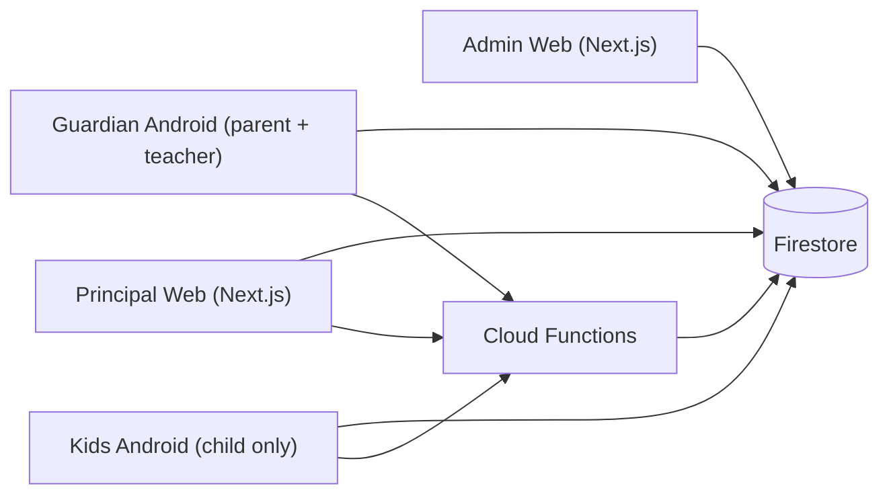
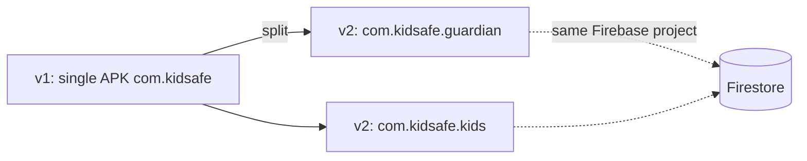
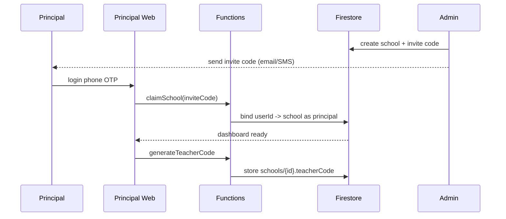
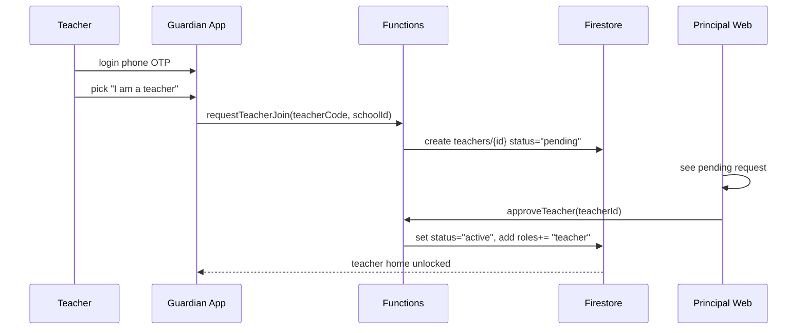
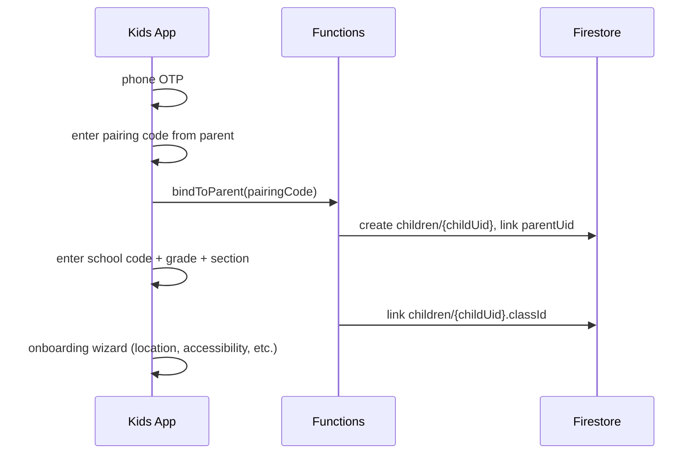
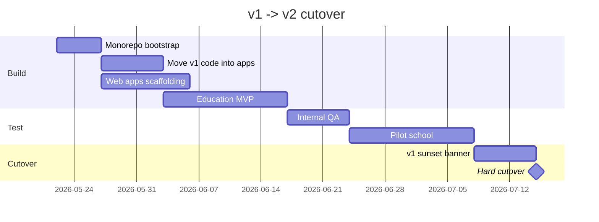
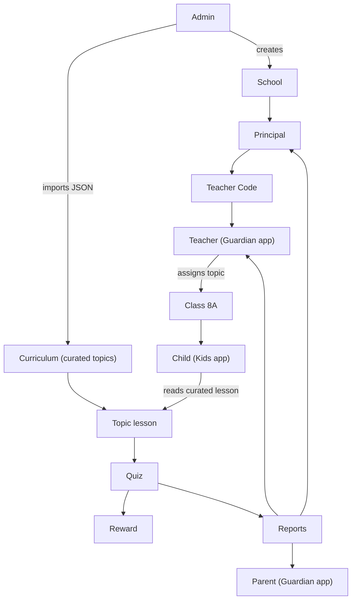

# Education AI Ecosystem — Locked Tech Spec (v2)

This document is the **single source of truth** for the v2 product design.

It captures every locked decision, the monorepo layout, the four-app system, Firestore schema, and phased delivery. Payment/subscriptions are **deferred** until the product works end-to-end.

It supersedes the early planning notes in [EDUCATION_AI_ECOSYSTEM_PLAN.md](./EDUCATION_AI_ECOSYSTEM_PLAN.md), which can still be read for product narrative and analogies.

---

## 0) Read Order For A New Developer

1. [BEGINNER_APP_FLOW.md](./BEGINNER_APP_FLOW.md) — what KidSafe v1 is.
2. [FIRESTORE_SCHEMA_EXPLAINED.md](./FIRESTORE_SCHEMA_EXPLAINED.md) — current schema.
3. [SYSTEM_DESIGN_KT.md](./SYSTEM_DESIGN_KT.md) — current technical deep-dive.
4. [EDUCATION_AI_ECOSYSTEM_PLAN.md](./EDUCATION_AI_ECOSYSTEM_PLAN.md) — product narrative.
5. **This document** — locked v2 tech spec.

---

## 1) Locked Decisions

| # | Decision | Status |
|---|---|---|
| 1 | Auth: phone + OTP everywhere (web also via Firebase Phone Auth) | locked |
| 2 | Teacher code = per school, generated by principal, used by teachers to join | locked |
| 3 | Class = `grade + section` (e.g. `8A`) | locked |
| 4 | Child phone is optional; pairing code stays | locked |
| 5 | Payment & subscriptions (Razorpay, plans, webhooks) | **deferred** — after end-to-end product is built |
| 6 | Topic assignment requires explicit "Mark as taught" by teacher | locked |
| 7 | App split: Guardian (parent+teacher), Kids (child), Principal web, Admin web | locked |
| 8 | Drop "shared mode" (single phone family) in v2 — two-device only | locked |
| 9 | A single user can have multiple roles via `roles: []` array (parent + teacher common) | locked |
| 10 | Repo: **monorepo from day 1** (pnpm + Turborepo) | locked |
| 11 | App names: **Guardian** (parent+teacher) and **Kids** (child) | locked |

---

## 2) The Four-App System



| App | Platform | Users | Primary Job |
|---|---|---|---|
| Admin Web | Next.js | Internal team | Create schools, moderate rewards, manage syllabus sources |
| Principal Web | Next.js | School principals | Generate teacher codes, approve teachers, view coverage |
| Guardian | React Native (Android) | Parents + teachers | Parent: monitor + control child. Teacher: assign topics, view class report |
| Kids | React Native (Android) | Children only | Onboarding + enforcement + study mission + quiz + reward |

Why this split:

- **Kids app isolated** — parent UI is not even bundled, child can't snoop or reverse-engineer.
- **Guardian combined** — many teachers are also parents; one install for both roles.
- **Web for Principal/Admin** — table-heavy, filter-heavy UIs are simpler on the web.

---

## 3) Roles & Multi-Role Users

`users/{userId}` stores a `roles` array, not a single role:

```json
{
  "uid": "user_abc",
  "phone": "+91XXXXXXXXXX",
  "displayName": "Naushad",
  "roles": ["parent", "teacher"],
  "primaryRole": "parent",
  "schoolIds": ["school_001"],
  "teacherProfileIds": ["teacher_123"],
  "createdAt": 1779050000000
}
```

Allowed role strings:

```text
admin | principal | teacher | parent | child
```

On app open, the Guardian app uses `roles`:

- 1 role → straight into that home screen.
- 2+ roles → show a **role switcher** at the top of the home screen, default to `primaryRole` (or last-used).

```text
+----------------------------+
| [ Parent ]  [ Teacher ]    |  <- role switcher
|----------------------------|
| selected role's home view  |
+----------------------------+
```

Important rules:

- A `child` role is **only** valid in the Kids app. Guardian app refuses to load child UI even if `roles` includes `child` (defense-in-depth).
- A user can be promoted to `teacher` only via principal approval (teacher code flow, see §6).

---

## 4) Monorepo Layout

### 4.1 Tooling Stack

- **pnpm workspaces** — fast installs, hoisted node_modules, RN-friendly.
- **Turborepo** — cached, parallel builds across packages.
- **TypeScript project references** — type-safe shared packages.
- **Firebase Emulator Suite** — local Firestore + Functions for dev.

> ESLint, Prettier, Husky, and lint-staged are **deferred to a later phase** — not in the initial monorepo bootstrap.

### 4.2 Folder Structure

```text
kidsafe/
  apps/
    guardian/                # Guardian Android (parent + teacher)
      android/
      src/
      index.tsx
      metro.config.js
      package.json

    kids/                    # Kids Android (child only)
      android/
      src/
      index.tsx
      metro.config.js
      package.json

    principal-web/           # Next.js 14 App Router
      app/
      components/
      package.json

    admin-web/               # Next.js 14 App Router
      app/
      components/
      package.json

    functions/               # Firebase Cloud Functions (TS)
      src/
        callable/
        ai/
        crons/
        triggers/
      package.json

  packages/
    shared-types/            # Firestore types, education types
      src/firestore.ts
      src/education.ts
      package.json

    shared-firebase/         # auth + firestore helpers (web + mobile)
      src/auth.ts
      src/firestore.ts
      src/index.web.ts
      src/index.native.ts
      package.json

    shared-ui-mobile/        # buttons, theme, components used in guardian+kids
      src/Button.tsx
      src/colors.ts
      package.json

    shared-ui-web/           # web-only components shared by admin+principal
      src/Button.tsx
      src/Card.tsx
      src/DataTable.tsx
      package.json

    shared-utils/            # date, formatters, validators (platform-agnostic)
      src/dates.ts
      src/validators.ts
      package.json

  android-modules/           # Kotlin native modules (mostly consumed by apps/kids)
    location-writer/
    app-blocker/
    screen-time/
    pin/
    device-admin/

  firestore/
    rules                    # firestore.rules
    indexes.json

  docs/
    EDUCATION_AI_TECH_SPEC.md  # this file
    ...

  scripts/
    bootstrap.sh
    build-all.sh
    release-android.sh

  pnpm-workspace.yaml
  turbo.json
  package.json
  tsconfig.base.json
  .npmrc
```

### 4.3 Key Config Files

**`pnpm-workspace.yaml`**

```yaml
packages:
  - "apps/*"
  - "packages/*"
```

**`.npmrc`** (root)

```text
node-linker=hoisted
shamefully-hoist=true
public-hoist-pattern[]=*
```

`hoisted` linker is required so React Native's Metro can resolve hoisted native dependencies.

**`turbo.json`**

```json
{
  "pipeline": {
    "build":     { "dependsOn": ["^build"], "outputs": ["dist/**", "build/**", ".next/**"] },
    "typecheck": { "dependsOn": ["^build"], "outputs": [] },
    "test":      { "dependsOn": ["^build"], "outputs": ["coverage/**"] }
  }
}
```

**`apps/guardian/metro.config.js`** (and same shape for `apps/kids`)

```javascript
const path = require('path');
const { getDefaultConfig } = require('@react-native/metro-config');

const workspaceRoot = path.resolve(__dirname, '../..');
const projectRoot = __dirname;

const config = getDefaultConfig(projectRoot);

config.watchFolders = [workspaceRoot];
config.resolver.nodeModulesPaths = [
  path.resolve(projectRoot, 'node_modules'),
  path.resolve(workspaceRoot, 'node_modules'),
];
config.resolver.disableHierarchicalLookup = true;

module.exports = config;
```

This combo is the standard fix for the Metro + workspace symlink issue.

### 4.4 Native Module Ownership

| Native module | Guardian | Kids |
|---|---|---|
| AppBlocker accessibility | no | yes |
| ScreenTime / UsageStats | no | yes |
| Foreground service | minimal (FCM only) | yes (location + enforcement) |
| Location writer | no | yes |
| DeviceAdmin | no | yes |
| Pin | no | yes |
| Firebase Messaging | yes | yes |
| Maps | yes | no |

The Kids APK keeps all the heavy native modules; Guardian stays lean. This is a meaningful UX win — parents don't get scared by long permission lists.

### 4.5 Migration From The Existing Single APK



- Same Firebase project, same Firestore data.
- Existing parent users install Guardian; existing child users install Kids.
- We ship a final v1 update with a hard upgrade screen: "Please install Guardian/Kids — old app is sunset on YYYY-MM-DD".

---

## 5) Web Apps In The Monorepo

Both web apps are **Next.js 14 (App Router)**:

- **server actions + route handlers** for callable-style server logic
- **`shared-firebase`** package for both client SDK and admin SDK use
- **Tailwind CSS** + shadcn-style primitives from `shared-ui-web`
- Hosted on **Firebase Hosting** or **Vercel** (decision pending; Vercel recommended for App Router maturity)

`apps/principal-web/` route map:

```text
/                            -> login (phone OTP)
/onboarding                  -> claim school via invite code
/dashboard                   -> coverage by class
/dashboard/classes/:classId  -> per-class detail
/teachers                    -> approve/reject teacher requests
/teachers/code               -> rotate teacher code
/syllabus                    -> review fetched topics for whole school
```

`apps/admin-web/` route map:

```text
/                            -> SSO/email + OTP gated
/schools                     -> CRUD schools, principals
/syllabus-sources            -> manage online adapters (NCERT, CBSE etc.)
/rewards                     -> moderate rewardCatalog
/users                       -> impersonate, ban
/audit                       -> action log
```

---

## 6) Onboarding Flows Per App

### 6.1 Principal Web



### 6.2 Teacher (Inside Guardian App)



### 6.3 Parent (Inside Guardian App)

Unchanged from KidSafe v1: phone OTP → set up child via pairing code.

### 6.4 Child (Kids App)



---

## 7) Payment & Subscriptions (Deferred)

Payment and subscription plumbing is **not in the current build scope**. Build the full product end-to-end first (schools, teachers, child study loop, curated lessons, quizzes, reports), then add monetization.

When implemented later, the planned approach (for reference only):

- **Provider:** Razorpay (India — UPI, cards, school B2B + parent B2C recurring)
- **Plans:** `school_basic`, `school_premium`, `parent_premium`
- **Server-only writes:** `subscriptions/`, `paymentEvents/`, `invoices/` — only Cloud Functions mutate
- **Gating:** education features read-only when subscription lapses; KidSafe core stays free

Do **not** add `packages/shared-payments/`, Razorpay SDK, billing routes, or webhook handlers until a dedicated post-MVP payment phase.

---

## 8) Updated Firestore Schema (Education)

Unchanged collections from v1: `users`, `children`, `apps`, `events`, `usageDaily`.

New collections summary:

```text
schools/{schoolId}
  ├─ classes/{classId}
  │   └─ subjects/{subjectId}
  │       └─ chapters/{chapterId}
  │           └─ topics/{topicId}
  └─ teachers/{teacherId}

curriculum/{curriculumId}
  chapters/{chapterId}
    topics/{topicId}              # full curated content + quiz (see §8.3)

studyAssignments/{assignmentId}
quizAttempts/{attemptId}
rewardCatalog/{rewardId}
rewardUnlocks/{unlockId}
```

Education schema details remain as documented in [EDUCATION_AI_ECOSYSTEM_PLAN.md §8](./EDUCATION_AI_ECOSYSTEM_PLAN.md).

### 8.1 New User Doc Shape

```json
{
  "uid": "user_abc",
  "phone": "+91XXXXXXXXXX",
  "roles": ["parent", "teacher"],
  "primaryRole": "parent",
  "schoolIds": ["school_001"],
  "teacherProfileIds": ["teacher_123"],
  "parentProfile": {
    "childUids": ["child_001", "child_002"]
  },
  "createdAt": 1779050000000
}
```

### 8.2 Teacher Doc

`schools/{schoolId}/teachers/{teacherId}`

```json
{
  "userId": "user_abc",
  "displayName": "Anita Sharma",
  "subjectIds": ["science", "maths"],
  "classIds": ["class_8A", "class_7B"],
  "status": "active",
  "joinedAt": 1779050000000,
  "approvedByUid": "user_principal_1"
}
```

### 8.3 Curated Topic Content (No AI Generation)

**Source of truth:** content team prepares JSON offline. Engineering **imports** it — no OpenAI/Gemini for lessons in MVP.

Firestore path:

```text
curriculum/{curriculumId}/chapters/{chapterId}/topics/{topicId}
```

Example: `curriculum/cbse_8_science/chapters/force_pressure/topics/types_of_forces`

Example doc (Class 8 Science):

```json
{
  "curriculumId": "cbse_8_science",
  "grade": 8,
  "subject": "science",
  "chapterNo": 11,
  "chapterName": "Force and Pressure",
  "topicId": "types_of_forces",
  "topicName": "Types of Forces",
  "explanation": "Force is a push or pull that can change the speed, direction, or shape of an object.",
  "examples": [
    "Pushing a door open",
    "Magnet pulling an iron nail"
  ],
  "videoUrl": "https://youtube.com/watch?v=approved_intro",
  "brainstorming": [
    {
      "question": "How does a solid turn into a liquid?",
      "answer": "When heat is added, particles move faster and break free from fixed positions — this is melting.",
      "videoUrl": "https://youtube.com/watch?v=approved_brainstorm"
    }
  ],
  "quiz": [
    {
      "questionId": "q1",
      "type": "mcq",
      "question": "Force is a:",
      "options": ["color", "push or pull", "sound", "temperature"],
      "correctIndex": 1,
      "explanation": "Force means push or pull."
    }
  ],
  "status": "published",
  "curatedBy": "content_team",
  "publishedAt": 1779050000000
}
```

Field guide:

| Field | Purpose |
|---|---|
| `explanation` | Main lesson text child reads first |
| `examples` | Real-life examples (array of strings) |
| `videoUrl` | Intro/explanation YouTube link (approved) |
| `brainstorming[]` | Common gaps students miss — each has question, answer, videoUrl |
| `quiz[]` | MCQs bundled with topic; server scores against this |
| `status` | `draft` → `published` (only published topics assignable) |

Import pipeline:

```text
content-team/*.json  →  scripts/import-curriculum.ts  →  Firestore curriculum/*
```

Classes/subjects link to a curriculum:

```json
{
  "name": "Science",
  "curriculumId": "cbse_8_science"
}
```

Kids app reads topic doc directly when child opens an assignment — **no `aiLessonGenerator` callable**.

---


---

## 9) Backend Function Inventory

```text
apps/functions/src/
  callable/
    claimSchool.ts                 # principal claims school via invite
    rotateTeacherCode.ts
    requestTeacherJoin.ts
    approveTeacher.ts
    generatePairingCode.ts         # parent -> child pairing
    assignTopic.ts                 # teacher marks topic for class
    submitQuizAttempt.ts           # server-validated scoring + reward unlock

  crons/
    aggregateClassReports.ts       # nightly: precompute principal dashboards

  content/
    importCurriculum.ts            # admin-only bulk import (or CLI script)
    syllabusFetchAdapter.ts        # optional: topic metadata only, not lesson content

  triggers/
    onQuizAttemptWrite.ts          # update class aggregate, fire reward
```

---

## 10) Education Read-Only Mode (Deferred)

Subscription-gated read-only mode is tied to the payment module (§7). **Not built in the current scope.** All education features are fully available during pilot and MVP.

When payments ship later: expired subscriptions block new assignments/quizzes but keep KidSafe core and past reports readable.

---

## 11) Migration Plan From v1 (Current KidSafe)

### 11.1 What Stays

- Firebase project (same Auth, same Firestore).
- Existing `users`, `children`, `apps`, `events`, `usageDaily` collections.
- All Kotlin native modules (move into `android-modules/` as packages, only Kids app consumes).
- Existing onboarding wizard, location pipeline, schedule, app-blocker.

### 11.2 What Splits

- Old `com.kidsafe` APK → two new app ids:
  - `com.kidsafe.guardian`
  - `com.kidsafe.kids`
- Code currently in `src/screens/parent/*` → moves to `apps/guardian/src/screens/parent/`.
- Code currently in `src/screens/child/*` → moves to `apps/kids/src/screens/child/`.
- Code currently in `src/screens/shared/*` → **deleted** (shared mode dropped).
- Native Android files in `android/app/src/main/java/com/kidsafe/*` → split between `android-modules/` Gradle modules.

### 11.3 What's New

- `apps/principal-web/`
- `apps/admin-web/`
- `apps/functions/` (currently no functions exist)
- `packages/shared-*`
- `roles[]` array on `users` doc (migration script needed)

### 11.4 One-Time Migration Script

```text
apps/functions/src/crons/oneTimeMigration_v1_to_v2.ts
```

For every existing `users/*` doc:

```ts
const doc = await db.doc(`users/${uid}`).get();
const role = doc.data().role; // old single string
await doc.ref.update({
  roles: [role],
  primaryRole: role,
});
```

Run once after deploy. Idempotent — checks if `roles` already exists.

### 11.5 Cutover Timeline



---

## 12) Phased Delivery Roadmap

### Phase 0 — Monorepo + Migration (1-2 weeks)

- pnpm + Turborepo skeleton
- Move existing KidSafe code into `apps/guardian/` + `apps/kids/`
- Extract `android-modules/` Gradle packages
- Run `oneTimeMigration_v1_to_v2`

> CI (GitHub Actions), lint, and Husky are deferred — focus on getting apps building first.

### Phase 1 — Web Apps Scaffolding (1 week)

- `apps/admin-web/` + `apps/principal-web/` boot
- Firebase Phone Auth on web
- Empty dashboards
- Tailwind + `shared-ui-web`

### Phase 2 — Education MVP (3-4 weeks)

- Cloud Functions scaffold (education callables only — no AI lesson gen)
- Schools / classes / subjects / topics schema
- Teacher onboarding inside Guardian
- Teacher assign topic
- Kids app: Study Mission screen
- Curated JSON import (Class 8 Science first) + topic learn screen
- Quiz attempt + reward unlock
- Parent + teacher report views

### Phase 3 — Principal Dashboards + Optional Syllabus Tools (2-3 weeks)

- Principal coverage dashboards
- Optional NCERT metadata adapter (topic names only — content still curated JSON)
- Syllabus view: published vs pending content
- Principal coverage dashboards
- Aggregated class reports

### Phase 4 — Personalization + Multi-language (3+ weeks)

- Weak-topic detection
- Adaptive quiz difficulty
- Hindi + regional language content (curated translations, not AI-first)
- Parent recommendations

### Phase 5 — Payment & Subscriptions (post-MVP, TBD)

- Razorpay integration, plans, webhooks, billing UI
- Subscription read-only enforcement
- Added only after end-to-end product is validated

### Phase 6 — AI-Assisted Content (post-MVP, optional)

- AI draft explanations for content team review (human publishes)
- Not used for direct child-facing generation without curation

---

## 13) Risks & Safeguards

| Risk | Mitigation |
|---|---|
| Metro + monorepo path issues | Standard `watchFolders` + `nodeModulesPaths` + `disableHierarchicalLookup` config; `node-linker=hoisted` |
| Native module path break after extraction | Keep Gradle module names identical to v1, just relocate the source root |
| Wrong curated quiz answer | Content team QA + import validator + spot-check before `published` status |
| Unsafe reward link | Strict allowlist in `rewardCatalog`, admin moderation only |
| Multi-role user confusion | Single role switcher UI, `primaryRole` default, audit logging on switch |
| Cross-app data leak | Firestore rules strictly check role + school binding; Kids app refuses parent-shaped reads |
| Child app reverse-engineered | Kids APK doesn't bundle parent UI; secrets are server-side only |

---

## 14) Open Decisions (Not Yet Locked)

These were flagged during design and should be decided before education MVP starts:

| # | Question | Recommendation |
|---|---|---|
| A | Web hosting: Vercel vs Firebase Hosting | Vercel (App Router maturity) |
| F | Teacher code rotation cadence | Manual (principal-triggered) |
| G | Child phone-less mode (tablet only) | Defer to Phase 5 |
| H | iOS app | Defer; not in v2 scope |

---

## 15) Final Mental Model



One-line summary:

> Content team curates JSON. Admin imports curriculum. Principal sets up classes. Teacher assigns. Child reads curated lesson + quiz. Parent monitors. Payments and AI come later.
