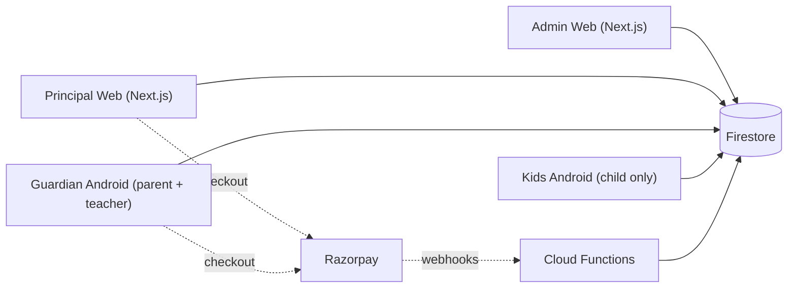
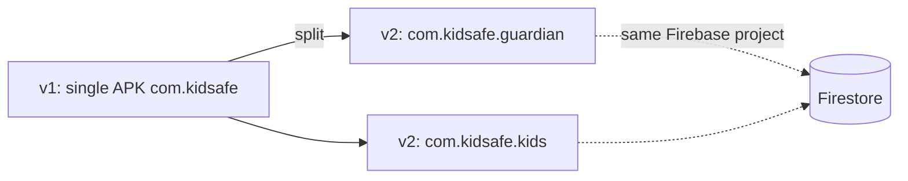
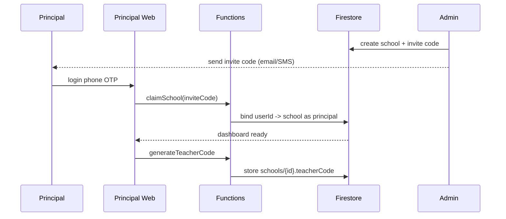
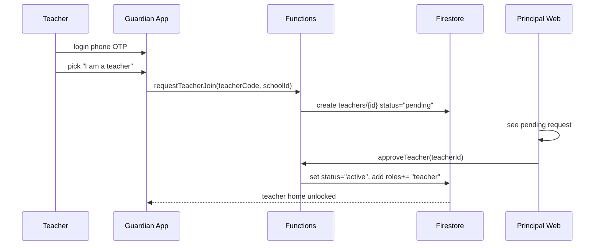
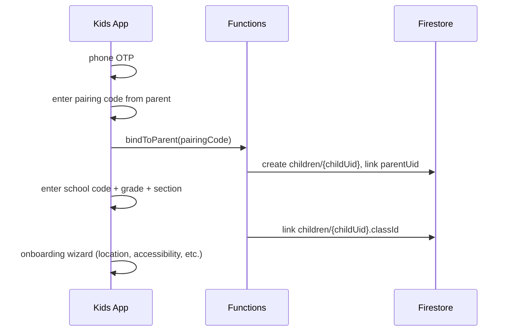
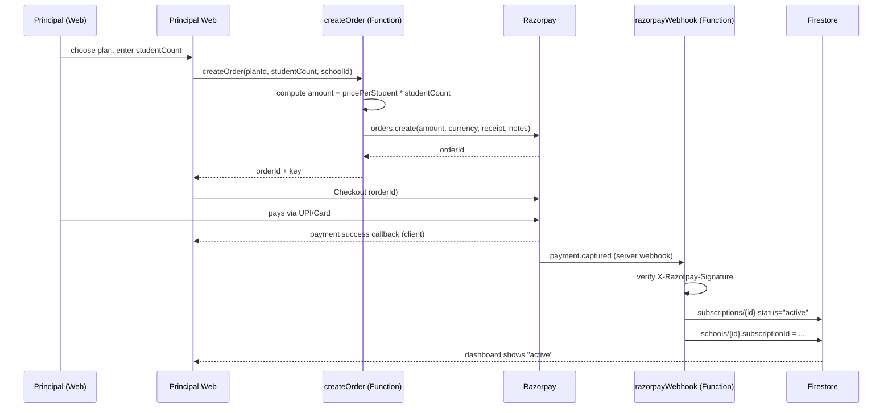
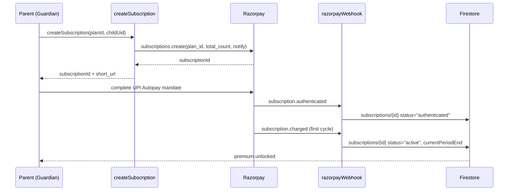
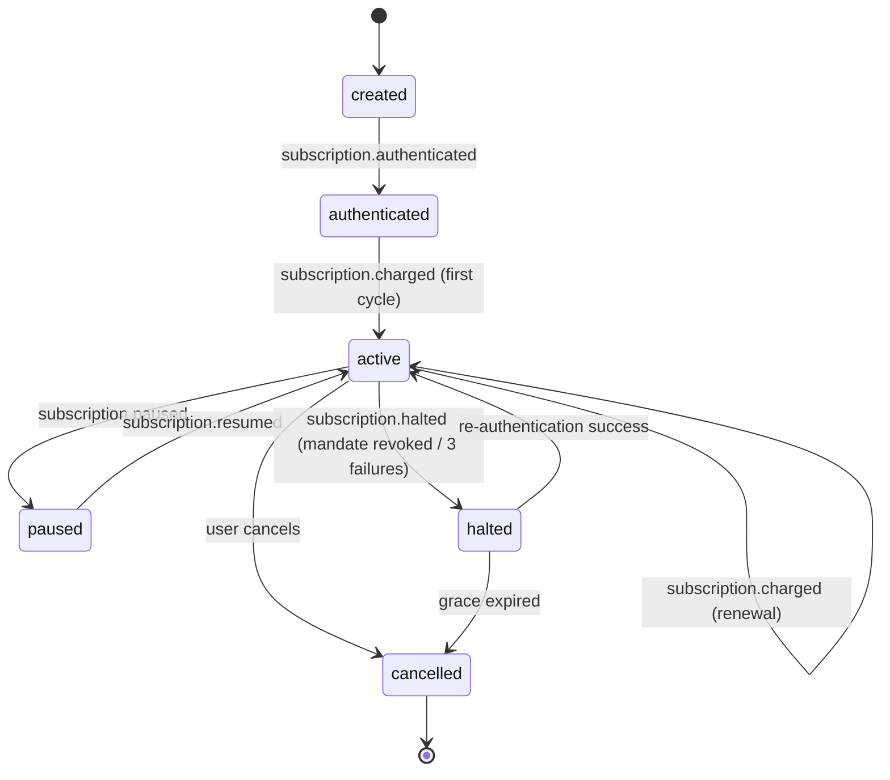
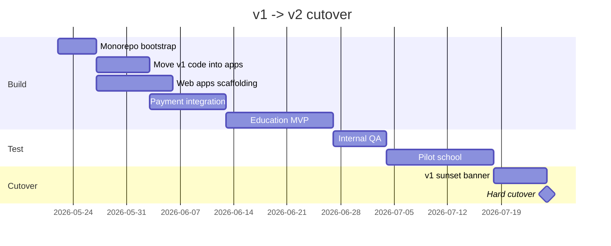
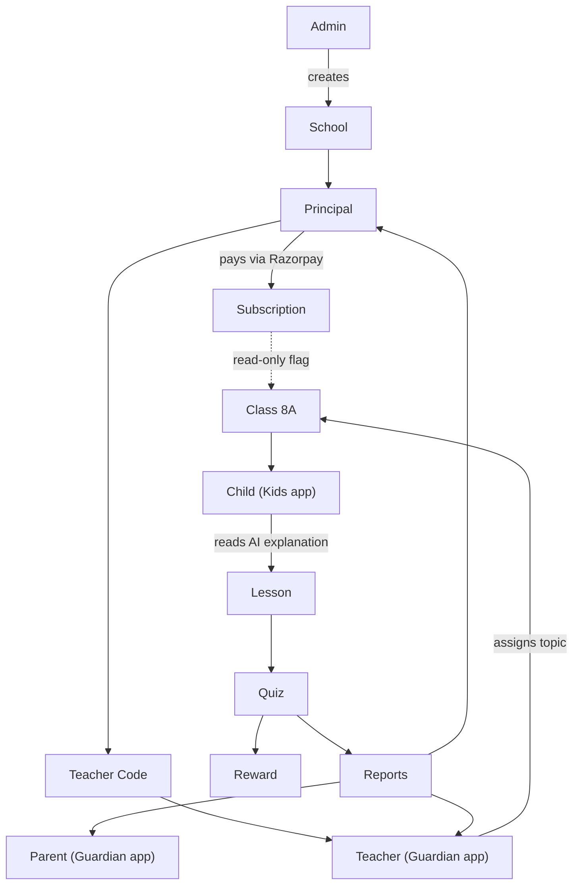

# Education AI Ecosystem — Locked Tech Spec (v2)

This document is the **single source of truth** for the v2 product design.

It captures every locked decision, the monorepo layout, the four-app system, payment + subscription design, Firestore schema, and phased delivery.

It supersedes the early planning notes in [EDUCATION_AI_ECOSYSTEM_PLAN.md](./EDUCATION_AI_ECOSYSTEM_PLAN.md), which can still be read for product narrative and analogies.

---

## 0) Read Order For A New Developer

1. [BEGINNER_APP_FLOW.md](./BEGINNER_APP_FLOW.md) — what KidSafe v1 is.
2. [FIRESTORE_SCHEMA_EXPLAINED.md](./FIRESTORE_SCHEMA_EXPLAINED.md) — current schema.
3. [SYSTEM_DESIGN_KT.md](./SYSTEM_DESIGN_KT.md) — current technical deep-dive.
4. [EDUCATION_AI_ECOSYSTEM_PLAN.md](./EDUCATION_AI_ECOSYSTEM_PLAN.md) — product narrative.
5. **This document** — locked v2 tech spec.

---

## 1) Locked Decisions

| # | Decision | Status |
|---|---|---|
| 1 | Auth: phone + OTP everywhere (web also via Firebase Phone Auth) | locked |
| 2 | Teacher code = per school, generated by principal, used by teachers to join | locked |
| 3 | Class = `grade + section` (e.g. `8A`) | locked |
| 4 | Child phone is optional; pairing code stays | locked |
| 5 | Subscription expiry → education features go **read-only**; KidSafe core (block, schedule, location) keeps working | locked |
| 6 | Topic assignment requires explicit "Mark as taught" by teacher | locked |
| 7 | App split: Guardian (parent+teacher), Kids (child), Principal web, Admin web | locked |
| 8 | Drop "shared mode" (single phone family) in v2 — two-device only | locked |
| 9 | A single user can have multiple roles via `roles: []` array (parent + teacher common) | locked |
| 10 | Repo: **monorepo from day 1** (pnpm + Turborepo) | locked |
| 11 | App names: **Guardian** (parent+teacher) and **Kids** (child) | locked |
| 12 | Payment gateway in v1 (Razorpay India, recurring via eMandate + UPI Autopay) | locked |

---

## 2) The Four-App System



| App | Platform | Users | Primary Job |
|---|---|---|---|
| Admin Web | Next.js | Internal team | Create schools, moderate rewards, manage syllabus sources, view billing |
| Principal Web | Next.js | School principals | Subscribe, generate teacher codes, approve teachers, view coverage |
| Guardian | React Native (Android) | Parents + teachers | Parent: monitor + control child. Teacher: assign topics, view class report |
| Kids | React Native (Android) | Children only | Onboarding + enforcement + study mission + quiz + reward |

Why this split:

- **Kids app isolated** — parent UI is not even bundled, child can't snoop or reverse-engineer.
- **Guardian combined** — many teachers are also parents; one install for both roles.
- **Web for Principal/Admin** — table-heavy, filter-heavy UIs are simpler on the web.

---

## 3) Roles & Multi-Role Users

`users/{userId}` stores a `roles` array, not a single role:

```json
{
  "uid": "user_abc",
  "phone": "+91XXXXXXXXXX",
  "displayName": "Naushad",
  "roles": ["parent", "teacher"],
  "primaryRole": "parent",
  "schoolIds": ["school_001"],
  "teacherProfileIds": ["teacher_123"],
  "createdAt": 1779050000000
}
```

Allowed role strings:

```text
admin | principal | teacher | parent | child
```

On app open, the Guardian app uses `roles`:

- 1 role → straight into that home screen.
- 2+ roles → show a **role switcher** at the top of the home screen, default to `primaryRole` (or last-used).

```text
+----------------------------+
| [ Parent ]  [ Teacher ]    |  <- role switcher
|----------------------------|
| selected role's home view  |
+----------------------------+
```

Important rules:

- A `child` role is **only** valid in the Kids app. Guardian app refuses to load child UI even if `roles` includes `child` (defense-in-depth).
- A user can be promoted to `teacher` only via principal approval (teacher code flow, see §6).

---

## 4) Monorepo Layout

### 4.1 Tooling Stack

- **pnpm workspaces** — fast installs, hoisted node_modules, RN-friendly.
- **Turborepo** — cached, parallel builds across packages.
- **TypeScript project references** — type-safe shared packages.
- **ESLint + Prettier** — root config inherited by all packages.
- **Husky + lint-staged** — pre-commit checks.
- **Firebase Emulator Suite** — local Firestore + Functions for dev.

### 4.2 Folder Structure

```text
kidsafe/
  apps/
    guardian/                # Guardian Android (parent + teacher)
      android/
      src/
      index.tsx
      metro.config.js
      package.json

    kids/                    # Kids Android (child only)
      android/
      src/
      index.tsx
      metro.config.js
      package.json

    principal-web/           # Next.js 14 App Router
      app/
      components/
      package.json

    admin-web/               # Next.js 14 App Router
      app/
      components/
      package.json

    functions/               # Firebase Cloud Functions (TS)
      src/
        webhooks/razorpay.ts
        crons/subscriptionReconciler.ts
        callable/createTeacherCode.ts
        callable/generatePairingCode.ts
        aiLessonGenerator/
        reportingAggregates/
      package.json

  packages/
    shared-types/            # Firestore types, payment types, education types
      src/firestore.ts
      src/payments.ts
      src/education.ts
      package.json

    shared-firebase/         # auth + firestore helpers (web + mobile)
      src/auth.ts
      src/firestore.ts
      src/index.web.ts
      src/index.native.ts
      package.json

    shared-ui-mobile/        # buttons, theme, components used in guardian+kids
      src/Button.tsx
      src/colors.ts
      package.json

    shared-ui-web/           # web-only components shared by admin+principal
      src/Button.tsx
      src/Card.tsx
      src/DataTable.tsx
      package.json

    shared-utils/            # date, formatters, validators (platform-agnostic)
      src/dates.ts
      src/validators.ts
      package.json

    shared-payments/         # Razorpay client + plan catalog + signature verify
      src/plans.ts
      src/razorpay-client.ts
      src/verify-webhook.ts
      package.json

  android-modules/           # Kotlin native modules (mostly consumed by apps/kids)
    location-writer/
    app-blocker/
    screen-time/
    pin/
    device-admin/

  firestore/
    rules                    # firestore.rules
    indexes.json

  docs/
    EDUCATION_AI_TECH_SPEC.md  # this file
    ...

  scripts/
    bootstrap.sh
    build-all.sh
    release-android.sh

  pnpm-workspace.yaml
  turbo.json
  package.json
  tsconfig.base.json
  .eslintrc.cjs
  .npmrc
```

### 4.3 Key Config Files

**`pnpm-workspace.yaml`**

```yaml
packages:
  - "apps/*"
  - "packages/*"
```

**`.npmrc`** (root)

```text
node-linker=hoisted
shamefully-hoist=true
public-hoist-pattern[]=*
```

`hoisted` linker is required so React Native's Metro can resolve hoisted native dependencies.

**`turbo.json`**

```json
{
  "pipeline": {
    "build":     { "dependsOn": ["^build"], "outputs": ["dist/**", "build/**", ".next/**"] },
    "lint":      { "outputs": [] },
    "typecheck": { "dependsOn": ["^build"], "outputs": [] },
    "test":      { "dependsOn": ["^build"], "outputs": ["coverage/**"] }
  }
}
```

**`apps/guardian/metro.config.js`** (and same shape for `apps/kids`)

```javascript
const path = require('path');
const { getDefaultConfig } = require('@react-native/metro-config');

const workspaceRoot = path.resolve(__dirname, '../..');
const projectRoot = __dirname;

const config = getDefaultConfig(projectRoot);

config.watchFolders = [workspaceRoot];
config.resolver.nodeModulesPaths = [
  path.resolve(projectRoot, 'node_modules'),
  path.resolve(workspaceRoot, 'node_modules'),
];
config.resolver.disableHierarchicalLookup = true;

module.exports = config;
```

This combo is the standard fix for the Metro + workspace symlink issue.

### 4.4 Native Module Ownership

| Native module | Guardian | Kids |
|---|---|---|
| AppBlocker accessibility | no | yes |
| ScreenTime / UsageStats | no | yes |
| Foreground service | minimal (FCM only) | yes (location + enforcement) |
| Location writer | no | yes |
| DeviceAdmin | no | yes |
| Pin | no | yes |
| Firebase Messaging | yes | yes |
| Maps | yes | no |
| Razorpay SDK | yes (for premium parent / teacher upgrades) | no |

The Kids APK keeps all the heavy native modules; Guardian stays lean. This is a meaningful UX win — parents don't get scared by long permission lists.

### 4.5 Migration From The Existing Single APK



- Same Firebase project, same Firestore data.
- Existing parent users install Guardian; existing child users install Kids.
- We ship a final v1 update with a hard upgrade screen: "Please install Guardian/Kids — old app is sunset on YYYY-MM-DD".

---

## 5) Web Apps In The Monorepo

Both web apps are **Next.js 14 (App Router)**:

- **server actions + route handlers** for callable-style server logic
- **`shared-firebase`** package for both client SDK and admin SDK use
- **Tailwind CSS** + shadcn-style primitives from `shared-ui-web`
- Hosted on **Firebase Hosting** or **Vercel** (decision pending; Vercel recommended for App Router maturity)

`apps/principal-web/` route map:

```text
/                            -> login (phone OTP)
/onboarding                  -> claim school via invite code
/dashboard                   -> coverage by class
/dashboard/classes/:classId  -> per-class detail
/teachers                    -> approve/reject teacher requests
/teachers/code               -> rotate teacher code
/billing                     -> Razorpay plan, invoices
/billing/checkout/:planId    -> server action -> Razorpay order -> redirect
/billing/webhook-status      -> internal debug
/syllabus                    -> review fetched topics for whole school
```

`apps/admin-web/` route map:

```text
/                            -> SSO/email + OTP gated
/schools                     -> CRUD schools, principals
/syllabus-sources            -> manage online adapters (NCERT, CBSE etc.)
/rewards                     -> moderate rewardCatalog
/billing                     -> all subscriptions, MRR, dunning
/billing/reconcile           -> manual reconcile against Razorpay
/users                       -> impersonate, ban
/audit                       -> action log
```

---

## 6) Onboarding Flows Per App

### 6.1 Principal Web



### 6.2 Teacher (Inside Guardian App)



### 6.3 Parent (Inside Guardian App)

Unchanged from KidSafe v1: phone OTP → set up child via pairing code.

### 6.4 Child (Kids App)



---

## 7) Payment Gateway Design

### 7.1 Provider Choice — Razorpay

| Reason | Detail |
|---|---|
| India-first | Native UPI + UPI Autopay + cards + netbanking + EMI |
| Recurring | Razorpay Subscriptions API supports eMandate, UPI Autopay |
| Webhooks | Reliable, signed, idempotency keys supported |
| RN SDK | `react-native-razorpay` is mature |
| Web SDK | Drop-in checkout (`checkout.razorpay.com/v1/checkout.js`) |
| Pricing | ~2% on cards, ~0.4% on UPI (India), no monthly fees |

Alternatives considered: Cashfree (similar, less mature subscriptions), Stripe (India recurring still restricted), PayU (older SDK).

### 7.2 Who Pays What

We support **two parallel revenue paths**:

| Plan | Audience | Sold via | Billing entity |
|---|---|---|---|
| `school_basic` | School | Principal web | School (B2B) |
| `school_premium` | School | Principal web | School (B2B) |
| `parent_premium` | Individual parents whose school isn't subscribed | Guardian app | Parent (B2C) |

If a school is subscribed, **all parents and teachers of that school get full education access for free**. If not, a parent can buy `parent_premium` for their own child only.

KidSafe core (blocking, schedule, location, usage, PIN) is **always free** — payment only gates the education features.

### 7.3 Plan Catalog (`shared-payments/src/plans.ts`)

```ts
export const PLANS = {
  school_basic: {
    id: "school_basic",
    audience: "school",
    name: "School Basic",
    currency: "INR",
    interval: "yearly",
    pricePerStudentPaise: 19900,          // ₹199 per student per year
    minStudents: 50,
    features: ["unlimited_assignments", "ai_explanations", "quiz", "reports"],
  },
  school_premium: {
    id: "school_premium",
    audience: "school",
    name: "School Premium",
    currency: "INR",
    interval: "yearly",
    pricePerStudentPaise: 39900,
    minStudents: 50,
    features: ["school_basic", "principal_analytics", "weak_topic_ai", "priority_support"],
  },
  parent_premium: {
    id: "parent_premium",
    audience: "parent",
    name: "Parent Premium",
    currency: "INR",
    interval: "monthly",
    pricePerChildPaise: 9900,             // ₹99 / child / month
    features: ["ai_explanations", "quiz", "reward_unlock", "parent_reports"],
  },
} as const;
```

### 7.4 Checkout Flow — School (Web)



### 7.5 Checkout Flow — Parent Premium (Mobile, Recurring)

Recurring uses Razorpay Subscriptions + UPI Autopay (eMandate).



### 7.6 Webhook Events Handled

```ts
// apps/functions/src/webhooks/razorpay.ts
export const RAZORPAY_EVENTS = [
  "payment.captured",
  "payment.failed",
  "order.paid",
  "subscription.authenticated",
  "subscription.activated",
  "subscription.charged",
  "subscription.completed",
  "subscription.cancelled",
  "subscription.paused",
  "subscription.resumed",
  "subscription.halted",       // mandate revoked / failure
  "refund.created",
  "refund.processed",
];
```

Each event handler:

1. **Verifies signature** using `crypto.createHmac("sha256", WEBHOOK_SECRET).update(rawBody).digest("hex")` → constant-time compare with `X-Razorpay-Signature`.
2. **Idempotency** — write a `paymentEvents/{razorpayEventId}` doc first with `processed=false`; if it already exists with `processed=true`, ack 200 and exit.
3. **Apply state change** in a Firestore transaction.
4. **Mark** `paymentEvents/{razorpayEventId}.processed=true`.
5. **Always return HTTP 200** unless signature verification fails (then 400).

### 7.7 Subscription Lifecycle State Machine



UI behavior per state:

| State | Education access | UI banner |
|---|---|---|
| `created` / `authenticated` | locked | "Complete payment" |
| `active` | unlocked | none |
| `paused` | locked | "Subscription paused — resume?" |
| `halted` | locked, **7-day grace** then locked | "Payment failed — update method" |
| `cancelled` | locked at `currentPeriodEnd` | "Cancelled, ends DD MMM" |

### 7.8 Subscription Reconciler (Daily Cron)

```text
apps/functions/src/crons/subscriptionReconciler.ts
```

- Runs every 24h via Cloud Scheduler.
- For every `subscriptions/*` with `currentPeriodEnd < now` and `status != "cancelled"`:
  - Re-fetch from Razorpay (`/v1/subscriptions/:id`) — trust Razorpay over local state.
  - Update Firestore.
- For every `schools/*.subscription.currentPeriodEnd < now`:
  - Flip `educationReadOnly = true` for that school.
- Sends Slack/email alert if Razorpay state ≠ Firestore state for > 1 hour (drift alert).

### 7.9 Refunds & Cancellations

- **Parent self-cancel**: Guardian app → settings → cancel → calls `cancelSubscription` function (Razorpay `subscriptions.cancel(id, { cancel_at_cycle_end: true })`). Access continues until `currentPeriodEnd`.
- **School cancel mid-year**: Principal cancels → admin must approve (manual) to issue partial refund. We use Razorpay `refunds.create()`.
- **Failed payment retries**: Razorpay handles 3 internal retries on eMandate. After that → `subscription.halted` → 7-day in-app grace → locked.

### 7.10 Security & Edge Cases

| Concern | Mitigation |
|---|---|
| Webhook spoofing | HMAC SHA256 signature verification, constant-time compare |
| Replay attack | `paymentEvents/{eventId}` idempotency doc |
| Client tampering with `amount` | **Always** compute amount server-side from plan + studentCount |
| User cancels checkout | Order auto-expires; no Firestore state until webhook |
| Network drop mid-payment | Reconciler picks up the inconsistency next cycle |
| Currency mismatch | Hard-coded to `INR` in v1; multi-currency = future work |
| Tax | GST 18% added server-side in `createOrder`; stored in `subscriptions.taxPaise` |
| PCI scope | Never store card data; Razorpay handles all card details |
| Webhook secret rotation | Stored in Cloud Secret Manager, rotated quarterly |

### 7.11 Payment Firestore Schema

`subscriptions/{subscriptionId}`

```json
{
  "id": "sub_NkXyz...",
  "razorpayId": "sub_NkXyz...",
  "audience": "school",
  "planId": "school_basic",
  "ownerType": "school",
  "ownerId": "school_001",
  "createdByUid": "user_principal_1",
  "status": "active",
  "studentCount": 320,
  "amountPaise": 6368000,
  "taxPaise": 1146240,
  "totalPaise": 7514240,
  "currency": "INR",
  "interval": "yearly",
  "currentPeriodStart": 1779050000000,
  "currentPeriodEnd": 1810586000000,
  "cancelAtPeriodEnd": false,
  "createdAt": 1779050000000,
  "updatedAt": 1779050000000
}
```

`paymentEvents/{razorpayEventId}` (idempotency)

```json
{
  "id": "evt_NkAbc...",
  "type": "subscription.charged",
  "subscriptionId": "sub_NkXyz...",
  "razorpayPayload": { },
  "processed": true,
  "processedAt": 1779050000500,
  "createdAt": 1779050000400
}
```

`invoices/{invoiceId}`

```json
{
  "subscriptionId": "sub_NkXyz...",
  "razorpayInvoiceId": "inv_NkInv...",
  "amountPaise": 7514240,
  "currency": "INR",
  "status": "paid",
  "issuedAt": 1779050000000,
  "paidAt": 1779050001000,
  "pdfUrl": "https://razorpay.com/.../invoice.pdf"
}
```

`schools/{schoolId}.subscription` (denormalized for fast reads)

```json
{
  "subscription": {
    "id": "sub_NkXyz...",
    "status": "active",
    "planId": "school_basic",
    "currentPeriodEnd": 1810586000000,
    "educationReadOnly": false
  }
}
```

### 7.12 Firestore Security Rules — Payments

Sketch (final rules go in `firestore/rules`):

```text
match /subscriptions/{subId} {
  allow read: if isOwner(resource.data) || isAdmin();
  allow write: if false;                 // only Cloud Functions write
}

match /paymentEvents/{eventId} {
  allow read, write: if false;           // only Cloud Functions
}

match /invoices/{invoiceId} {
  allow read: if isOwner(resource.data) || isAdmin();
  allow write: if false;
}
```

The client **never writes** payment state. Only server (`functions/`) can mutate.

### 7.13 Native Module — Guardian RN Razorpay

```ts
// apps/guardian/src/payments/checkout.ts
import RazorpayCheckout from "react-native-razorpay";
import { callFn } from "shared-firebase/native";

export async function startParentPremiumCheckout(childUid: string) {
  const { subscriptionId, shortUrl, keyId } = await callFn("createSubscription", {
    planId: "parent_premium",
    childUid,
  });

  return RazorpayCheckout.open({
    key: keyId,
    subscription_id: subscriptionId,
    name: "KidSafe Guardian",
    description: "Parent Premium",
    prefill: { /* phone / email */ },
    theme: { color: "#0ea5e9" },
  });
}
```

The success callback is **advisory only** — actual unlock is driven by the webhook → Firestore listener.

---

## 8) Updated Firestore Schema (Education + Payments)

Unchanged collections from v1: `users`, `children`, `apps`, `events`, `usageDaily`.

New collections summary:

```text
schools/{schoolId}
  ├─ classes/{classId}
  │   └─ subjects/{subjectId}
  │       └─ chapters/{chapterId}
  │           └─ topics/{topicId}
  └─ teachers/{teacherId}

studyAssignments/{assignmentId}
lessonGenerations/{lessonId}
quizAttempts/{attemptId}
rewardCatalog/{rewardId}
rewardUnlocks/{unlockId}

subscriptions/{subscriptionId}
paymentEvents/{razorpayEventId}
invoices/{invoiceId}
```

Education schema details remain as documented in [EDUCATION_AI_ECOSYSTEM_PLAN.md §8](./EDUCATION_AI_ECOSYSTEM_PLAN.md). Payment schema is documented in §7.11 above.

### 8.1 New User Doc Shape

```json
{
  "uid": "user_abc",
  "phone": "+91XXXXXXXXXX",
  "roles": ["parent", "teacher"],
  "primaryRole": "parent",
  "schoolIds": ["school_001"],
  "teacherProfileIds": ["teacher_123"],
  "parentProfile": {
    "childUids": ["child_001", "child_002"]
  },
  "createdAt": 1779050000000
}
```

### 8.2 Teacher Doc

`schools/{schoolId}/teachers/{teacherId}`

```json
{
  "userId": "user_abc",
  "displayName": "Anita Sharma",
  "subjectIds": ["science", "maths"],
  "classIds": ["class_8A", "class_7B"],
  "status": "active",
  "joinedAt": 1779050000000,
  "approvedByUid": "user_principal_1"
}
```

---

## 9) Backend Function Inventory

```text
apps/functions/src/
  callable/
    createOrder.ts                 # B2B (school) one-time orders
    createSubscription.ts          # B2C (parent) recurring
    cancelSubscription.ts
    claimSchool.ts                 # principal claims school via invite
    rotateTeacherCode.ts
    requestTeacherJoin.ts
    approveTeacher.ts
    generatePairingCode.ts         # parent -> child pairing
    assignTopic.ts                 # teacher marks topic for class
    submitQuizAttempt.ts           # server-validated scoring + reward unlock

  webhooks/
    razorpay.ts                    # signed, idempotent

  crons/
    subscriptionReconciler.ts      # daily
    educationReadOnlyEnforcer.ts   # hourly: flip schools to read-only on expiry
    aggregateClassReports.ts       # nightly: precompute principal dashboards

  ai/
    aiLessonGenerator.ts           # callable + cached writes
    rewardModerator.ts
    syllabusFetchAdapter.ts

  triggers/
    onQuizAttemptWrite.ts          # update class aggregate, fire reward
    onSubscriptionStatusChange.ts  # flip educationReadOnly cache on school
```

---

## 10) Education Read-Only Mode

When subscription lapses, education features become **read-only**. KidSafe core is unaffected.

| Feature | When subscription expired |
|---|---|
| KidSafe blocking / schedule | works |
| KidSafe location / usage / PIN | works |
| View past quiz scores | works (read-only) |
| View past reward unlocks | works (read-only) |
| **Teacher: assign new topic** | blocked, banner "Renew to assign" |
| **Child: attempt new quiz** | blocked, banner "School subscription expired" |
| **Child: unlock new reward** | blocked |
| **Principal: view dashboards** | works (read-only) |

Enforcement:

- `educationReadOnlyEnforcer` cron flips `schools/{id}.subscription.educationReadOnly = true`.
- All write callables (`assignTopic`, `submitQuizAttempt`) check this flag and refuse with a typed error.
- Client UI subscribes to the school doc and disables write buttons accordingly.

---

## 11) Migration Plan From v1 (Current KidSafe)

### 11.1 What Stays

- Firebase project (same Auth, same Firestore).
- Existing `users`, `children`, `apps`, `events`, `usageDaily` collections.
- All Kotlin native modules (move into `android-modules/` as packages, only Kids app consumes).
- Existing onboarding wizard, location pipeline, schedule, app-blocker.

### 11.2 What Splits

- Old `com.kidsafe` APK → two new app ids:
  - `com.kidsafe.guardian`
  - `com.kidsafe.kids`
- Code currently in `src/screens/parent/*` → moves to `apps/guardian/src/screens/parent/`.
- Code currently in `src/screens/child/*` → moves to `apps/kids/src/screens/child/`.
- Code currently in `src/screens/shared/*` → **deleted** (shared mode dropped).
- Native Android files in `android/app/src/main/java/com/kidsafe/*` → split between `android-modules/` Gradle modules.

### 11.3 What's New

- `apps/principal-web/`
- `apps/admin-web/`
- `apps/functions/` (currently no functions exist)
- `packages/shared-*`
- `roles[]` array on `users` doc (migration script needed)
- All payment-related collections

### 11.4 One-Time Migration Script

```text
apps/functions/src/crons/oneTimeMigration_v1_to_v2.ts
```

For every existing `users/*` doc:

```ts
const doc = await db.doc(`users/${uid}`).get();
const role = doc.data().role; // old single string
await doc.ref.update({
  roles: [role],
  primaryRole: role,
});
```

Run once after deploy. Idempotent — checks if `roles` already exists.

### 11.5 Cutover Timeline



---

## 12) Phased Delivery Roadmap

### Phase 0 — Monorepo + Migration (1-2 weeks)

- pnpm + Turborepo skeleton
- Move existing KidSafe code into `apps/guardian/` + `apps/kids/`
- Extract `android-modules/` Gradle packages
- Run `oneTimeMigration_v1_to_v2`
- CI: `pnpm -r typecheck`, `pnpm -r lint`, `pnpm -r test`

### Phase 1 — Web Apps Scaffolding (1 week)

- `apps/admin-web/` + `apps/principal-web/` boot
- Firebase Phone Auth on web
- Empty dashboards
- Tailwind + `shared-ui-web`

### Phase 2 — Payment Plumbing (2 weeks)

- Razorpay account, plans created
- `createOrder`, `createSubscription`, `cancelSubscription` callables
- Webhook handler + idempotency
- `subscriptions`, `paymentEvents`, `invoices` schema
- Principal web checkout
- Guardian app checkout (parent premium)
- Reconciler cron

### Phase 3 — Education MVP (2-3 weeks)

- Schools / classes / subjects / topics schema
- Teacher onboarding inside Guardian
- Teacher assign topic
- Kids app: Study Mission screen
- AI lesson generation (cached, structured JSON)
- Quiz attempt + reward unlock
- Parent + teacher report views
- Education read-only enforcement

### Phase 4 — Syllabus Adapters + Principal Dashboards (2 weeks)

- Online syllabus fetch adapters (NCERT + state boards)
- Teacher review/approve flow
- Principal coverage dashboards
- Aggregated class reports

### Phase 5 — Personalization + Multi-language (3+ weeks)

- Weak-topic detection
- Adaptive quiz difficulty
- Hindi + regional language AI explanations
- Parent recommendations

---

## 13) Risks & Safeguards

| Risk | Mitigation |
|---|---|
| Metro + monorepo path issues | Standard `watchFolders` + `nodeModulesPaths` + `disableHierarchicalLookup` config; `node-linker=hoisted` |
| Native module path break after extraction | Keep Gradle module names identical to v1, just relocate the source root |
| Razorpay webhook missed | Daily reconciler + drift alert |
| Razorpay account suspended | Cashfree as backup adapter (clean `PaymentProvider` interface in `shared-payments`) |
| AI hallucinates wrong answer | Structured JSON output + teacher-reviewed topics + moderation layer |
| Unsafe reward link | Strict allowlist in `rewardCatalog`, admin moderation only |
| Multi-role user confusion | Single role switcher UI, `primaryRole` default, audit logging on switch |
| Education read-only edge during renewal | 24h grace before flipping read-only; show banner at T-7 days |
| Cross-app data leak | Firestore rules strictly check role + school binding; Kids app refuses parent-shaped reads |
| Child app reverse-engineered | Kids APK doesn't bundle parent UI; secrets are server-side only |

---

## 14) Open Decisions (Not Yet Locked)

These were flagged during design and should be decided before Phase 2 starts:

| # | Question | Recommendation |
|---|---|---|
| A | Web hosting: Vercel vs Firebase Hosting | Vercel (App Router maturity) |
| B | Education read-only grace period | 7 days |
| C | Min students for school plan | 50 |
| D | Annual vs monthly for schools | Annual only (simpler invoicing) |
| E | AI provider for lesson generation | OpenAI v1, Gemini fallback |
| F | Teacher code rotation cadence | Manual (principal-triggered) |
| G | Child phone-less mode (tablet only) | Defer to Phase 5 |
| H | iOS app | Defer; not in v2 scope |

---

## 15) Final Mental Model



One-line summary:

> Admin onboards schools. Principal pays. Teacher assigns. Child learns. Parent monitors. Everyone is happy. Razorpay charges. KidSafe core stays free.
