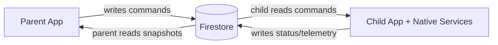

# Firestore Schema Explained (Noob-Friendly)

This document explains:

1. how parent and child connect,
2. what data is stored in Firestore,
3. who writes which fields,
4. how data flows in daily app usage.

If you are new to KidSafe, read this after `SETUP.md` and before deep debugging.

---

## 1) Big Picture In One Minute

KidSafe uses Firestore as the **shared mailbox** between:

- parent app (dashboard + controls), and
- child app (enforcement + telemetry).

Parent writes commands.  
Child reads commands and applies them.  
Child writes live state.  
Parent reads live state.



---

## 2) Core Collections

Top-level collections:

- `users/{uid}`
- `children/{childUid}`

Subcollections under each child:

- `children/{childUid}/apps/{packageName}`
- `children/{childUid}/events/{eventId}`
- `children/{childUid}/usageDaily/{YYYY-MM-DD}`

---

## 3) How Parent And Child Connect

## 3.1 Two-device mode (normal)

This is the standard setup:

- parent has their own Firebase auth uid
- child has their own Firebase auth uid

Connection is done via pairing code:

1. Parent generates 6-digit code in `users/{parentUid}`.
2. Child enters code.
3. Child user doc gets `parentUid`.
4. Child starts writing to `children/{childUid}`.
5. Parent queries users where `role=child` and `parentUid==myUid`.

### Example

`users/parent123`

```json
{
  "role": "parent",
  "name": "Nishat",
  "pairingCode": "482193",
  "pairingCodeExpiresAt": 1779050000000
}
```

`users/child456`

```json
{
  "role": "child",
  "name": "Kid Phone",
  "parentUid": "parent123"
}
```

---

## 3.2 Shared mode (one phone)

In shared mode, there is no second child auth account.  
Instead, the child profile doc id is deterministic:

- `childUid = ${parentUid}_shared`

So if parent uid is `parent123`, shared child doc is:

- `children/parent123_shared`

This is protected by rules (`parentOwns` check in `firestore.rules`).

---

## 4) `users/{uid}` Schema (Simple)

Typical fields:

- `role`: `"parent"` or `"child"`
- `name`, `email`
- `pairingCode`, `pairingCodeExpiresAt` (parent only)
- `parentUid` (child only in two-device mode)
- `deviceMode`: `"two_device"` or `"shared"` (parent)
- `sharedProfile` (parent, shared mode)

### Shared profile example

```json
{
  "deviceMode": "shared",
  "sharedProfile": {
    "childUid": "parent123_shared",
    "childName": "Nishat Jr",
    "createdAt": 1779040000000
  }
}
```

---

## 5) `children/{childUid}` Main Doc Schema

This is the most important document in the app.

It contains both:

- **commands** (written by parent), and
- **live state** (written by child/native engine).

### Common fields

- `status`: `"online"` / `"offline"`
- `lastSeenAt`
- `lockState`
- `screenTime`
- `schedule`
- `currentLocation`
- `locationDiagnostics`
- `currentApp`
- `childMode` (shared only)
- `pinResetRequest` (parent command)

### Realistic example

```json
{
  "status": "online",
  "mode": "child_owned",
  "lastSeenAt": 1779052100000,
  "lockState": {
    "locked": false,
    "until": null
  },
  "screenTime": {
    "limitMins": 120,
    "usedTodayMins": 43,
    "resetAt": 1778994600000
  },
  "schedule": {
    "enabled": true,
    "daysOfWeek": [1, 2, 3, 4, 5],
    "startMinutes": 1260,
    "endMinutes": 420,
    "allowedPackages": [
      "com.android.dialer",
      "com.whatsapp"
    ]
  },
  "currentLocation": {
    "lat": 12.9716,
    "lng": 77.5946,
    "accuracy": 18.4,
    "updatedAt": 1779052085000
  },
  "locationDiagnostics": {
    "evaluatedAt": 1779052087000,
    "ok": true
  },
  "currentApp": {
    "packageName": "com.whatsapp",
    "state": "foreground",
    "updatedAt": 1779052090000,
    "source": "native_usage_stats",
    "confidence": "high"
  }
}
```

---

## 6) Child Subcollections

## 6.1 `apps/{packageName}`

One doc per installed app.

Example:

```json
{
  "appName": "WhatsApp",
  "icon": "data:image/png;base64,...",
  "isBlocked": true,
  "installedAt": 1779040005000
}
```

`isBlocked` is the field parent usually toggles.

---

## 6.2 `events/{eventId}`

Append-only event feed:

- tamper attempts
- geofence transitions
- setup events

Example:

```json
{
  "type": "tamper_attempt",
  "kind": "accessibility",
  "success": false,
  "timestamp": 1779051000000
}
```

---

## 6.3 `usageDaily/{YYYY-MM-DD}`

Per-day app usage summary.

Doc id is date string in child local timezone (example `2026-05-20`).

Example:

```json
{
  "date": "2026-05-20",
  "totalMins": 132,
  "perApp": {
    "com.whatsapp": 41,
    "com.google.android.youtube": 35,
    "com.android.chrome": 22
  },
  "updatedAt": 1779052100000
}
```

---

## 7) Who Writes What? (Very Important)

| Area | Parent writes | Child writes |
|---|---|---|
| `users/{uid}` | own profile, mode config | own profile, parent link on pairing |
| `children/{childUid}.lockState` | yes | reads/applies |
| `children/{childUid}.schedule` | yes | reads/applies to native schedule |
| `children/{childUid}.screenTime.limitMins` | yes | reads/applies |
| `children/{childUid}.screenTime.usedTodayMins` | no | yes |
| `children/{childUid}.currentLocation` | no | yes (native location writer) |
| `children/{childUid}.locationDiagnostics` | no | yes (JS + native) |
| `children/{childUid}.currentApp` | no | yes |
| `children/{childUid}/apps/*` | `isBlocked` update | app sync + metadata |
| `children/{childUid}/events/*` | usually no | yes (telemetry/audit) |
| `children/{childUid}/usageDaily/*` | no | yes |

Rules source: `firestore.rules`.

---

## 8) Daily Data Flow Scenarios

## 8.1 Parent blocks an app

1. Parent toggles app in Apps tab.
2. Firestore update: `apps/{packageName}.isBlocked = true`.
3. Child listener receives snapshot.
4. Child calls native `AppBlocker.setBlockedPackages`.
5. Next time kid opens app, block overlay appears.

## 8.2 Parent opens Location tab

1. Parent subscribes `children/{childUid}`.
2. Reads:
   - `currentLocation`
   - `locationDiagnostics`
3. UI chooses one:
   - healthy map state,
   - diagnostics banner,
   - stale banner fallback.

## 8.3 Child location issue (example GPS off)

1. Child `LocationWriter` sees system location OFF.
2. Writes diagnostics:
   - `ok=false`
   - `reason=system_location_off`
3. Parent tab shows red banner with guidance.

---

## 9) `locationDiagnostics` Reasons (Simple Meanings)

Current allowed reason values:

- `fine_permission_missing` - app location permission missing
- `background_permission_missing` - no "Allow all the time"
- `system_location_off` - Android GPS master switch OFF
- `play_services_unavailable` - no/old Google Play Services, fallback mode
- `fg_service_not_running` - foreground service dead
- `first_fix_timeout` - no location fix arrived in watchdog window
- `firestore_write_failing` - child cannot write to Firestore/network issue

These are enforced in rules and typed in TS (`src/firebase/types.ts`).

---

## 10) Shared Mode Data Differences

Shared mode adds:

- `users/{parentUid}.deviceMode = "shared"`
- `users/{parentUid}.sharedProfile`
- `children/{parentUid}_shared` doc (owned by parent via rules)
- `childMode` state in shared child doc

When Child Mode is OFF, enforcement/telemetry paths are gated to avoid tracking parent's own usage.

---

## 11) Security Rules Mental Model

Rules checks in plain English:

- child can read/write own child data (`isSelf`)
- linked parent can read child and update only allowed command fields (`isParentOf`)
- shared mode parent can own `${parentUid}_shared` docs (`parentOwns`)
- `locationDiagnostics` shape/reason is validated

See: `firestore.rules`

---

## 12) Debugging With Real Examples

## Quick commands

Child logs (native pipeline):

```bash
adb -s <childSerial> logcat -v time -s KidSafe.Location KidSafe.LocationWriter KidSafeFgService KidSafe.LocToggleRecv
```

Parent logs (UI snapshots):

```bash
adb -s <parentSerial> logcat -v time ReactNativeJS:* *:S
```

## What to inspect in Firestore first

If parent cannot track child location, open `children/{childUid}`:

1. `currentLocation.updatedAt` (is it fresh?)
2. `locationDiagnostics.ok`
3. `locationDiagnostics.reason`
4. `status` / `lastSeenAt`

If `reason=system_location_off`, fix child phone GPS toggle before anything else.

---

## 13) New Developer Checklist

When joining project, do this in order:

1. Read `SETUP.md`.
2. Read this file (`FIRESTORE_SCHEMA_EXPLAINED.md`).
3. Read `SYSTEM_DESIGN_KT.md`.
4. Run parent + child on two targets and watch logs.
5. Verify one full flow:
   - block app,
   - set schedule,
   - open location tab and confirm diagnostics behavior.

---

## 14) Source File References

- Data types: `src/firebase/types.ts`
- Firestore helpers: `src/firebase/firestore.ts`
- Security: `firestore.rules`
- Child engine: `src/services/childSyncEngine.ts`
- Parent location UI: `src/screens/parent/LocationTab.tsx`
- Native location writer: `android/app/src/main/java/com/kidsafe/services/LocationWriter.kt`
