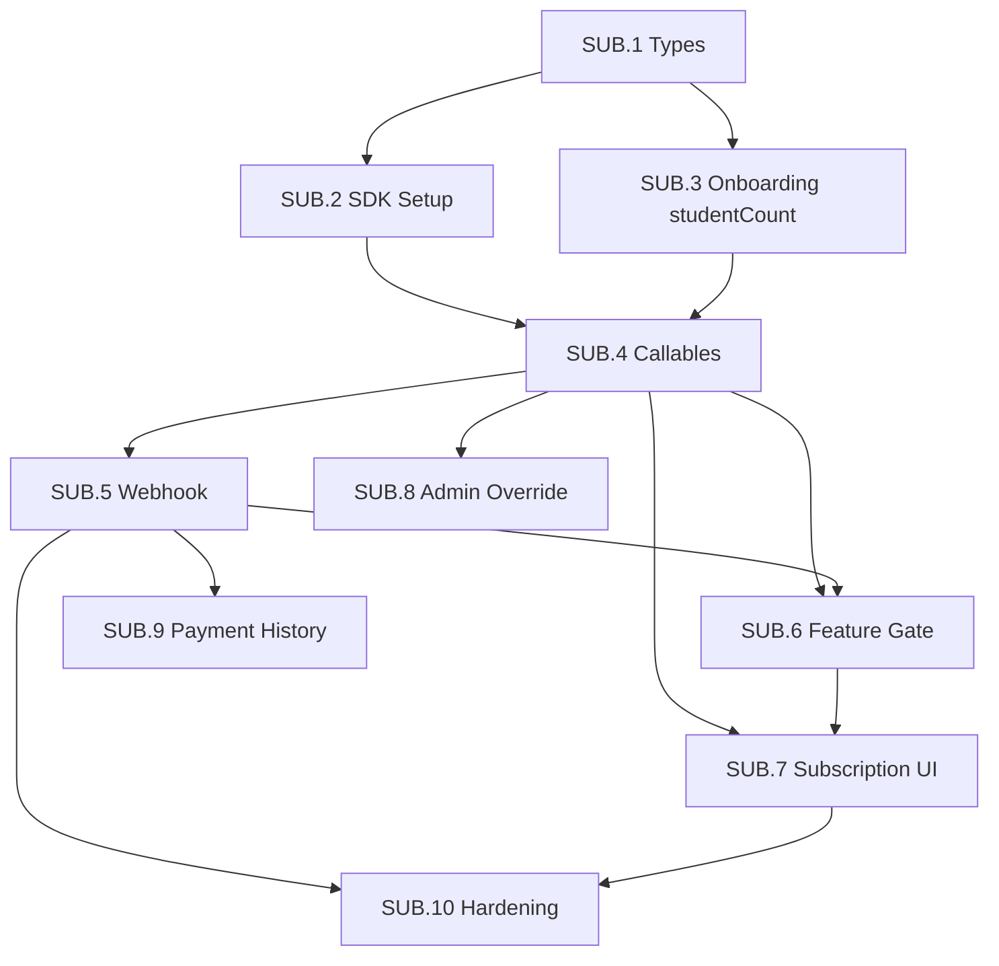

# Payment Architecture — Razorpay Subscription for Zerebro Campus

> **Status:** Locked  
> **Provider:** Razorpay (India — UPI, cards, net banking, recurring e-mandate)  
> **Billing model:** ₹99/student/month, manual student count entry, auto-recurring charge  
> **Gating:** Hard block — zero features accessible without active subscription

---

## 1) Business Rules

| Rule | Value |
|------|-------|
| Price per student | ₹99/month |
| Billing cycle | Monthly (auto-recurring via Razorpay) |
| Student count source | Principal enters during onboarding (not auto-counted from rosters) |
| Example | 200 students × ₹99 = ₹19,800/month |
| Grace period | 2 days after payment failure |
| Trial period | None (0 days) |
| What stays free | Nothing — full hard block on all features |
| Admin override | Yes — admin can manually activate a school with an expiry date |
| Quantity update | Principal can change student count; takes effect next billing cycle |

---

## 2) How Razorpay Subscriptions Work

```
Razorpay Concepts:
┌──────────┐     ┌──────────────┐     ┌──────────────┐
│   Plan   │────▶│ Subscription │────▶│   Invoices   │
│ (template│     │ (per school) │     │ (auto-gen    │
│  ₹99/unit│     │ quantity = N │     │  each cycle) │
│  monthly)│     │              │     │              │
└──────────┘     └──────────────┘     └──────────────┘
                        │
                        ▼
                  Total charge = Plan amount × quantity
                  = ₹99 × N students
```

**Key API parameters:**
- `plan.amount`: 9900 (paise = ₹99)
- `plan.period`: "monthly"
- `subscription.quantity`: student count
- `subscription.total_count`: 1200 (100 years max — effectively indefinite)

---

## 3) Subscription Lifecycle

```
Principal Signs Up (Phone OTP)
        │
        ▼
Onboarding Page
  - Enter school invite code ✓ (existing)
  - Select grades/sections ✓ (existing)
  - Enter total number of students ← NEW
        │
        ▼
Admin approves principal (existing flow)
        │
        ▼
Principal lands on /subscription (NOT dashboard)
  - Sees: "150 students × ₹99 = ₹14,850/month"
  - Clicks [Subscribe Now]
        │
        ▼
Backend creates Razorpay Subscription
  - Returns subscription_id
        │
        ▼
Razorpay Checkout modal opens
  - Principal authorizes payment (card/UPI/etc.)
        │
        ▼
Razorpay webhook: subscription.activated
        │
        ▼
Features unlocked — principal sees full dashboard
        │
        ▼
Monthly cycle:
  ┌─────────────────────────────────────────┐
  │ charge_at reached → Razorpay auto-debits│
  │         │                               │
  │    ┌────┴─────┐                         │
  │    │          │                         │
  │ SUCCESS    FAILURE                      │
  │    │          │                         │
  │ Webhook:   Webhook:                     │
  │ sub.charged sub.pending                 │
  │    │          │                         │
  │ Extend     Start 2-day                  │
  │ period     grace timer                  │
  │    │          │                         │
  │ Features   ┌──┴───┐                    │
  │ remain     │      │                    │
  │ unlocked   Pays   Doesn't pay          │
  │            within  within 2 days        │
  │            2 days     │                 │
  │              │     Webhook:             │
  │           Unlocked sub.halted           │
  │              │        │                 │
  │              │     FULL BLOCK           │
  │              │     Only /subscription   │
  │              │     page accessible      │
  └─────────────────────────────────────────┘
```

---

## 4) Feature Gating Strategy

**Hard block** — when subscription is not active, the principal sees ONLY the `/subscription` page. Every other route redirects there.

```
Request to any (dashboard) route
        │
        ▼
Check subscription status
        │
  ┌─────┴──────────┐
  │                 │
ACTIVE           NOT ACTIVE
  │                 │
  ▼                 ▼
Normal page      Redirect to /subscription
rendering        (paywall + "Subscribe" or "Renew" CTA)
```

**"Active" means any of:**
1. `status === 'active'`
2. `status === 'pending'` AND within 2-day grace window
3. `manuallyActivated === true` AND `manuallyActivatedUntil > now`

Everything else = blocked.

---

## 5) Firestore Schema

### 5.1 Modified: `schools/{schoolId}`

```typescript
interface SchoolDoc {
  // ... all existing fields unchanged ...
  studentCount: number;  // NEW — entered by principal during onboarding
}
```

### 5.2 New: `schools/{schoolId}/subscription` (single document)

```typescript
interface SubscriptionDoc {
  // Razorpay references
  razorpaySubscriptionId: string;
  razorpayCustomerId: string;
  razorpayPlanId: string;

  // Subscription state (mirrors Razorpay status)
  status: 'created' | 'authenticated' | 'active' | 'pending'
        | 'halted' | 'cancelled' | 'completed' | 'expired';
  quantity: number;            // = studentCount at time of creation/update
  amountPerStudent: number;    // 9900 (paise)
  totalAmount: number;         // quantity × amountPerStudent

  // Current billing cycle
  currentPeriodStart: Timestamp;
  currentPeriodEnd: Timestamp;
  nextChargeAt: Timestamp;
  lastChargeFailedAt: Timestamp | null;  // for 2-day grace calculation

  // Admin override
  manuallyActivated: boolean;
  manuallyActivatedBy: string | null;     // admin UID
  manuallyActivatedUntil: Timestamp | null;

  // Metadata
  createdAt: Timestamp;
  updatedAt: Timestamp;
  cancelledAt: Timestamp | null;
}
```

### 5.3 New: `paymentEvents/{eventId}` (append-only log)

```typescript
interface PaymentEventDoc {
  schoolId: string;
  subscriptionId: string;
  razorpayEventId: string;
  eventType: string;            // e.g. "subscription.charged"
  razorpayPaymentId: string | null;
  amount: number | null;
  payload: Record<string, any>; // raw webhook body
  processedAt: Timestamp;
}
```

### 5.4 Security Rules

```
// Server-only writes — no client can write to these
match /schools/{schoolId}/subscription {
  allow read: if isOwnerPrincipal(schoolId) || isAdmin();
  allow write: if false;  // only Cloud Functions write here
}

match /paymentEvents/{eventId} {
  allow read: if isAdmin();
  allow write: if false;  // only webhook handler writes here
}
```

---

## 6) API Design (Cloud Functions)

### 6.1 Callables

| Callable | Role Required | Input | Output | Description |
|----------|--------------|-------|--------|-------------|
| `createSubscription` | `principal` | `{ schoolId }` | `{ subscriptionId, shortUrl, amount }` | Creates Razorpay subscription using school's studentCount |
| `getSubscriptionStatus` | `principal` | `{ schoolId }` | `SubscriptionDoc` | Returns current subscription state |
| `updateStudentCount` | `principal` | `{ schoolId, newCount }` | `{ effectiveFrom, newAmount }` | Updates quantity for next billing cycle |
| `cancelSubscription` | `principal` | `{ schoolId, reason? }` | `{ cancelledAt }` | Cancels subscription (immediate block) |
| `adminActivateSubscription` | `admin` | `{ schoolId, until }` | `{ activatedUntil }` | Manual override activation with expiry |
| `adminDeactivateSubscription` | `admin` | `{ schoolId }` | `{}` | Remove manual override |

### 6.2 HTTP Function (Webhook)

| Function | Method | Path | Auth |
|----------|--------|------|------|
| `razorpayWebhook` | POST | `/razorpayWebhook` | Razorpay signature (X-Razorpay-Signature header) |

---

## 7) Webhook Event Handling

| Razorpay Event | Action in Firestore | Feature Access |
|----------------|--------------------|-|
| `subscription.authenticated` | Set status → `authenticated` | Blocked (awaiting first charge) |
| `subscription.activated` | Set status → `active`, set period dates | **Unlocked** |
| `subscription.charged` | Set status → `active`, extend period, log payment | **Unlocked** |
| `subscription.pending` | Set status → `pending`, set `lastChargeFailedAt` | Unlocked (2-day grace) |
| `subscription.halted` | Set status → `halted` | **Blocked** |
| `subscription.cancelled` | Set status → `cancelled`, set `cancelledAt` | **Blocked** |
| `subscription.paused` | Set status → `halted` | **Blocked** |
| `subscription.resumed` | Set status → `active` | **Unlocked** |

### Webhook Signature Verification

```typescript
import crypto from 'crypto';

function verifyRazorpayWebhook(rawBody: string, signature: string, secret: string): boolean {
  const expected = crypto
    .createHmac('sha256', secret)
    .update(rawBody)
    .digest('hex');
  return crypto.timingSafeEqual(Buffer.from(expected), Buffer.from(signature));
}
```

### Idempotency

Webhooks can be delivered multiple times. Before processing:
1. Check if `razorpayEventId` already exists in `paymentEvents`
2. If yes, skip processing (return 200 OK)
3. If no, process and log

---

## 8) Frontend Integration

### 8.1 Razorpay Checkout (Client-Side)

Load the Razorpay checkout script in `principal-web`:

```html
<script src="https://checkout.razorpay.com/v1/checkout.js"></script>
```

Checkout options:

```typescript
const options = {
  key: process.env.NEXT_PUBLIC_RAZORPAY_KEY_ID,
  subscription_id: subscriptionId,  // from createSubscription callable
  name: "Zerebro Campus",
  description: `School Subscription — ${studentCount} students`,
  handler: function (response) {
    // response.razorpay_payment_id
    // response.razorpay_subscription_id
    // response.razorpay_signature
    // Verify on server or wait for webhook to update status
  },
  theme: { color: "#4F46E5" },
};

const rzp = new window.Razorpay(options);
rzp.open();
```

### 8.2 New Routes in Principal Web

| Route | Page | Purpose |
|-------|------|---------|
| `/subscription` | SubscriptionPage | Show status, amount, pay/renew button |
| `/subscription/history` | PaymentHistoryPage | List past payments/invoices |

### 8.3 Modified Routes

| Route | Change |
|-------|--------|
| `/onboarding` | Add `studentCount` number input field |
| `(dashboard)/layout.tsx` | Add subscription gate (redirect to `/subscription` if not active) |

---

## 9) Admin Override (Zerebro Admin)

Admins can force-activate a school's subscription (for demos, offline payments, special deals):

- **UI:** Button on school detail page: "Activate Subscription" + date picker for expiry
- **Callable:** `adminActivateSubscription({ schoolId, until: Timestamp })`
- **Effect:** Sets `manuallyActivated: true` + `manuallyActivatedUntil` on the subscription doc
- **Gate logic:** If `manuallyActivated && until > now` → treat as active regardless of Razorpay status

---

## 10) Environment Variables

| Variable | Where | Purpose |
|----------|-------|---------|
| `RAZORPAY_KEY_ID` | Cloud Functions (secret) | API authentication |
| `RAZORPAY_KEY_SECRET` | Cloud Functions (secret) | API authentication |
| `RAZORPAY_WEBHOOK_SECRET` | Cloud Functions (secret) | Webhook signature verification |
| `RAZORPAY_PLAN_ID` | Cloud Functions (config) | The single plan ID (created once) |
| `NEXT_PUBLIC_RAZORPAY_KEY_ID` | Principal Web (.env) | Checkout script (public key only) |

---

## 11) File Structure (New/Modified)

```
apps/functions/src/
├── callable/subscription/
│   ├── createSubscription.ts
│   ├── getSubscriptionStatus.ts
│   ├── updateStudentCount.ts
│   ├── cancelSubscription.ts
│   └── adminActivateSubscription.ts
├── http/
│   └── razorpayWebhook.ts
├── lib/
│   └── razorpay.ts                    ← SDK instance + helpers
└── index.ts                           ← export new callables + http fn

packages/shared-types/src/
├── subscription.ts                    ← SubscriptionDoc, PaymentEventDoc
└── index.ts                           ← re-export

apps/principal-web/src/
├── app/
│   ├── onboarding/page.tsx            ← MODIFY (add studentCount field)
│   └── (dashboard)/
│       ├── layout.tsx                 ← MODIFY (add subscription gate)
│       └── subscription/
│           ├── page.tsx               ← NEW (subscribe/renew page)
│           └── history/page.tsx       ← NEW (payment history)
└── components/
    └── SubscriptionBanner.tsx         ← NEW (warning banner during grace)

apps/admin-web/src/app/
└── schools/[id]/page.tsx              ← MODIFY (add override controls)

firestore/rules                        ← MODIFY (add subscription rules)
```

---

## 12) Dependencies

| Package | Location | Purpose |
|---------|----------|---------|
| `razorpay` (npm, latest) | `apps/functions/package.json` | Server-side Razorpay SDK |
| Checkout.js (CDN) | `apps/principal-web` | Client-side payment modal |

No new packages needed for principal-web or admin-web beyond what's already installed.

---

## 13) Implementation Phases

| Phase | Scope | Depends on |
|-------|-------|-----------|
| **P1: Types & Schema** | Add `SubscriptionDoc`, `PaymentEventDoc` types, update `SchoolDoc`, update Firestore rules | Nothing |
| **P2: Razorpay Setup** | Create plan via API/dashboard, store plan ID in config, add `razorpay` package to functions | P1 |
| **P3: Callables** | `createSubscription`, `getSubscriptionStatus`, `cancelSubscription`, `updateStudentCount`, `adminActivateSubscription` | P2 |
| **P4: Webhook** | `razorpayWebhook` HTTP function — signature verification, event processing, Firestore updates | P3 |
| **P5: Onboarding Update** | Add `studentCount` field to onboarding page, update `claimSchool` callable | P1 |
| **P6: Subscription Page** | `/subscription` route — display amount, checkout integration, status display | P3 |
| **P7: Feature Gate** | Update `(dashboard)/layout.tsx` to enforce subscription check | P4, P6 |
| **P8: Admin Override** | Add activation controls to admin school detail page | P3 |
| **P9: Payment History** | `/subscription/history` — list past invoices from `paymentEvents` | P4 |

---

## 14) Testing Strategy

- **Test mode:** Use Razorpay test keys (`rzp_test_*`) during development
- **Emulator:** Webhook handler testable via `curl` to local functions emulator
- **Webhook simulation:** Razorpay dashboard → Webhooks → "Send Test Webhook"
- **Edge cases to test:**
  - First payment success → features unlock
  - Payment failure → 2-day grace → block
  - Payment retry during grace → re-unlock
  - Student count update → next cycle amount changes
  - Admin override → features unlock regardless of Razorpay status
  - Admin override expiry → falls back to Razorpay status
  - Duplicate webhook delivery → idempotent (no double processing)
  - Cancel → immediate block
  - Re-subscribe after cancel → new subscription created

---

## 15) Razorpay Dashboard Setup (One-Time)

1. Create account at `dashboard.razorpay.com`
2. Enable Subscriptions feature (Settings → Product Configuration)
3. Generate API keys (Settings → API Keys)
4. Create webhook endpoint (Settings → Webhooks)
   - URL: `https://asia-south1-kidsafe-e5eac.cloudfunctions.net/razorpayWebhook`
   - Events: All subscription events
   - Secret: Store as `RAZORPAY_WEBHOOK_SECRET`
5. Create Plan via API (or use `createPlan` one-off script):
   - Period: monthly
   - Interval: 1
   - Amount: 9900 (₹99 in paise)
   - Currency: INR
   - Item name: "Zerebro Campus — Per Student"

---
---

# PART 2: Detailed Execution Plan (Micro-Tasks)

> Follows the same format as [V2_BUILD_PHASES.md](./V2_BUILD_PHASES.md).
> Every task is **0.5 to 1 day** so it can be completed in a single sitting.
> Each task includes what you build, files touched, dependencies, and acceptance criteria.

---

## Task Format

```text
### SUB.<group>.<task> — Title (Xh)

What you build:        one paragraph
Files touched:         which files this creates or edits
Firestore paths:       which collections this reads or writes
Functions:             which Cloud Functions this defines or calls
Depends on:            which earlier tasks must be done first
Unlocks:               what becomes possible after this
Edge cases handled:    failure modes and race conditions addressed
Steps:                 numbered
Acceptance:            testable checklist
```

---

## High-Level Task Groups

| Group | Name | Tasks | Effort |
|-------|------|-------|--------|
| SUB.1 | Types & Shared Schema | 2 tasks | 2–3h |
| SUB.2 | Razorpay SDK & Config | 2 tasks | 2–3h |
| SUB.3 | Onboarding Update (studentCount) | 2 tasks | 3–4h |
| SUB.4 | Subscription Callables | 5 tasks | 6–8h |
| SUB.5 | Webhook Handler | 3 tasks | 4–5h |
| SUB.6 | Feature Gate (Principal Web) | 3 tasks | 4–5h |
| SUB.7 | Subscription UI (Pay Page) | 3 tasks | 5–6h |
| SUB.8 | Admin Override | 2 tasks | 3–4h |
| SUB.9 | Payment History & Invoices | 2 tasks | 3–4h |
| SUB.10 | Edge Cases & Hardening | 3 tasks | 4–5h |
| **Total** | | **27 tasks** | **~36–47h (~5–6 days)** |

---

## Dependency Graph



---

## SUB.1 — Types & Shared Schema

### SUB.1.1 — Define subscription TypeScript interfaces (1h)

**What you build:**
Create `packages/shared-types/src/subscription.ts` with all subscription-related
interfaces: `SubscriptionDoc`, `PaymentEventDoc`, `SubscriptionStatus`,
`CreateSubscriptionInput/Output`, `GetSubscriptionStatusOutput`, and the updated
`SchoolDoc` addition (`studentCount` field).

**Files touched:**
- `packages/shared-types/src/subscription.ts` (NEW)
- `packages/shared-types/src/index.ts` (add re-export)
- `packages/shared-types/src/education.ts` (add `studentCount` to `SchoolDoc`)

**Depends on:** Nothing
**Unlocks:** SUB.2, SUB.3, SUB.4, SUB.5, SUB.6

**Steps:**
1. Create `subscription.ts` with `SubscriptionStatus` union type
2. Define `SubscriptionDoc` interface (all fields from §5.2 of this doc)
3. Define `PaymentEventDoc` interface (all fields from §5.3)
4. Define callable input/output types for each planned callable
5. Add `studentCount: number` to `SchoolDoc` in `education.ts`
6. Re-export from `index.ts`
7. Run `pnpm typecheck` in workspace root

**Acceptance:**
- [ ] `pnpm typecheck` passes with no errors
- [ ] All interfaces match exactly what §5 of this doc specifies
- [ ] `SchoolDoc` now includes `studentCount: number`

---

### SUB.1.2 — Update Firestore security rules (1h)

**What you build:**
Add rules for `schools/{schoolId}/subscription` (single doc, server-only write,
principal + admin can read) and `paymentEvents/{eventId}` (server-only write,
admin-only read). Ensure no client can write to either collection.

**Files touched:**
- `firestore/rules` (the main rules file)

**Firestore paths:**
- `schools/{schoolId}/subscription` — read: principal of school + admin; write: deny all
- `paymentEvents/{eventId}` — read: admin only; write: deny all

**Depends on:** Nothing (can run parallel to SUB.1.1)
**Unlocks:** SUB.4, SUB.5

**Edge cases handled:**
- Client-side write attempt → denied (server-only via Admin SDK)
- Non-owning principal tries to read another school's subscription → denied
- Unauthenticated user → denied

**Steps:**
1. Add `match /schools/{schoolId}/subscription` rule block
2. Allow read if `isAdmin() || isPrincipalOfSchool(schoolId)`
3. Deny all writes (`allow write: if false`)
4. Add `match /paymentEvents/{eventId}` rule block
5. Allow read if `isAdmin()`
6. Deny all writes
7. Deploy rules to emulator and verify via test writes (expect PERMISSION_DENIED)

**Acceptance:**
- [ ] Emulator rejects client writes to both collections
- [ ] Principal can read their own school's subscription doc
- [ ] Principal CANNOT read another school's subscription doc
- [ ] Admin can read both collections

---

## SUB.2 — Razorpay SDK & Config

### SUB.2.1 — Install Razorpay SDK and create instance helper (1h)

**What you build:**
Add `razorpay` npm package to functions, create `apps/functions/src/lib/razorpay.ts`
that exports a lazily-initialized Razorpay instance using secrets from environment.
Use Firebase Functions `defineSecret()` for key management.

**Files touched:**
- `apps/functions/package.json` (add `razorpay` dependency)
- `apps/functions/src/lib/razorpay.ts` (NEW)

**Depends on:** SUB.1.1
**Unlocks:** SUB.4

**Steps:**
1. Run `pnpm add razorpay` in `apps/functions/`
2. Create `lib/razorpay.ts`:
   - Import `defineSecret` from `firebase-functions/params`
   - Define `razorpayKeyId`, `razorpayKeySecret`, `razorpayWebhookSecret` secrets
   - Export `getRazorpayInstance()` function (lazy singleton)
   - Export `RAZORPAY_PLAN_ID` as a `defineString` param
   - Export `verifyWebhookSignature(rawBody, signature)` helper
3. Add type declaration for `razorpay` module if needed (or use SDK types)
4. Run `pnpm typecheck`

**Acceptance:**
- [ ] `pnpm typecheck` passes
- [ ] `getRazorpayInstance()` returns typed Razorpay instance
- [ ] Secrets are accessed via `defineSecret` (not hardcoded)
- [ ] `verifyWebhookSignature` uses `crypto.timingSafeEqual`

---

### SUB.2.2 — Create Razorpay plan (one-off script) (1h)

**What you build:**
A CLI script `apps/functions/src/scripts/createRazorpayPlan.ts` that creates the
₹99/month plan in Razorpay (test mode) and prints the `plan_id`. This runs once
manually and the resulting ID is stored in Firebase config.

**Files touched:**
- `apps/functions/src/scripts/createRazorpayPlan.ts` (NEW)
- `apps/functions/package.json` (add npm script: `"create:plan"`)

**Depends on:** SUB.2.1
**Unlocks:** SUB.4 (callables reference the plan_id)

**Steps:**
1. Create script that instantiates Razorpay with env vars (not defineSecret — scripts run locally)
2. Call `razorpay.plans.create({ period: "monthly", interval: 1, item: { name: "Zerebro Campus — Per Student", amount: 9900, currency: "INR" } })`
3. Print the `plan.id` and instruct dev to set it via `firebase functions:config:set` or `.env`
4. Add `"create:plan": "pnpm build && node dist/scripts/createRazorpayPlan.js"` to scripts
5. Run against Razorpay test mode, save the returned plan_id

**Acceptance:**
- [ ] Script runs successfully with test keys
- [ ] Returns a valid `plan_00000000000001` format ID
- [ ] Plan visible in Razorpay Dashboard (test mode)
- [ ] Plan details: monthly, ₹99, INR

---

## SUB.3 — Onboarding Update (studentCount)

### SUB.3.1 — Update claimSchool callable to accept studentCount (1.5h)

**What you build:**
Modify the `claimSchool` callable to accept an optional `studentCount` field in
its input. When provided, store it on the `schools/{schoolId}` document. Validate
it's a positive integer between 1 and 50000.

**Files touched:**
- `apps/functions/src/callable/claimSchool.ts` (MODIFY — add studentCount to Input, write to school doc)

**Firestore paths:**
- `schools/{schoolId}` — write `studentCount` field

**Depends on:** SUB.1.1
**Unlocks:** SUB.3.2, SUB.4.1

**Edge cases handled:**
- `studentCount` = 0 or negative → reject
- `studentCount` > 50000 → reject (safety cap)
- `studentCount` not provided → allow (backward compat, but subscription page will require it)
- Non-integer → floor + reject if < 1
- Existing school already has studentCount → overwrite on re-claim (idempotent)

**Steps:**
1. Add `studentCount?: number` to `Input` interface
2. Add validation: if provided, must be integer 1–50000
3. In the write payload to `principalRef.set(...)`, include `studentCount` in school doc update
4. After successful claim, write `studentCount` to `schools/{schoolId}` via `schoolSnap.ref.update({ studentCount })`
5. If `studentCount` not provided, skip the write (backward compat)
6. Run `pnpm typecheck`

**Acceptance:**
- [ ] Calling with `studentCount: 200` stores `200` on school doc
- [ ] Calling with `studentCount: 0` throws `invalid-argument`
- [ ] Calling with `studentCount: -5` throws `invalid-argument`
- [ ] Calling without `studentCount` still works (no regression)
- [ ] Emulator shows field on school document

---

### SUB.3.2 — Add studentCount field to onboarding UI (1.5h)

**What you build:**
Add a "Total number of students" number input to the principal onboarding form
in `apps/principal-web/src/app/onboarding/page.tsx`. Pass it to `claimSchool`.
Show the monthly cost preview below the input (e.g. "₹14,850/month").

**Files touched:**
- `apps/principal-web/src/app/onboarding/page.tsx` (MODIFY)

**Depends on:** SUB.3.1
**Unlocks:** SUB.7.1

**Edge cases handled:**
- User types 0 → disable submit, show inline error
- User leaves blank → disable submit
- User types decimal → round to integer
- User types > 50000 → show cap warning

**Steps:**
1. Add `const [studentCount, setStudentCount] = useState<number | ''>(0)`
2. Add a `<label>` + `<input type="number" min={1} max={50000}>` after grade section
3. Show cost preview: `{studentCount} students × ₹99 = ₹{(studentCount * 99).toLocaleString('en-IN')}/month`
4. Add validation in `handleSubmit`: `studentCount` must be ≥ 1
5. Pass `studentCount` to the `callFn('claimSchool', { ...existing, studentCount })` call
6. Update the disabled condition on submit button

**Acceptance:**
- [ ] Input visible on onboarding page
- [ ] Cost preview updates in real-time as user types
- [ ] Cannot submit with 0 or empty studentCount
- [ ] Value is passed to claimSchool and stored in Firestore

---

## SUB.4 — Subscription Callables

### SUB.4.1 — createSubscription callable (2h)

**What you build:**
A callable that a principal invokes from the subscription page. Reads the school's
`studentCount`, creates a Razorpay subscription (or returns existing if already
created but not yet paid), and returns the `subscription_id` + `short_url` + amount
for the frontend to open checkout.

**Files touched:**
- `apps/functions/src/callable/subscription/createSubscription.ts` (NEW)
- `apps/functions/src/index.ts` (add export)

**Firestore paths:**
- READ: `schools/{schoolId}` (get studentCount)
- READ: `schools/{schoolId}/subscription` (check existing)
- WRITE: `schools/{schoolId}/subscription` (create initial doc)

**Depends on:** SUB.2.1, SUB.2.2, SUB.3.1
**Unlocks:** SUB.7.1

**Edge cases handled:**
- School has no `studentCount` → throw `failed-precondition` with message to go back to onboarding
- Subscription already exists and is `active` → return existing (don't create duplicate)
- Subscription exists but is `created` (abandoned) → return existing subscription_id for retry
- Subscription exists but is `cancelled`/`expired` → create a fresh one
- Razorpay API failure → throw `internal`, client can retry
- Race condition: two tabs call simultaneously → first write wins (Firestore transaction)
- Principal calls for school they don't own → throw `permission-denied`

**Steps:**
1. Create file with `onCall` handler, require `principal` role
2. Validate caller owns the school (check `schools/{schoolId}.principalUid === caller.uid`)
3. Read `studentCount` from school doc — throw if missing
4. Check if `schools/{schoolId}/subscription` doc exists:
   - If `status` is `active` → return `{ alreadyActive: true, ... }`
   - If `status` is `created` or `authenticated` → return existing `subscription_id`
   - If `cancelled`/`expired`/`halted` → proceed to create new
5. Call `razorpay.subscriptions.create({ plan_id, quantity: studentCount, total_count: 1200, customer_notify: false, notes: { schoolId, principalUid } })`
6. Write to `schools/{schoolId}/subscription`: `{ razorpaySubscriptionId, status: 'created', quantity: studentCount, ... }`
7. Return `{ subscriptionId, shortUrl, amount: studentCount * 9900, quantity: studentCount }`

**Acceptance:**
- [ ] Returns valid subscription_id from Razorpay (test mode)
- [ ] Firestore doc created with status `created`
- [ ] Second call returns same subscription (idempotent)
- [ ] Calling for another school's ID → `permission-denied`
- [ ] Missing studentCount → `failed-precondition`

---

### SUB.4.2 — getSubscriptionStatus callable (1h)

**What you build:**
A simple callable that principals call on page load to check their current
subscription status. Returns the full `SubscriptionDoc` or `null` if no
subscription exists.

**Files touched:**
- `apps/functions/src/callable/subscription/getSubscriptionStatus.ts` (NEW)
- `apps/functions/src/index.ts` (add export)

**Firestore paths:**
- READ: `schools/{schoolId}/subscription`

**Depends on:** SUB.1.1
**Unlocks:** SUB.6.1, SUB.7.1

**Edge cases handled:**
- No subscription doc exists → return `{ exists: false }`
- Principal not owner of school → `permission-denied`
- `manuallyActivated` + expired → report as inactive (compute on server)

**Steps:**
1. Create callable, require `principal` role
2. Validate caller owns the school
3. Read subscription doc
4. If doesn't exist → return `{ exists: false }`
5. Compute `isActive` boolean (status=active OR within grace OR manually activated)
6. Return `{ exists: true, ...doc, isActive, daysUntilBlock (if in grace) }`

**Acceptance:**
- [ ] Returns `{ exists: false }` for new school
- [ ] Returns full doc + `isActive: true` for active subscription
- [ ] Returns `isActive: false` + details when halted/cancelled
- [ ] Grace period computation correct (2-day window)

---

### SUB.4.3 — updateStudentCount callable (1.5h)

**What you build:**
Callable for principals to update their student count. This updates both the
school doc and calls Razorpay's subscription update API with `schedule_change_at:
"cycle_end"` so the new quantity takes effect next billing cycle.

**Files touched:**
- `apps/functions/src/callable/subscription/updateStudentCount.ts` (NEW)
- `apps/functions/src/index.ts` (add export)

**Firestore paths:**
- READ+WRITE: `schools/{schoolId}` (update studentCount)
- READ+WRITE: `schools/{schoolId}/subscription` (update quantity, note pending change)

**Depends on:** SUB.4.1
**Unlocks:** SUB.7.2

**Edge cases handled:**
- New count same as current → no-op, return success
- New count < 1 or > 50000 → reject
- No active subscription → just update school doc (subscription page will use new count on next create)
- Razorpay update fails → rollback school doc change, throw internal
- Subscription is not active (halted/cancelled) → only update school doc, skip Razorpay call

**Steps:**
1. Validate input: `newCount` must be integer 1–50000
2. Validate caller owns school
3. Read current school doc and subscription doc
4. Update `schools/{schoolId}.studentCount = newCount`
5. If subscription exists and status is `active`:
   - Call `razorpay.subscriptions.update(subId, { quantity: newCount, schedule_change_at: "cycle_end" })`
   - Update subscription doc: `{ pendingQuantity: newCount, has_scheduled_changes: true }`
6. Return `{ newCount, effectiveFrom: "next_cycle", newMonthlyAmount: newCount * 9900 }`

**Acceptance:**
- [ ] School doc updated with new count
- [ ] Razorpay subscription shows pending update
- [ ] Current cycle charge unchanged
- [ ] Next cycle charges new amount (verify in Razorpay dashboard)
- [ ] Invalid counts rejected

---

### SUB.4.4 — cancelSubscription callable (1h)

**What you build:**
Callable for principals to cancel their subscription. Calls Razorpay cancel API
and updates Firestore. Cancellation is immediate — features block immediately.

**Files touched:**
- `apps/functions/src/callable/subscription/cancelSubscription.ts` (NEW)
- `apps/functions/src/index.ts` (add export)

**Firestore paths:**
- READ+WRITE: `schools/{schoolId}/subscription`

**Depends on:** SUB.4.1
**Unlocks:** SUB.7.2

**Edge cases handled:**
- No subscription exists → throw `not-found`
- Subscription already cancelled → return success (idempotent)
- Razorpay returns error (sub already cancelled their side) → still update Firestore
- Race: webhook fires cancel before callable response → both paths converge to same state

**Steps:**
1. Validate caller owns school
2. Read subscription doc
3. If already `cancelled` → return `{ alreadyCancelled: true }`
4. Call `razorpay.subscriptions.cancel(subId)`
5. Update Firestore: `{ status: 'cancelled', cancelledAt: serverTimestamp(), updatedAt: serverTimestamp() }`
6. Return `{ cancelled: true, cancelledAt }`

**Acceptance:**
- [ ] Razorpay subscription status = cancelled
- [ ] Firestore doc status = cancelled
- [ ] Features immediately blocked after this call
- [ ] Calling twice doesn't error

---

### SUB.4.5 — adminActivateSubscription callable (1h)

**What you build:**
Admin-only callable that force-activates a school's subscription regardless of
Razorpay status. Used for demos, offline payments, or special arrangements.
Takes an expiry date after which the override expires.

**Files touched:**
- `apps/functions/src/callable/subscription/adminActivateSubscription.ts` (NEW)
- `apps/functions/src/index.ts` (add export)

**Firestore paths:**
- WRITE: `schools/{schoolId}/subscription`

**Depends on:** SUB.1.1, SUB.1.2
**Unlocks:** SUB.8.1

**Edge cases handled:**
- No subscription doc exists → create one with `manuallyActivated: true` (no Razorpay sub needed)
- `until` date is in the past → reject
- `until` date is > 1 year out → warn but allow (admin decision)
- Non-admin calls → `permission-denied`
- Deactivate: separate callable or pass `until: null` to remove override

**Steps:**
1. Require `admin` role
2. Validate `schoolId` exists and `until` is a future timestamp
3. Read or create subscription doc
4. Set `{ manuallyActivated: true, manuallyActivatedBy: caller.uid, manuallyActivatedUntil: until, updatedAt: serverTimestamp() }`
5. If `until` is null → set `manuallyActivated: false` (deactivate)
6. Return `{ activated: true, until }` or `{ deactivated: true }`

**Acceptance:**
- [ ] After activation, `getSubscriptionStatus` returns `isActive: true`
- [ ] After expiry, `isActive` flips to false
- [ ] Non-admin gets `permission-denied`
- [ ] Works even when no Razorpay subscription exists

---

## SUB.5 — Webhook Handler

### SUB.5.1 — Create HTTP webhook function with signature verification (1.5h)

**What you build:**
An `onRequest` HTTP Cloud Function that Razorpay POSTs to. This function ONLY
handles signature verification, idempotency check (deduplicate by event ID), and
dispatches to event-specific handlers. Does NOT use `onCall` — raw HTTP is required
for webhooks.

**Files touched:**
- `apps/functions/src/http/razorpayWebhook.ts` (NEW)
- `apps/functions/src/index.ts` (add export)

**Depends on:** SUB.2.1
**Unlocks:** SUB.5.2, SUB.5.3

**Edge cases handled:**
- Invalid signature → return 400 (do NOT process)
- Missing `X-Razorpay-Signature` header → return 400
- Duplicate event ID (already processed) → return 200 OK (skip processing)
- Malformed JSON body → return 400
- Unknown event type → log warning, return 200 (don't block Razorpay retries)
- Non-POST method → return 405

**Steps:**
1. Create `onRequest` function with CORS disabled (Razorpay server-to-server)
2. Check method is POST, else 405
3. Read raw body (IMPORTANT: do NOT JSON.parse before signature check)
4. Get `X-Razorpay-Signature` header
5. Call `verifyWebhookSignature(rawBody, signature)` — if false, return 400
6. Parse JSON body
7. Extract `event` and Razorpay entity ID as idempotency key
8. Check if `paymentEvents/{eventId}` exists — if yes, return 200
9. Dispatch to event handler based on `event` type
10. Log event to `paymentEvents` collection
11. Return 200

**Acceptance:**
- [ ] Invalid signature → 400
- [ ] Valid signature → 200
- [ ] Duplicate event → 200 (no re-processing)
- [ ] Unknown event → 200 (logged, not processed)
- [ ] Function deployed and accessible via URL

---

### SUB.5.2 — Implement subscription event handlers (2h)

**What you build:**
Event-specific handler functions that update the `schools/{schoolId}/subscription`
document based on webhook event type. Each handler maps a Razorpay event to a
Firestore status update + any side effects.

**Files touched:**
- `apps/functions/src/http/webhookHandlers.ts` (NEW)

**Firestore paths:**
- WRITE: `schools/{schoolId}/subscription`
- WRITE: `paymentEvents/{eventId}`

**Depends on:** SUB.5.1
**Unlocks:** SUB.6.1, SUB.9.1

**Edge cases handled:**
- `subscription.charged` but subscription doc doesn't exist → create it (handle out-of-order)
- `subscription.halted` but already cancelled → ignore (don't overwrite cancel)
- Payment entity missing from payload → log error, skip
- `schoolId` extraction from notes fails → try fetching subscription from Razorpay API by ID
- Timestamp fields missing → use `processedAt` as fallback

**Steps:**
1. Create handler map: `{ 'subscription.authenticated': handleAuthenticated, ... }`
2. `handleAuthenticated`: set status=authenticated
3. `handleActivated`: set status=active, set currentPeriodStart/End from invoice dates
4. `handleCharged`: set status=active, extract payment amount, update period dates, clear lastChargeFailedAt
5. `handlePending`: set status=pending, set lastChargeFailedAt=now
6. `handleHalted`: set status=halted (Razorpay gave up retrying)
7. `handleCancelled`: set status=cancelled, set cancelledAt
8. `handlePaused`: set status=halted
9. `handleResumed`: set status=active
10. Each handler extracts `schoolId` from `subscription.notes.schoolId`
11. Each handler writes to `paymentEvents` for audit trail

**Acceptance:**
- [ ] Each event type correctly maps to Firestore status
- [ ] Payment amounts recorded in paymentEvents
- [ ] `schoolId` correctly extracted from notes
- [ ] Out-of-order events handled gracefully
- [ ] No crash on malformed payload

---

### SUB.5.3 — Grace period computation and alerting (1h)

**What you build:**
When `subscription.pending` fires (payment failed), compute the grace deadline
(+2 days from now) and store it. Optionally, prepare a mechanism to alert the
principal (via SMS/push — deferred, but store the flag). When grace expires and
`subscription.halted` hasn't fired yet, a lightweight check on read ensures
blocking starts after 2 days even if Razorpay is slow to fire `halted`.

**Files touched:**
- `apps/functions/src/http/webhookHandlers.ts` (MODIFY — enhance `handlePending`)
- `apps/functions/src/callable/subscription/getSubscriptionStatus.ts` (MODIFY — add grace check)

**Depends on:** SUB.5.2, SUB.4.2
**Unlocks:** SUB.6.1

**Edge cases handled:**
- Razorpay fires `halted` before 2 days → immediate block (overrides grace)
- Razorpay fires `charged` during grace → clear grace, restore active
- Clock skew between server and Razorpay → use server timestamp for grace start
- Multiple `pending` events in sequence → use earliest `lastChargeFailedAt`

**Steps:**
1. In `handlePending`: set `lastChargeFailedAt = FieldValue.serverTimestamp()` and `gracePeriodEnd = now + 2 days`
2. In `handleCharged`: clear `lastChargeFailedAt` and `gracePeriodEnd` (null them out)
3. In `getSubscriptionStatus`: if status=`pending`, check if `now > gracePeriodEnd`
   - If yes → report `isActive: false` (effective block)
   - If no → report `isActive: true, graceRemaining: X hours`
4. In `handleHalted`: set status=halted regardless of grace (Razorpay's final word)

**Acceptance:**
- [ ] After `pending` webhook, `isActive` remains true for 2 days
- [ ] After 2 days pass, `isActive` returns false even without `halted` webhook
- [ ] After `charged` during grace, `isActive` returns true and grace cleared
- [ ] `halted` event immediately blocks regardless of grace timer

---

## SUB.6 — Feature Gate (Principal Web)

### SUB.6.1 — Create subscription check hook/utility (1.5h)

**What you build:**
A React hook `useSubscriptionStatus()` for the principal web that calls
`getSubscriptionStatus` on mount and exposes `{ isActive, status, loading, subscription }`.
Also a server-side utility that the dashboard layout can call.

**Files touched:**
- `apps/principal-web/src/lib/useSubscriptionStatus.ts` (NEW)

**Depends on:** SUB.4.2
**Unlocks:** SUB.6.2

**Edge cases handled:**
- Network error calling the function → treat as "unknown", show retry UI (don't hard-block on network failure)
- User has no school yet (pre-onboarding) → `exists: false`, treat as no subscription
- Stale cache: always fetch fresh on route change (no aggressive caching)

**Steps:**
1. Create hook that calls `callFn('getSubscriptionStatus', { schoolId })`
2. `schoolId` comes from user doc or localStorage (set during onboarding)
3. Return `{ loading, error, subscription, isActive }`
4. Handle all error states gracefully
5. Export for use in layout and subscription page

**Acceptance:**
- [ ] Hook returns `loading: true` initially, then resolves
- [ ] `isActive: true` when subscription is active
- [ ] `isActive: false` when halted/cancelled/expired
- [ ] Network error doesn't hard-crash the app

---

### SUB.6.2 — Add subscription gate to dashboard layout (1.5h)

**What you build:**
Modify `apps/principal-web/src/app/(dashboard)/layout.tsx` to check subscription
status after confirming the user is an approved principal. If not active, redirect
to `/subscription`. The `/subscription` route itself is INSIDE the dashboard group
but exempt from the gate.

**Files touched:**
- `apps/principal-web/src/app/(dashboard)/layout.tsx` (MODIFY)

**Depends on:** SUB.6.1
**Unlocks:** SUB.7.1

**Edge cases handled:**
- `/subscription` page itself must NOT be gated (infinite redirect loop)
- Loading state → show spinner (don't flash dashboard then redirect)
- Network failure on status check → show "Unable to verify subscription, retrying..." (don't permanently block)
- Principal just paid → webhook may not have fired yet → poll for up to 30 seconds before showing dashboard
- Admin-overridden school → isActive: true, show dashboard normally

**Steps:**
1. After the existing `hasRole(userDoc, 'principal')` check succeeds, call subscription check
2. Add state: `subscriptionState: 'checking' | 'active' | 'inactive'`
3. If `inactive` and pathname !== `/subscription` → `router.replace('/subscription')`
4. If `active` → render children normally
5. Show loading spinner during `checking` state
6. Make `/subscription` and `/subscription/history` exempt from gate

**Acceptance:**
- [ ] Unpaid principal lands on `/subscription` regardless of which URL they visit
- [ ] Paid principal sees normal dashboard
- [ ] `/subscription` page always accessible (no redirect loop)
- [ ] Admin-activated school sees dashboard
- [ ] Loading state visible briefly, no flash of gated content

---

### SUB.6.3 — Subscription expiry banner component (1h)

**What you build:**
A `<SubscriptionBanner />` component that shows at the top of the dashboard when
the subscription is in grace period (payment failed but 2 days haven't passed yet).
Shows countdown and "Pay Now" link.

**Files touched:**
- `apps/principal-web/src/components/SubscriptionBanner.tsx` (NEW)
- `apps/principal-web/src/app/(dashboard)/layout.tsx` (MODIFY — render banner)

**Depends on:** SUB.6.1, SUB.6.2
**Unlocks:** Nothing (polish)

**Edge cases handled:**
- Grace period just started → show "Payment failed. You have 2 days to renew."
- Less than 12 hours remaining → show "Expiring in X hours" with urgency styling
- Subscription active → don't show banner
- Subscription blocked → user is already on /subscription page (banner irrelevant)

**Steps:**
1. Create component that accepts `{ graceRemaining, nextChargeAmount }`
2. Render warning bar with countdown + "Renew Now" link to `/subscription`
3. Use urgency colors: yellow for > 12h, red for < 12h
4. Integrate into layout: show between sidebar/header and children when in grace

**Acceptance:**
- [ ] Banner visible when status = pending and within grace
- [ ] Banner NOT visible when subscription is active
- [ ] "Renew Now" links to /subscription
- [ ] Countdown shows hours remaining

---

## SUB.7 — Subscription UI (Pay Page)

### SUB.7.1 — Subscription page: display status + checkout trigger (2h)

**What you build:**
The main `/subscription` page in principal web. Shows current subscription status,
billing amount, and either a "Subscribe Now" or "Renew" button that calls
`createSubscription` and opens the Razorpay checkout modal.

**Files touched:**
- `apps/principal-web/src/app/(dashboard)/subscription/page.tsx` (NEW)
- `apps/principal-web/src/app/layout.tsx` (MODIFY — add Razorpay checkout script to `<head>`)

**Depends on:** SUB.4.1, SUB.6.2
**Unlocks:** SUB.7.2, SUB.7.3

**Edge cases handled:**
- Checkout modal closed without paying → show "Payment not completed" message, allow retry
- Razorpay JS fails to load → show fallback "Open payment link" with short_url
- `createSubscription` returns error → humanize and show inline
- After payment success → poll status for up to 30s (webhook may be slow), then redirect to dashboard
- Already active subscription → show status card, no pay button

**Steps:**
1. Load Razorpay checkout via `next/script` (`<Script src="https://checkout.razorpay.com/v1/checkout.js" />`)
2. On mount, call `getSubscriptionStatus` to determine current state
3. If no subscription / cancelled / expired: show pricing card + "Subscribe Now" button
4. On button click: call `createSubscription` callable → get `subscriptionId`
5. Open Razorpay checkout with `{ key, subscription_id, name, handler }`
6. In handler: show "Verifying payment..." → poll `getSubscriptionStatus` every 3s for 30s
7. When `isActive: true` → redirect to `/dashboard`
8. If active: show status card (next charge date, amount, student count)
9. If in grace: show warning + "Pay Now" button (same flow)
10. If halted: show urgent "Renew" CTA

**Acceptance:**
- [ ] New school sees pricing breakdown and Subscribe button
- [ ] Razorpay modal opens with correct amount
- [ ] After payment, user lands on dashboard within 30s
- [ ] Active subscription shows status info (no pay button)
- [ ] Halted subscription shows Renew button

---

### SUB.7.2 — Subscription management UI: update count + cancel (1.5h)

**What you build:**
Add "Update student count" and "Cancel subscription" controls to the subscription
page for active subscribers. Update count shows a number input + preview of new
amount + "effective next cycle" note. Cancel shows confirmation dialog.

**Files touched:**
- `apps/principal-web/src/app/(dashboard)/subscription/page.tsx` (MODIFY)

**Depends on:** SUB.4.3, SUB.4.4, SUB.7.1
**Unlocks:** Nothing

**Edge cases handled:**
- Update to same count → show "No change" toast
- Cancel confirmation: require typing "CANCEL" to proceed (prevent accidents)
- After cancel: redirect to subscription page showing "Cancelled" state
- Optimistic UI: show pending state while callable runs
- Error during update/cancel → show error toast, revert UI

**Steps:**
1. Add "Manage Subscription" section below status card (only when active)
2. "Update student count": number input + "Save" button + cost preview
3. On save: call `updateStudentCount` → show success toast "New count effective next month"
4. "Cancel subscription": button → confirmation modal → require type "CANCEL"
5. On confirm: call `cancelSubscription` → update local state to cancelled

**Acceptance:**
- [ ] Can update student count (new amount shown)
- [ ] "Effective next cycle" clearly communicated
- [ ] Cancel requires explicit confirmation
- [ ] After cancel, page shows cancelled state + "Re-subscribe" button

---

### SUB.7.3 — Post-payment success polling and redirect (1h)

**What you build:**
After the Razorpay checkout handler fires (payment completed on client), implement
a robust polling mechanism that waits for the webhook to update Firestore, then
redirects to dashboard. Handles the gap between client-side success and server-side
webhook processing.

**Files touched:**
- `apps/principal-web/src/app/(dashboard)/subscription/page.tsx` (MODIFY)

**Depends on:** SUB.7.1
**Unlocks:** Nothing (reliability)

**Edge cases handled:**
- Webhook arrives instantly (< 1s) → redirect immediately
- Webhook delayed (up to 30s) → show "Verifying your payment..." spinner
- Webhook never arrives (network issue) → after 30s show "Payment received! It may take a moment to activate. Refresh the page."
- User navigates away during poll → cancel polling
- Browser tab hidden → pause polling, resume on focus

**Steps:**
1. After Razorpay handler fires with `razorpay_payment_id`:
2. Show "Verifying payment..." state
3. Start polling `getSubscriptionStatus` every 3 seconds
4. If `isActive: true` → clear poll, redirect to `/dashboard`
5. After 10 attempts (30s): show success message with manual refresh note
6. Clean up polling on unmount

**Acceptance:**
- [ ] Fast webhook → redirect in < 5s
- [ ] Slow webhook → user sees spinner, eventually redirects
- [ ] Very slow webhook → user sees success message, manual refresh works
- [ ] No memory leak if user navigates away

---

## SUB.8 — Admin Override

### SUB.8.1 — Admin web: subscription status display (1.5h)

**What you build:**
On the admin school detail page (`apps/admin-web/src/app/schools/[id]/page.tsx`),
show the current subscription status: active/inactive, amount, next charge date,
student count. This gives admins visibility before they decide to override.

**Files touched:**
- `apps/admin-web/src/app/schools/[id]/page.tsx` (MODIFY — add subscription section)

**Firestore paths:**
- READ: `schools/{schoolId}/subscription`

**Depends on:** SUB.1.2
**Unlocks:** SUB.8.2

**Steps:**
1. In the school detail page, add a "Subscription" section
2. Read `schools/{schoolId}/subscription` document
3. Display: status badge (green/red/yellow), student count, monthly amount, next charge, period dates
4. If no subscription doc: show "No subscription yet"
5. If manually activated: show "Admin override active until [date]"

**Acceptance:**
- [ ] Active subscription shows green badge + details
- [ ] Halted shows red badge
- [ ] No subscription shows gray "None" state
- [ ] Override status clearly visible

---

### SUB.8.2 — Admin web: override activation button + date picker (1.5h)

**What you build:**
Add "Activate Override" button with date picker to the admin school detail page.
Calls `adminActivateSubscription` callable. Also add a "Deactivate" button to
remove an existing override.

**Files touched:**
- `apps/admin-web/src/app/schools/[id]/page.tsx` (MODIFY)

**Depends on:** SUB.4.5, SUB.8.1
**Unlocks:** Nothing

**Edge cases handled:**
- Date picker allows past dates → disable past dates in UI
- Override already active → show "Override active until [date]. Extend?" option
- Deactivate while school has no Razorpay sub → school becomes fully blocked (expected)
- Admin selects very far future date (e.g. 2030) → allow (admin decision)

**Steps:**
1. Add "Activate Override" button (shown when subscription inactive or override not set)
2. Click → show date picker modal for expiry date
3. On confirm: call `adminActivateSubscription({ schoolId, until: selectedDate })`
4. On success: refresh status display
5. Add "Deactivate Override" button (shown when override is active)
6. Deactivate: call `adminActivateSubscription({ schoolId, until: null })`

**Acceptance:**
- [ ] Admin can set override → school's subscription shows as active
- [ ] Admin can remove override → school falls back to Razorpay status
- [ ] Date picker doesn't allow past dates
- [ ] UI refreshes after action

---

## SUB.9 — Payment History & Invoices

### SUB.9.1 — Payment history page: list past payments (1.5h)

**What you build:**
Create `/subscription/history` page that lists all past payment events for the
school from `paymentEvents` collection. Shows date, amount, status (success/failed),
and Razorpay payment ID.

**Files touched:**
- `apps/principal-web/src/app/(dashboard)/subscription/history/page.tsx` (NEW)

**Firestore paths:**
- READ: `paymentEvents` where `schoolId == mySchoolId`, ordered by `processedAt` desc

**Depends on:** SUB.5.2
**Unlocks:** SUB.9.2

**Edge cases handled:**
- No payments yet → show "No payment history" empty state
- Many payments (pagination) → show last 12 months, "Load more" button
- Failed payment attempts visible → clearly marked red

**Steps:**
1. Create page component
2. Query `paymentEvents` filtered by schoolId, ordered desc, limit 20
3. Display as table/list: Date, Amount (₹), Status badge, Razorpay ID
4. Color-code: green for `subscription.charged`, red for failed events
5. Add "Load more" for pagination (startAfter cursor)
6. Add link from subscription page to history

**Acceptance:**
- [ ] Shows all past payments in chronological order
- [ ] Successful payments green, failed red
- [ ] Empty state for new schools
- [ ] Pagination works

---

### SUB.9.2 — Subscription page: add navigation link to history (0.5h)

**What you build:**
Add a "Payment History" link on the main subscription page and a "Subscription"
link in the sidebar navigation (between Grades and School code).

**Files touched:**
- `apps/principal-web/src/app/(dashboard)/subscription/page.tsx` (MODIFY — add link)
- `apps/principal-web/src/app/(dashboard)/layout.tsx` (MODIFY — add nav item)

**Depends on:** SUB.7.1, SUB.9.1
**Unlocks:** Nothing

**Steps:**
1. Add nav item to `NAV` array: `{ href: '/subscription', label: 'Subscription', icon: ... }`
2. Add "View payment history →" link on subscription page
3. Ensure nav item highlights correctly

**Acceptance:**
- [ ] "Subscription" appears in sidebar nav
- [ ] Active state highlights correctly
- [ ] Link to history works

---

## SUB.10 — Edge Cases & Hardening

### SUB.10.1 — Handle re-subscription after cancel (1.5h)

**What you build:**
When a principal cancels and wants to re-subscribe later, the `createSubscription`
callable must handle the case where a cancelled subscription exists. It should
create a brand-new Razorpay subscription (not reactivate the old one) and
overwrite the Firestore doc.

**Files touched:**
- `apps/functions/src/callable/subscription/createSubscription.ts` (MODIFY)
- `apps/principal-web/src/app/(dashboard)/subscription/page.tsx` (MODIFY — show Re-subscribe button)

**Depends on:** SUB.4.1, SUB.4.4, SUB.7.1
**Unlocks:** Nothing

**Edge cases handled:**
- Old subscription has pending changes → ignore (it's cancelled)
- Student count changed since cancellation → use current `studentCount` from school doc
- Multiple cancelled subscriptions in history → only latest matters
- Razorpay retains old subscription ID → we use new one, old stays as audit trail

**Steps:**
1. In `createSubscription`: if existing doc status is `cancelled`/`expired`/`completed`:
   - Archive old `razorpaySubscriptionId` in notes
   - Create fresh Razorpay subscription
   - Overwrite Firestore doc with new subscription data
2. In subscription page: when status is `cancelled`, show "Re-subscribe" button
3. Re-subscribe button uses same `createSubscription` + checkout flow

**Acceptance:**
- [ ] After cancel + re-subscribe, new Razorpay subscription created
- [ ] Firestore doc reflects new subscription
- [ ] Old payment events preserved in `paymentEvents` collection
- [ ] Dashboard accessible after re-subscription

---

### SUB.10.2 — Idempotency and race condition hardening (1.5h)

**What you build:**
Add Firestore transactions where needed to prevent race conditions:
1. `createSubscription` uses a transaction to prevent two simultaneous creates
2. Webhook handler uses idempotency key to prevent double-processing
3. `cancelSubscription` handles race with webhook

**Files touched:**
- `apps/functions/src/callable/subscription/createSubscription.ts` (MODIFY — wrap in transaction)
- `apps/functions/src/http/razorpayWebhook.ts` (MODIFY — transaction for event log check)
- `apps/functions/src/http/webhookHandlers.ts` (MODIFY — conditional updates)

**Depends on:** SUB.4.1, SUB.5.1, SUB.5.2
**Unlocks:** Nothing

**Edge cases handled:**
- Two browser tabs call `createSubscription` at same time → only one Razorpay sub created
- Webhook fires while callable is still running → transaction serializes
- Same webhook delivered twice within milliseconds → dedup via event ID
- Status transition conflict (e.g. callable sets `cancelled` while webhook sets `charged`) → webhook wins for Razorpay-sourced events
- Firestore transaction retry exhaustion → throw `internal`, client can retry

**Steps:**
1. Wrap `createSubscription` body in `db().runTransaction(async t => { ... })`
   - Read subscription doc inside transaction
   - Only create if status allows
   - Write inside transaction
2. In webhook handler: use `db().runTransaction` to check+write `paymentEvents`
3. In webhook handlers: use `update` with preconditions where possible
4. Add retry logic for transient Razorpay API failures (1 retry with 2s delay)

**Acceptance:**
- [ ] Concurrent `createSubscription` calls from two tabs → only one subscription created
- [ ] Same webhook delivered twice → only one `paymentEvents` doc created
- [ ] No orphaned Razorpay subscriptions (every created sub has a Firestore doc)

---

### SUB.10.3 — Error handling, logging, and monitoring (1h)

**What you build:**
Add structured logging to all subscription functions for debugging and monitoring.
Log all Razorpay API calls, webhook events, and state transitions. Add error
reporting for critical failures.

**Files touched:**
- All callable/subscription/*.ts files (MODIFY — add structured logs)
- `apps/functions/src/http/razorpayWebhook.ts` (MODIFY — add structured logs)
- `apps/functions/src/lib/razorpay.ts` (MODIFY — add API call logging)

**Depends on:** SUB.4, SUB.5
**Unlocks:** Nothing (observability)

**Edge cases handled:**
- Razorpay API timeout → log with full request context for debugging
- Webhook signature failure → log IP + headers (possible attack detection)
- State transition anomaly (e.g. `halted` → `created`) → log as error

**Steps:**
1. Use `firebase-functions/logger` for structured logging
2. Log at INFO level: subscription created, payment received, status changes
3. Log at WARN level: grace period started, unusual state transitions
4. Log at ERROR level: signature failures, Razorpay API errors, transaction conflicts
5. Include `schoolId`, `subscriptionId`, `event` in all log entries
6. Add monitoring note: set up Cloud Monitoring alert on ERROR logs for webhook failures

**Acceptance:**
- [ ] All subscription operations produce structured logs
- [ ] Logs queryable by schoolId in Cloud Logging
- [ ] Errors include enough context to debug without reprocing
- [ ] No sensitive data (keys, secrets) in logs

---

## Checklist: Complete Edge Cases Matrix

Before marking the subscription feature as production-ready, verify ALL of these scenarios work end-to-end:

| # | Scenario | Expected Behavior | Tested? |
|---|----------|-------------------|---------|
| 1 | New school, first payment | Features unlock within 30s of payment | ☐ |
| 2 | Monthly auto-charge succeeds | Features remain unlocked, period extends | ☐ |
| 3 | Monthly auto-charge fails | Grace period starts (2 days) | ☐ |
| 4 | Payment retry during grace | Grace cleared, features stay unlocked | ☐ |
| 5 | Grace expires (2 days, no payment) | Features blocked, only /subscription accessible | ☐ |
| 6 | Razorpay fires `halted` | Immediate block regardless of grace | ☐ |
| 7 | Principal manually cancels | Immediate block | ☐ |
| 8 | Re-subscribe after cancel | New subscription created, features unlock | ☐ |
| 9 | Admin override activates school | Features unlock without Razorpay payment | ☐ |
| 10 | Admin override expires | Falls back to Razorpay subscription status | ☐ |
| 11 | Student count updated | Next cycle charges new amount | ☐ |
| 12 | Student count = 1 (minimum) | Charges ₹99/month | ☐ |
| 13 | Checkout modal closed without paying | No side effects, can retry | ☐ |
| 14 | Razorpay JS script fails to load | Fallback payment link shown | ☐ |
| 15 | Webhook delivered twice | Processed once (idempotent) | ☐ |
| 16 | Two tabs create subscription simultaneously | Only one Razorpay sub created | ☐ |
| 17 | Network error during status check | Retry UI shown, not permanently blocked | ☐ |
| 18 | Principal visits dashboard URL while blocked | Redirected to /subscription | ☐ |
| 19 | /subscription page while active | Shows status info, no unwanted redirect | ☐ |
| 20 | Webhook fires before client polls | Poll catches the update, redirects to dashboard | ☐ |
| 21 | Webhook never fires (infra issue) | After 30s, shows manual refresh message | ☐ |
| 22 | School has no studentCount (legacy) | Redirected to update count before subscribing | ☐ |
| 23 | Subscription exists but school principal changes | New principal inherits subscription status | ☐ |
| 24 | Multiple failed charge attempts | Only first `pending` sets grace timer | ☐ |
| 25 | Subscription `completed` (total_count reached) | Treated same as expired → blocked | ☐ |

---

## Execution Order (Recommended)

```
Day 1 (Foundation):
  └── SUB.1.1 → SUB.1.2 → SUB.2.1 → SUB.2.2

Day 2 (Onboarding + Callables):
  └── SUB.3.1 → SUB.3.2 → SUB.4.1 → SUB.4.2

Day 3 (Callables continued + Webhook):
  └── SUB.4.3 → SUB.4.4 → SUB.4.5 → SUB.5.1

Day 4 (Webhook handlers + Gate):
  └── SUB.5.2 → SUB.5.3 → SUB.6.1 → SUB.6.2

Day 5 (UI):
  └── SUB.6.3 → SUB.7.1 → SUB.7.2 → SUB.7.3

Day 6 (Admin + History + Hardening):
  └── SUB.8.1 → SUB.8.2 → SUB.9.1 → SUB.9.2
  └── SUB.10.1 → SUB.10.2 → SUB.10.3
```

Total: **~6 working days** for a complete, production-grade subscription system.
