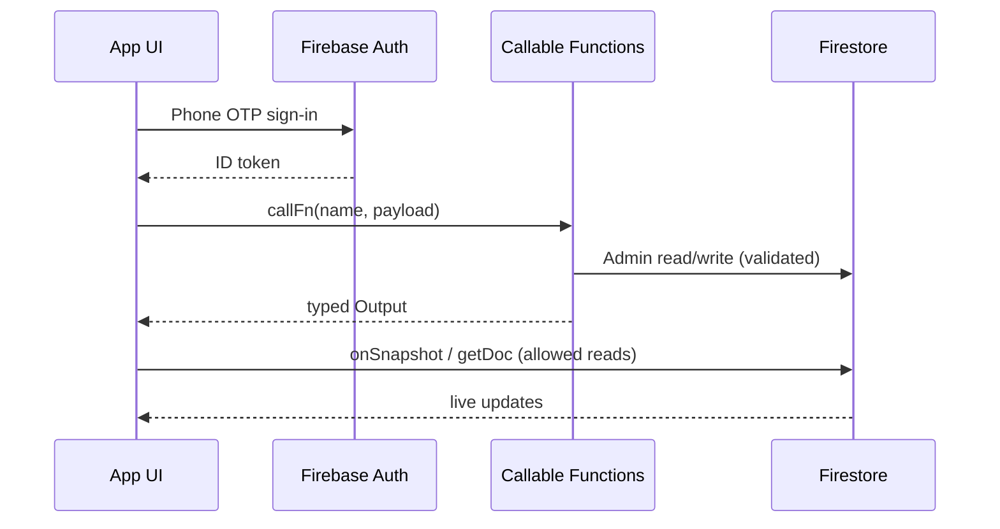

# Phase 1 — UI/UX Update & Backend API Handoff Plan

> Single reference for freelancers / partners working on the Zerebro design update.
> There is **no Swagger / OpenAPI** spec. The backend is **Firebase Callable Functions**
> (HTTPS callables) plus Firestore reads. This document is the API contract inventory.

**Last updated:** 2026-07-22  
**Region:** all callables deploy to `asia-south1` (Mumbai)  
**Auth:** Firebase Phone Auth; callables enforce roles via `users/{uid}.roles[]`

---

## 1. Phase 1 goals

| Priority | Goal | Owner |
|----------|------|-------|
| 1 | Update existing UI/UX to match the new design we provide | Freelancer (UI) |
| 2 | Improve overall user experience (navigation, flows, polish) | Freelancer (UI) + Zerebro |
| 3 | Optimize AI pipeline for cost / latency (voice assistant at ~1.5M voice minutes/month) | Zerebro (backend / AI) |

Design reference site: `beta.zerebrokid.com` (Claude-generated mock; Figma/export assets will be provided separately for implementation).

---

## 2. Scope split (APIs vs UI)

### Zerebro (our team) owns

- All existing Firebase Callable Functions and any **new** endpoints needed for the redesign
- Firestore schema, security rules, Auth, Storage
- AI voice pipeline (models, cost, latency) — see §8
- Organizing / reshaping responses when the new UI needs a different data shape

### Freelancer owns

- Implementing the new UI/UX against provided designs
- Wiring screens to **existing** callables + Firestore listeners
- Calling out gaps (missing fields, awkward shapes) — we add/adjust callables

### Explicitly out of freelancer API scope

- Creating a new REST/Swagger layer
- Owning Firebase Functions deployment, secrets, or Razorpay webhooks
- Re-architecting the AI voice stack unless separately scoped

> **Bottom line:** most APIs already exist and already return what the UI needs.
> Phase 1 is mainly **organize / present** that data for the new design. If a screen
> truly needs a new aggregate, we add a small callable on our side.

---

## 3. How the “API” works (not REST)

Clients do **not** hit `/api/v1/...` routes. They call:

```ts
// packages/shared-firebase — same shape on web + native
await callFn<Input, Output>('assignTopic', { schoolId, classId, ... });
```

Under the hood this is Firebase `httpsCallable` against Cloud Functions Gen 2.

**Additionally**, many screens read Firestore **directly** with security rules
(e.g. `onSnapshot` on assignments, class lists, pending approvals). Sensitive
**writes** always go through callables (Admin SDK).

| Layer | Role |
|-------|------|
| Firebase Auth | Identity (phone OTP) |
| Firestore | Source of truth; clients read allowed docs |
| Callable Functions | Validated mutations + AI/speech proxies |
| Triggers / crons | Side effects (rewards, nightly reports) |
| HTTP webhook | Razorpay only (`razorpayWebhook`) |

**Code locations**

| What | Path |
|------|------|
| Deployed exports | `apps/functions/src/index.ts` |
| Callable implementations | `apps/functions/src/callable/**` |
| Shared I/O types | `apps/functions/src/lib/sharedTypes.ts` + `packages/shared-types/` |
| Client helper | `packages/shared-firebase` (`callFn`) |
| Data model | `docs/DATA_MODEL.md` |

---

## 4. Product surfaces (apps)

| App | Package | Users |
|-----|---------|-------|
| ZConnect (Guardian) | `apps/guardian` | Parents (+ teacher mode) |
| ZKid | `apps/kids` | Children |
| Zerebro Campus | `apps/principal-web` | Principals |
| Zerebro Admin | `apps/admin-web` | Platform admins |
| Functions | `apps/functions` | Backend |
| Zumi Agent | `apps/zumi-agent` | LiveKit Python voice agent (realtime path) |

Roles on `users/{uid}.roles[]`: `admin` | `principal` | `teacher` | `parent` | `child`.

---

## 5. Full callable inventory

### 5.1 Health

| Callable | Role | Input | Output |
|----------|------|-------|--------|
| `ping` | none (smoke) | `{}` | health payload |

### 5.2 Principal onboarding

| Callable | Role | Input | Output | Notes |
|----------|------|-------|--------|-------|
| `claimSchool` | authenticated | `{ inviteCode, displayName, requestedGradeSections?, studentCount? }` | `{ schoolId, principalId, status: 'pending' }` | Creates pending principal; admin must approve |
| `approvePrincipal` | `admin` | `{ schoolId, principalId }` | `{ ok: true }` | Grants `principal` role |
| `rejectPrincipal` | `admin` | `{ schoolId, principalId, reason }` | `{ ok: true }` | Does not grant role |
| `rotateInviteCode` | `admin` | `{ schoolId }` | `{ inviteCode }` | Invalidates old school invite code |

### 5.3 Teacher onboarding

| Callable | Role | Input | Output | Notes |
|----------|------|-------|--------|-------|
| `rotateTeacherCode` | `principal` | `{ schoolId }` | `{ teacherCode }` | Manual share with teachers |
| `lookupSchoolClasses` | authenticated | `{ teacherCode }` | `{ schoolId, schoolName, classes[], curricula[] }` | Class picker before join request |
| `requestTeacherJoin` | authenticated | `{ teacherCode, displayName, classSubjects? }` | `{ schoolId, teacherId, status: 'pending' }` | Principal approves |
| `approveTeacher` | `principal` | `{ schoolId, teacherId }` | `{ ok: true }` | Grants `teacher` role + class links |
| `rejectTeacher` | `principal` | `{ schoolId, teacherId, reason }` | `{ ok: true }` | |

### 5.4 Parent + child school link (no approval gate)

| Callable | Role | Input | Output | Notes |
|----------|------|-------|--------|-------|
| `joinSchoolAsParent` | authenticated | `{ inviteCode, displayName }` | `{ schoolId, alreadyJoined }` | Immediate `parent` role |
| `joinSchool` | authenticated | `{ inviteCode, grade, section }` | `{ schoolId, classId, alreadyJoined }` | Immediate `child` role + class roster |

Both are **one-time at first signup**; later OTP logins skip the code screen (sticky role).

### 5.5 Grade management

| Callable | Role | Input | Output |
|----------|------|-------|--------|
| `requestGradeChange` | `principal` | `{ schoolId, gradesToAdd?, gradesSections? }` | `{ requestId, status: 'pending' }` |
| `approveGradeChange` | `admin` | `{ schoolId, requestId }` | `{ ok: true }` |
| `rejectGradeChange` | `admin` | `{ schoolId, requestId, reason }` | `{ ok: true }` |

### 5.6 Study loop (core education)

| Callable | Role | Input | Output | Notes |
|----------|------|-------|--------|-------|
| `assignTopic` | `teacher` | `{ schoolId, classId, curriculumId, chapterId, topicId, dueAt }` | `{ assignmentId, alreadyExisted }` | `dueAt` = epoch ms UTC; must be within ~30 days |
| `submitQuizAttempt` | `child` | `{ assignmentId, answers: [{ questionId, selectedIndex }], mode?, voiceAnswers? }` | `{ attemptId, score, total, percentage, passed, firstPass, results[] }` | **Server grades**; client cannot forge score. `mode: 'voice'` uses server-written `quizVoiceEvals` |

**Side effects (not callables)**

| Name | Type | Behavior |
|------|------|----------|
| `onQuizAttemptWrite` | Firestore trigger | Unlocks reward on **first pass** only → `rewardUnlocks` |
| `aggregateClassReports` | Cron 02:00 IST | Nightly class report aggregates |

### 5.7 Zumi voice (AI / speech proxies)

Keys stay server-side. Child role required unless noted.

| Callable | Input | Output | Purpose |
|----------|-------|--------|---------|
| `zumiConverse` | `{ assignmentId, stage: 'greeting' \| 'closing', history?, scorePercent? }` | `{ reply, audioUrl? }` | Session open / wrap-up lines |
| `zumiTeach` | `{ assignmentId, phase, history? }` | `{ say, phase, animationHint, audioUrl? }` | Adaptive teaching turns |
| `zumiEvaluateAnswer` | `{ assignmentId, questionId, transcript }` | `{ result, score, reasoning, feedback }` | Spoken quiz grading; writes `quizVoiceEvals` |
| `zumiSpeak` | `{ text }` | `{ url }` | TTS → cached Storage MP3 URL |
| `zumiTranscribe` | `{ audioBase64?, mimeType? }` or `{ storagePath? }` | `{ transcript }` | STT (prefer base64 fast path) |
| `zumiLiveKitToken` | `{ assignmentId }` | `{ url, token, room }` | LiveKit room JWT for realtime agent path |

**Teach phases (server-driven):**  
`warmup → hook → explore → explain → check → ready_for_quiz`

**Animation hints:** `none | experiment | visualize | reveal | celebrate | trap`

### 5.8 Billing (Razorpay)

| Callable | Role | Input | Output |
|----------|------|-------|--------|
| `createSubscription` | `principal` | `{ schoolId }` | `{ subscriptionId, shortUrl, amount, quantity, alreadyActive? }` |
| `getSubscriptionStatus` | `principal` | `{ schoolId }` | `{ exists, isActive, subscription, graceRemainingHours, studentCount }` |
| `updateStudentCount` | `principal` | `{ schoolId, newCount }` | `{ newCount, effectiveFrom, newMonthlyAmount }` |
| `cancelSubscription` | `principal` | `{ schoolId, reason? }` | `{ cancelled, alreadyCancelled?, cancelledAt }` |
| `adminActivateSubscription` | `admin` | `{ schoolId, until }` | `{ activated, deactivated, activatedUntil }` |
| `getPaymentHistory` | `principal` | `{ schoolId, limit?, startAfter? }` | `{ events[], hasMore }` |

| HTTP | Method | Auth |
|------|--------|------|
| `razorpayWebhook` | POST | Razorpay signature header (not for UI) |

---

## 6. Typical UI data flows



### Example screens → data sources

| Screen | Reads (Firestore) | Writes (callable) |
|--------|-------------------|-------------------|
| Parent join school | — | `joinSchoolAsParent` |
| Child school step | — | `joinSchool` |
| Teacher assign topic | curricula / topics | `assignTopic` |
| Child study mission | `studyAssignments` | — |
| Child MCQ quiz | topic `quiz[]` | `submitQuizAttempt` |
| Child Zumi voice lesson | assignment + topic `voiceStory` | `zumiConverse` / `zumiTeach` / `zumiSpeak` / `zumiTranscribe` / `zumiEvaluateAnswer` / `submitQuizAttempt` |
| Principal pending teachers | `schools/.../teachers` | `approveTeacher` / `rejectTeacher` |
| Principal subscription | — | `getSubscriptionStatus` / `createSubscription` |
| Admin approve principal | pending principals | `approvePrincipal` / `rejectPrincipal` |

---

## 7. Error contract (Firebase `HttpsError`)

UI should map these codes to user-facing copy:

| Code | Typical meaning |
|------|-----------------|
| `unauthenticated` | Not signed in |
| `permission-denied` | Missing role or not allowed for this resource |
| `invalid-argument` | Bad / missing input (wrong invite code shape, etc.) |
| `not-found` | Doc does not exist |
| `failed-precondition` | Business rule blocked (school already has principal, class missing, topic unpublished, etc.) |
| `internal` | Unexpected server failure — safe to retry |

Callables are written to be **idempotent** where onboarding is involved (re-submit same join → success no-op).

---

## 8. AI voice assistant — current architecture (for Phase 1 planning)

Phase 1 asks for a **technical plan + cost path** from partners who touch voice; the **live system today** is:

### 8.1 Two paths

1. **Turn-based (Cloud Functions)** — ZKid calls `zumiTeach` / `zumiConverse` / `zumiSpeak` / `zumiTranscribe` / `zumiEvaluateAnswer` per turn.
2. **Realtime (LiveKit + Python agent)** — ZKid calls `zumiLiveKitToken`, connects to a room; `apps/zumi-agent` runs the conversation (STT → LLM → TTS) with lower perceived latency.

### 8.2 Models / services (current)

| Piece | Service | Why |
|-------|---------|-----|
| Teaching / converse / grade | OpenAI `gpt-4o-mini` | Fast, cheap, solid Hinglish + JSON |
| TTS | ElevenLabs `eleven_flash_v2_5` (+ Storage cache) | Low latency; cache avoids re-synthesis |
| STT | ElevenLabs Scribe `scribe_v2` | Accuracy for kids’ speech |
| Realtime transport | LiveKit | Streaming duplex for agent path |

### 8.3 Data flow (turn-based)

```
Child mic → zumiTranscribe → transcript
→ zumiTeach / zumiConverse (LLM) → text (+ optional audioUrl)
→ zumiSpeak if audio missing → play MP3
→ quiz: zumiEvaluateAnswer → quizVoiceEvals
→ session end: submitQuizAttempt(mode: 'voice') → score + rewards
```

### 8.4 Latency & cost levers (what we optimize)

At **~1.5M voice minutes / month**, cost and latency dominate. Direction of travel:

| Lever | Approach |
|-------|----------|
| TTS cost | Aggressive Storage cache (`zumiSpeak`); reuse static quiz prompts |
| STT latency | Prefer `audioBase64` path (skip Storage upload) |
| Cold starts | Warm instances / keep agent process alive for LiveKit path |
| LLM cost | Short histories, capped turn length, `gpt-4o-mini` (or cheaper) for teach/grade |
| Minutes | Prefer realtime agent with local/cheaper TTS (e.g. Kokoro experiments in `apps/zumi-agent`) where quality allows |
| Scale | Stateless callables + horizontal LiveKit agents; region `asia-south1` |

Detailed walkthrough: `docs/ZUMI_AI_TECHNICAL_WALKTHROUGH.md`, `docs/ZUMI_AI_TECH_DESIGN.md`.

**Ask for any external partner proposing voice work:** implementation plan, model/service choices + why, architecture/data flow, latency + cost plan at 1.5M minutes/month.

---

## 9. What we will provide the UI team

1. Design package (screens from `beta.zerebrokid.com` + any Figma/export assets)
2. This document (API inventory + contracts)
3. Repo access (or exports of):
   - `docs/DATA_MODEL.md`
   - `docs/V2_BUILD_PHASES.md` (Phase 4 acceptance detail)
   - `apps/functions/src/callable/*` (source of truth for I/O)
   - Client call sites under `apps/guardian`, `apps/kids`, `apps/principal-web`, `apps/admin-web`
4. Staging Firebase project credentials (as needed)
5. Clarification channel for “need a new endpoint?” → we implement

---

## 10. Phase 1 delivery plan (recommended)

### Milestone A — Discovery & mapping (3–5 days)

- Walk current apps against new design
- Map each new screen → existing callable and/or Firestore query
- Produce a **gap list** (missing fields / new aggregates only)

### Milestone B — UI rebuild against existing APIs (main effort)

- Implement screens role-by-role (child → parent → teacher → principal → admin) or by product priority we set
- Reuse `callFn` and existing hooks/services; do not invent a parallel API client
- Keep auth / role guards behavior (sticky roles, pending gates)

### Milestone C — Gap callables (Zerebro)

- Implement only the endpoints from the gap list
- Keep contracts typed and mirrored in `shared-types` where applicable

### Milestone D — UX polish + QA

- Loading / empty / error states
- Latency-sensitive voice screens (no blocking UI on TTS cache hits)
- Regression on join / assign / quiz / rewards flows

### Milestone E — AI cost track (parallel, Zerebro-led)

- Baseline current $/minute and p95 latency
- Ship optimizations without blocking UI redesign

---

## 11. Acceptance criteria (Phase 1)

- [ ] New UI matches provided design on target devices (mobile + web as applicable)
- [ ] All existing education journeys still work: join school → assign → learn → quiz → reward
- [ ] No client-side forging of scores / roles (still server-authoritative)
- [ ] No new public REST surface required for MVP redesign
- [ ] Gap callables documented with Input/Output before merge
- [ ] Voice path remains usable; cost plan documented for 1.5M minutes/month

---

## 12. Related docs (deeper reference)

| Doc | Use when |
|-----|----------|
| `docs/DATA_MODEL.md` §13 | Which function touches which collection |
| `docs/EDUCATION_AI_TECH_SPEC.md` | Product + education architecture |
| `docs/V2_BUILD_PHASES.md` | Per-callable acceptance tests |
| `docs/ZUMI_AI_TECHNICAL_WALKTHROUGH.md` | Voice I/O detail |
| `docs/PAYMENT_ARCHITECTURE.md` §6 | Subscription callable table |
| `docs/FIRESTORE_SCHEMA_EXPLAINED.md` | Schema shapes for UI reads |
| `apps/functions/README.md` | Local emulator / deploy |

---

## 13. Suggested message to share externally

> We don’t have a Swagger/OpenAPI spec. Backend is Firebase Callable Functions.  
> Full inventory + input/output contracts are in `docs/PHASE1_UI_API_HANDOFF.md`.  
> Most data the UI needs already exists; Phase 1 is UI/UX against those contracts.  
> API creation/handling stays with us — if a screen needs a new shape, we’ll add a callable.  
> For voice AI, see §8 of the same doc; please share your tech plan (models, architecture, latency/cost at ~1.5M voice minutes/month).

---

*If this doc disagrees with code under `apps/functions/src/`, the code wins — update this file.*
