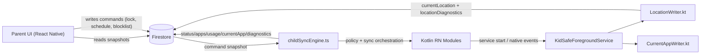
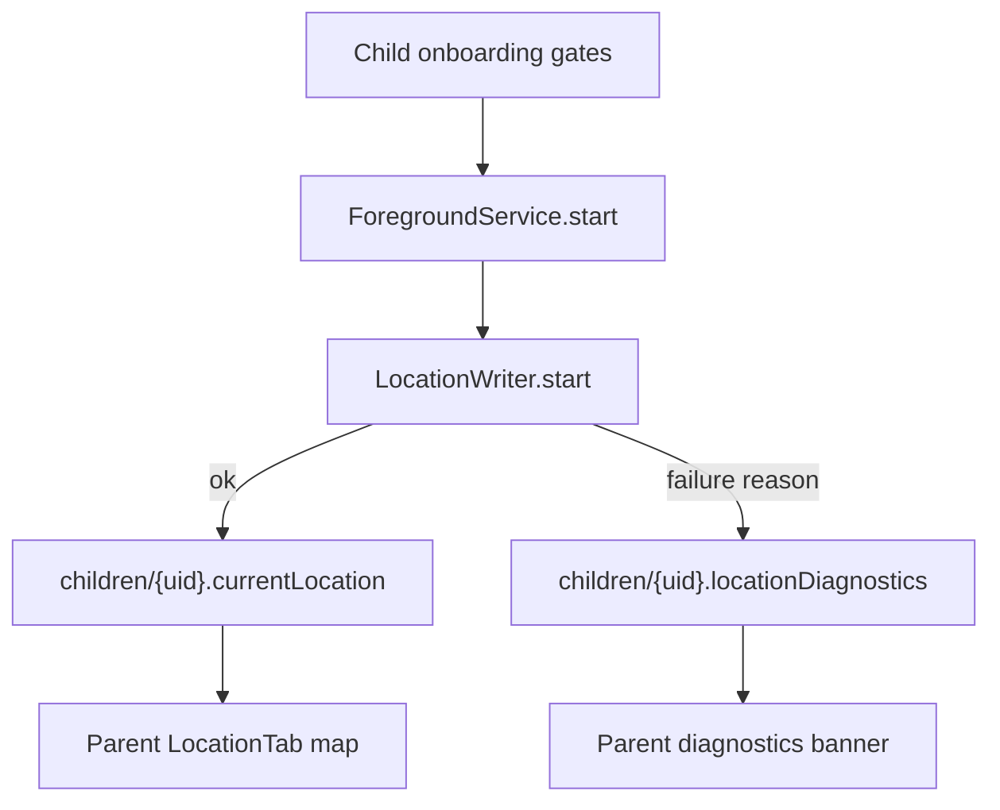

# KidSafe System Design KT

This document is the handover guide for new developers joining KidSafe. It explains how the current build works end-to-end, where core logic lives, and how to debug quickly.

## 1) Product Modes And Core Journeys

KidSafe runs in two operating modes:

- `two_device`: traditional parent phone + separate child phone.
- `shared`: one-phone household; parent and child modes run on the same install.

Key types: `DeviceMode`, `ChildModeState` in `src/firebase/types.ts`.

### Parent Journey (two-device)

1. Parent signs in.
2. Parent links child by pairing code.
3. Parent opens child details.
4. Parent manages:
   - Apps tab (block list + latest tamper attempt)
   - Schedule tab
   - Location tab (map + diagnostics)
   - Usage tab
   - PIN tab

### Child Journey (two-device)

1. Child signs in and pairs.
2. Child completes onboarding steps (permissions + OEM reliability screens).
3. Foreground service starts.
4. Native and JS engines sync state to Firestore and enforce commands.

### Shared Journey (single phone)

1. Parent sets up shared profile (`{parentUid}_shared` child id).
2. Parent toggles Child Mode ON/OFF.
3. Enforcement and telemetry are gated by Child Mode.

## 2) Architecture Overview



## 3) UI Wireframes (Current Build)

### Parent Child Details Screen

```text
+--------------------------------------------------+
| [Back] ChildName                                 |
| [ CurrentAppPill: • Phone idle / Using <app> ]  |
| [Apps] [Schedule] [Location] [Usage] [PIN]      |
|--------------------------------------------------|
| (tab content region)                             |
|  - Location: full-height map + top diagnostic    |
|  - Apps: latest tamper card + block toggles      |
|  - Usage: day chart + per-app rows               |
|  - Schedule / PIN: settings panels               |
+--------------------------------------------------+
```

### Child Onboarding (Location-related sequence)

```text
locationForegroundStep
   -> locationBackgroundStep
   -> locationBackgroundExplainStep
   -> locationServicesStep (strict: system GPS must be ON)
```

## 4) Repository Map By Responsibility

- Navigation and route branching:
  - `src/navigation/ParentNavigator.tsx`
  - `src/navigation/types.ts`
- Parent detail and tab composition:
  - `src/screens/parent/ChildDetailsScreen.tsx`
  - `src/screens/parent/CurrentAppPill.tsx`
  - `src/screens/parent/LocationTab.tsx`
- Child orchestration engine:
  - `src/services/childSyncEngine.ts`
- Native Android service layer:
  - `android/app/src/main/java/com/kidsafe/services/KidSafeForegroundService.kt`
  - `android/app/src/main/java/com/kidsafe/services/LocationWriter.kt`
  - `android/app/src/main/java/com/kidsafe/receivers/LocationToggleReceiver.kt`
- RN native bridge:
  - `src/modules/native.ts`
- Firestore contract + schema:
  - `src/firebase/types.ts`
  - `src/firebase/firestore.ts`
  - `firestore.rules`

## 5) Data Model And Firestore Contract

Top-level collections:

- `users/{uid}`
  - auth/profile + pairing + device mode metadata.
- `children/{childUid}`
  - live state and parent commands (`lockState`, `screenTime`, `schedule`, `currentLocation`, `locationDiagnostics`, `currentApp`, etc.).
- `children/{childUid}/apps/{packageName}`
  - installed app metadata + `isBlocked`.
- `children/{childUid}/events/{eventId}`
  - append-only audit stream (tamper, geofence transitions).
- `children/{childUid}/usageDaily/{YYYY-MM-DD}`
  - per-day app usage summary.

Security highlights from `firestore.rules`:

- `isSelf(childUid)` for child-owned writes.
- `isParentOf(childUid)` for parent command edits.
- `parentOwns(childId)` for shared profile docs (`${parentUid}_shared`).
- strict validation for `locationDiagnostics` reason enum and shape.

## 6) Command And Telemetry Flow

### Parent -> Child commands

Parent updates child doc/subcollections (lock, schedule, block list, geofence, pin reset).  
`childSyncEngine.reactToChildDoc()` applies those to native modules:

- lock -> `DeviceAdmin.lockNow()`
- schedule -> `Schedule.setSchedule(...)`
- geofence -> `Geofence.setFence/clearFence(...)`
- blocklist -> `AppBlocker.setBlockedPackages(...)`

### Child -> Parent telemetry

Child pushes:

- status heartbeat (`writeChildStatus`)
- installed apps (`reconcileInstalledApps`)
- usage daily (`setUsageDaily`)
- current app pill state (`writeCurrentApp` + native writer)
- location (`LocationWriter`)
- location diagnostics (`ensureLocationWatcher` + native `writeDiagnostic`)

## 7) Location Pipeline (Most Important KT Area)

Current architecture is native-first for reliability:

1. Onboarding enforces:
   - app location grant
   - background location grant ("Allow all the time")
   - system location master switch ON (`locationServicesStep`, `strict: true`)
2. `KidSafeForegroundService` starts and calls `LocationWriter.start(...)`.
3. `LocationWriter`:
   - checks permissions and system location state
   - chooses Fused provider, falls back to `LocationManager` if Play Services unavailable
   - seeds from last cached fix if recent
   - writes `currentLocation`
   - writes `locationDiagnostics` for failures (`system_location_off`, `first_fix_timeout`, etc.)
4. Parent `LocationTab` subscribes to child doc:
   - shows live marker when healthy
   - shows diagnostics banner when unhealthy
   - shows stale fallback banner when data is old

### Location runtime flow



## 8) Native Component Roles

- `KidSafeForegroundService.kt`
  - process liveness anchor (`START_STICKY`)
  - starts location writer
  - polls UsageStats for live current-app reliability
  - emits screen state events
- `LocationWriter.kt`
  - authoritative location subscription and Firestore writes
  - retry + watchdog + diagnostics
- `LocationToggleReceiver.kt`
  - re-attach location writer when GPS is toggled back on
- `modules/*`
  - typed bridges exposed in `src/modules/native.ts`

## 9) Parent UI Module Guide

- `ChildDetailsScreen.tsx`
  - fixed tab row
  - location tab rendered in flex-fill region for full-screen map area
  - Apps tab only shows latest tamper attempt
- `CurrentAppPill.tsx`
  - "Using <app>" / "Phone idle" states
  - launcher filtering logic
- `LocationTab.tsx`
  - map + marker
  - severe diagnostic handling
  - shareable instruction CTA for parent

## 10) Runbook: Local Dev And Debug

## 10.1 Parent + Child simultaneously

Recommended split:

- child app on real Android device
- parent app on emulator

Check devices:

```bash
adb devices
```

Install release build on each:

```bash
adb -s <childSerial> install -r android/app/build/outputs/apk/release/app-release.apk
adb -s <parentSerial> install -r android/app/build/outputs/apk/release/app-release.apk
```

## 10.2 Log commands by role

Child native (location + service):

```bash
adb -s <childSerial> logcat -v time -s KidSafe.Location KidSafe.LocationWriter KidSafeFgService KidSafe.LocToggleRecv
```

Parent JS (UI snapshot + rendering errors):

```bash
adb -s <parentSerial> logcat -v time ReactNativeJS:* *:S
```

## 10.3 Fast triage checklist

If parent map is stale/off:

1. Child log: check `isLocationServicesEnabled` and `LocationWriter` diagnostics.
2. Parent log: verify `[KidSafe][Parent][Location] snapshot` updates.
3. Firestore child doc: inspect `currentLocation.updatedAt` and `locationDiagnostics`.
4. OEM settings: autostart + battery unrestricted (especially Realme/Oppo/Vivo).

If parent location tab crashes:

- look for `Rendered more hooks than during the previous render` in parent logs.
- verify `LocationTab` hooks run before any early return.

## 11) Release And QA Handover

- Use `docs/RELEASE_CHECKLIST.md` as the canonical release gate.
- Optional wake-up scaling design is in `docs/FCM_WAKEUP.md`.
- For daily PRs, minimum sanity:
  - `npx tsc --noEmit`
  - relevant screen smoke test on emulator
  - targeted logcat verification for touched features

## 12) Known Constraints And Design Decisions

- Android-first implementation (native modules + services are core).
- New Architecture currently off for RN maps stability.
- Firestore is the source of truth for parent-child command/state sync.
- Shared mode is explicit and guarded by rules (`parentOwns`) to avoid a second auth user.
- Geofence native/event plumbing exists; parent location UX is now focused on live location and diagnostics.
