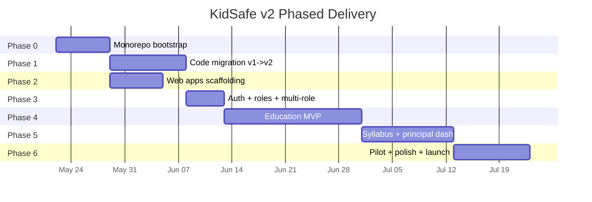
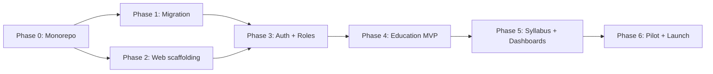

# V2 Build Phases — Step-By-Step Execution Plan

This document breaks the entire v2 work (from [EDUCATION_AI_TECH_SPEC.md](./EDUCATION_AI_TECH_SPEC.md)) into **small, doable chunks**.

Each chunk = **1 to 5 days of work**, has clear deliverables and acceptance criteria, and can be picked up as a sprint ticket.

> Read [EDUCATION_AI_TECH_SPEC.md](./EDUCATION_AI_TECH_SPEC.md) first to understand the locked design.
> This document is **how we get there**, not **what we're building**.

---

## 0) High-Level Timeline



| Phase | Duration | Devs needed | Critical path? |
|---|---|---|---|
| Phase 0 — Monorepo Bootstrap | 1 week | 1 | yes |
| Phase 1 — Code Migration | 2 weeks | 1-2 | yes |
| Phase 2 — Web Apps Scaffolding | 1 week | 1 | parallel with P1 |
| Phase 3 — Auth + Multi-Role | 1 week | 1 | yes |
| Phase 4 — Education MVP | 3-4 weeks | 2 | yes |
| Phase 5 — Syllabus + Dashboards | 2-3 weeks | 1-2 | yes |
| Phase 6 — Pilot + Launch | 2 weeks | all hands | yes |

**Total**: ~10-12 weeks with 1-2 developers (payment/subscriptions deferred to post-MVP).

---

## 1) Pre-Flight (Before Phase 0)

Lock these decisions before any coding starts. Block here until done.

- [ ] **PF-1** Lock open decisions from `EDUCATION_AI_TECH_SPEC.md §14` (web host, code rotation, tablet mode, iOS).
- [ ] **PF-2** Register domains: `kidsafe.app` (or chosen), `principal.kidsafe.app`, `admin.kidsafe.app`.
- [ ] **PF-3** Decide branding for Guardian + Kids icons, splash, color palette (can be same as v1 initially).
- [ ] **PF-4** Finalize curated JSON format with content team; receive first bundle (e.g. Class 8 Science — all chapters/topics with explanation, examples, videos, brainstorming, quiz).
- [ ] **PF-5** Set up issue tracker board (Linear/Jira) with this doc's chunk IDs as ticket labels.

**Definition of done**: All 5 items checked; curated JSON sample stored in a private team folder (not committed if large).

---

## Phase 0 — Monorepo Bootstrap (1 week)

**Goal**: Empty monorepo skeleton. No app code yet. (CI/GitHub Actions deferred — build the apps first.)

### P0.1 — Repo skeleton & pnpm workspaces (1 day)

- [ ] Create branch `v2/monorepo-bootstrap`
- [ ] Add `pnpm-workspace.yaml`, `.npmrc` (with `node-linker=hoisted`)
- [ ] Create empty folders: `apps/`, `packages/`, `android-modules/`, `firestore/`, `scripts/`
- [ ] Add root `package.json` with `"private": true` and base scripts
- [ ] Add `.gitignore` (node_modules, .turbo, build, .next, android build)

**Acceptance**: `pnpm install` runs cleanly at root.

### P0.2 — Turborepo + base TS config (1 day)

- [ ] Install Turborepo, add `turbo.json` (build / typecheck / test pipelines)
- [ ] Add `tsconfig.base.json` with strict settings

**Acceptance**: `pnpm turbo run typecheck` runs (no targets yet, exits 0).

> ESLint, Prettier, Husky, and lint-staged are deferred to a later phase — not part of Phase 0.

### P0.3 — Shared packages skeleton (1 day)

Create empty package shells for:

- [ ] `packages/shared-types/` (Firestore types, education types stubs)
- [ ] `packages/shared-firebase/` (auth + firestore helpers stubs)
- [ ] `packages/shared-utils/`

Each has its own `package.json`, `tsconfig.json` extending base, and an `src/index.ts` that exports `{}`.

Mobile and web apps use **Tailwind** (NativeWind on RN, Tailwind CSS on Next.js) for UI — no `shared-ui-mobile` or `shared-ui-web` packages.

**Acceptance**: `pnpm -r build` succeeds; type references resolve across packages.

### P0.4 — Firebase Emulator wiring (1 day)

- [ ] Add `firestore/rules` (copied from v1)
- [ ] Add `firestore/indexes.json`
- [ ] Add `firebase.json` configuring Auth, Firestore, Functions, Hosting emulators
- [ ] Add `scripts/dev-emulator.sh` to start emulators

**Acceptance**: `pnpm dev:emulator` starts Firebase emulators on standard ports.

### Phase 0 Definition Of Done

```text
- monorepo installs cleanly
- emulator boots
- all packages typecheck
- merged to v2/main
```

> CI pipeline (`.github/workflows/ci.yml`), PR template, and automated checks are deferred to a later phase.

---

## Phase 1 — Code Migration v1 → v2 (2 weeks)

**Goal**: Existing KidSafe v1 lives split across `apps/guardian/` and `apps/kids/` and still produces working APKs.

### P1.1 — Bootstrap `apps/kids/` (1 day)

- [ ] `pnpm dlx react-native@latest init kids` inside `apps/`
- [ ] Apply monorepo Metro config (workspace watchFolders, hoisted nodeModulesPaths, disableHierarchicalLookup)
- [ ] Set `applicationId = com.kidsafe.kids`
- [ ] App name "KidSafe Kids", colors/icon placeholder
- [ ] NativeWind (Tailwind for RN) configured

**Acceptance**: `pnpm --filter kids android` builds and launches an empty RN app.

### P1.2 — Bootstrap `apps/guardian/` (1 day)

Same as P1.1 but:

- [ ] Set `applicationId = com.kidsafe.guardian`
- [ ] App name "KidSafe Guardian"
- [ ] NativeWind (Tailwind for RN) configured

**Acceptance**: Both apps build and launch side by side on one device.

### P1.3 — Extract child-side code into `apps/kids/src/` (2 days)

Move from v1:

- [ ] `src/screens/child/*` → `apps/kids/src/screens/child/`
- [ ] `src/services/childSyncEngine.ts` → `apps/kids/src/services/`
- [ ] `src/firebase/*` → split: contracts to `packages/shared-types`, client to `packages/shared-firebase`
- [ ] `src/modules/native.ts` → child-only natives stay in `apps/kids/`
- [ ] Update import paths

**Acceptance**: Kids app launches v1 onboarding wizard; child can pair with parent (using v1 Guardian APK still installed elsewhere).

### P1.4 — Extract parent-side code into `apps/guardian/src/` (2 days)

Move:

- [ ] `src/screens/parent/*` → `apps/guardian/src/screens/parent/`
- [ ] `src/navigation/ParentNavigator.tsx` → `apps/guardian/src/navigation/`
- [ ] Map view, child details, tabs

**Acceptance**: Guardian app shows parent dashboard for existing v1 children.

### P1.5 — Split Android native modules into Gradle packages (2 days)

Move Kotlin source from `android/app/src/main/java/com/kidsafe/*`:

- [ ] `android-modules/location-writer/` — LocationWriter, LocationToggleReceiver, KidSafeForegroundService (location bits)
- [ ] `android-modules/app-blocker/` — accessibility service
- [ ] `android-modules/screen-time/` — UsageStats writer
- [ ] `android-modules/pin/`
- [ ] `android-modules/device-admin/`
- [ ] Each is its own Gradle module with `apply plugin: 'com.android.library'`
- [ ] `apps/kids/android/settings.gradle` references all 5
- [ ] `apps/guardian/android/settings.gradle` references none (Guardian doesn't need them)

**Acceptance**:
- Kids release APK builds and behaves identical to v1 child mode
- Guardian release APK builds without native modules, ~40% smaller

### P1.6 — Drop shared mode (1 day)

- [ ] Delete `src/screens/shared/*` references
- [ ] Remove `ChildModeState` shared-related fields from `shared-types`
- [ ] Update onboarding to skip mode selection (always two-device)
- [ ] Update Firestore rules to drop `_shared` child id pattern

**Acceptance**: Shared mode is unreachable from UI; types compile without shared-mode code paths.

### P1.7 — Delete v1 root source (1 day)

- [ ] Remove old `src/` at repo root
- [ ] Remove old `android/` at repo root
- [ ] Verify nothing else references it
- [ ] Update `README.md` to point at new app folders

**Acceptance**: `git grep "src/screens/parent"` returns only paths under `apps/`.

### Phase 1 DoD

```text
- apps/kids release APK behaves like v1 child install
- apps/guardian release APK behaves like v1 parent install
- v1 Firestore data is untouched and continues to work
- both apps can coexist on one phone with separate package ids
```

---

## Phase 2 — Web Apps Scaffolding (1 week, parallel with P1)

**Goal**: Empty `principal-web` and `admin-web` deployed to staging with login.

### P2.1 — Next.js 14 scaffolding (1 day)

- [ ] `apps/principal-web/` — `pnpm create next-app` with App Router + Tailwind + TS
- [ ] `apps/admin-web/` — same

**Acceptance**: Both run on `localhost:3001` and `localhost:3002`.

### P2.2 — Firebase Phone Auth on web (1 day)

- [ ] Add `firebase` client SDK via `shared-firebase`
- [ ] Implement `/login` page with reCAPTCHA + phone OTP
- [ ] Redirect to `/dashboard` on success
- [ ] Same login flow for both apps (Tailwind-styled pages in each app)

**Acceptance**: User can log in with phone OTP on both apps; `users/{uid}` doc auto-created.

### P2.3 — Empty dashboards + nav shell (1 day)

- [ ] Principal: `/dashboard`, `/teachers`, `/syllabus` placeholders
- [ ] Admin: `/schools`, `/syllabus-sources`, `/rewards`, `/users`, `/audit` placeholders
- [ ] Sidebar nav with Tailwind in each web app
- [ ] Logout button

**Acceptance**: Full nav clickable, all pages render "Coming soon".

### P2.4 — Staging deployment (1 day)

- [ ] Deploy `principal-web` and `admin-web` to Vercel (or Firebase Hosting if chosen)
- [ ] Domains: `principal-staging.kidsafe.app`, `admin-staging.kidsafe.app`
- [ ] Env vars: Firebase config via Vercel project settings

**Acceptance**: Both apps reachable from public staging URLs.

### Phase 2 DoD

```text
- two empty web apps deployed
- phone OTP login works on both
- staging URLs shared with team
```

---

## Phase 3 — Auth + Roles + Multi-Role (1 week)

**Goal**: User doc has `roles[]`, role-switcher UI works in Guardian, all callable functions enforce role.

### P3.1 — User doc migration (1 day)

- [ ] Add `apps/functions/src/crons/oneTimeMigration_v1_to_v2.ts`
- [ ] For every `users/*`: convert `role: "parent"` → `roles: ["parent"], primaryRole: "parent"`
- [ ] Idempotent (skip if `roles` already set)
- [ ] Run on staging, verify

**Acceptance**: All staging user docs have `roles[]` and `primaryRole`.

### P3.2 — `shared-types/User` updated everywhere (1 day)

- [ ] Update `UserDoc` type in `shared-types`
- [ ] Update `auth.ts` in `shared-firebase` to fetch + return `roles[]`
- [ ] Update Guardian + Kids + web reads to use new shape
- [ ] Backwards-compat read fallback for un-migrated users

**Acceptance**: Apps compile and read new user shape.

### P3.3 — Role switcher UI in Guardian (1 day)

- [ ] Component `RoleSwitcher` in Guardian app (styled with NativeWind)
- [ ] Top bar of Guardian home: pill switcher when `roles.length > 1`
- [ ] Persists selection to `users/{uid}.primaryRole`
- [ ] Wires into parent or teacher home screen

**Acceptance**: User with `["parent","teacher"]` sees switcher and can toggle.

### P3.4 — Firestore rules with role gates (2 days)

Add to `firestore/rules`:

- [ ] `isParent()`, `isTeacher()`, `isPrincipal()`, `isAdmin()` helpers
- [ ] `belongsToSchool(schoolId)` helper
- [ ] Gate `studyAssignments`, `quizAttempts`, `schools/*` accordingly
- [ ] Defense-in-depth: Kids app cannot read `studyAssignments` for classes outside the child's class

**Acceptance**: Rules unit tests pass; tests cover at least 10 deny + 10 allow cases.

### Phase 3 DoD

```text
- users have roles[] in production schema
- role switcher live in Guardian
- rules enforce role for every collection
- migration script run on staging successfully
```

---

## Phase 4 — Education MVP (3-4 weeks)

**Goal**: Teacher assigns a topic → child sees it → reads curated lesson → takes quiz → unlocks reward → parent + teacher see the score.

> **No AI-generated lesson content in MVP.** All topic material (explanation, examples, videos, brainstorming, quiz) is **pre-curated JSON** uploaded to Firestore by the content team.

> Payment/subscriptions are **deferred to post-MVP**. No Razorpay, billing UI, or subscription gating in this phase.

### P4.1 — Cloud Functions scaffold (1 day)

- [ ] `apps/functions/` — initialize with TS + Firebase Functions v2
- [ ] Add `firebase deploy --only functions` script
- [ ] Deploy empty callable `ping` to staging

**Acceptance**: Callable `ping` returns `{ ok: true }` from staging.

### P4.2 — Schools + curriculum schema (2 days)

- [ ] Add types to `shared-types/education.ts` (schools, classes, subjects, **curriculum**, chapters, topics)
- [ ] Admin-web: CRUD UI for `schools/*`
- [ ] Principal-web: CRUD UI for `classes/*` and `subjects/*` (each subject links to a `curriculumId`, e.g. `cbse_8_science`)
- [ ] Seed script with 1 sample school + 2 classes

**Acceptance**: Admin can create a school; Principal can create classes with curriculum linked.

### P4.3 — Teacher onboarding flow (2 days)

- [ ] Principal-web: "Generate teacher code" button → writes `schools/{id}.teacherCode`
- [ ] Guardian app: "I am a teacher" path → enter code → `requestTeacherJoin` callable creates `teachers/{id}` status `pending`
- [ ] Principal-web: `/teachers` lists pending → approve/reject → `approveTeacher` callable adds `roles += "teacher"`
- [ ] Guardian app: teacher home unlocks after approval

**Acceptance**: New teacher signs up, principal approves, teacher home opens.

### P4.4 — Child onboarding pulls school+class (1 day)

- [ ] Kids app: after pairing code, ask for school code + grade + section
- [ ] Validate against `schools/*` and `classes/*`
- [ ] Write `children/{uid}.classId`

**Acceptance**: Child completes onboarding, classId visible to teacher.

### P4.5 — Teacher: assign topic UI (2 days)

- [ ] Guardian app (teacher mode): list classes → pick subject → pick topic → "Assign Today"
- [ ] `assignTopic` callable writes `studyAssignments/{id}`
- [ ] Mark topic status `assigned`

**Acceptance**: Teacher sees assignment immediately after creation.

### P4.6 — Kids app: Study Mission screen (2 days)

- [ ] New screen during study window: list today's `studyAssignments`
- [ ] Each card shows topic name, status, **"Start Learning"**, **"Take Quiz"**, reward placeholder

**Acceptance**: Child sees assigned topic the next time they unlock during study window.

### P4.7 — Curated content schema + import pipeline (2 days)

Content team already has JSON per grade/subject/chapter/topic. We **upload it**, not generate it.

Each topic JSON includes:

1. **Explanation** (text)
2. **Examples** (array)
3. **YouTube video link** (topic intro)
4. **Brainstorming** — question + answer + YouTube link (common gaps students miss, e.g. "how solid turns to liquid")
5. **Quiz** — MCQs with correct answers (already prepared with the topic)

- [ ] Define `TopicContent` type in `shared-types/education.ts` (see tech spec §8.3)
- [ ] Firestore path: `curriculum/{curriculumId}/chapters/{chapterId}/topics/{topicId}`
- [ ] JSON schema validator (reject bad imports before write)
- [ ] Admin script `scripts/import-curriculum.ts` — reads folder/JSON bundle, bulk-writes chapters + topics
- [ ] Admin-web: preview imported topics (read-only list + JSON viewer) — optional but helpful for QA
- [ ] Import first real bundle: **Class 8 Science** (all chapters/topics from content team)

**Acceptance**: Running import script loads Class 8 Science into Firestore; each topic doc has explanation, examples, video, brainstorming[], quiz[].

### P4.8 — Topic learn screen (2 days)

- [ ] Kids app: fetch `curriculum/.../topics/{topicId}` for assigned topic
- [ ] Render sections in order: explanation → examples → intro video (safe webview/YouTube)
- [ ] **Brainstorming section**: expandable cards with question, answer, video link
- [ ] "I'm ready for the quiz" → goes to quiz screen

**Acceptance**: Child reads full curated lesson for a real Class 8 Science topic; all 5 content types visible.

### P4.9 — Quiz UI + scoring (2 days)

- [ ] Kids app: MCQ screen, one Q at a time — questions loaded from same topic doc (`quiz[]`)
- [ ] Submit → `submitQuizAttempt` callable
- [ ] Server validates answers against **curated quiz in Firestore** (not client-sent answers only), computes score, writes `quizAttempts/{id}`

**Acceptance**: Quiz submission produces a `quizAttempts` doc with server-authoritative score matched to curated quiz.

### P4.10 — Reward catalog + unlock (2 days)

- [ ] Admin-web: CRUD `rewardCatalog/*` with moderation flag
- [ ] On quiz pass: `onQuizAttemptWrite` trigger picks an approved reward matching subject + age, writes `rewardUnlocks/{id}`
- [ ] Kids app: shows unlocked reward (external link opens in safe webview)

**Acceptance**: Pass quiz → reward shows; fail quiz → "Try again tomorrow".

### P4.11 — Parent report tab (1 day)

- [ ] Guardian app (parent mode): new "Study" tab in child details
- [ ] Lists today's assignments + scores + rewards

**Acceptance**: Parent sees same data the child sees.

### P4.12 — Teacher class report (2 days)

- [ ] Guardian app (teacher mode): per-class summary: avg score, attempted/not attempted, weak topics
- [ ] Pull from `quizAttempts` filtered by `classId`

**Acceptance**: Teacher sees class summary updated within seconds of attempts.

### Phase 4 DoD

```text
- full loop: teacher assigns -> child reads curated lesson -> quiz -> reward -> parent + teacher see
- Class 8 Science curriculum imported and visible in Kids app
- quiz scored server-side against curated quiz[] in topic doc
- no AI lesson generation in this phase
- no payment/subscription code in this phase
```

---

## Phase 5 — Principal Dashboards + Optional Syllabus Tools (2-3 weeks)

**Goal**: Principal sees school-wide coverage; optional tools to expand curated content beyond initial JSON import.

> **MVP content source = curated JSON import (P4.7).** Online NCERT fetch (P5.1–P5.2) is optional — only if you want to auto-discover topic *names* before content team fills them in.

### P5.1 — Syllabus source adapter interface (1 day, optional)

- [ ] `apps/functions/src/content/syllabusFetchAdapter.ts` with `fetchClassTopics(grade, board): TopicMetadata[]`
- [ ] Stub for NCERT + CBSE — metadata only (topic names), **not** lesson content

**Acceptance**: Interface compiles, stub returns hardcoded topic name list.

### P5.2 — NCERT adapter (3 days, optional / defer)

- [ ] Implement HTML scrape or API call (depending on availability)
- [ ] Map output to chapter/topic **metadata** only (content team still uploads full JSON via import script)
- [ ] Schedule weekly cron to refresh topic name list

**Acceptance**: Adapter populates topic skeleton; curated import still required for explanation/quiz/video.

### P5.3 — Teacher review UI (2 days)

- [ ] Principal-web: `/syllabus` shows curriculum topics for linked `curriculumId`
- [ ] Flag topics missing curated content (`status: metadata_only` vs `published`)
- [ ] Teacher can see which topics are ready to assign vs pending content upload

### P5.4 — Principal coverage dashboard (3 days)

- [ ] Principal-web: `/dashboard` shows class coverage cards
- [ ] Aggregates: approved topics, assigned topics, completed-by-70%-students topics
- [ ] Nightly cron `aggregateClassReports` precomputes these into `classReports/{classId}/daily/{date}`

**Acceptance**: Dashboard loads in <1s using precomputed aggregates.

### P5.5 — Principal teacher activity view (1 day)

- [ ] `/teachers` shows last-assignment-date per teacher, total assigned this month

**Acceptance**: Principal can spot inactive teachers.

### P5.6 — Weak topic detection (2 days)

- [ ] Cron looks at quizAttempts, marks topics where class avg < 60% as `weak`
- [ ] Teacher dashboard shows "Re-teach: X, Y, Z"

**Acceptance**: Weak topics surface for a test class with mock low scores.

### Phase 5 DoD

```text
- principal dashboards show real aggregates
- curriculum topics with `published` status visible in syllabus view
- weak topics surface for re-teaching
- (optional) NCERT metadata adapter if built
```

---

## Phase 6 — Pilot + Polish + Launch (2 weeks)

**Goal**: One real pilot school running on production (no payment required for pilot).

### P6.1 — Pilot school onboarding (2 days)

- [ ] Sign up one partner school
- [ ] Admin creates school in production
- [ ] Principal logs in and sets up school + classes
- [ ] Principal adds 2 classes, generates teacher code
- [ ] 2 teachers + 10 parents + 10 children onboarded

**Acceptance**: All entities live in production Firestore.

### P6.2 — Real-device QA matrix (2 days)

- [ ] Test Guardian + Kids on: Realme, Xiaomi, Samsung, OPPO, Vivo, Pixel
- [ ] Each OEM gets a checklist: onboarding, location, app blocking, study mission, quiz, reward
- [ ] Fix top 5 bugs

**Acceptance**: Matrix sheet 100% green except known low-priority items.

### P6.3 — Crash + analytics wiring (1 day)

- [ ] Crashlytics on all 4 apps
- [ ] Firebase Analytics events: onboarding_complete, quiz_submitted, reward_unlocked
- [ ] Sentry on functions

**Acceptance**: Dashboards show events from pilot users.

### P6.4 — Documentation refresh (1 day)

- [ ] Update `BEGINNER_APP_FLOW.md` with v2 split
- [ ] Update `FIRESTORE_SCHEMA_EXPLAINED.md` with new collections
- [ ] Update `RELEASE_CHECKLIST.md` for 4-app release process
- [ ] Add `RUNBOOK.md` for on-call

**Acceptance**: New dev can read docs and run all 4 apps locally without help.

### P6.5 — Public launch (1 day)

- [ ] Publish Guardian + Kids to Play Store internal track
- [ ] Promote to closed beta → open beta → production
- [ ] Principal/admin web hit production domains
- [ ] v1 sunset banner ships in last v1 build

**Acceptance**: Apps live on Play Store production; v1 users see upgrade prompt.

### P6.6 — Buffer / hotfix week (3 days)

- [ ] Reserved for whatever breaks
- [ ] Pilot feedback ingestion
- [ ] First retro

**Acceptance**: No blocker bugs open; retro scheduled.

### Phase 6 DoD

```text
- 1 pilot school live in production
- crash-free rate > 99%
- 4 apps published / deployed
- retro held
- v1 sunset announced
```

---

## 2) Critical Path & Parallelization



**Critical path** = P0 → P1 → P3 → P4 → P5 → P6.

**Parallelizable**:
- P2 (web scaffolding) can run alongside P1.
- P4.8 (Topic learn screen) can be built before P4.6 (Study Mission UI) if we mock assignments with hardcoded topicId.
- P5.2 (NCERT adapter) is **deferred** — curated JSON import replaces online fetch for MVP.

---

## 3) Risk Buffers Per Phase

| Phase | Known risk | Buffer |
|---|---|---|
| P0 | pnpm + Metro path edge cases | +1 day |
| P1 | Native module Gradle migration | +2 days |
| P3 | Firestore rules complexity | +1 day |
| P4 | Curated JSON import errors / schema drift | +2 days |
| P5 | NCERT scrape brittleness | +3 days |
| P6 | Real-device OEM bugs | +3 days |

Add ~10% schedule buffer overall.

---

## 4) Ticket Template

For each chunk, use this template in Linear/Jira:

```text
ID: P4.7
Title: Curated content import pipeline
Phase: Phase 4 — Education MVP
Owner: <dev>
Estimate: 2 days
Depends on: P4.2

Scope:
- TopicContent type in shared-types (explanation, examples, video, brainstorming[], quiz[])
- Firestore path curriculum/{curriculumId}/chapters/{chapterId}/topics/{topicId}
- JSON schema validator + scripts/import-curriculum.ts
- Bulk import Class 8 Science bundle from content team

Acceptance:
- Import script loads all Class 8 Science topics
- Each topic doc passes schema validation
- Admin can preview topics in admin-web (optional)

References:
- docs/EDUCATION_AI_TECH_SPEC.md §8.3
- docs/EDUCATION_AI_ECOSYSTEM_PLAN.md §8.7
```

---

## 5) Tracking Cheat Sheet

| Phase | Done when |
|---|---|
| P0 | Monorepo installs, packages typecheck, emulator boots |
| P1 | v1 feature parity on split APKs |
| P2 | Web apps live on staging |
| P3 | `users.roles[]` shipped + rules enforce |
| P4 | Full education loop works on staging |
| P5 | Principal dashboard shows real coverage |
| P6 | 1 pilot school live, retro done |

---

## 6) What To Do Right Now (Today)

1. Open Pre-Flight checklist (§1) and lock the open decisions.
2. Create branch `v2/monorepo-bootstrap`.
3. Start ticket **P0.1**.
4. Schedule kickoff meeting; share this doc + tech spec.

That's it. One small step at a time.
