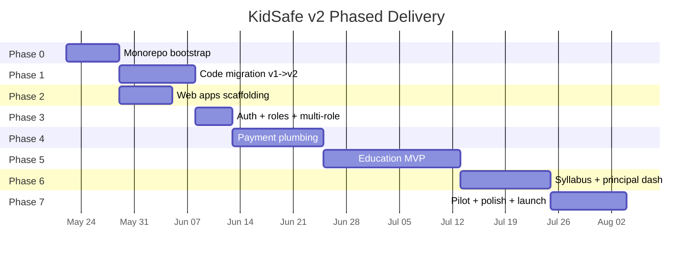
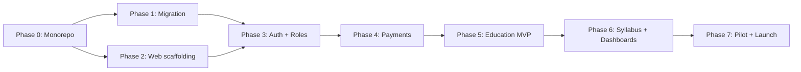

# V2 Build Phases — Step-By-Step Execution Plan

This document breaks the entire v2 work (from [EDUCATION_AI_TECH_SPEC.md](./EDUCATION_AI_TECH_SPEC.md)) into **small, doable chunks**.

Each chunk = **1 to 5 days of work**, has clear deliverables and acceptance criteria, and can be picked up as a sprint ticket.

> Read [EDUCATION_AI_TECH_SPEC.md](./EDUCATION_AI_TECH_SPEC.md) first to understand the locked design.
> This document is **how we get there**, not **what we're building**.

---

## 0) High-Level Timeline



| Phase | Duration | Devs needed | Critical path? |
|---|---|---|---|
| Phase 0 — Monorepo Bootstrap | 1 week | 1 | yes |
| Phase 1 — Code Migration | 2 weeks | 1-2 | yes |
| Phase 2 — Web Apps Scaffolding | 1 week | 1 | parallel with P1 |
| Phase 3 — Auth + Multi-Role | 1 week | 1 | yes |
| Phase 4 — Payment Plumbing | 2-3 weeks | 1-2 | yes |
| Phase 5 — Education MVP | 3-4 weeks | 2 | yes |
| Phase 6 — Syllabus + Dashboards | 2-3 weeks | 1-2 | yes |
| Phase 7 — Pilot + Launch | 2 weeks | all hands | yes |

**Total**: ~14-16 weeks with 1-2 developers.

---

## 1) Pre-Flight (Before Phase 0)

Lock these decisions before any coding starts. Block here until done.

- [ ] **PF-1** Lock the 8 open decisions from `EDUCATION_AI_TECH_SPEC.md §14` (web host, grace period, min students, billing cadence, AI provider, code rotation, tablet mode, iOS).
- [ ] **PF-2** Create Razorpay business account, get test + live API keys, configure webhook URL placeholder.
- [ ] **PF-3** Register domains: `kidsafe.app` (or chosen), `principal.kidsafe.app`, `admin.kidsafe.app`.
- [ ] **PF-4** Decide branding for Guardian + Kids icons, splash, color palette (can be same as v1 initially).
- [ ] **PF-5** Pick AI provider account (OpenAI/Gemini), get API keys, set monthly spend cap.
- [ ] **PF-6** Set up issue tracker board (Linear/Jira) with this doc's chunk IDs as ticket labels.

**Definition of done**: All 6 items checked, keys and decisions written into a private `infra/secrets.md` (not committed).

---

## Phase 0 — Monorepo Bootstrap (1 week)

**Goal**: Empty monorepo skeleton with CI green. No app code yet.

### P0.1 — Repo skeleton & pnpm workspaces (1 day)

- [ ] Create branch `v2/monorepo-bootstrap`
- [ ] Add `pnpm-workspace.yaml`, `.npmrc` (with `node-linker=hoisted`)
- [ ] Create empty folders: `apps/`, `packages/`, `android-modules/`, `firestore/`, `scripts/`
- [ ] Add root `package.json` with `"private": true` and base scripts
- [ ] Add `.gitignore` (node_modules, .turbo, build, .next, android build)

**Acceptance**: `pnpm install` runs cleanly at root.

### P0.2 — Turborepo + base TS config (1 day)

- [ ] Install Turborepo, add `turbo.json` (build / lint / typecheck / test pipelines)
- [ ] Add `tsconfig.base.json` with strict settings
- [ ] Add `.eslintrc.cjs` at root, `.prettierrc`
- [ ] Add `husky` + `lint-staged`

**Acceptance**: `pnpm turbo run lint` runs (no targets yet, exits 0).

### P0.3 — Shared packages skeleton (1 day)

Create empty package shells for:

- [ ] `packages/shared-types/` (Firestore types, payment types stubs)
- [ ] `packages/shared-firebase/` (auth + firestore helpers stubs)
- [ ] `packages/shared-utils/`
- [ ] `packages/shared-ui-mobile/`
- [ ] `packages/shared-ui-web/`
- [ ] `packages/shared-payments/`

Each has its own `package.json`, `tsconfig.json` extending base, and an `src/index.ts` that exports `{}`.

**Acceptance**: `pnpm -r build` succeeds; type references resolve across packages.

### P0.4 — CI pipeline (1 day)

- [ ] Add `.github/workflows/ci.yml`
- [ ] Steps: install → `pnpm -r typecheck` → `pnpm -r lint` → `pnpm -r test`
- [ ] PR template referencing this doc

**Acceptance**: PR to `v2/main` runs CI green.

### P0.5 — Firebase Emulator wiring (1 day)

- [ ] Add `firestore/rules` (copied from v1)
- [ ] Add `firestore/indexes.json`
- [ ] Add `firebase.json` configuring Auth, Firestore, Functions, Hosting emulators
- [ ] Add `scripts/dev-emulator.sh` to start emulators

**Acceptance**: `pnpm dev:emulator` starts Firebase emulators on standard ports.

### Phase 0 Definition Of Done

```text
- monorepo installs cleanly
- CI green
- emulator boots
- all packages typecheck
- merged to v2/main
```

---

## Phase 1 — Code Migration v1 → v2 (2 weeks)

**Goal**: Existing KidSafe v1 lives split across `apps/guardian/` and `apps/kids/` and still produces working APKs.

### P1.1 — Bootstrap `apps/kids/` (1 day)

- [ ] `pnpm dlx react-native@latest init kids` inside `apps/`
- [ ] Apply monorepo Metro config (workspace watchFolders, hoisted nodeModulesPaths, disableHierarchicalLookup)
- [ ] Set `applicationId = com.kidsafe.kids`
- [ ] App name "KidSafe Kids", colors/icon placeholder

**Acceptance**: `pnpm --filter kids android` builds and launches an empty RN app.

### P1.2 — Bootstrap `apps/guardian/` (1 day)

Same as P1.1 but:

- [ ] Set `applicationId = com.kidsafe.guardian`
- [ ] App name "KidSafe Guardian"

**Acceptance**: Both apps build and launch side by side on one device.

### P1.3 — Extract child-side code into `apps/kids/src/` (2 days)

Move from v1:

- [ ] `src/screens/child/*` → `apps/kids/src/screens/child/`
- [ ] `src/services/childSyncEngine.ts` → `apps/kids/src/services/`
- [ ] `src/firebase/*` → split: contracts to `packages/shared-types`, client to `packages/shared-firebase`
- [ ] `src/modules/native.ts` → child-only natives stay in `apps/kids/`
- [ ] Update import paths

**Acceptance**: Kids app launches v1 onboarding wizard; child can pair with parent (using v1 Guardian APK still installed elsewhere).

### P1.4 — Extract parent-side code into `apps/guardian/src/` (2 days)

Move:

- [ ] `src/screens/parent/*` → `apps/guardian/src/screens/parent/`
- [ ] `src/navigation/ParentNavigator.tsx` → `apps/guardian/src/navigation/`
- [ ] Map view, child details, tabs

**Acceptance**: Guardian app shows parent dashboard for existing v1 children.

### P1.5 — Split Android native modules into Gradle packages (2 days)

Move Kotlin source from `android/app/src/main/java/com/kidsafe/*`:

- [ ] `android-modules/location-writer/` — LocationWriter, LocationToggleReceiver, KidSafeForegroundService (location bits)
- [ ] `android-modules/app-blocker/` — accessibility service
- [ ] `android-modules/screen-time/` — UsageStats writer
- [ ] `android-modules/pin/`
- [ ] `android-modules/device-admin/`
- [ ] Each is its own Gradle module with `apply plugin: 'com.android.library'`
- [ ] `apps/kids/android/settings.gradle` references all 5
- [ ] `apps/guardian/android/settings.gradle` references none (Guardian doesn't need them)

**Acceptance**:
- Kids release APK builds and behaves identical to v1 child mode
- Guardian release APK builds without native modules, ~40% smaller

### P1.6 — Drop shared mode (1 day)

- [ ] Delete `src/screens/shared/*` references
- [ ] Remove `ChildModeState` shared-related fields from `shared-types`
- [ ] Update onboarding to skip mode selection (always two-device)
- [ ] Update Firestore rules to drop `_shared` child id pattern

**Acceptance**: Shared mode is unreachable from UI; types compile without shared-mode code paths.

### P1.7 — Delete v1 root source (1 day)

- [ ] Remove old `src/` at repo root
- [ ] Remove old `android/` at repo root
- [ ] Verify nothing else references it
- [ ] Update `README.md` to point at new app folders

**Acceptance**: `git grep "src/screens/parent"` returns only paths under `apps/`.

### Phase 1 DoD

```text
- apps/kids release APK behaves like v1 child install
- apps/guardian release APK behaves like v1 parent install
- v1 Firestore data is untouched and continues to work
- both apps can coexist on one phone with separate package ids
```

---

## Phase 2 — Web Apps Scaffolding (1 week, parallel with P1)

**Goal**: Empty `principal-web` and `admin-web` deployed to staging with login.

### P2.1 — Next.js 14 scaffolding (1 day)

- [ ] `apps/principal-web/` — `pnpm create next-app` with App Router + Tailwind + TS
- [ ] `apps/admin-web/` — same

**Acceptance**: Both run on `localhost:3001` and `localhost:3002`.

### P2.2 — Firebase Phone Auth on web (1 day)

- [ ] Add `firebase` client SDK via `shared-firebase`
- [ ] Implement `/login` page with reCAPTCHA + phone OTP
- [ ] Redirect to `/dashboard` on success
- [ ] Same code for both apps (component lives in `shared-ui-web`)

**Acceptance**: User can log in with phone OTP on both apps; `users/{uid}` doc auto-created.

### P2.3 — Empty dashboards + nav shell (1 day)

- [ ] Principal: `/dashboard`, `/teachers`, `/billing`, `/syllabus` placeholders
- [ ] Admin: `/schools`, `/syllabus-sources`, `/rewards`, `/billing`, `/users`, `/audit` placeholders
- [ ] Sidebar nav from `shared-ui-web`
- [ ] Logout button

**Acceptance**: Full nav clickable, all pages render "Coming soon".

### P2.4 — Staging deployment (1 day)

- [ ] Deploy `principal-web` and `admin-web` to Vercel (or Firebase Hosting if chosen)
- [ ] Domains: `principal-staging.kidsafe.app`, `admin-staging.kidsafe.app`
- [ ] Env vars: Firebase config via Vercel project settings

**Acceptance**: Both apps reachable from public staging URLs.

### Phase 2 DoD

```text
- two empty web apps deployed
- phone OTP login works on both
- staging URLs shared with team
```

---

## Phase 3 — Auth + Roles + Multi-Role (1 week)

**Goal**: User doc has `roles[]`, role-switcher UI works in Guardian, all callable functions enforce role.

### P3.1 — User doc migration (1 day)

- [ ] Add `apps/functions/src/crons/oneTimeMigration_v1_to_v2.ts`
- [ ] For every `users/*`: convert `role: "parent"` → `roles: ["parent"], primaryRole: "parent"`
- [ ] Idempotent (skip if `roles` already set)
- [ ] Run on staging, verify

**Acceptance**: All staging user docs have `roles[]` and `primaryRole`.

### P3.2 — `shared-types/User` updated everywhere (1 day)

- [ ] Update `UserDoc` type in `shared-types`
- [ ] Update `auth.ts` in `shared-firebase` to fetch + return `roles[]`
- [ ] Update Guardian + Kids + web reads to use new shape
- [ ] Backwards-compat read fallback for un-migrated users

**Acceptance**: Apps compile and read new user shape.

### P3.3 — Role switcher UI in Guardian (1 day)

- [ ] Component `RoleSwitcher` in `shared-ui-mobile`
- [ ] Top bar of Guardian home: pill switcher when `roles.length > 1`
- [ ] Persists selection to `users/{uid}.primaryRole`
- [ ] Wires into parent or teacher home screen

**Acceptance**: User with `["parent","teacher"]` sees switcher and can toggle.

### P3.4 — Firestore rules with role gates (2 days)

Add to `firestore/rules`:

- [ ] `isParent()`, `isTeacher()`, `isPrincipal()`, `isAdmin()` helpers
- [ ] `belongsToSchool(schoolId)` helper
- [ ] Gate `studyAssignments`, `quizAttempts`, `schools/*` accordingly
- [ ] Defense-in-depth: Kids app cannot read `studyAssignments` for classes outside the child's class

**Acceptance**: Rules unit tests pass; tests cover at least 10 deny + 10 allow cases.

### Phase 3 DoD

```text
- users have roles[] in production schema
- role switcher live in Guardian
- rules enforce role for every collection
- migration script run on staging successfully
```

---

## Phase 4 — Payment Plumbing (2-3 weeks)

**Goal**: A school can subscribe via Principal web; a parent can subscribe via Guardian app. Webhook is signed, idempotent, reconciled.

### P4.1 — Plan catalog + types (1 day)

- [ ] `packages/shared-types/src/payments.ts` — Subscription, Invoice, PaymentEvent types
- [ ] `packages/shared-payments/src/plans.ts` — PLANS const (3 plans)
- [ ] Unit tests for amount math (per-student, GST)

**Acceptance**: Plan amount calculations verified by tests.

### P4.2 — Functions scaffold (1 day)

- [ ] `apps/functions/` — initialize with TS + Firebase Functions v2
- [ ] Add `RAZORPAY_KEY_ID`, `RAZORPAY_KEY_SECRET`, `RAZORPAY_WEBHOOK_SECRET` to Secret Manager
- [ ] Add `firebase deploy --only functions` script

**Acceptance**: Empty callable `ping` deployed to staging.

### P4.3 — `createOrder` callable (B2B one-time) (1 day)

- [ ] Validate planId + studentCount server-side
- [ ] Compute amount + GST
- [ ] Call Razorpay `orders.create`
- [ ] Return `{ orderId, keyId, amountPaise, currency }`

**Acceptance**: From Principal web, calling this returns a valid Razorpay order.

### P4.4 — `createSubscription` callable (B2C recurring) (1 day)

- [ ] Validate planId + childUid
- [ ] Call Razorpay `subscriptions.create` with plan, total_count
- [ ] Return `{ subscriptionId, shortUrl, keyId }`

**Acceptance**: From Guardian app, calling this returns valid Razorpay subscription.

### P4.5 — Razorpay webhook handler (2 days)

- [ ] HTTPS function `/razorpayWebhook` (raw body, no JSON parser)
- [ ] Verify `X-Razorpay-Signature` with HMAC-SHA256 (constant-time compare)
- [ ] Idempotency via `paymentEvents/{eventId}` doc transaction
- [ ] Handle 12 event types listed in tech spec §7.6
- [ ] Always return 200 unless signature invalid

**Acceptance**:
- Manual webhook tests via `razorpay --signature ...` pass
- Replay of same event = no double-write
- Bad signature returns 400

### P4.6 — Subscription state writes (1 day)

- [ ] On `payment.captured` / `subscription.charged`: upsert `subscriptions/{id}`, write `invoices/{id}`, update `schools/{id}.subscription` denormalized
- [ ] On `subscription.halted`: flip status, start 7-day grace
- [ ] On `subscription.cancelled`: flip status, keep access until `currentPeriodEnd`

**Acceptance**: Full state machine validated with mocked webhook payloads.

### P4.7 — Principal web checkout page (2 days)

- [ ] `/billing/checkout/:planId` — student count input, plan summary, "Proceed to Pay" button
- [ ] Calls `createOrder`, opens Razorpay Checkout overlay
- [ ] Success → redirect `/billing` showing "Pending confirmation"
- [ ] Subscribe to `schools/{id}` → flip to "Active" when webhook lands

**Acceptance**: End-to-end test in Razorpay test mode results in active subscription.

### P4.8 — Guardian app parent checkout (2 days)

- [ ] Settings → Premium → "Subscribe ₹99/month/child"
- [ ] Wire `react-native-razorpay`
- [ ] Call `createSubscription`, open native Razorpay sheet
- [ ] Subscribe to `subscriptions/{id}` → toast "Premium active" when webhook lands

**Acceptance**: Test-mode parent checkout activates premium.

### P4.9 — `cancelSubscription` callable + UI (1 day)

- [ ] Cancel at period end via Razorpay API
- [ ] Show "Cancels on DD MMM" banner
- [ ] Admin can also cancel any subscription from `admin-web/billing`

**Acceptance**: Cancel from both Guardian and Principal works, status reflects in Firestore.

### P4.10 — Daily reconciler cron (1 day)

- [ ] Cloud Scheduler → `subscriptionReconciler` function
- [ ] Compare local state vs Razorpay for every active subscription with `currentPeriodEnd < now + 24h`
- [ ] Slack/email alert on drift > 1h

**Acceptance**: Manually break local state, reconciler restores it.

### P4.11 — `educationReadOnlyEnforcer` cron (0.5 day)

- [ ] Hourly: flip `schools/{id}.subscription.educationReadOnly = true` if `currentPeriodEnd < now`

**Acceptance**: Manually expire a sub, within 1h the flag flips.

### P4.12 — Payment rules (0.5 day)

- [ ] `subscriptions/*` — server-only writes, owner-read
- [ ] `paymentEvents/*` — server-only read+write
- [ ] `invoices/*` — server-only writes, owner-read

**Acceptance**: Rules tests pass.

### Phase 4 DoD

```text
- school can subscribe via Principal web (test mode)
- parent can subscribe via Guardian app (test mode)
- webhook is signed + idempotent + handles 12 event types
- daily reconciler catches drift
- educationReadOnly flag flips on expiry
- all payment writes happen server-side only
- production Razorpay keys swapped in after pilot
```

---

## Phase 5 — Education MVP (3-4 weeks)

**Goal**: Teacher assigns a topic → child sees it → reads AI explanation → takes quiz → unlocks reward → parent + teacher see the score.

### P5.1 — Schools / classes / subjects / chapters / topics schema (2 days)

- [ ] Add types to `shared-types/education.ts`
- [ ] Admin-web: CRUD UI for `schools/*`
- [ ] Principal-web: CRUD UI for `classes/*` and `subjects/*`
- [ ] Seed script with 1 sample school + 2 classes

**Acceptance**: Admin can create a school; Principal can create classes inside it.

### P5.2 — Teacher onboarding flow (2 days)

- [ ] Principal-web: "Generate teacher code" button → writes `schools/{id}.teacherCode`
- [ ] Guardian app: "I am a teacher" path → enter code → `requestTeacherJoin` callable creates `teachers/{id}` status `pending`
- [ ] Principal-web: `/teachers` lists pending → approve/reject → `approveTeacher` callable adds `roles += "teacher"`
- [ ] Guardian app: teacher home unlocks after approval

**Acceptance**: New teacher signs up, principal approves, teacher home opens.

### P5.3 — Child onboarding pulls school+class (1 day)

- [ ] Kids app: after pairing code, ask for school code + grade + section
- [ ] Validate against `schools/*` and `classes/*`
- [ ] Write `children/{uid}.classId`

**Acceptance**: Child completes onboarding, classId visible to teacher.

### P5.4 — Teacher: assign topic UI (2 days)

- [ ] Guardian app (teacher mode): list classes → pick subject → pick topic → "Assign Today"
- [ ] `assignTopic` callable writes `studyAssignments/{id}`
- [ ] Mark topic status `assigned`

**Acceptance**: Teacher sees assignment immediately after creation.

### P5.5 — Kids app: Study Mission screen (2 days)

- [ ] New screen during study window: list today's `studyAssignments`
- [ ] Each card shows topic name, status, "Learn with AI", "Start Quiz", reward placeholder

**Acceptance**: Child sees assigned topic the next time they unlock during study window.

### P5.6 — AI lesson generator (3 days)

- [ ] `aiLessonGenerator` callable: input `topicId, classId, grade, language`
- [ ] If `lessonGenerations/{lessonId}` cached, return it
- [ ] Else call OpenAI/Gemini with structured prompt → parse JSON → write cache → return
- [ ] Hard cap monthly spend with check at function start

**Acceptance**: First call generates, second call hits cache; structured JSON validated.

### P5.7 — AI explanation screen (1 day)

- [ ] Kids app: render lesson short + examples + analogy
- [ ] "I understood, start quiz" → goes to quiz screen

**Acceptance**: Child reads lesson, taps continue.

### P5.8 — Quiz UI + scoring (2 days)

- [ ] Kids app: MCQ screen, one Q at a time
- [ ] Submit → `submitQuizAttempt` callable
- [ ] Server validates answers, computes score, writes `quizAttempts/{id}`
- [ ] If subscription is read-only, refuse with typed error

**Acceptance**: Quiz submission produces a `quizAttempts` doc with server-authoritative score.

### P5.9 — Reward catalog + unlock (2 days)

- [ ] Admin-web: CRUD `rewardCatalog/*` with moderation flag
- [ ] On quiz pass: `onQuizAttemptWrite` trigger picks an approved reward matching subject + age, writes `rewardUnlocks/{id}`
- [ ] Kids app: shows unlocked reward (external link opens in safe webview)

**Acceptance**: Pass quiz → reward shows; fail quiz → "Try again tomorrow".

### P5.10 — Parent report tab (1 day)

- [ ] Guardian app (parent mode): new "Study" tab in child details
- [ ] Lists today's assignments + scores + rewards

**Acceptance**: Parent sees same data the child sees.

### P5.11 — Teacher class report (2 days)

- [ ] Guardian app (teacher mode): per-class summary: avg score, attempted/not attempted, weak topics
- [ ] Pull from `quizAttempts` filtered by `classId`

**Acceptance**: Teacher sees class summary updated within seconds of attempts.

### P5.12 — Read-only enforcement in education writes (1 day)

- [ ] `assignTopic`, `submitQuizAttempt`, `aiLessonGenerator` all read `schools/{id}.subscription.educationReadOnly`
- [ ] If `true`, reject writes with `subscription_expired` error
- [ ] UI shows banner + CTA

**Acceptance**: Expire a school's sub manually, teacher and child can't write; existing data still readable.

### Phase 5 DoD

```text
- full loop: teacher assigns -> child learns -> quiz -> reward -> parent + teacher see
- read-only mode works when sub expired
- AI generator caches and respects spend cap
- everything tested end-to-end on staging with a real device pair
```

---

## Phase 6 — Syllabus Adapters + Principal Dashboards (2-3 weeks)

**Goal**: Topics auto-populate from online sources; principal can see school-wide coverage.

### P6.1 — Syllabus source adapter interface (1 day)

- [ ] `apps/functions/src/ai/syllabusFetchAdapter.ts` with `fetchClassTopics(grade, board): Topic[]`
- [ ] Stub for NCERT + CBSE

**Acceptance**: Interface compiles, stub returns hardcoded sample.

### P6.2 — NCERT adapter (3 days)

- [ ] Implement HTML scrape or API call (depending on availability)
- [ ] Map output to internal schema
- [ ] Write to `chapters/*` and `topics/*` with status `fetched`
- [ ] Schedule weekly cron to refresh

**Acceptance**: Running the adapter populates real Class 8 Science topics.

### P6.3 — Teacher review UI (2 days)

- [ ] Principal-web: `/syllabus` shows fetched topics filtered by class
- [ ] Bulk approve / individual edit
- [ ] Status moves `fetched → reviewed → approved`
- [ ] Also exposed in Guardian teacher mode for per-subject quick review

**Acceptance**: Teacher can approve a fetched topic before children see it.

### P6.4 — Principal coverage dashboard (3 days)

- [ ] Principal-web: `/dashboard` shows class coverage cards
- [ ] Aggregates: approved topics, assigned topics, completed-by-70%-students topics
- [ ] Nightly cron `aggregateClassReports` precomputes these into `classReports/{classId}/daily/{date}`

**Acceptance**: Dashboard loads in <1s using precomputed aggregates.

### P6.5 — Principal teacher activity view (1 day)

- [ ] `/teachers` shows last-assignment-date per teacher, total assigned this month

**Acceptance**: Principal can spot inactive teachers.

### P6.6 — Weak topic detection (2 days)

- [ ] Cron looks at quizAttempts, marks topics where class avg < 60% as `weak`
- [ ] Teacher dashboard shows "Re-teach: X, Y, Z"

**Acceptance**: Weak topics surface for a test class with mock low scores.

### Phase 6 DoD

```text
- NCERT topics auto-fetched weekly
- teacher review flow live
- principal dashboards show real aggregates
- weak topics surface for re-teaching
```

---

## Phase 7 — Pilot + Polish + Launch (2 weeks)

**Goal**: One real pilot school running on production with real payment.

### P7.1 — Pilot school onboarding (2 days)

- [ ] Sign up one partner school
- [ ] Admin creates school in production
- [ ] Principal logs in, subscribes (real Razorpay charge)
- [ ] Principal adds 2 classes, generates teacher code
- [ ] 2 teachers + 10 parents + 10 children onboarded

**Acceptance**: All entities live in production Firestore.

### P7.2 — Real-device QA matrix (2 days)

- [ ] Test Guardian + Kids on: Realme, Xiaomi, Samsung, OPPO, Vivo, Pixel
- [ ] Each OEM gets a checklist: onboarding, location, app blocking, study mission, quiz, reward
- [ ] Fix top 5 bugs

**Acceptance**: Matrix sheet 100% green except known low-priority items.

### P7.3 — Crash + analytics wiring (1 day)

- [ ] Crashlytics on all 4 apps
- [ ] Firebase Analytics events: onboarding_complete, quiz_submitted, reward_unlocked, subscription_active
- [ ] Sentry on functions

**Acceptance**: Dashboards show events from pilot users.

### P7.4 — Documentation refresh (1 day)

- [ ] Update `BEGINNER_APP_FLOW.md` with v2 split
- [ ] Update `FIRESTORE_SCHEMA_EXPLAINED.md` with new collections
- [ ] Update `RELEASE_CHECKLIST.md` for 4-app release process
- [ ] Add `RUNBOOK.md` for on-call

**Acceptance**: New dev can read docs and run all 4 apps locally without help.

### P7.5 — Public launch (1 day)

- [ ] Publish Guardian + Kids to Play Store internal track
- [ ] Promote to closed beta → open beta → production
- [ ] Principal/admin web hit production domains
- [ ] v1 sunset banner ships in last v1 build

**Acceptance**: Apps live on Play Store production; v1 users see upgrade prompt.

### P7.6 — Buffer / hotfix week (3 days)

- [ ] Reserved for whatever breaks
- [ ] Pilot feedback ingestion
- [ ] First retro

**Acceptance**: No blocker bugs open; retro scheduled.

### Phase 7 DoD

```text
- 1 paying school live in production
- crash-free rate > 99%
- 4 apps published / deployed
- retro held
- v1 sunset announced
```

---

## 2) Critical Path & Parallelization



**Critical path** = P0 → P1 → P3 → P4 → P5 → P6 → P7.

**Parallelizable**:
- P2 (web scaffolding) can run alongside P1.
- P5.6 (AI generator) can be built before P5.5 (Study Mission UI) if we mock the UI side first.
- P6.2 (NCERT adapter) can start in parallel with P5 if a second dev is free.

---

## 3) Risk Buffers Per Phase

| Phase | Known risk | Buffer |
|---|---|---|
| P0 | pnpm + Metro path edge cases | +1 day |
| P1 | Native module Gradle migration | +2 days |
| P3 | Firestore rules complexity | +1 day |
| P4 | Razorpay webhook edge cases | +3 days |
| P5 | AI generator output quality | +3 days |
| P6 | NCERT scrape brittleness | +3 days |
| P7 | Real-device OEM bugs | +3 days |

Add ~10% schedule buffer overall.

---

## 4) Ticket Template

For each chunk, use this template in Linear/Jira:

```text
ID: P4.5
Title: Razorpay webhook handler
Phase: Phase 4 — Payment Plumbing
Owner: <dev>
Estimate: 2 days
Depends on: P4.2

Scope:
- HTTPS function /razorpayWebhook, raw body
- Verify X-Razorpay-Signature (HMAC SHA256, constant-time)
- Idempotency: paymentEvents/{eventId} doc transaction
- Handle 12 event types from tech spec §7.6
- Always return 200 unless signature invalid

Acceptance:
- Manual webhook test with valid sig: 200 + Firestore write
- Replay same event: 200, no double-write
- Bad sig: 400
- Unit tests cover 12 event types

References:
- docs/EDUCATION_AI_TECH_SPEC.md §7.5-§7.6
- razorpay.com/docs/api/webhooks
```

---

## 5) Tracking Cheat Sheet

| Phase | Done when |
|---|---|
| P0 | CI green on empty monorepo |
| P1 | v1 feature parity on split APKs |
| P2 | Web apps live on staging |
| P3 | `users.roles[]` shipped + rules enforce |
| P4 | Test-mode payment succeeds end to end |
| P5 | Full education loop works on staging |
| P6 | Principal dashboard shows real coverage |
| P7 | 1 paying school live, retro done |

---

## 6) What To Do Right Now (Today)

1. Open Pre-Flight checklist (§1) and lock the 8 open decisions.
2. Create branch `v2/monorepo-bootstrap`.
3. Start ticket **P0.1**.
4. Schedule kickoff meeting; share this doc + tech spec.

That's it. One small step at a time.
