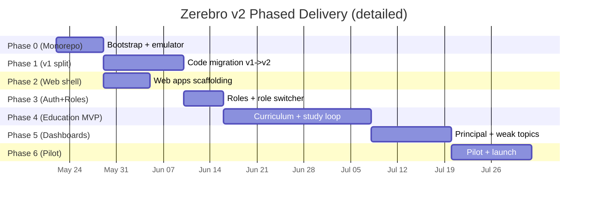
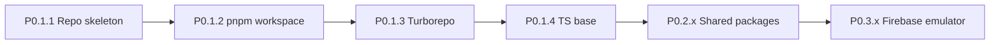
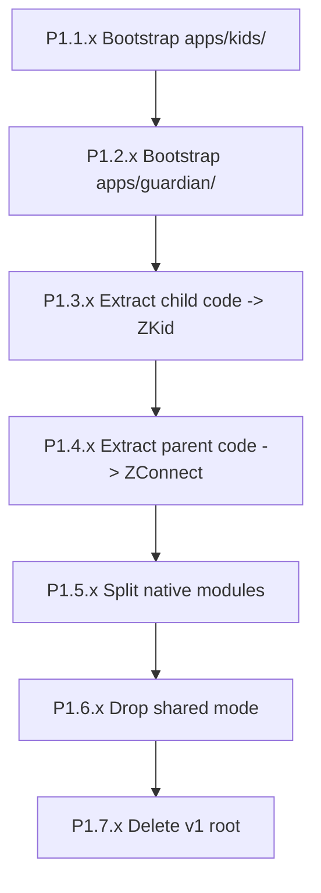
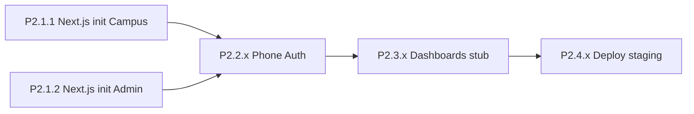
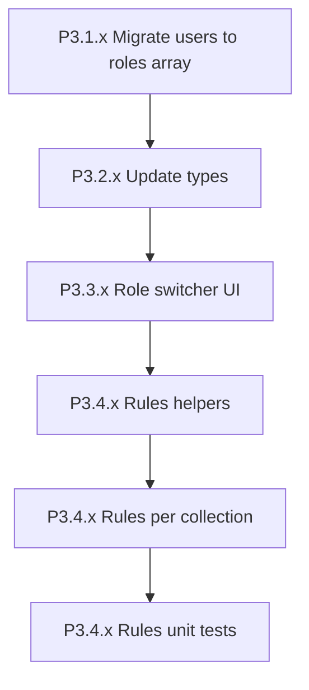
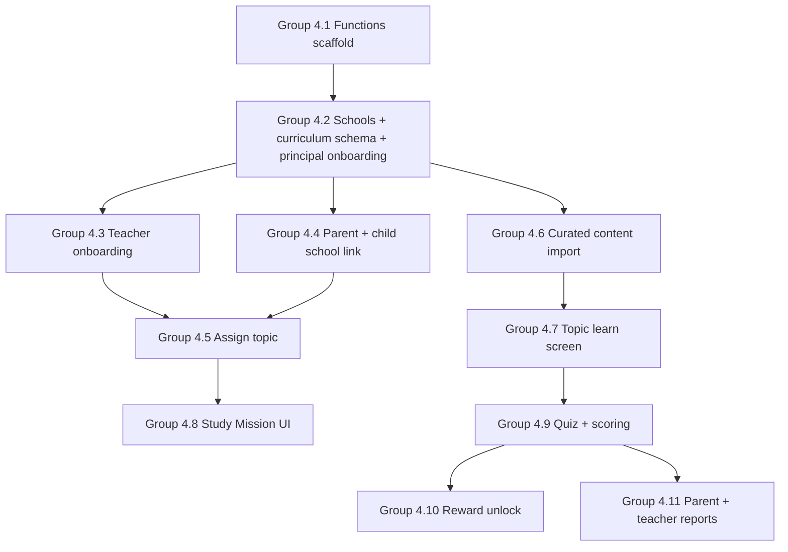
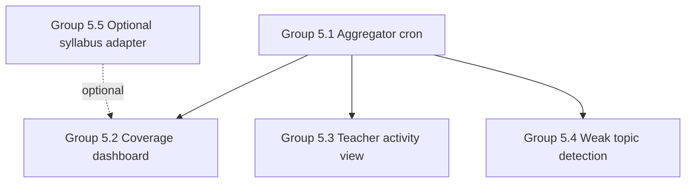
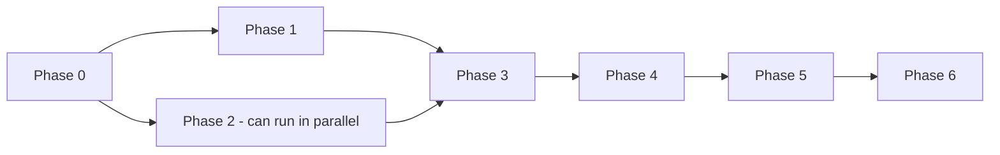

# V2 Build Phases — Detailed Execution Plan

> Companion to [EDUCATION_AI_TECH_SPEC.md](./EDUCATION_AI_TECH_SPEC.md).
> **Every task is sized 0.5 to 1 day** so any developer can pick one ticket and finish it in a single sitting.
> Each task includes: what you build, files touched, Firestore paths, dependencies, what feature it unlocks, and acceptance criteria.

---

## 0) How To Read This Doc

Each micro-task uses this format:

```text
### P<phase>.<group>.<task> — Title (Xh / Xd)

What you build:        one paragraph, plain English
Files / paths touched: which files this task creates or edits
Firestore paths:       which collections this reads or writes
Functions:             which Cloud Functions this defines or calls
Depends on:            which earlier tasks must be done
Unlocks:               which later tasks become possible
Interacts with:        how this connects to other parts of the system
Steps:                 numbered step-by-step
Acceptance:            testable checklist
```

Naming: `P<phase>.<group>.<task>`
- `P4.2.3` = Phase 4, group 2, task 3.
- Groups roughly map to the old single-letter sub-phases (P4.2 was "schools schema" — now it's a group of 5 tasks).

---

## 1) High-Level Timeline



| Phase | Micro-tasks | Days | Devs | Critical path |
|---|---|---|---|---|
| Phase 0 — Monorepo Bootstrap | 10 | 5–7 | 1 | yes |
| Phase 1 — Code Migration | 18 | 10–14 | 1–2 | yes |
| Phase 2 — Web Apps Scaffolding | 11 | 5–7 | 1 | parallel with P1 |
| Phase 3 — Auth + Multi-Role | 11 | 5–7 | 1 | yes |
| Phase 4 — Education MVP | 45 | 20–25 | 2 | yes |
| Phase 5 — Dashboards + Reports | 14 | 10–14 | 1–2 | yes |
| Phase 6 — Pilot + Launch | 14 | 10–14 | all hands | yes |
| **Total** | **~123 tickets** | **~70–90 days** | 1–2 | — |

That's roughly **10–13 calendar weeks** at 1.5 devs.

---

## 2) Feature Interaction Map (Read This First)

Before diving into tickets, here's how the **major features** chain together once Phase 4 ships. Knowing this makes each task make sense in context.

```mermaid
flowchart TD
  subgraph SetupFlow ["Setup (one-time per school)"]
    Admin["Admin creates School + inviteCode (Zerebro Admin)"] -->|manual share: SMS/WhatsApp/in-person| Principal
    Principal["Principal first-signup in Campus: enter inviteCode ONCE -> admin verifies -> roles += 'principal'"] --> Class["Principal creates Class + Subject"]
    Class --> CurriculumLink["Subject -> curriculumId link"]
    ContentTeam["Content team curates JSON"] --> ImportScript["Import script writes curriculum/*"]
    ImportScript --> Topics["topics published"]
    Principal --> TeacherCode["Generate teacher code (Zerebro Campus)"]
    TeacherCode -->|manual share: WhatsApp/SMS/in-person| Teacher["Teacher first-signup in ZConnect: enter code ONCE -> principal approves -> roles += 'teacher'"]
    Principal -->|re-share SAME school inviteCode manually| Parent["Parent first-signup in ZConnect: enter school code ONCE -> joinSchoolAsParent -> roles += 'parent' (NO approval)"]
    Parent -->|re-share SAME school inviteCode + grade + section manually| Child["Child first-signup in ZKid: enter school code + grade + section ONCE -> joinSchool -> roles += 'child' + class link (NO approval)"]
    Parent --> ChildLink
    Child --> ChildLink["children/{uid}.classId set + users/{childUid}.roles = ['child']"]
  end

  subgraph DailyFlow ["Daily learning loop"]
    Teacher2["Teacher opens ZConnect (teacher mode)"] --> AssignTopic["assignTopic callable"]
    AssignTopic --> StudyAssign["studyAssignments/{id} created"]
    StudyAssign --> ChildSee["ZKid Study Mission shows new card"]
    ChildSee --> ReadTopic["Topic learn screen loads curriculum doc"]
    ReadTopic --> Quiz["Student takes quiz"]
    Quiz --> SubmitAttempt["submitQuizAttempt callable"]
    SubmitAttempt --> AttemptDoc["quizAttempts/{id} written"]
    AttemptDoc --> RewardTrigger["onQuizAttemptWrite trigger"]
    RewardTrigger --> Unlock["rewardUnlocks/{id} written if passed"]
    AttemptDoc --> ParentReport["ZConnect parent Study tab"]
    AttemptDoc --> TeacherReport["ZConnect teacher class report"]
  end

  subgraph PrincipalFlow ["Aggregation"]
    Nightly["aggregateClassReports cron"] --> Dashboards["classReports/{classId}/daily/{date}"]
    Dashboards --> PrincipalDash["Zerebro Campus dashboard"]
  end
```



### Data ownership

| Collection | Written by | Read by |
|---|---|---|
| `users/{uid}` | All apps on signup; Functions on role grant | All apps |
| `schools/{id}` | Admin web (create + rotate inviteCode); Functions (`approvePrincipal` sets `principalUid`) | Principal, ZConnect, ZKid |
| `schools/{id}/principals/{principalId}` | Functions (`claimSchool`, `approvePrincipal`, `rejectPrincipal`) | Admin, principal-web |
| `schools/{id}/classes/{classId}` | Principal web | ZConnect, ZKid, Functions |
| `schools/{id}/teachers/{teacherId}` | Functions (`requestTeacherJoin`, `approveTeacher`) | Principal, ZConnect |
| `schools/{id}/parents/{parentId}` | Functions (`joinSchoolAsParent`) | Principal, ZConnect parent UI |
| `children/{uid}` | ZKid on onboarding; native services | ZConnect parent UI, Functions |
| `curriculum/{cId}/chapters/.../topics/{tId}` | Import script (admin only) | ZKid, ZConnect, Principal |
| `studyAssignments/{id}` | Function `assignTopic` (teacher only) | ZKid, ZConnect, Functions |
| `quizAttempts/{id}` | Function `submitQuizAttempt` (server-only) | ZConnect, Principal, Functions |
| `rewardCatalog/{id}` | Admin web | Functions (reward picker) |
| `rewardUnlocks/{id}` | Function trigger `onQuizAttemptWrite` | ZKid, ZConnect |
| `classReports/{classId}/daily/{date}` | Cron `aggregateClassReports` | Principal web |

### Who can write what (security rules summary)

```text
ZKid  (child role):
  WRITE  children/{ownUid}.currentLocation, locationDiagnostics
  WRITE  events/{ownUid}/*
  CALL   joinSchool (first-signup, one-time), submitQuizAttempt
  READ   own assignment + curriculum + reward

ZConnect (parent role):
  CALL   joinSchoolAsParent (first-signup, one-time)
  READ   children where parentUid == self
  WRITE  apps, schedule on linked child
  READ   quizAttempts, rewardUnlocks for linked child

ZConnect (teacher role):
  READ   class members + curriculum
  CALL   assignTopic, requestTeacherJoin
  READ   quizAttempts for own class

Zerebro Campus (principal role):
  CRUD   schools/{ownSchoolId}/classes, subjects, teachers
  CALL   approveTeacher, rotateTeacherCode
  READ   classReports + all class quizAttempts in own school

Zerebro Admin (admin role):
  CRUD   schools (incl. inviteCode), curriculum (via import), rewardCatalog
  CALL   approvePrincipal, rejectPrincipal, rotateInviteCode
  READ   everything
```

---

## 3) Pre-Flight (Block until done)

These must be locked before any code is written.

### PF.1 — Lock open decisions (0.5 day)

Decide and write down (in a private team note):

- [ ] Web hosting: Vercel or Firebase Hosting (recommended: Vercel)
- [ ] Teacher code rotation cadence (recommended: manual by principal)
- [ ] Tablet-only child mode in v2: yes or defer
- [ ] iOS in v2: defer
- [ ] Pilot school name + contact

### PF.2 — Domains + DNS (0.5 day)

- [ ] Register `zerebrokid.com`
- [ ] DNS records ready for: `admin.zerebrokid.com`, `campus.zerebrokid.com`, plus `admin-staging.*`, `campus-staging.*`
- [ ] Wildcard SSL or Vercel-managed certs

### PF.3 — Brand assets (1 day)

- [ ] App icons + adaptive icons for **ZConnect** and **ZKid** (mipmap-anydpi-v26)
- [ ] Splash screens
- [ ] Favicons for **Zerebro Campus** and **Zerebro Admin**
- [ ] Color palette doc (reuse v1 if possible)

### PF.4 — Content team handshake (1 day)

- [ ] Lock JSON schema for one topic (see tech spec §8.3)
- [ ] Receive Class 8 Science full bundle (all chapters/topics) as JSON files
- [ ] Validate one topic by hand
- [ ] Decide hosting path for source JSON (private GitHub repo, Drive folder, etc.)

### PF.5 — Issue tracker (0.5 day)

- [ ] Linear/Jira project created
- [ ] Labels: `phase-0` through `phase-6`, `blocked`, `critical-path`
- [ ] Each task in this doc becomes one ticket using IDs `P0.1.1` etc.

**Definition of done:** All 5 checkboxes ✅, content JSON sample stored somewhere safe (not in this repo if large).

---

## Phase 0 — Monorepo Bootstrap (1 week)

**Goal:** Empty monorepo skeleton. No app code yet, no CI. Just enough scaffolding that Phase 1 can move v1 code in.



### Group P0.1 — Repo + tooling

#### P0.1.1 — Repo skeleton (3h)

**What you build:** Branch + empty folder tree + root `package.json`.

**Files touched:**
- `package.json` (root) — `"private": true`, name `zerebro`
- `.gitignore` — node_modules, .turbo, build, .next, dist, android `.gradle`, build outputs
- `apps/`, `packages/`, `android-modules/`, `firestore/`, `scripts/` (empty `.gitkeep`)

**Depends on:** PF.1–PF.5
**Unlocks:** All of P0.

**Steps:**
1. `git checkout -b v2/monorepo-bootstrap`
2. `mkdir apps packages android-modules firestore scripts`
3. Add `.gitkeep` to each empty folder
4. Write minimal root `package.json`

**Acceptance:** `git status` is clean after a commit; folder tree exists.

#### P0.1.2 — pnpm workspace (3h)

**What you build:** pnpm workspace config + hoisted node-linker so React Native Metro can find native modules later.

**Files touched:**
- `pnpm-workspace.yaml`
- `.npmrc` (root) — `node-linker=hoisted`, `shamefully-hoist=true`, `public-hoist-pattern[]=*`
- `package.json` (root) — add `"packageManager": "pnpm@9.x.x"`

**Depends on:** P0.1.1
**Unlocks:** P0.2.x

**Steps:**
1. Add the configs above
2. `pnpm install` at root (no packages yet, validates config)

**Acceptance:** `pnpm install` exits 0, creates `pnpm-lock.yaml`.

#### P0.1.3 — Turborepo install + pipelines (3h)

**What you build:** Cached parallel build runner.

**Files touched:**
- `turbo.json` — `build`, `typecheck`, `test` pipelines (no `lint` — deferred)
- `package.json` — add `turbo` devDependency + scripts `build`, `typecheck`, `test`

**Depends on:** P0.1.2
**Unlocks:** P0.2.x

**Acceptance:** `pnpm turbo run typecheck` runs, exits 0 with "no targets".

#### P0.1.4 — TypeScript base config (3h)

**What you build:** Strict TS base config that every package extends.

**Files touched:**
- `tsconfig.base.json` — strict mode, target ES2022, module preserve, declarations on
- `tsconfig.json` (root) — project references stub

**Depends on:** P0.1.3
**Unlocks:** P0.2.x

**Acceptance:** `tsc --noEmit -p tsconfig.json` exits 0.

### Group P0.2 — Shared packages skeleton

> Each package is a one-file shell so later phases can fill it in.

#### P0.2.1 — `packages/shared-types/` shell (3h)

**What you build:** Empty types package.

**Files touched:**
- `packages/shared-types/package.json` — name `@zerebro/shared-types`
- `packages/shared-types/tsconfig.json` — extends base
- `packages/shared-types/src/index.ts` — `export {};`
- `packages/shared-types/src/firestore.ts` — placeholder
- `packages/shared-types/src/education.ts` — placeholder

**Acceptance:** `pnpm --filter @zerebro/shared-types build` succeeds.

#### P0.2.2 — `packages/shared-firebase/` shell (3h)

**What you build:** Empty Firebase helpers package with web + native entry points.

**Files touched:**
- `packages/shared-firebase/package.json`
- `packages/shared-firebase/src/index.web.ts` — placeholder
- `packages/shared-firebase/src/index.native.ts` — placeholder
- `packages/shared-firebase/src/auth.ts` — placeholder
- `packages/shared-firebase/src/firestore.ts` — placeholder
- Conditional exports in `package.json` (`browser` vs `react-native`)

**Acceptance:** Both entry points typecheck.

#### P0.2.3 — `packages/shared-utils/` shell (2h)

**What you build:** Platform-agnostic utilities.

**Files touched:**
- `packages/shared-utils/package.json`
- `packages/shared-utils/src/dates.ts` — stub
- `packages/shared-utils/src/validators.ts` — stub

**Acceptance:** `pnpm -r typecheck` exits 0.

### Group P0.3 — Firestore + emulator

#### P0.3.1 — Firestore rules + indexes seed (3h)

**What you build:** Copy v1 rules into monorepo as a starting point.

**Files touched:**
- `firestore/rules` — copied from v1 `firestore.rules`
- `firestore/indexes.json` — copied from v1

**Acceptance:** Rules file lints with `firebase deploy --only firestore:rules --dry-run` (run from CLI).

#### P0.3.2 — Firebase config + emulator script (3h)

**What you build:** Emulator wiring so any dev can run `pnpm dev:emulator`.

**Files touched:**
- `firebase.json` — emulators block (auth 9099, firestore 8080, functions 5001, hosting 5000, ui 4000)
- `scripts/dev-emulator.sh` — `firebase emulators:start --import=./.emulator-data --export-on-exit`
- `package.json` — script `"dev:emulator": "bash scripts/dev-emulator.sh"`

**Depends on:** P0.3.1
**Unlocks:** All later phases use emulator for local dev.

**Acceptance:** `pnpm dev:emulator` boots, UI accessible at `localhost:4000`.

### Phase 0 Definition Of Done

```text
✅ monorepo installs cleanly with pnpm
✅ 3 shared packages typecheck
✅ Firebase emulator boots
✅ Branch merged to v2/main
```

---

## Phase 1 — Code Migration v1 → v2 (2 weeks)

**Goal:** v1 KidSafe code lives split across `apps/guardian/` (ZConnect) and `apps/kids/` (ZKid). Both produce working APKs identical in behavior to v1.



### Group P1.1 — Bootstrap ZKid app

#### P1.1.1 — Init RN project (3h)

**What you build:** Fresh RN project at `apps/kids/`.

**Files touched:**
- `apps/kids/*` (RN init scaffold)
- `apps/kids/package.json` — name `@zerebro/zkid`

**Steps:**
1. `pnpm dlx @react-native-community/cli@latest init kids --pm pnpm`
2. Move into `apps/kids/`
3. Delete extra files we don't need

**Acceptance:** `pnpm --filter @zerebro/zkid android` builds and launches empty RN app.

#### P1.1.2 — Monorepo Metro config (3h)

**What you build:** Metro config that resolves modules from workspace root.

**Files touched:**
- `apps/kids/metro.config.js` — workspace `watchFolders`, hoisted `nodeModulesPaths`, `disableHierarchicalLookup`

**Depends on:** P1.1.1
**Unlocks:** P1.3.x (so shared packages resolve)

**Acceptance:** `import {} from '@zerebro/shared-types'` works in a test file.

#### P1.1.3 — Android applicationId + launcher name (3h)

**What you build:** Brand ZKid on the Android home screen.

**Files touched:**
- `apps/kids/android/app/build.gradle` — `applicationId "com.kidsafe.kids"`
- `apps/kids/android/app/src/main/AndroidManifest.xml` — `android:label`
- `apps/kids/android/app/src/main/res/values/strings.xml` — `app_name = "ZKid"`
- Adaptive icon assets in `mipmap-*` (placeholder from PF.3)

**Acceptance:** App installs as "ZKid" on launcher.

#### P1.1.4 — NativeWind + Tailwind config (3h)

**What you build:** Tailwind CSS for React Native.

**Files touched:**
- `apps/kids/package.json` — `nativewind`, `tailwindcss` deps
- `apps/kids/tailwind.config.js`
- `apps/kids/babel.config.js` — `nativewind/babel`
- `apps/kids/app/global.css` (or wherever NativeWind expects)

**Acceptance:** `<View className="bg-red-500" />` renders red.

### Group P1.2 — Bootstrap ZConnect app

#### P1.2.1 — Init RN + Metro (4h)

Same as P1.1.1 + P1.1.2 combined, but for `apps/guardian/`.

**Acceptance:** Both ZKid and ZConnect can build and run side-by-side on one device (different package ids).

#### P1.2.2 — Android brand (3h)

**Files touched:**
- `apps/guardian/android/app/build.gradle` — `applicationId "com.kidsafe.guardian"`
- `apps/guardian/android/app/src/main/res/values/strings.xml` — `app_name = "ZConnect"`
- Icon assets

**Acceptance:** App installs as "ZConnect".

#### P1.2.3 — NativeWind config (2h)

Same as P1.1.4 but for guardian.

### Group P1.3 — Migrate child code → ZKid

#### P1.3.1 — Move screens (4h)

**What you build:** v1 child screens live in ZKid.

**Files touched:**
- `src/screens/child/*` → `apps/kids/src/screens/child/`
- Update import paths

**Interacts with:** Existing v1 Firestore data — ZKid reads/writes the same `children/{uid}` collection.

**Acceptance:** ZKid launches v1 onboarding wizard.

#### P1.3.2 — Move child sync engine (4h)

**Files touched:**
- `src/services/childSyncEngine.ts` → `apps/kids/src/services/`
- `src/modules/native.ts` → `apps/kids/src/modules/`
- All native bridge calls (Location, ForegroundService, etc.)

**Acceptance:** Child can pair with v1 Guardian APK still installed elsewhere.

#### P1.3.3 — Extract types to `shared-types` (4h)

**What you build:** Pull Firestore contracts out of app code so ZConnect can reuse them.

**Files touched:**
- `src/firebase/types.ts` → `packages/shared-types/src/firestore.ts`
- Update imports in `apps/kids/`

**Interacts with:** Phase 4 will add `education.ts` here.

**Acceptance:** `import { ChildDoc, UserDoc } from '@zerebro/shared-types'` compiles.

#### P1.3.4 — Extract Firestore client to `shared-firebase` (4h)

**Files touched:**
- `src/firebase/firestore.ts` → `packages/shared-firebase/src/firestore.ts`
- `src/firebase/auth.ts` → `packages/shared-firebase/src/auth.ts`
- Native-side entry point exports

**Acceptance:** Both apps import from `@zerebro/shared-firebase`.

### Group P1.4 — Migrate parent code → ZConnect

#### P1.4.1 — Move parent screens (4h)

**Files touched:**
- `src/screens/parent/*` → `apps/guardian/src/screens/parent/`
- `src/navigation/ParentNavigator.tsx` → `apps/guardian/src/navigation/`

**Acceptance:** ZConnect shows parent home using v1 Firestore data.

#### P1.4.2 — Move map + child details + tabs (4h)

**Files touched:**
- `LocationTab.tsx`, `ChildDetailsScreen.tsx`, `CurrentAppPill.tsx`, etc.

**Acceptance:** Parent map + Apps/Schedule/Location/Usage/PIN tabs functional.

### Group P1.5 — Native side migration

The original plan here was to split the v1 Kotlin code into 5 separate Gradle
libraries under `android-modules/` (one per concern: location-writer,
app-blocker, screen-time, pin, device-admin). After surveying the v1 code (13
modules + 6 receivers + 3 security files + 4 services + KidSafeStore =
~25 files / ~3k lines) and weighing build-system risk against payoff, we
**deferred the library split** and replaced it with a single-module migration:

#### P1.5.1 — Move v1 Kotlin wholesale into `apps/kids/android/` ✅ (done)

**What was built:** Full v1 native side migrated as a single Android
application module living entirely inside `apps/kids/android/app/`. ZConnect
keeps zero native modules.

**Files touched (history-preserving `git mv`):**
- `android/app/src/main/java/com/kidsafe/{blocker, modules, receivers, security, services, store}/`
  → `apps/kids/android/app/src/main/java/com/kidsafe/{...}/`
- `android/app/src/main/res/{layout, xml}/` → `apps/kids/android/app/src/main/res/{...}/`

**Files touched (manual merge):**
- `apps/kids/android/app/src/main/res/values/strings.xml` — kept ZKid app_name,
  pulled the v1 device-admin / accessibility / notification / blocker / PIN
  strings in re-branded as ZKid
- `apps/kids/android/app/src/main/AndroidManifest.xml` — v1 manifest verbatim,
  but every class outside the `com.kidsafe.kids` namespace is referenced by
  fully-qualified package name (`com.kidsafe.blocker.BlockedAppActivity`, etc.)
- `apps/kids/android/build.gradle` — Kotlin 2.0.21, googlePlayServices versions,
  `com.google.gms:google-services` classpath, `allprojects` resolution strategy
  forcing kotlin-stdlib alignment
- `apps/kids/android/app/build.gradle` — `apply plugin: "com.google.gms.google-services"`,
  Firebase BoM + Auth/Firestore/Messaging, Play Services Location + Auth,
  Kotlin coroutines, AndroidX (core-ktx, work-runtime, constraintlayout,
  appcompat) pinned to compileSdk=35-compatible versions, `multiDexEnabled`,
  `packagingOptions { pickFirst '**/libc++_shared.so' }`
- `apps/kids/android/app/google-services.json` — copied from v1 (gitignored)
- `apps/kids/android/app/src/main/java/com/kidsafe/kids/MainApplication.kt` —
  imports + registers `KidSafePackage()` from `com.kidsafe.modules`

**Why we kept v1 package names (`com.kidsafe.*` instead of renaming to
`com.kidsafe.kids.*`):** bulk-renaming would churn ~25 source files for no
functional gain and risks breaking any persisted SharedPreferences keys /
file paths that bake in the v1 package string. The applicationId switch
(`com.kidsafe` → `com.kidsafe.kids`) already separates the APK identity --
the Java package names are an implementation detail.

**Acceptance (must verify locally on a device):**
- `pnpm --filter @zerebro/zkid android` produces a debug APK named ZKid that
  installs alongside any leftover v1 install (`com.kidsafe`)
- The 12 v1 native modules (`AppBlocker`, `ChildMode`, `DeviceAdmin`,
  `ForegroundService`, `Geofence`, `InstalledApps`, `KidSafeLocationModule`,
  `OemSettings`, `Pin`, `Schedule`, `ScreenTime`, `Supervision`) all show up
  in `NativeModules` from JS
- `pnpm --filter @zerebro/zconnect android` still builds without linking any
  native modules
- Firebase initializes successfully -- requires registering `com.kidsafe.kids`
  (and `com.kidsafe.guardian`) in the Firebase console and replacing the
  copied `google-services.json` files

#### Deferred: 5-library Gradle split (was P1.5.1–1.5.6 in the original plan)

The library split is still desirable -- it gives faster incremental builds
and lets ZConnect drop ~30% of APK size by never compiling native modules
it doesn't link. It just doesn't have to happen now. When picked back up:

| Module                          | Owns                                                                 |
|---------------------------------|----------------------------------------------------------------------|
| `android-modules/location-writer` | `LocationWriter`, `LocationToggleReceiver`, `KidSafeForegroundService` |
| `android-modules/app-blocker`     | `AppBlockerService`, `BlockedAppActivity`, `AppBlockerModule`          |
| `android-modules/screen-time`     | `ScreenTimeModule`, `ScreenTimeReceiver`                               |
| `android-modules/pin`             | `PinModule`, `PinGateActivity`, `KidSafeStore`                         |
| `android-modules/device-admin`    | `DeviceAdminModule`, `KidSafeDeviceAdminReceiver`                      |

See `apps/kids/android/README.md` for the authoritative file-to-library
mapping when this is revisited.

### Group P1.6 — Drop shared mode

#### P1.6.1 — Delete shared screens + types (3h)

**Files touched:**
- Delete `src/screens/shared/*` references
- Delete `ChildModeState` shared-mode fields from `shared-types`
- Remove mode selection from onboarding

**Acceptance:** Shared mode unreachable from UI; typecheck passes.

#### P1.6.2 — Update Firestore rules to drop `_shared` (2h)

**Files touched:**
- `firestore/rules` — remove `${parentUid}_shared` child id pattern

**Acceptance:** Rules tests pass.

### Group P1.7 — Clean up v1 root

#### P1.7.1 — Delete root `src/` + `android/` (3h)

**Files touched:** Delete root `src/`, `android/`, root `package.json` mobile deps.

**Acceptance:** `git grep "src/screens/parent"` returns only paths under `apps/`.

#### P1.7.2 — Update README to point at new app folders (2h)

### Phase 1 DoD

```text
✅ apps/kids release APK behaves like v1 child install
✅ apps/guardian release APK behaves like v1 parent install
✅ v1 Firestore data is untouched
✅ both apps coexist on one phone (different package ids)
```

---

## Phase 2 — Web Apps Scaffolding (1 week, parallel with P1)

**Goal:** Empty **Zerebro Campus** and **Zerebro Admin** deployed to staging, with phone OTP login.



### Group P2.1 — Next.js scaffolding

#### P2.1.1 — Init Zerebro Campus (3h)

**Files touched:**
- `apps/principal-web/*` — `pnpm create next-app@latest` with App Router + Tailwind + TS

**Acceptance:** `pnpm --filter @zerebro/campus dev` runs on `localhost:3001`.

#### P2.1.2 — Init Zerebro Admin (3h)

Same for `apps/admin-web/`, runs on `localhost:3002`.

#### P2.1.3 — Tailwind shared theme (2h)

**What you build:** Same color tokens on both web apps (no shared-ui package — utility classes only).

**Files touched:**
- `apps/principal-web/tailwind.config.ts` — colors
- `apps/admin-web/tailwind.config.ts` — same colors

**Acceptance:** Brand colors render identically on both apps.

### Group P2.2 — Phone OTP login

#### P2.2.1 — Firebase client SDK wiring (3h)

**Files touched:**
- `packages/shared-firebase/src/index.web.ts` — `initializeApp`, `getAuth`, `getFirestore` for web
- Both web apps consume this

**Acceptance:** Firebase initializes on page load without errors.

#### P2.2.2 — Login page with reCAPTCHA + OTP send (4h)

**Files touched:**
- `apps/principal-web/app/login/page.tsx` — phone input, reCAPTCHA v2, "Send OTP"
- Same in admin-web
- `signInWithPhoneNumber` from `firebase/auth`

**Firestore paths:** Reads nothing yet; writes `users/{uid}` on confirm.

**Acceptance:** SMS OTP arrives on phone; user can submit code.

#### P2.2.3 — OTP confirm + user doc upsert (3h)

**Files touched:**
- `apps/principal-web/app/login/confirm/page.tsx`
- Server action that upserts `users/{uid}` with `phone`, `roles: []`, `createdAt`

**Firestore paths:** writes `users/{uid}` (create if missing)

**Interacts with:** Phase 3 fills `roles[]` on this same doc.

**Acceptance:** After login, `users/{uid}` exists in Firestore.

### Group P2.3 — Dashboard stub + nav

#### P2.3.1 — Sidebar nav for Campus (3h)

**Files touched:**
- `apps/principal-web/app/layout.tsx` — sidebar with `/dashboard`, `/teachers`, `/syllabus`
- All tailwind utility classes

**Acceptance:** Click each link → "Coming soon" page.

#### P2.3.2 — Sidebar nav for Admin (3h)

Same for admin-web: `/schools`, `/syllabus-sources`, `/rewards`, `/users`, `/audit`.

#### P2.3.3 — Logout button (1h)

**Acceptance:** Logout clears Firebase session, redirects to `/login`.

### Group P2.4 — Staging deployment

#### P2.4.1 — Deploy Campus to Vercel (3h)

**Files touched:**
- `apps/principal-web/.env.example` — Firebase config keys
- Vercel project linked to monorepo, root = `apps/principal-web`
- Domain: `campus-staging.zerebrokid.com`

**Acceptance:** Public URL loads login page.

#### P2.4.2 — Deploy Admin to Vercel (2h)

Domain: `admin-staging.zerebrokid.com`.

### Phase 2 DoD

```text
✅ Both web apps deployed and reachable
✅ Phone OTP login creates users/{uid}
✅ Empty dashboards with sidebar nav
```

---

## Phase 3 — Auth + Roles + Multi-Role (1 week)

**Goal:** `users.roles[]` array everywhere; role switcher in ZConnect; Firestore rules enforce roles.



### Group P3.1 — User migration

#### P3.1.1 — Scaffold `apps/functions/` (3h)

**What you build:** Firebase Functions project so we can host the migration script + later Education callables.

**Files touched:**
- `apps/functions/package.json`
- `apps/functions/src/index.ts` — exports nothing yet
- `apps/functions/tsconfig.json`
- `firebase.json` — add `functions` block

**Acceptance:** `firebase deploy --only functions --dry-run` validates project.

#### P3.1.2 — One-time migration script (3h)

**Files touched:**
- `apps/functions/src/crons/oneTimeMigration_v1_to_v2.ts`
- Reads every `users/*`, if `role: string` → write `roles: [role]`, `primaryRole: role`
- Idempotent: skip docs that already have `roles[]`

**Firestore paths:** Read/write `users/*`

**Acceptance:** Dry-run on staging — all docs have `roles[]` after; re-running is a no-op.

#### P3.1.3 — Run on staging + verify (1h)

**Acceptance:** Manual spot-check 5 user docs.

### Group P3.2 — Type updates

#### P3.2.1 — `UserDoc` type update (3h)

**Files touched:**
- `packages/shared-types/src/firestore.ts` — `roles: Role[]`, `primaryRole: Role`, deprecate `role: string`
- Re-export `type Role = 'admin' | 'principal' | 'teacher' | 'parent' | 'child'`

#### P3.2.2 — `shared-firebase/auth.ts` returns roles (3h)

**Files touched:**
- `getCurrentUserDoc()` returns the new shape
- Backwards-compat fallback: if `roles` missing, derive from old `role`

**Interacts with:** Used by all 4 apps + functions.

**Acceptance:** Apps compile against new shape; un-migrated users still load.

#### P3.2.3 — Update reads in ZConnect, ZKid, web apps (4h)

**Files touched:** Every place that reads `.role` switches to `.roles[]`.

**Acceptance:** All 4 apps run against staging data.

### Group P3.3 — Role switcher UI (ZConnect only)

#### P3.3.1 — `RoleSwitcher` component (3h)

**What you build:** Pill switcher at top of ZConnect home when user has 2+ roles.

**Files touched:**
- `apps/guardian/src/components/RoleSwitcher.tsx` — NativeWind styles
- Pill UI: `[ Parent ] [ Teacher ]`

**Interacts with:**
- Reads `users/{uid}.roles[]` and `.primaryRole`
- Persists selection to `users/{uid}.primaryRole`

**Acceptance:** User with `["parent","teacher"]` sees switcher; tap persists.

#### P3.3.2 — Wire switcher into home navigator (3h)

**Files touched:**
- `apps/guardian/src/navigation/` — switch root navigator based on `primaryRole`
- Defense-in-depth: if `roles` includes `child`, do **not** render ZKid screens

**Acceptance:** Switching role swaps the home stack instantly.

#### P3.3.3 — Default-role logic on first login (2h)

**Files touched:**
- If `roles.length === 1`, no switcher; `primaryRole = that role`
- If `roles.length === 0` (brand new user), navigate to onboarding gate

**Acceptance:** New users land on onboarding; single-role users skip switcher.

### Group P3.4 — Firestore rules

#### P3.4.1 — Rules helper functions (3h)

**Files touched:**
- `firestore/rules` — add `isAdmin()`, `isPrincipal()`, `isTeacher()`, `isParent()`, `belongsToSchool(schoolId)`, `isOwnChild(childUid)`

**Acceptance:** Helpers compile.

#### P3.4.2 — Gate education collections (3h)

**Files touched:**
- Rules for `schools/*`, `studyAssignments/*`, `quizAttempts/*` (collections will be created in Phase 4, rules ready now)
- Defense-in-depth: ZKid cannot read `studyAssignments` for classes other than own

**Acceptance:** Manual review by 1 dev + rules compile.

#### P3.4.3 — Rules unit tests (4h)

**Files touched:**
- `firestore/__tests__/rules.test.ts` — `@firebase/rules-unit-testing`
- 10 allow cases + 10 deny cases minimum

**Acceptance:** `pnpm test --filter firestore-rules` passes.

### Phase 3 DoD

```text
✅ users have roles[] in production
✅ role switcher live in ZConnect
✅ rules enforce role on every collection
✅ migration ran on staging successfully
```

---

## Phase 4 — Education MVP (3–4 weeks)

**Goal:** Teacher assigns a topic → child reads curated lesson → takes quiz → reward unlocks → parent + teacher see the score.

This is the **biggest phase**. Broken into 7 groups, 45 micro-tasks.



### Group P4.1 — Cloud Functions scaffold

#### P4.1.1 — Functions deploy + ping callable (3h)

**Files touched:**
- `apps/functions/src/index.ts` — `export { ping } from './callable/ping'`
- `apps/functions/src/callable/ping.ts` — returns `{ ok: true, ts: Date.now() }`

**Acceptance:** Calling `ping` from emulator + staging both return ok.

#### P4.1.2 — Functions env + secrets wiring (2h)

**Files touched:**
- `firebase.json` — secrets block
- README addendum on `firebase functions:secrets:set`

**Acceptance:** Empty secret can be set and read.

### Group P4.2 — Schools + curriculum schema + principal onboarding

> Principal onboarding lives in this group because it's part of school setup (school exists → principal claims it → principal creates classes). Teacher onboarding is the next group, since it requires an active principal.

#### P4.2.1 — Types: school / class / subject / principal (3h)

**Files touched:**
- `packages/shared-types/src/education.ts`:
  - `SchoolDoc` — `name`, `city`, `principalUid` (nullable until verified), `inviteCode`, `inviteCodeRotatedAt`, `teacherCode`
  - `PrincipalDoc` (subcollection `schools/{id}/principals/{principalId}`) — `userId`, `displayName`, `phone`, `status: 'pending' | 'active' | 'rejected'`, `requestedAt`, `approvedByUid?`, `approvedAt?`, `rejectedReason?`
  - `ClassDoc` — `grade`, `section`, `className`, `academicYear`, `teacherIds[]`, `studentChildUids[]`
  - `SubjectDoc` — `name`, `code`, `curriculumId`, `teacherIds[]`

**Interacts with:** All apps + functions import these.

**Acceptance:** Types compile in all 4 apps. `SchoolDoc.principalUid` is typed as `string | null` so newly-created schools (pre-claim) typecheck.

#### P4.2.2 — Types: curriculum / chapter / topic (3h)

**Files touched:**
- `CurriculumDoc` — `id`, `board`, `grade`, `subject`
- `ChapterDoc` — `chapterName`, `chapterNo`, `status`
- `TopicContent` — full curated shape from tech spec §8.3:
  - `explanation`, `examples[]`, `videoUrl`
  - `brainstorming[{question, answer, videoUrl}]`
  - `quiz[{questionId, type, question, options[], correctIndex, explanation}]`
  - `status: 'draft' | 'published'`

**Acceptance:** Types compile.

#### P4.2.3 — Admin-web: create school UI + auto-generate inviteCode (4h)

**What you build:** Admin can create a school. The form auto-generates an 8-char `inviteCode` server-side and displays it in the success view, with a copy-to-clipboard button + an explicit reminder to **share it manually** with the principal (SMS / WhatsApp / in-person — no automated send).

**Files touched:**
- `apps/admin-web/app/schools/page.tsx` — list
- `apps/admin-web/app/schools/new/page.tsx` — form (name, city, principal phone hint — phone is optional metadata, NOT used for auto-SMS)
- `apps/admin-web/app/schools/[id]/page.tsx` — detail view with current `inviteCode` + "Copy" + "Rotate" buttons
- Server action writes `schools/{id}` with `inviteCode = generateInviteCode()` and `principalUid: null`

**Firestore paths:** `schools/{id}` write (also stores `inviteCode`)

**Interacts with:** P4.2.4 (claimSchool) reads `schools` by `inviteCode`.

**Acceptance:**
- Admin creates a school → sees the `inviteCode` in the success page with a Copy button.
- UI text explicitly says "share this code manually with the principal — we don't auto-send".
- Detail page shows current code; "Rotate" button calls `rotateInviteCode` (P4.2.4) and replaces the displayed code.
- Schools list shows status (`pending principal` / `active`).

#### P4.2.4 — `claimSchool` + `rotateInviteCode` callables (4h)

**What you build:** Two callables that drive the principal-onboarding state machine.

**Files touched:**
- `apps/functions/src/callable/claimSchool.ts`
  - Input: `{ inviteCode: string, displayName: string }`.
  - Reads `schools` collection where `inviteCode == input.inviteCode` (1 result expected). Rejects with `invalid-argument` if not found.
  - Rejects with `failed-precondition` if `schools/{id}.principalUid` is already set (school has an active principal).
  - Idempotent: if the caller already has a `pending` principal doc for this school, returns the existing record instead of writing a duplicate.
  - Writes `schools/{schoolId}/principals/{principalId}` with `userId: caller.uid`, `phone: caller.phone`, `status: 'pending'`, `requestedAt`.
- `apps/functions/src/callable/rotateInviteCode.ts`
  - Admin-only. Generates a fresh `inviteCode`, writes `schools/{id}.inviteCode` + `inviteCodeRotatedAt`.
  - Pending principal claims keyed by `userId` are NOT invalidated (the approval flow operates on the pending doc, not on the code).

**Firestore paths:**
- Read: `schools` query where `inviteCode == X`
- Write: `schools/{id}/principals/{principalId}`, `schools/{id}.inviteCode`

**Acceptance:**
- Wrong code → `invalid-argument` with a clean message; no Firestore write.
- Valid code on a school with no active principal → creates pending record; second call from same caller returns the existing record (no duplicate).
- Valid code on a school WITH active principal → `failed-precondition` ("school already has an active principal — ask admin to rotate the code").
- Admin rotates code → old code stops working immediately; old pending requests survive and can still be approved.

#### P4.2.5 — Principal-web: claim-school flow + pending screen (4h)

**What you build:** First-time-only onboarding flow on Zerebro Campus that gates the dashboard until the principal is verified.

**Files touched:**
- `apps/principal-web/app/onboarding/page.tsx` — new claim screen: school code + display name form, calls `claimSchool`.
- `apps/principal-web/app/onboarding/pending/page.tsx` — "Waiting for admin verification" view that subscribes via `onSnapshot` to `schools/{schoolId}/principals/{principalId}` and auto-redirects to `/dashboard` the moment `status` flips to `'active'`.
- `apps/principal-web/app/(dashboard)/layout.tsx` — route guard:
  - If `users/{uid}.roles` includes `'principal'` → render dashboard (normal session).
  - Else if pending principal record exists → redirect to `/onboarding/pending`.
  - Else → redirect to `/onboarding`.

**Visibility rule (sticky role):**
- The onboarding screens MUST NOT mount when `roles[]` already includes `'principal'`. Once verified, the user goes straight to the dashboard on every login.

**Depends on:** P4.2.4
**Unlocks:** P4.2.6

**Acceptance:**
- Fresh principal: OTP → `/onboarding` → submit code → `/onboarding/pending` ("Waiting for admin verification").
- Admin approves on Admin web → pending page auto-flips to `/dashboard` within ~2 seconds (no manual refresh).
- **Sign out + sign back in after approval:** lands DIRECTLY on `/dashboard` with no code prompt. This is the canonical proof that the role is sticky on the phone number.
- Wrong code → inline error on the form, no redirect.

#### P4.2.6 — `approvePrincipal` + `rejectPrincipal` callables (3h)

**Files touched:**
- `apps/functions/src/callable/approvePrincipal.ts`
  - Input: `{ schoolId: string, principalId: string }`.
  - Admin-only (caller must have `roles` includes `'admin'`).
  - Reads `schools/{schoolId}/principals/{principalId}`; rejects with `failed-precondition` if status is not `'pending'` or if `schools/{schoolId}.principalUid` is already set.
  - In a single Firestore transaction:
    - `principals/{principalId}.status = 'active'`, `approvedByUid = caller.uid`, `approvedAt = now`.
    - `schools/{schoolId}.principalUid = principals/{principalId}.userId` (denormalized pointer for fast lookups).
    - `users/{principalUid}.roles` array-union `'principal'`; if `primaryRole` is empty or not in `roles[]`, set it to `'principal'`.
- `apps/functions/src/callable/rejectPrincipal.ts`
  - Sets `principals/{principalId}.status = 'rejected'`, `rejectedReason`. Does NOT touch `users/{uid}.roles`.

**Firestore paths:**
- Write: `principals/{principalId}`, `schools/{id}.principalUid`, `users/{uid}.roles` (array-union)

**Interacts with:** Principal-web pending screen (P4.2.5) snapshot-flip.

**Acceptance:**
- Non-admin caller → `permission-denied`.
- Approve twice → second call → `failed-precondition` ("school already has an active principal").
- Approve when target `users/{uid}` doc no longer exists → `failed-precondition`.
- Successful approval: `users/{principalUid}.roles` contains `'principal'`, `schools/{id}.principalUid` is set, pending screen flips.
- Reject → status becomes `'rejected'`, principal sees the onboarding gate again on next login and can request a fresh code from the admin.

#### P4.2.7 — Admin-web: approve / reject principals page (3h)

**Files touched:**
- `apps/admin-web/app/principals/page.tsx` — list pending principal claims across all schools.
- `apps/admin-web/app/principals/[id]/page.tsx` — detail view: school name, principal phone + displayName, requested time. "Approve" / "Reject (with reason)" buttons calling P4.2.6 callables.

**Acceptance:**
- Pending principal appears in the list within seconds of `claimSchool` being called.
- Approve removes from "pending" list, surfaces in "active" list (filtered).
- Reject removes from pending; the principal's `users/{uid}.roles` is untouched and they can re-claim with a fresh code.

#### P4.2.8 — Principal-web: create class + subject UI (4h)

**Files touched:**
- `apps/principal-web/app/classes/page.tsx` — list classes for own school
- `apps/principal-web/app/classes/new/page.tsx` — form (grade, section)
- Subject sub-form: name + `curriculumId` dropdown (curriculum list seeded in P4.6)

**Firestore paths:**
- `schools/{schoolId}/classes/{classId}` write
- `schools/{schoolId}/classes/{classId}/subjects/{subjectId}` write

**Depends on:** P4.2.6 (principal must be verified before creating classes — rules enforce this)
**Interacts with:** Teacher (P4.3) gets assigned to classes; child onboarding (P4.4) joins a class.

**Acceptance:** Principal creates 2 classes + 3 subjects per class.

#### P4.2.9 — Seed script (sample school + verified principal + classes) (2h)

**Files touched:**
- `scripts/seed-staging.ts` — creates `Demo School`, auto-approves a "Demo Principal" test user (skips the claim+approve UI by writing directly via Admin SDK), Class 8A, Class 8B, Science + Maths

**Acceptance:** Running on emulator populates staging with a fully-onboarded principal + classes, so other Phase 4 tasks (teacher onboarding, assign topic) have working fixtures without needing the manual claim flow.

### Group P4.3 — Teacher onboarding

**Full flow (locked):**

1. **Principal generates the code** inside Zerebro Campus (`rotateTeacherCode` callable, P4.3.1 / P4.3.2). The code is stored at `schools/{id}.teacherCode`.
2. **Principal shares the code MANUALLY** with the teacher — WhatsApp, SMS, in person, whatever the principal prefers. **There is no automated SMS callable on our side**; Firebase Phone Auth is the only place we send OTPs. Keeping the hand-off manual lets the principal vet the recipient and avoids extra SMS provider plumbing.
3. **Teacher signs up in ZConnect for the first time.** OTP login creates `users/{uid}` with `roles: []`. The signup screen (P4.3.0) asks "Are you a parent or a teacher?" — picking "teacher" routes to the teacher-code screen (P4.3.4), which calls `requestTeacherJoin` (P4.3.3).
4. **Pending state.** `schools/{schoolId}/teachers/{teacherId}` is written with `status: 'pending'`, `userId: caller.uid`. ZConnect shows "Waiting for principal approval" while it listens on this doc.
5. **Principal approves** (P4.3.5 UI → `approveTeacher` callable, P4.3.6). The callable writes `teachers/{teacherId}.status = 'active'` AND APPENDS `'teacher'` to `users/{teacherUid}.roles[]` (append, not replace — important for parent-teachers).
6. **ZConnect auto-routes.** The teacher's onSnapshot listener picks up the new `roles[]`, the runtime repair effect snaps `primaryRole` to `'teacher'` (if single-role), and TeacherNavigator mounts. **No sign-out required.**
7. **Every later login is plain OTP — NO code prompt.** The teacher's phone number is permanently bound to `roles: ['teacher']`. On future logins, `users/{uid}` resolves with `roles[]` already populated, so the role-intent picker (P4.3.0) and the teacher-code screen (P4.3.4) are both skipped — ZConnect routes straight to teacher home.

**Why "manual" + "one-time"?**
- **Manual** avoids a backend SMS provider beyond Firebase Phone Auth, and gives the principal full control over who gets a code.
- **One-time** because `roles[]` is server-side state on the `users/{uid}` doc; once `'teacher'` is in the array, the teacher's phone is permanently a teacher account. Re-prompting for a code on every login would be both unnecessary and bad UX.

**Edge cases (encoded in callables / UI):**
- Code rotated between signup and approval → pending request is keyed by `teachers/{teacherId}.userId`, not by the code. Approval still works against the doc.
- Principal rejects the request → `teachers/{teacherId}.status = 'rejected'`, `users/{uid}.roles` stays `[]`, ZConnect shows the onboarding gate again so the teacher can request a fresh code.
- Existing parent gets approved as teacher → `approveTeacher` does an array-union, ending with `roles: ['parent', 'teacher']`. RoleSwitcher (P3.3) appears on next render.

#### P4.3.0 — ZConnect: role-intent picker on first signup (3h)

**What you build:** Replace ZConnect's hard-coded `role: 'parent'` signup with a first-screen intent picker shown only when the user has no role yet.

**Files touched:**
- `apps/guardian/src/navigation/AuthNavigator.tsx` — drop `initialParams={{role: 'parent'}}` hard-code; route to a new `RoleIntentScreen` for OTP-fresh users
- `apps/guardian/src/screens/auth/RoleIntentScreen.tsx` — two big buttons: "I'm a parent" / "I'm a teacher"
- `apps/guardian/src/screens/auth/RoleOnboardingGate.tsx` — becomes intent-aware: shows the intent picker if `roles: []` AND no intent stored yet

**Firestore paths:**
- No writes from this screen alone. Parent path calls existing parent signup flow; teacher path opens P4.3.4's code screen.

**Depends on:** P3.3.3 (onboarding gate exists)
**Unlocks:** P4.3.4

**Acceptance:**
- Fresh OTP login with `users/{uid}.roles = []` shows the picker.
- Tap "parent" → existing parent signup path (or just stamps `primaryRole: 'parent'` as a hint until they pair a child).
- Tap "teacher" → opens P4.3.4 teacher code screen.
- A signed-in user whose `roles[]` already contains `parent` or `teacher` **never** sees this screen.

#### P4.3.1 — `rotateTeacherCode` callable (3h)

**What it does:** Principal-only callable that writes a fresh 6-char code to `schools/{id}.teacherCode`.

**Files touched:**
- `apps/functions/src/callable/rotateTeacherCode.ts`

**Interacts with:**
- Reads: caller must be principal of the school
- Writes: `schools/{id}.teacherCode`, `teacherCodeRotatedAt`

**Acceptance:** Returns new code; non-principal call rejected. Rotation does NOT cancel pending `teachers/*.status = 'pending'` requests (those are keyed by `userId`, not by the code itself).

#### P4.3.2 — Principal-web: teacher code button (3h)

**Files touched:**
- `apps/principal-web/app/teachers/code/page.tsx` — shows current code + "Rotate" button + copy-to-clipboard helper so the principal can paste it straight into WhatsApp / SMS
- Calls `rotateTeacherCode`

**Acceptance:** Click rotate → new code displayed; copy button puts the code on the clipboard. UI text reminds the principal to share the code manually (not auto-sent).

#### P4.3.3 — `requestTeacherJoin` callable (3h)

**Files touched:**
- `apps/functions/src/callable/requestTeacherJoin.ts` — input `{ teacherCode, displayName }`
- Looks up school by `teacherCode`
- Writes `schools/{schoolId}/teachers/{teacherId}` with `status: 'pending'`, `userId: caller.uid`, `requestedAt`

**Firestore paths:**
- Read: `schools/*` query where `teacherCode == X`
- Write: `schools/{id}/teachers/{teacherId}`

**Acceptance:** Wrong code rejected with `invalid-argument`; valid code creates pending record. Same caller submitting twice produces ONE pending record (idempotent on `userId`).

#### P4.3.4 — ZConnect: teacher-code entry + pending screen (3h)

**What you build:** First-time-only teacher-code entry screen reached from P4.3.0's intent picker, plus the "waiting for approval" view.

**Files touched:**
- `apps/guardian/src/screens/teacher/JoinScreen.tsx` — single form: teacher code + display name; submits via `requestTeacherJoin`
- After submit, the same screen swaps to a "Waiting for principal approval" status that subscribes to `schools/{schoolId}/teachers/{teacherId}` so it can flip the moment the principal approves (no manual refresh)

**Visibility rule:**
- Reachable ONLY when `roles: []` AND user picked "teacher" intent.
- If `roles[]` already contains `'teacher'`, this screen MUST NOT mount — the user goes straight to TeacherNavigator. The route guard in `RootNavigator` handles this; the screen itself shouldn't be reachable from the regular navigator stack.

**Depends on:** P4.3.0, P4.3.3
**Unlocks:** P4.3.6 (the approve callable is what flips this screen)

**Acceptance:**
- First-time teacher: enters code, submits, sees "Waiting…" message.
- When principal approves on the web, the screen auto-transitions to TeacherNavigator within ~2 seconds via the snapshot listener.
- **Re-test sign-out / sign-in after approval:** the teacher's next OTP login skips this screen entirely and lands on TeacherNavigator directly. No code is asked for, ever again.

#### P4.3.5 — Principal-web: approve/reject teachers (3h)

**Files touched:**
- `apps/principal-web/app/teachers/page.tsx` — list `status: 'pending'` for the principal's school
- Approve / Reject buttons. Approve calls `approveTeacher`; Reject calls `rejectTeacher` (sets `status: 'rejected'`).

**Acceptance:** Approving a pending teacher removes them from the "pending" list and adds them to the "active" list within 1 second.

#### P4.3.6 — `approveTeacher` callable (3h)

**Files touched:**
- `apps/functions/src/callable/approveTeacher.ts`
- Updates `schools/{id}/teachers/{teacherId}.status = 'active'`, sets `approvedByUid`, `joinedAt`
- **Array-union** `'teacher'` into `users/{teacherUid}.roles` (`FieldValue.arrayUnion('teacher')` — never overwrite, so parent-teachers keep their parent role)
- If `users/{teacherUid}.primaryRole` is empty OR not in the resulting `roles[]`, set it to `'teacher'`

**Firestore paths:**
- Write: `users/{uid}.roles` (array-union), optionally `primaryRole`
- Write: teacher doc status fields

**Interacts with:** Triggers ZConnect role switcher to show teacher mode (P3.3).

**Acceptance:**
- After approval, teacher's ZConnect ParentNavigator (if applicable) and "Waiting for approval" screen both flip to TeacherNavigator within ~2 seconds.
- Existing `roles: ['parent']` becomes `roles: ['parent', 'teacher']`; RoleSwitcher pill appears on next render.
- **Sign out + sign back in on the teacher's phone → lands DIRECTLY on TeacherNavigator with no code prompt and no waiting screen.** This is the canonical proof that the role is sticky on the phone number.
- Approving a teacher whose `users/{uid}` doc has been deleted between request and approval returns `failed-precondition` instead of silently creating a doc.

### Group P4.4 — Parent + child school link

> **Design intent (locked):** Both parent and child join their school by submitting the **same school `inviteCode`** the principal received from the admin (§6.1 of the tech spec). The principal re-shares this code manually with each parent; the parent re-shares it with their child(ren). **There is no approval gate** for parent or child — if the code is valid, the role is granted by the callable in the same transaction that links them to the school. Both codes are **one-time at first signup**; future logins are plain OTP with no code prompt.

#### P4.4.1 — ZConnect: parent school-code entry (first-signup only) (3h)

**What you build:** New onboarding screen on ZConnect for the "parent" branch of the role-intent picker (P4.3.0). Mounted ONLY when `users/{uid}.roles` does not yet include `'parent'`.

**Files touched:**
- `apps/guardian/src/screens/parent/JoinSchoolScreen.tsx` — single form: school code + display name; submits via `joinSchoolAsParent`.
- `apps/guardian/src/navigation/RootNavigator.tsx` — route guard: if user picked "parent" intent AND `roles[]` is empty, mount `JoinSchoolScreen`; once `roles` includes `'parent'`, go straight to `ParentNavigator`.

**Visibility rule (sticky role):**
- This screen MUST NOT mount when `roles[]` already includes `'parent'`. Future logins skip it entirely.

**Depends on:** P4.3.0 (role-intent picker), P4.4.2 (callable)
**Unlocks:** P4.4.5 (class roster view will list these parents)

**Acceptance:**
- First-time parent: pick "I'm a parent" → see school code screen → submit valid code → land on ParentNavigator within ~1 second.
- Wrong code → inline error, no redirect, no Firestore write.
- **Sign out + sign back in:** lands DIRECTLY on ParentNavigator with no code prompt. Canonical proof the role is sticky on the phone number.
- Parent who already has `roles: ['parent']` and tries to deep-link this screen → router redirects to ParentNavigator.

#### P4.4.2 — `joinSchoolAsParent` callable (3h)

**What you build:** Callable that validates the school `inviteCode` and immediately grants `roles: ['parent']`. No pending state, no approval flow.

**Files touched:**
- `apps/functions/src/callable/joinSchoolAsParent.ts`
  - Input: `{ inviteCode: string, displayName: string }`.
  - Reads `schools` where `inviteCode == input.inviteCode`. Rejects with `invalid-argument` if not found.
  - Rejects with `failed-precondition` if the school has no active principal yet (`schools/{id}.principalUid == null`) — a school that isn't fully set up can't accept parents.
  - In a single transaction:
    - Writes `schools/{schoolId}/parents/{parentId}` with `userId: caller.uid`, `phone: caller.phone`, `displayName`, `joinedAt`.
    - `users/{caller.uid}.roles` array-union `'parent'`.
    - `users/{caller.uid}.schoolIds` array-union `schoolId`.
    - Sets `primaryRole: 'parent'` if it was empty / not in `roles[]`.
  - Idempotent: if caller already has `roles` containing `'parent'` AND `schoolIds` containing `schoolId`, returns success without writing anything.

**Firestore paths:**
- Read: `schools` query where `inviteCode == X`
- Write: `schools/{id}/parents/{parentId}`, `users/{uid}.roles`, `users/{uid}.schoolIds`

**Acceptance:**
- Wrong code → `invalid-argument`, no writes.
- Valid code on a school without a principal yet → `failed-precondition`.
- Valid code, first call → role + schoolId + parent doc written; client snapshot fires within ~2 seconds.
- Valid code, second call from same caller → no-op success (idempotent).
- Parent joining a SECOND school later → schoolId array-unions, `roles[]` already has `'parent'` so no change there.

#### P4.4.3 — ZKid: school code + grade + section step (first-signup only) (4h)

**What you build:** Extend the existing ZKid onboarding wizard to add a "school link" step after pairing-with-parent. Mounted ONLY when `users/{uid}.roles` does not yet include `'child'`.

**Files touched:**
- `apps/kids/src/screens/child/onboarding/SchoolStep.tsx` — new step after pairing; form: school code + grade + section; submits via `joinSchool`.
- `apps/kids/src/navigation/RootNavigator.tsx` — route guard: if `users/{uid}.roles` lacks `'child'` and child is paired but not yet school-linked, mount this step. Once `roles` includes `'child'`, skip.

**Visibility rule (sticky role):**
- This screen MUST NOT mount when `roles[]` already includes `'child'`. Future logins skip it entirely.

**Depends on:** P4.4.4 (callable)

**Acceptance:**
- First-time child after pairing → sees school step → submits valid code + grade + section → lands on ZKid home within ~2 seconds.
- Wrong code → inline error, can retry.
- Class not yet created at school → friendly error "ask your school to add Class {grade}{section}", child can retry once principal creates it.
- **Sign out + sign back in:** lands DIRECTLY on ZKid home — no pairing prompt, no school step, no code.

#### P4.4.4 — `joinSchool` callable (3h)

**What you build:** Callable that validates code + grade + section, links the child to the class roster, AND grants `roles: ['child']` in a single transaction.

**Files touched:**
- `apps/functions/src/callable/joinSchool.ts`
  - Input: `{ inviteCode: string, grade: number, section: string }`.
  - Reads `schools` where `inviteCode == input.inviteCode`. Rejects with `invalid-argument` if not found.
  - Reads `schools/{schoolId}/classes` where `grade == input.grade AND section == input.section`. Rejects with `failed-precondition` if not found.
  - Rejects with `failed-precondition` if `children/{caller.uid}` doesn't exist (caller hasn't paired with a parent yet).
  - In a single transaction:
    - Writes `children/{caller.uid}.classId = { schoolId, classId }`.
    - Array-unions `caller.uid` into `schools/{schoolId}/classes/{classId}.studentChildUids[]`.
    - `users/{caller.uid}.roles` array-union `'child'`.
    - `users/{caller.uid}.schoolIds` array-union `schoolId`.
    - Sets `primaryRole: 'child'` if it was empty / not in `roles[]`.
  - Idempotent: if child already has `roles` containing `'child'` AND `classId` set to the same school+class, returns success without writing.

**Firestore paths:**
- Read: `schools` (by inviteCode), `schools/{id}/classes` (by grade+section)
- Write: `children/{uid}.classId`, `classes/*.studentChildUids[]`, `users/{uid}.roles`, `users/{uid}.schoolIds`

**Interacts with:** Teacher (P4.3) sees this child in class roster; principal (P4.4.5) sees them in class detail.

**Acceptance:**
- Wrong code → `invalid-argument`.
- Valid code, missing class → `failed-precondition` with a friendly message.
- Unpaired child → `failed-precondition`.
- Successful join → all 4 writes happen atomically; class roster shows child name within seconds.
- Second call from same child (same school + class) → idempotent no-op success.

#### P4.4.5 — Principal-web: class roster + parent roster view (3h)

**Files touched:**
- `apps/principal-web/app/classes/[id]/page.tsx` — show child list (existing scope) + add a "Parents linked to this class" section that joins `children.parentUid` → `users` for display names + phones.
- `apps/principal-web/app/parents/page.tsx` — list all parents in this principal's school via `schools/{schoolId}/parents/*`.

**Acceptance:** Principal sees 1 child + 1 parent after one parent+child completes onboarding. Updates within ~2 seconds of each `joinSchool*` call.

### Group P4.5 — Assign topic — ✅ shipped

#### P4.5.1 — `assignTopic` callable (4h) — ✅ shipped

**Files touched:**
- `apps/functions/src/callable/assignTopic.ts`
- Inputs: `{ schoolId, classId, subjectId, chapterId, topicId, dueAt }`
- Validates caller is teacher of class
- Writes `studyAssignments/{id}` with `assignedDate`, `dueAt`, `status: 'active'`

**Firestore paths:**
- Read: caller's teacher status
- Write: `studyAssignments/{id}`

**Interacts with:**
- ZKid Study Mission (P4.8) listens to `studyAssignments` filtered by own `classId`
- Teacher dashboard (P4.11) lists own assignments

**Acceptance:** Returns assignment id; second teacher cannot assign to another class.

#### P4.5.2 — ZConnect (teacher mode): assign topic UI (4h) — ✅ shipped

**Files touched:**
- `apps/guardian/src/screens/teacher/AssignScreen.tsx`
- Dropdowns: class → subject → chapter → topic
- "Assign Today" button

**Firestore paths:**
- Reads: teacher's classes, subjects, `curriculum/.../topics` where `status = 'published'`
- Calls `assignTopic`

**Acceptance:** Teacher picks a topic from real Class 8 Science curriculum, assigns it.

#### P4.5.3 — Teacher "today's assignments" list (3h) — ✅ shipped

**Files touched:**
- `apps/guardian/src/screens/teacher/HomeScreen.tsx` — list today's `studyAssignments` by teacher

**Acceptance:** Just-assigned topic appears.

### Group P4.6 — Curated content import

#### P4.6.1 — JSON schema for topic (3h) — ✅ shipped (Zod)

**What you build:** Strict JSON schema for `TopicContent`.

**Files touched:**
- `packages/shared-types/src/schemas/topicContent.ts` — Zod schema (chose Zod over Ajv for unified validator family across the repo + TS inference). Mirror at `apps/functions/src/lib/topicContentSchema.ts` (Cloud Build can't resolve workspace specifiers; same policy as `sharedTypes.ts`).
- `validateTopicContent(json)` + `safeValidateTopicContent(json)` helpers exported from the canonical file.

**Acceptance:** Sample JSON in `content/cbse_8_science/force_pressure/` passes; intentionally-broken JSON (e.g. `correctIndex` out of range) fails with the exact field path. Covered by `apps/functions/src/scripts/__tests__/importCurriculum.test.ts`.

#### P4.6.2 — `scripts/import-curriculum.ts` (4h) — ✅ shipped

**What you build:** CLI script that reads a folder of JSON files and bulk-writes to Firestore.

**Files touched:**
- `apps/functions/src/scripts/importCurriculum.ts` (lives next to other admin-side scripts so it inherits the functions tsconfig + reuses `lib/scriptInit.ts`). Exposed at the workspace root as `pnpm import:curriculum`.
- `content/README.md` documents the bundle layout.

**Behaviour:**
- Walks `content/{curriculumId}/{chapterDir}/topics/*.json`
- Validates each topic against the Zod schema (P4.6.1); prints field paths on failure and CONTINUES (one broken topic does not abort the import).
- Writes deterministic doc ids derived from folder + filename.
- Idempotent: re-runs `set` with merge; `publishedAt` only stamped on the first `draft -> published` transition.
- Flags: `--apply` / `--dry-run` (default dry-run), `--target=emulator|prod`, `--content=PATH`.

**Firestore paths:**
- Write: `curriculum/{id}`, `curriculum/{id}/chapters/{id}`, `curriculum/{id}/chapters/{id}/topics/{id}`

**Interacts with:** Topic learn screen (P4.7) reads from these docs.

**Acceptance:** Re-running `pnpm import:curriculum -- --apply` is idempotent (no errors, no schema regressions). Covered by the test suite at `apps/functions/src/scripts/__tests__/importCurriculum.test.ts`.

#### P4.6.3 — Admin-web: curriculum preview (4h) — 🟡 lite (JSON viewer only; rendered preview deferred)

**Files touched:**
- `apps/admin-web/src/app/(dashboard)/curriculum/page.tsx` — live list of every `curriculum/{id}` doc.
- `apps/admin-web/src/app/(dashboard)/curriculum/[id]/page.tsx` — chapters drill.
- `apps/admin-web/src/app/(dashboard)/curriculum/[id]/[chapterId]/page.tsx` — topics list with collapsible **View JSON** + Zod validation badge per row (green "schema ok" / red "N schema issues").

**What's deferred:** the rendered preview (explanation + brainstorming + quiz formatted like the ZKid screen) — JSON viewer is sufficient for QA and ships now; rendered preview lands with P4.7 once we have a shareable React component.

#### P4.6.4 — Re-run import idempotency (2h) — ✅ shipped (folded into P4.6.2)

**What you build:** Make import script safe to re-run (no duplicate writes, update existing docs).

**Acceptance:** Running import twice = same Firestore state. Covered by the `re-running the importer is idempotent` test in `apps/functions/src/scripts/__tests__/importCurriculum.test.ts`.

### Group P4.7 — Topic learn screen (ZKid)

#### P4.7.1 — Fetch + render explanation + examples (3h)

**Files touched:**
- `apps/kids/src/screens/learn/TopicScreen.tsx` — reads `curriculum/.../topics/{topicId}`
- Renders `explanation` (formatted) + `examples` as bulleted list

**Firestore paths:** Read `curriculum/.../topics/{id}`

**Acceptance:** Real Class 8 Science topic renders.

#### P4.7.2 — Intro video player (3h)

**Files touched:**
- YouTube safe webview component (no related videos, no comments)
- Renders `videoUrl`

**Acceptance:** Video plays inline; back button returns to topic screen.

#### P4.7.3 — Brainstorming expandable cards (4h)

**Files touched:**
- `BrainstormingSection.tsx` — accordion of `brainstorming[]` items
- Each card: question, answer (collapsed), embedded video link

**Acceptance:** All 3 brainstorming items expand/collapse smoothly.

#### P4.7.4 — "Start Quiz" CTA (1h)

**Files touched:**
- Bottom button navigates to `QuizScreen.tsx` with `topicId` + `assignmentId`

**Acceptance:** Tap → quiz screen.

### Group P4.8 — Study Mission UI (ZKid)

#### P4.8.1 — Study Mission card list (3h)

**Files touched:**
- `apps/kids/src/screens/learn/StudyMissionScreen.tsx`
- Subscribes to `studyAssignments` where `classId == childClassId` and `assignedDate == today`
- Card per assignment: topic name, status, "Start Learning", "Take Quiz"

**Firestore paths:** Read `studyAssignments/*`

**Interacts with:**
- "Start Learning" → opens `TopicScreen` (P4.7)
- "Take Quiz" → opens `QuizScreen` (P4.9)

**Acceptance:** When teacher assigns, ZKid card appears within seconds.

#### P4.8.2 — Empty state + study window check (2h)

**What you build:** Show "No assignments today" empty state; only show during study window from existing schedule.

**Acceptance:** Empty list renders with friendly message.

### Group P4.9 — Quiz + scoring

#### P4.9.1 — Quiz one-question-at-a-time UI (4h)

**Files touched:**
- `apps/kids/src/screens/learn/QuizScreen.tsx`
- Loads `quiz[]` from topic doc
- Question + 4 options, one per screen, "Next"
- Local state for selected answers

**Acceptance:** All 10 questions presented sequentially.

#### P4.9.2 — `submitQuizAttempt` callable (4h)

**Files touched:**
- `apps/functions/src/callable/submitQuizAttempt.ts`
- Inputs: `{ assignmentId, answers: [{questionId, selectedIndex}] }`
- **Server fetches** topic doc, validates answers against `quiz[].correctIndex`
- Computes score, writes `quizAttempts/{id}`

**Firestore paths:**
- Read: assignment, child class, topic
- Write: `quizAttempts/{id}` with `score`, `total`, `percentage`, `answers[]`, `childUid`, `parentUid`, `classId`, `topicId`

**Interacts with:**
- Triggers `onQuizAttemptWrite` (P4.10) for reward
- Read by parent + teacher reports (P4.11)

**Acceptance:** Client-tampered answers cannot inflate score (server is source of truth).

#### P4.9.3 — Quiz submit + result screen (3h)

**Files touched:**
- `QuizResultScreen.tsx` — shows score, correct/wrong breakdown

**Acceptance:** Result matches server score; reward CTA appears on pass.

### Group P4.10 — Reward unlock

#### P4.10.1 — `rewardCatalog` schema + admin CRUD (4h)

**Files touched:**
- `packages/shared-types/src/education.ts` — `RewardDoc` (type, title, url, ageMin, ageMax, subjectTags[], moderationStatus)
- `apps/admin-web/app/rewards/page.tsx` — CRUD + moderation flag

**Firestore paths:** `rewardCatalog/{id}` CRUD

**Acceptance:** Admin adds 10 sample rewards.

#### P4.10.2 — `onQuizAttemptWrite` trigger (4h)

**Files touched:**
- `apps/functions/src/triggers/onQuizAttemptWrite.ts`
- On create: if `percentage >= 60`, query `rewardCatalog` for matching subject + age + `moderationStatus = approved`
- Pick random eligible reward
- Write `rewardUnlocks/{id}` with `childUid`, `rewardId`, `attemptId`, `unlockedAt`

**Firestore paths:**
- Read: `rewardCatalog/*` query
- Write: `rewardUnlocks/{id}`

**Interacts with:**
- ZKid reward screen (P4.10.3) listens to own `rewardUnlocks`
- ZConnect parent Study tab (P4.11) shows reward

**Acceptance:** Pass quiz → reward doc created within 5 seconds.

#### P4.10.3 — ZKid: reward unlock screen (3h)

**Files touched:**
- `RewardUnlockScreen.tsx` — congrats + reward title + "Play / Watch" button
- Opens reward `url` in safe webview

**Acceptance:** Child sees reward immediately after passing quiz.

#### P4.10.4 — Fail path: "Try again tomorrow" (1h)

**Files touched:**
- If `percentage < 60`, show fail screen + encouragement; no reward

**Acceptance:** Failed quiz shows correct UI.

### Group P4.11 — Parent + Teacher reports

#### P4.11.1 — Parent Study tab in ZConnect (3h)

**Files touched:**
- `apps/guardian/src/screens/parent/StudyTab.tsx` — new tab in child details
- Lists today's assignments + score + reward for linked children

**Firestore paths:**
- Read: `studyAssignments` (today), `quizAttempts` (today, by child), `rewardUnlocks` (today)

**Acceptance:** Parent sees data immediately after child submits.

#### P4.11.2 — Teacher class report screen (4h)

**Files touched:**
- `apps/guardian/src/screens/teacher/ClassReportScreen.tsx`
- Per class: list of children, latest attempt score, attempted vs not attempted

**Firestore paths:**
- Read: `quizAttempts` filtered by `classId` (needs index)

**Acceptance:** Teacher sees class summary updated in seconds.

#### P4.11.3 — Firestore composite indexes (1h)

**Files touched:**
- `firestore/indexes.json` — add indexes for `quizAttempts` (`classId`, `submittedAt`) etc.

**Acceptance:** No "missing index" console errors.

#### P4.11.4 — End-to-end demo on real device pair (2h)

Run full loop on staging:
1. Admin imports curriculum
2. Principal creates class
3. Teacher signs up + approved
4. Child onboarded
5. Teacher assigns topic
6. Child reads + quizzes + unlocks reward
7. Parent + teacher see report

**Acceptance:** Loop works in < 10 minutes on real Android device pair.

### Phase 4 DoD

```text
✅ Full loop end-to-end on staging
✅ Class 8 Science curriculum imported and visible in ZKid
✅ Quiz scored server-side against curated quiz[]
✅ Rewards unlock automatically on pass
✅ Parent + teacher see reports in seconds
✅ No AI lesson generation
✅ No payment/subscription gating
```

---

## Phase 5 — Principal Dashboards + Reports (2–3 weeks)

**Goal:** Principal sees school-wide coverage; weak topics surface for re-teaching; optional syllabus tools.



### Group P5.1 — Aggregator cron

#### P5.1.1 — `aggregateClassReports` cron (4h)

**Files touched:**
- `apps/functions/src/crons/aggregateClassReports.ts`
- Runs nightly at 02:00 IST
- For each class: aggregate today's `quizAttempts` → avg score, attempted count, weakest topics
- Writes `classReports/{classId}/daily/{YYYY-MM-DD}`

**Firestore paths:**
- Read: `quizAttempts` for the day
- Write: `classReports/{classId}/daily/{date}`

**Interacts with:** Principal dashboard reads pre-computed `classReports` (fast).

**Acceptance:** After manual trigger, today's reports exist.

#### P5.1.2 — Cloud Scheduler wiring (1h)

**Files touched:**
- `apps/functions/src/crons/aggregateClassReports.ts` — `onSchedule('every day 02:00')`

**Acceptance:** Visible in GCP Scheduler console.

### Group P5.2 — Coverage dashboard

#### P5.2.1 — Coverage card UI (4h)

**Files touched:**
- `apps/principal-web/app/dashboard/page.tsx`
- Card per class: total topics, assigned topics, completed-by-70%-students count

**Firestore paths:** Read `classReports/{classId}/daily/{today}`

**Acceptance:** Dashboard loads in < 1 second.

#### P5.2.2 — Class detail drill-down (3h)

**Files touched:**
- `apps/principal-web/app/dashboard/classes/[classId]/page.tsx`
- Topic-by-topic coverage table

**Acceptance:** Click card → detail page shows per-topic stats.

### Group P5.3 — Teacher activity view

#### P5.3.1 — Teacher activity card (3h)

**Files touched:**
- `apps/principal-web/app/teachers/page.tsx` — add columns: last-assigned-date, total-this-month

**Firestore paths:** Read `studyAssignments` by `assignedByTeacherId`

**Acceptance:** Principal can spot inactive teachers.

### Group P5.4 — Weak topic detection

#### P5.4.1 — Weak topic flagging in cron (3h)

**Files touched:**
- In `aggregateClassReports`: mark topic `weak: true` when class avg < 60%
- Write `classReports/{classId}/weakTopics`

**Acceptance:** A class with mock low scores gets weak-topics list.

#### P5.4.2 — Teacher dashboard: "Re-teach" callout (2h)

**Files touched:**
- `apps/guardian/src/screens/teacher/HomeScreen.tsx` — "Re-teach: Topic A, Topic B"

**Acceptance:** Teacher sees weak topics tagged.

### Group P5.5 — Optional syllabus adapter (DEFER unless needed)

> Skip these unless content team needs auto-discovered topic names.

#### P5.5.1 — Adapter interface (1d)
#### P5.5.2 — NCERT scrape adapter (3d)
#### P5.5.3 — Topic name skeleton write (1d)
#### P5.5.4 — Weekly refresh cron (0.5d)

### Phase 5 DoD

```text
✅ Principal dashboards show real aggregates
✅ Teacher activity visible per principal
✅ Weak topics surface
✅ (Optional) NCERT metadata adapter live
```

---

## Phase 6 — Pilot + Polish + Launch (2 weeks)

**Goal:** 1 real pilot school live in production. All 4 apps on Play Store + production web.

### Group P6.1 — Pilot onboarding

#### P6.1.1 — Sign pilot school (1d)

External — schedule kickoff with principal.

#### P6.1.2 — Production schema seed (3h)

Admin creates real school in production Firestore.

#### P6.1.3 — Onboard principal + 2 teachers + 10 parents + 10 children (1d)

Walkthrough sessions; document any UX friction.

### Group P6.2 — Real-device QA matrix

#### P6.2.1 — Realme + Xiaomi (1d)

OEM-specific tests: onboarding, location, app blocking, study mission, quiz, reward.

#### P6.2.2 — Samsung + OPPO + Vivo + Pixel (1d)

Same matrix.

#### P6.2.3 — Fix top 5 bugs (1d)

### Group P6.3 — Crash + analytics

#### P6.3.1 — Crashlytics on all 4 apps (3h)
#### P6.3.2 — Firebase Analytics events (3h)

Events: `onboarding_complete`, `quiz_submitted`, `reward_unlocked`.

#### P6.3.3 — Sentry on Functions (2h)

### Group P6.4 — Docs refresh

#### P6.4.1 — Update BEGINNER_APP_FLOW.md with v2 split (3h)
#### P6.4.2 — Update FIRESTORE_SCHEMA_EXPLAINED.md with new collections (3h)
#### P6.4.3 — Update RELEASE_CHECKLIST.md (2h)
#### P6.4.4 — Add `RUNBOOK.md` for on-call (3h)

### Group P6.5 — Public launch

#### P6.5.1 — Play Store internal track (4h)
#### P6.5.2 — Promote to production (closed → open → live) (4h)
#### P6.5.3 — Web apps on production domains (2h)
#### P6.5.4 — v1 sunset banner on last v1 build (3h)

### Group P6.6 — Buffer

#### P6.6.1 — Hotfix slot (3d) — keep reserved
#### P6.6.2 — First retro (2h)

### Phase 6 DoD

```text
✅ 1 pilot school live in production
✅ Crash-free rate > 99%
✅ 4 apps published / deployed
✅ Retro held
✅ v1 sunset announced
```

---

## 4) Critical Path & Parallel Work



**Things that can be parallelized inside a phase:**

| Phase | Can run in parallel | Why |
|---|---|---|
| P1 | P1.5 (native split) parallel with P1.3/P1.4 (RN screens) | Two devs split |
| P4 | P4.6 (curriculum import) parallel with P4.3 (teacher onboarding) | Different code paths |
| P4 | P4.10 (reward catalog) parallel with P4.9 (quiz UI) | Quiz writes a doc; trigger fires asynchronously |
| P5 | P5.5 (NCERT adapter) parallel with P5.2 (dashboards) | Optional, isolated |
| P6 | P6.3 (analytics) parallel with P6.2 (QA matrix) | Different scope |

---

## 5) Risk Buffers Per Phase

| Phase | Known risk | Buffer |
|---|---|---|
| P0 | pnpm + Metro path edge cases on Windows | +1 day |
| P1 | Native module Gradle migration | +2 days |
| P3 | Firestore rules complexity | +1 day |
| P4 | Curated JSON schema drift from content team | +2 days |
| P4 | Quiz scoring edge cases (timeouts, partial answers) | +1 day |
| P5 | NCERT scrape brittleness (if attempted) | +3 days |
| P6 | Real-device OEM bugs | +3 days |

Total ~10% schedule buffer.

---

## 6) Ticket Template

Every task in this doc maps to one ticket. Copy this template:

```text
ID: P4.5.1
Title: assignTopic callable
Phase: Phase 4 — Education MVP
Group: P4.5 — Assign topic
Owner: <dev>
Estimate: 4h
Depends on: P4.2.8, P4.3.6, P3.4.2

Scope:
- Function `assignTopic` in apps/functions/src/callable/
- Validates caller is teacher of class
- Writes studyAssignments/{id}
- Returns assignment id

Firestore touched:
- Read: schools/{id}/teachers/* (caller status)
- Write: studyAssignments/{id}

Interacts with:
- P4.8.1 (Study Mission UI listens to studyAssignments)
- P4.11.2 (Teacher class report reads studyAssignments)

Acceptance:
- Valid call returns id
- Non-teacher rejected with permission-denied
- Non-class-teacher rejected
- Unit test for both happy + sad paths

References:
- docs/EDUCATION_AI_TECH_SPEC.md §9 (function inventory)
- docs/V2_BUILD_PHASES.md §Phase 4 (this doc)
```

---

## 7) Tracking Cheat Sheet

| Phase | Done when |
|---|---|
| P0 | Monorepo installs, packages typecheck, emulator boots |
| P1 | v1 feature parity on split APKs (ZKid + ZConnect) |
| P2 | Both web apps deployed, phone OTP works |
| P3 | `users.roles[]` everywhere + role switcher live |
| P4 | Full education loop works end-to-end on staging |
| P5 | Principal dashboard shows real aggregates |
| P6 | 1 pilot school live in production, retro done |

---

## 8) What To Do Right Now (Today)

1. Open Pre-Flight (§3); lock all 5 PF.* items.
2. Create one Linear/Jira ticket per micro-task using these IDs as labels.
3. Create branch `v2/monorepo-bootstrap`.
4. Start **P0.1.1**.

One ticket per day. Don't skip dependencies. Don't merge a ticket without its acceptance criteria.

That's it.
