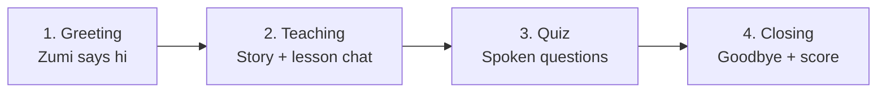
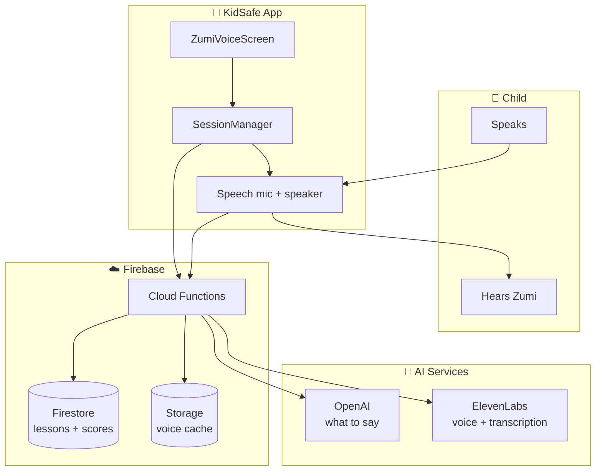

# Zumi AI — Simple Overview

> **Who is this for?** Anyone who wants to understand Zumi without reading code.
> Start here. For deep technical details, see [ZUMI_AI_TECH_DESIGN.md](./ZUMI_AI_TECH_DESIGN.md).

---

## 1. What is Zumi?

**Zumi is a friendly voice character** inside the KidSafe kids app. A child talks to Zumi like a friend, learns a school topic through conversation, and then answers a short spoken quiz.

Think of it like:

- A **cartoon friend** on the phone (Zumi mascot + speech bubble)
- Who **speaks in Hinglish** (Hindi + English mixed, Roman script)
- Who **teaches without feeling like a classroom** — more like a story + chat
- Who **listens** when the child speaks and **responds** naturally

**Target users:** Primary school children (roughly grades 1–6).

---

## 2. What does the child experience?

Here is one full session from the child's point of view:

```
1. Open Fun tab
      ↓
2. Zumi appears and says hello
      ↓
3. Child talks back (name, mood, etc.)
      ↓
4. Zumi tells a fun story and slowly teaches the topic
      ↓
5. Child keeps answering Zumi's questions
      ↓
6. Zumi asks quiz questions (spoken)
      ↓
7. Child answers by voice
      ↓
8. Zumi celebrates or encourages
      ↓
9. Session ends — score shown
```

The child **never types**. Everything is **voice in, voice out**.

---

## 3. High-level design (the big picture)

Zumi is split into **three layers**. This is the most important diagram to remember:

```
┌─────────────────────────────────────────────────────────────┐
│  LAYER 1 — PHONE (KidSafe app)                              │
│                                                             │
│  What the child sees:                                       │
│    • Zumi character + animations                            │
│    • Speech bubble (what Zumi said)                         │
│    • Mic button / auto-listening                            │
│                                                             │
│  What runs in the background:                               │
│    • Session flow (greeting → teach → quiz → goodbye)       │
│    • Microphone + speaker                                   │
└──────────────────────────┬──────────────────────────────────┘
                           │  Internet (secure calls)
                           ▼
┌─────────────────────────────────────────────────────────────┐
│  LAYER 2 — FIREBASE (our backend)                           │
│                                                             │
│  • Checks: Is this really a child? Right class? Right topic?│
│  • Loads lesson content from Firestore                      │
│  • Calls AI and speech services                             │
│  • Saves quiz scores (server decides the score)             │
│  • Caches Zumi's voice audio for reuse                      │
└──────────────────────────┬──────────────────────────────────┘
                           │
                           ▼
┌─────────────────────────────────────────────────────────────┐
│  LAYER 3 — EXTERNAL AI SERVICES                             │
│                                                             │
│  • OpenAI     → Zumi's brain (what to say, grade answers)   │
│  • ElevenLabs → Zumi's natural voice (text → speech)        │
│  • ElevenLabs → Transcription when needed (speech → text)   │
│  • Google Speech (on phone) → Fast listening when available   │
└─────────────────────────────────────────────────────────────┘
```

### Why this shape?

| Decision | In simple words |
|---|---|
| **Brain on server** | OpenAI API key never goes on the child's phone — safer |
| **Voice on server** | ElevenLabs key also stays on server |
| **Thin phone app** | Phone mostly plays audio, shows UI, records mic |
| **Scores on server** | Child cannot fake a high quiz score |

---

## 4. The four phases of a session

Every Zumi session follows the same **four phases**:



| Phase | What happens | Who decides what Zumi says? |
|---|---|---|
| **Greeting** | Warm hello, ask child's name/mood | OpenAI (`zumiConverse`) |
| **Teaching** | Fun chat that secretly teaches the topic | OpenAI (`zumiTeach`) — many turns |
| **Quiz** | Zumi asks questions, child answers by voice | Questions from content; grading by OpenAI |
| **Closing** | Wrap-up based on score | OpenAI (`zumiConverse`) |

**Teaching** is the longest part. Zumi can go back and forth many times (up to 16 turns) until the lesson is done.

---

## 5. Teaching phases (inside the lesson)

During teaching, Zumi moves through **6 mini-stages**. The AI decides when to move forward:

```
warmup  →  hook  →  explore  →  explain  →  check  →  ready_for_quiz
  │          │         │            │          │              │
  Hi!     Story    Guess +      Concept    Quick       Quiz
  mood    starts   experiment   + trick    check       time!
```

| Stage | Purpose (simple) |
|---|---|
| **warmup** | Friendly start — 1 short turn |
| **hook** | Exciting story or mystery to grab attention |
| **explore** | Child guesses, tries a small activity |
| **explain** | Concept becomes clear + memory trick |
| **check** | Light "did you get it?" — not a lecture |
| **ready_for_quiz** | Lesson done → quiz begins |

The **lesson content** (story ideas, keywords, memory trick, quiz questions) comes from Firestore — written by the curriculum team, not invented by the app.

---

## 6. Main parts — who does what?

### On the phone

| Part | Job |
|---|---|
| **ZumiHomeScreen** | Opens Fun tab, picks today's assignment, launches session |
| **ZumiVoiceScreen** | Full-screen session UI (character, bubble, mic) |
| **ZumiSessionManager** | **The conductor** — runs greeting → teach → quiz → closing in order |
| **zumiSpeech** | Speaker + microphone (cloud voice, fallback voice, listening) |
| **zumiApi** | Sends requests to Firebase functions |

**ZumiSessionManager** is the heart of the app side. It does not draw UI — it only emits events like "show this text", "start listening", "play celebration".

### On Firebase (server)

| Function | Job |
|---|---|
| **zumiConverse** | Hello and goodbye messages |
| **zumiTeach** | Next teaching line + which animation to show |
| **zumiEvaluateAnswer** | Grade one quiz answer + save score |
| **zumiSpeak** | Turn text into MP3 audio URL |
| **zumiTranscribe** | Turn recorded audio into text |
| **submitQuizAttempt** | Final score submission |
| **resolveVoiceContext** | Security + load child's name, grade, lesson content |

### External services

| Service | Job |
|---|---|
| **OpenAI (gpt-4o-mini)** | Writes Zumi's words, grades quiz answers |
| **ElevenLabs TTS** | Natural voice for Zumi |
| **ElevenLabs STT** | Backup transcription |
| **Google Speech (on device)** | Fast listening when available |

---

## 7. One turn — step by step

A **turn** = Zumi says something, then waits for the child.

Here is what happens in one teaching turn:

```
STEP 1 — Think
  Phone asks server: "What should Zumi say next?"
  Server asks OpenAI with lesson content + chat history
  OpenAI returns: { say, phase, animationHint }

STEP 2 — Show + animate
  Phone shows text in speech bubble
  Phone may play a Lottie animation (books, sparkle, etc.)

STEP 3 — Speak
  Phone asks server: "Turn this text into audio"
  Server calls ElevenLabs → saves MP3 → returns URL
  Phone plays the audio

STEP 4 — Listen
  Phone opens microphone
  Child speaks
  Phone converts speech to text (Google on device, or upload to server)

STEP 5 — Remember
  Phone saves child's words in chat history
  Next turn sends history back so Zumi stays in context
```

**Time the child waits** = mostly Step 1 (AI) + Step 3 (voice generation) + audio playback length.

---

## 8. Where does lesson content come from?

Content lives in **Firestore**, attached to each school topic:

```
curriculum
  └── chapters
        └── topics
              └── voiceStory   ← everything Zumi needs for that topic
```

**voiceStory** includes things like:

- Story hook ("Imagine you found a messy room...")
- Experiment idea
- Concept explanation
- Keywords child should learn
- Memory trick
- Quiz questions + expected answers

**Teachers/curriculum team write this.** OpenAI uses it as **guidance**, not a script to read word-for-word. Zumi still improvises in Hinglish.

---

## 9. Voice: how Zumi speaks and listens

### Speaking (TTS)

```
Preferred:  Text → Firebase zumiSpeak → ElevenLabs → MP3 → play
Fallback:   Text → phone's built-in TTS (robotic but works offline-ish)
```

If cloud voice fails repeatedly, the app **stops trying cloud** for that session and uses phone TTS only — so it doesn't waste time on failed calls.

**Cached audio:** The same sentence is synthesized once and stored. Next time it's instant.

### Listening (STT)

```
Preferred:  Mic → Google Speech on phone (fast, streaming)
Fallback:   Mic → record file → send to Firebase → ElevenLabs transcribe
Manual:     Child taps mic button if auto-listen doesn't work
```

---

## 10. Quiz and scoring (simple rules)

1. Zumi asks a question **out loud**.
2. Child answers **out loud**.
3. Answer is converted to **text**.
4. Server sends text + question to **OpenAI** for grading.
5. Server saves result in Firestore (`quizVoiceEvals`).
6. Zumi speaks **feedback** (praise or gentle correction).
7. At the end, **submitQuizAttempt** reads server records and computes final score.

**Scoring:**

| Answer quality | Points per question |
|---|---|
| Correct | 25 |
| Partial | 12 |
| Wrong / no answer | 0 |

**Pass threshold:** typically 60% (configured in submit flow).

**Important:** The phone does **not** decide the final score alone. The server does.

---

## 11. Security (plain English)

- Only **logged-in children** can use Zumi.
- A child can only play assignments for **their own class**.
- API keys for OpenAI and ElevenLabs **never** ship in the app.
- Quiz grades are **written by the server**, not trusted from the phone.
- Child's **first name** may be sent to OpenAI to personalize chat (privacy note for production).

---

## 12. What happens when something breaks?

Zumi is built so **the child is never stuck**:

| Problem | What happens |
|---|---|
| OpenAI slow or down | Zumi says a safe canned line and moves on |
| Cloud voice fails | Phone uses built-in TTS |
| Mic permission denied | Tap-to-talk button shown |
| Nothing heard | Child can try again or skip |
| Transcription fails | Treated as empty answer |
| Child leaves screen | Session stops cleanly (no ghost audio) |

---

## 13. Simple architecture diagram



---

## 14. API cheat sheet (minimal)

You don't need to memorize these — just know **what each one is for**:

| API name | One-line purpose |
|---|---|
| `zumiConverse` | Hello / goodbye chat line |
| `zumiTeach` | Next lesson line + animation hint |
| `zumiEvaluateAnswer` | Grade one quiz answer |
| `zumiSpeak` | Text → audio URL |
| `zumiTranscribe` | Audio → text |
| `submitQuizAttempt` | Submit final quiz result |

**Every call needs:** `assignmentId` (which homework/topic session this is).

---

## 15. File map (where to look in code)

| What | Where |
|---|---|
| Session flow (greeting → quiz) | `apps/kids/src/services/zumi/zumiSessionManager.ts` |
| Mic + speaker | `apps/kids/src/services/zumi/zumiSpeech.ts` |
| API calls from app | `apps/kids/src/services/zumi/zumiApi.ts` |
| Main UI screen | `apps/kids/src/screens/fun/ZumiVoiceScreen.tsx` |
| OpenAI logic | `apps/functions/src/lib/zumiAi.ts` |
| Auth + load lesson | `apps/functions/src/lib/zumiSession.ts` |
| Each Firebase function | `apps/functions/src/callable/zumi*.ts` |

---

## 16. Glossary (easy words)

| Term | Meaning |
|---|---|
| **Session** | One full visit with Zumi (hello → lesson → quiz → bye) |
| **Turn** | Zumi speaks once, then child responds (or skips) |
| **Phase** | Stage inside teaching (hook, explore, etc.) |
| **voiceStory** | Lesson pack stored in Firestore for a topic |
| **TTS** | Text-to-Speech — Zumi talking |
| **STT** | Speech-to-Text — understanding child's voice |
| **Callable** | Firebase function the app calls over HTTPS |
| **Fallback** | Backup plan when the main path fails |
| **Hinglish** | Hindi + English mixed, written in Roman letters |

---

## 17. Read next

| Document | When to read it |
|---|---|
| **[ZUMI_AI_TECH_DESIGN.md](./ZUMI_AI_TECH_DESIGN.md)** | Diagrams for every pipeline, all API input/output types |
| **[ZUMI_AI_TECHNICAL_WALKTHROUGH.md](./ZUMI_AI_TECHNICAL_WALKTHROUGH.md)** | Long-form engineering walkthrough with decisions and runbook |

---

## 18. One-paragraph summary

**Zumi** is a voice tutor for young children: the app runs a scripted **session flow** (hello, teach, quiz, goodbye), the **phone** handles mic, speaker, and UI, **Firebase** checks permissions and loads lesson content from Firestore, **OpenAI** decides what Zumi says and whether quiz answers are correct, and **ElevenLabs** (with phone fallbacks) handles natural voice and transcription. The child always experiences a single continuous conversation; all the complexity stays behind the server.
