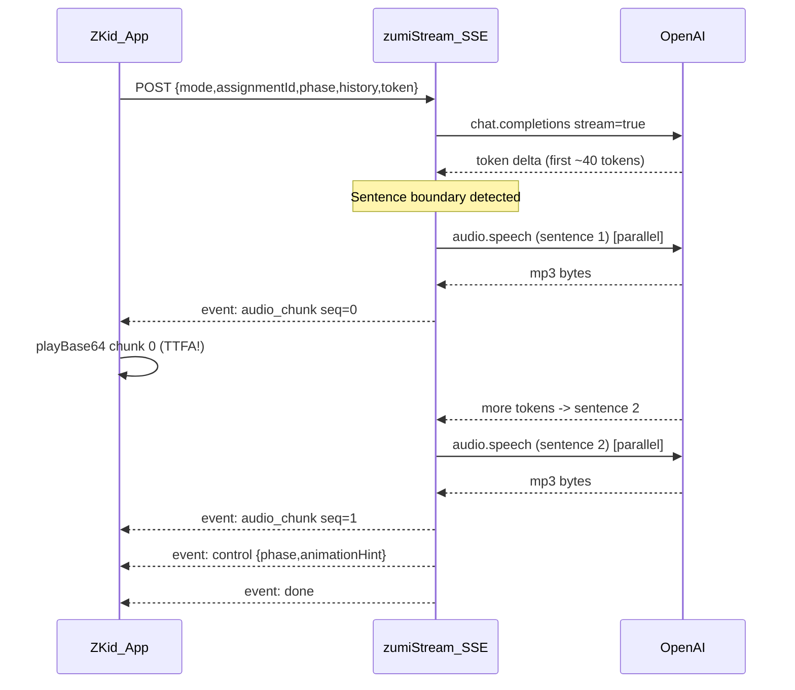

# Zumi AI — Complete Technical Walkthrough

> **Audience**: engineers, technical contributors, and anyone reviewing the architecture.
> This document covers every layer of the Zumi voice system: product intent, data model,
> server-side AI/speech functions, client-side state machine, UI components, performance
> instrumentation, and known operational decisions.

---

## Table of Contents

1. [What Zumi Is](#1-what-zumi-is)
2. [High-Level Architecture](#2-high-level-architecture)
3. [Data Model & Content Structure](#3-data-model--content-structure)
4. [Server-Side Functions](#4-server-side-functions)
   - 4.1 [Authorization & Context Resolution](#41-authorization--context-resolution)
   - 4.2 [zumiConverse — Bookend Chat Turns](#42-zumiconverse--bookend-chat-turns)
   - 4.3 [zumiTeach — Adaptive Stealth Teaching](#43-zumiteach--adaptive-stealth-teaching)
   - 4.4 [zumiEvaluateAnswer — Server-Authoritative Grading](#44-zumievaluateanswer--server-authoritative-grading)
   - 4.5 [zumiSpeak — ElevenLabs TTS Proxy](#45-zumispeak--elevenlabs-tts-proxy)
   - 4.6 [zumiTranscribe — ElevenLabs STT Proxy](#46-zumitranscribe--elevenlabs-stt-proxy)
5. [AI Layer (OpenAI)](#5-ai-layer-openai)
   - 5.1 [Model Choice](#51-model-choice)
   - 5.2 [converse()](#52-converse)
   - 5.3 [teachTurn()](#53-teachturn)
   - 5.4 [evaluateAnswer()](#54-evaluateanswer)
6. [Speech Layer (ElevenLabs)](#6-speech-layer-elevenlabs)
   - 6.1 [TTS — synthesize()](#61-tts--synthesize)
   - 6.2 [STT — transcribe()](#62-stt--transcribe)
7. [Client-Side Services](#7-client-side-services)
   - 7.1 [zumiApi.ts — Thin Cloud-Function Wrappers](#71-zumiapts--thin-cloud-function-wrappers)
   - 7.2 [zumiSpeech.ts — Full Speech I/O Stack](#72-zumispeechts--full-speech-io-stack)
   - 7.3 [zumiSessionManager.ts — The State Machine](#73-zumisessionmanagerts--the-state-machine)
8. [UI Layer](#8-ui-layer)
   - 8.1 [ZumiHomeScreen](#81-zumihomescreen)
   - 8.2 [ZumiVoiceScreen](#82-zumivoicescreen)
   - 8.3 [ZumiCharacter](#83-zumicharacter)
   - 8.4 [ZumiPlayground](#84-zumiplayground)
   - 8.5 [ZumiCue — Lottie / Rive Animations](#85-zumicue--lottie--rive-animations)
9. [Security Design](#9-security-design)
10. [Performance Instrumentation](#10-performance-instrumentation)
    - 10.1 [zumiPerf.ts — The Timing Layer](#101-zumiperfts--the-timing-layer)
    - 10.2 [Measured Latency Breakdown (Real Session)](#102-measured-latency-breakdown-real-session)
    - 10.3 [Root-Cause Analysis: Cloud TTS Failures](#103-root-cause-analysis-cloud-tts-failures)
11. [Optimizations Applied](#11-optimizations-applied)
12. [Known Limitations & TODOs](#12-known-limitations--todos)
13. [Operational Runbook](#13-operational-runbook)
14. [Glossary](#14-glossary)

---

## 1. What Zumi Is

Zumi is a voice-first AI tutoring companion for primary-school children (grades 1–6) built
into the KidSafe app. It uses a conversational, Hinglish-speaking character to teach NCERT
curriculum topics through **stealth teaching** — chatting like a friend until the child
has naturally absorbed the concept, then running a short spoken quiz.

**Design principles:**
- **No keyboard required.** The whole session is voice-in / voice-out.
- **Never let a child get stuck.** Every network/AI/audio step degrades gracefully to a
  canned fallback. If the cloud voice fails, on-device TTS fires. If transcription fails,
  the child can skip. If AI fails, the session advances with a scripted line.
- **Server-authoritative scoring.** Verdicts and scores are computed and persisted
  server-side so the client cannot inflate them.
- **API keys never leave the server.** OpenAI and ElevenLabs keys are Firebase secrets
  injected at runtime into Cloud Functions; the child app never sees them.

---

## 2. High-Level Architecture

```
┌─────────────────────────────────────────────────────┐
│                 Android Device (child)               │
│                                                     │
│  ZumiHomeScreen                                     │
│      │  (auto-launches on today's assignment)       │
│      ▼                                              │
│  ZumiVoiceScreen  ──→  ZumiSessionManager           │
│      │ (thin view)        │  (state machine)        │
│      │                    │                         │
│      │              ┌─────┴──────────────┐          │
│      │              │  zumiApi.ts        │          │
│      │              │  (callFn wrappers) │          │
│      │              └─────┬──────────────┘          │
│      │                    │  Firebase HTTPS callable │
│      │              ┌─────┴──────────────┐          │
│      │              │  zumiSpeech.ts     │          │
│      │              │  TTS / STT / mic   │          │
│      │              └────────────────────┘          │
└─────────────────────────────────────────────────────┘
                       │ HTTPS (asia-south1)
                       ▼
┌─────────────────────────────────────────────────────┐
│              Firebase Cloud Functions (Gen 2)        │
│                                                     │
│  zumiConverse      ─→  zumiAi.converse()  ─→  OpenAI│
│  zumiTeach         ─→  zumiAi.teachTurn() ─→  OpenAI│
│  zumiEvaluateAnswer─→  zumiAi.evaluate()  ─→  OpenAI│
│                                                     │
│  zumiSpeak         ─→  ElevenLabs TTS               │
│                        + Firebase Storage cache     │
│  zumiTranscribe    ─→  ElevenLabs Scribe STT        │
│                                                     │
│  zumiSession.ts    ─→  Firestore (auth + content)   │
└─────────────────────────────────────────────────────┘
                       │
                       ▼
┌─────────────────────────────────────────────────────┐
│  External APIs                                      │
│  OpenAI  gpt-4o-mini   (AI text generation)         │
│  ElevenLabs Flash v2.5 (TTS — cloud voice)          │
│  ElevenLabs Scribe v2  (STT — transcription)        │
└─────────────────────────────────────────────────────┘
```

**Key architectural choice — thin client, fat server:**
The React Native app is a pure view. All AI prompts, API keys, scoring logic, and
authorization live in Cloud Functions. This keeps the APK dependency-free of keys,
allows prompt iteration without app updates, and ensures the server is the source of
truth for scores.

---

## 3. Data Model & Content Structure

### 3.1 Firestore Collections (Zumi-relevant)

| Collection | Document | Purpose |
|---|---|---|
| `studyAssignments/{id}` | Assignment | Links a class to a topic; carries `status`, `classId`, `curriculumId`, `chapterId`, `topicId`, `topicName`. |
| `curriculum/{cid}/chapters/{chid}/topics/{tid}` | Topic | Contains `voiceStory` (see below), `grade`, topic metadata. |
| `children/{uid}` | Child profile | `classId` used for authorization. |
| `users/{uid}` | User | `displayName` for personalizing Zumi's script. |
| `quizVoiceEvals/{assignmentId}_{uid}` | Voice eval | Per-question verdicts written server-side by `zumiEvaluateAnswer`. Never modified client-side. |

### 3.2 `voiceStory` Shape

Each topic's Firestore document carries a `voiceStory` sub-object that drives the
entire Zumi session. The fields are authored by the curriculum team:

```typescript
interface VoiceStory {
  // Teaching material fed to the AI director
  hookContext: string;            // Real-life mystery to open with
  predictContext: string;         // Prompt to make child guess
  experimentInstruction: string;  // Hands-on activity instruction
  conceptRevealScript: string;    // Plain-language concept reveal
  ncertDefinition: string;        // Exam-accurate NCERT phrasing
  keyPoints: string[];            // Bullet points child must hear
  keywords: string[];             // Terms to slip in naturally
  memoryTrick: string;            // Mnemonic / memory aid

  // Discovery stage hooks (legacy fields, kept for backwards compat)
  discoveryLeadQuestion: string;
  discoveryCelebration: string;

  // Closing lines (score-conditional)
  closingHighScoreContext: string; // >= 75%
  closingMidScoreContext: string;  // 50–74%
  closingLowScoreContext: string;  // < 50%

  parentTryTonight: string;        // Homework prompt surfaced to parent

  // Quiz
  voiceQuiz: VoiceQuizQuestion[];
}

interface VoiceQuizQuestion {
  questionId: string;
  questionText: string;
  questionAudioUrl?: string;      // Pre-synthesized audio (optional)
  expectedConcepts: string[];     // Keywords the evaluator checks
  correctIndicator: string;       // Free-text description of a correct answer
  responseCorrect: string;        // Scripted correct-answer line
  responsePartial?: string;       // Scripted partial-answer line
  responseIncorrect: string;      // Scripted wrong-answer line
}
```

---

## 4. Server-Side Functions

All Zumi functions deploy to `asia-south1` (Mumbai) and are exported from
`apps/functions/src/index.ts`. They all require Firebase Auth (`requireAuth`) and a
`child` role check (`requireRole`).

### 4.1 Authorization & Context Resolution

**File:** `apps/functions/src/lib/zumiSession.ts`

`resolveVoiceContext(uid, assignmentId)` is called at the top of every Zumi callable.
It performs a multi-step authorization and data-loading chain:

```
1. Load studyAssignments/{assignmentId}
   → Throws 404 if missing, 412 if not 'active'

2. Load children/{uid}
   → Compare child's classId against assignment's classId
   → Throws 403 if mismatch ("You can only play Zumi for your own class.")

3. Load curriculum/.../topics/{topicId}
   → Throws 404 if missing
   → Throws 412 if voiceStory or voiceQuiz is absent

4. Best-effort child name resolution:
   users/{uid}.displayName  →  if blank, Firebase Auth displayName  →  else ''
```

Returns a `VoiceContext` struct used by all three AI callables so they don't need
their own Firestore reads.

**Design decision:** centralizing auth here prevents the two AI callables from drifting
apart on security checks (a common drift bug in microservice patterns).

### 4.2 `zumiConverse` — Bookend Chat Turns

**File:** `apps/functions/src/callable/zumiConverse.ts`
**Config:** `region: asia-south1, minInstances: 1`

Handles the two non-lesson stages: `greeting` (session opener) and `closing` (session
wrap-up after the quiz). `minInstances: 1` keeps one warm instance alive so the first
words the child hears don't suffer a cold-start delay.

**Request:**
```typescript
{ assignmentId: string; stage: 'greeting' | 'closing'; history?: ChatTurn[]; scorePercent?: number }
```

**Response:**
```typescript
{ reply: string }
```

History is trimmed to the last 8 turns and each turn capped at 500 chars before
forwarding to the AI layer, preventing prompt injection through a runaway history.

On any AI failure the function still returns `200` with a safe canned Hinglish line
so the session never blocks on a network hiccup.

### 4.3 `zumiTeach` — Adaptive Stealth Teaching

**File:** `apps/functions/src/callable/zumiTeach.ts`
**Config:** `region: asia-south1, minInstances: 1`

The heart of the system. Each call represents one turn of the adaptive teaching
conversation. The function:

1. Calls `resolveVoiceContext` to get the topic's full `voiceStory` teaching material.
2. Builds a rich system prompt for the AI director — the material is treated as
   **knowledge/goals**, never a verbatim script.
3. Sends the running `history` (last 20 turns, each capped at 500 chars) and the
   current `phase`.
4. Returns a structured JSON response `{ say, phase, animationHint }`.

**Phase progression:**

```
warmup → hook → explore → explain → check → ready_for_quiz
```

The AI director decides when to advance each phase based on the child's responses.
The client never advances phases on its own; it only reports the phase the server
returned. If the AI fails, the function advances the phase by one automatically
so the session can't loop forever on a single broken phase.

**Request:**
```typescript
{ assignmentId: string; phase: TeachPhase; history?: ChatTurn[] }
```

**Response:**
```typescript
{ say: string; phase: TeachPhase; animationHint: AnimationHint }
```

`AnimationHint` values: `none | experiment | visualize | reveal | celebrate | trap`

### 4.4 `zumiEvaluateAnswer` — Server-Authoritative Grading

**File:** `apps/functions/src/callable/zumiEvaluateAnswer.ts`
**Config:** `region: asia-south1, minInstances: 1`

Grades one spoken quiz answer. This function is the **only** place verdicts are
written to Firestore. The flow:

1. Loads `resolveVoiceContext` to find the quiz question's `expectedConcepts` and
   `correctIndicator`.
2. Calls `zumiAi.evaluateAnswer()` which asks gpt-4o-mini for a JSON verdict
   (`correct | partial | incorrect`) + score + spoken feedback line.
3. **Persists** the verdict to `quizVoiceEvals/{assignmentId}_{uid}` with `merge: true`
   so sibling answers aren't overwritten.
4. Returns the verdict + an adaptive, answer-aware feedback line Zumi speaks back.

`submitQuizAttempt` (called at session end) reads ONLY these server-written verdicts
to compute the authoritative score — the client can never inflate it.

**Previous config gap (now fixed):** `zumiEvaluateAnswer` originally lacked
`minInstances: 1`. The first quiz question always hit a cold start (~2–5s extra).
Fixed by adding `minInstances: 1` matching its siblings.

### 4.5 `zumiSpeak` — ElevenLabs TTS Proxy

**File:** `apps/functions/src/callable/zumiSpeak.ts`
**Config:** `region: asia-south1, minInstances: 1`

Converts a text string to a playable MP3 URL. Uses a Firebase Storage cache keyed by
`sha256(voiceId + model + outputFormat + speed + text)` so any repeated line
(and every static quiz question) is synthesized **at most once** — ElevenLabs is
only called on a cache miss.

**Cache strategy:**
```
1. Probe Storage metadata for {hash}.mp3 (one round trip, throws on 404 = miss)
2. Cache hit with token → return download URL immediately
3. Cache hit without token → mint a new token, setMetadata, return URL
4. Miss → call ElevenLabs synthesize() → save to Storage → return URL
```

The returned URL is a Firebase Storage token URL (`?alt=media&token=...`) which
`react-native-sound` can stream directly without any Storage security rule.

**Audio spec:** `mp3_44100_64` (64 kbps, 44.1 kHz) — good quality, fast to stream.
**Voice model:** `eleven_flash_v2_5` (~75 ms server latency, 32 languages incl. Hindi).

### 4.6 `zumiTranscribe` — ElevenLabs STT Proxy

**File:** `apps/functions/src/callable/zumiTranscribe.ts`
**Config:** `region: asia-south1, minInstances: 1`

Transcribes recorded audio to text. Supports two input modes:

**Fast path (base64 inline):**
```
Client reads the local recording file → encodes to base64 → sends in the request body
→ Function decodes → calls ElevenLabs Scribe → returns transcript
Saves: ~6–7s Firebase Storage upload + download round trip
```

**Legacy path (Storage):**
```
Client uploads to zumi_stt/{uid}/{filename} → calls function with storagePath
→ Function downloads from Storage → calls Scribe → deletes temp file → returns transcript
```

The fast base64 path was added specifically to eliminate the upload latency that was
adding 6–7 seconds to every transcription. The legacy path remains as a fallback.

**Model:** `scribe_v2` (ElevenLabs' highest-accuracy transcription model).
**Max audio:** 5 MB.

---

## 5. AI Layer (OpenAI)

**File:** `apps/functions/src/lib/zumiAi.ts`

This is the only file that uses the `OPENAI_API_KEY` secret. The key is loaded lazily
via `openaiApiKey.value()` into a singleton `OpenAI` client. Never instantiated until
first call (so cold-start cost is shared across turns).

### 5.1 Model Choice

| Parameter | Value | Reason |
|---|---|---|
| Model | `gpt-4o-mini` | Fast, cheap, strong Hinglish support, JSON structured output |
| Timeout | 12 000 ms | Prevents a hung request from blocking the session |
| Max retries | 1 | One retry on transient error; fast fail otherwise |

### 5.2 `converse()`

Used by `zumiConverse` callable. Produces a 2–3 sentence Hinglish reply for greeting
and closing stages. System prompt specifies: Hinglish (Roman script), max 2–3 short
simple sentences, warm and playful, no emoji or markdown.

`max_tokens: 200`, `temperature: 0.85` (slightly creative but not erratic).

### 5.3 `teachTurn()`

Used by `zumiTeach` callable. The most complex prompt in the system.

The system prompt (~1 400 tokens) tells the model:
- **Identity:** Zumi is the child's energetic AI friend, not a teacher.
- **Tone:** Suspense, mystery, "guess karo!", challenges, funny twists.
- **Goal:** Make the child discover the concept themselves through conversation.
  Never lecture. Always react to what the child ACTUALLY said.
- **Creative freedom:** The teaching material is KNOWLEDGE/GOALS — the model builds
  its own examples, stories, and jokes.
- **Phase discipline:** Only advance phase when the current phase's goal is met.
  `ready_for_quiz` only when concept is understood AND memory trick was delivered.
- **Animation guidance:** Which `animationHint` to emit with each line.

**Structured output:** Uses `json_schema` response format with strict mode:
```json
{ "say": "...", "phase": "hook", "animationHint": "experiment" }
```
This guarantees parseable JSON without a secondary extraction pass (except as a
belt-and-suspenders fallback in `parseTeach()`).

`max_tokens: 220`, `temperature: 0.9` (more creative for varied storytelling).

### 5.4 `evaluateAnswer()`

Grades one spoken answer. Short-circuits to `incorrect` + canned feedback if the
transcript is empty (no audio captured).

For non-empty transcripts: sends the question, expected concepts, correct indicator,
and the child's exact words to the model. Instructs leniency on Hinglish/spelling —
grade the IDEA, not the words.

Returns `{ result, reasoning, feedback }` via `json_schema` structured output.

Falls back to **keyword matching** if the model returns non-JSON (never crashes the
quiz on a malformed reply).

`max_tokens: 120`, `temperature: 0.1` (deterministic grading).

**Score mapping:**
- `correct` → 25 points
- `partial` → 12 points
- `incorrect` → 0 points

---

## 6. Speech Layer (ElevenLabs)

**File:** `apps/functions/src/lib/elevenLabs.ts`

Singleton HTTP wrappers around the ElevenLabs v1 API. The `ELEVENLABS_API_KEY` secret
is the only access point.

### 6.1 TTS — `synthesize()`

```typescript
synthesize(text: string): Promise<Buffer>
```

- Trims text to `MAX_TTS_CHARS = 800` (prevents runaway cost).
- Builds a JSON body with voice settings: `stability: 0.6, similarity_boost: 0.85,
  style: 0.0, use_speaker_boost: true, speed: 0.88`.
- The 0.88 speed (slightly slower than natural) helps children follow each word.
- Retries once on failure (idempotent — same audio is produced for the same input).
- 15 second timeout per attempt.

**Voice configuration (env-tunable):**
| Param | Default | Override env var |
|---|---|---|
| Voice ID | `EXAVITQu4vr4xnSDxMaL` (Sarah — free-tier premade) | `ELEVENLABS_VOICE_ID` |
| Speed | `0.88` | `ELEVENLABS_VOICE_SPEED` |

**Critical note:** ElevenLabs Voice Library voices require a **paid plan**. The previous
default (`RxWGQqmx8sKzknGaIdmb`) was a library voice that returned `402 paid_plan_required`
on the free tier — silently forcing every line onto the slow on-device fallback. The
default was changed to Sarah (`EXAVITQu4vr4xnSDxMaL`), a premade voice available on
the free tier.

### 6.2 STT — `transcribe()`

```typescript
transcribe(audio: Buffer, mimeType?: string): Promise<string>
```

Builds a `multipart/form-data` body manually (avoids DOM `FormData` / `Blob` type
complexity in the Node ES2022 environment). Sends to `POST /v1/speech-to-text` with
`scribe_v2` model. 20 second timeout (audio uploads take longer than TTS).

---

## 7. Client-Side Services

### 7.1 `zumiApi.ts` — Thin Cloud-Function Wrappers

**File:** `apps/kids/src/services/zumi/zumiApi.ts`

Six typed wrappers around Firebase `callFn` (the shared HTTPS callable helper):
`zumiConverse`, `zumiTeach`, `zumiEvaluateAnswer`, `zumiSpeak`, `zumiTranscribe`,
`submitVoiceQuiz`.

Each wrapper is instrumented with `timed()` from `zumiPerf.ts` so Metro shows the
exact round-trip time for every cloud function call, e.g.:

```
[ZumiPerf] net zumiTeach[warmup] — 2747ms (256 chars -> hook)
[ZumiPerf] net zumiSpeak — 312ms (48 chars)
```

### 7.2 `zumiSpeech.ts` — Full Speech I/O Stack

**File:** `apps/kids/src/services/zumi/zumiSpeech.ts`

The most complex client file. Manages three independent subsystems:

#### TTS (Text-to-Speech)

**Primary path — ElevenLabs cloud voice:**
```
speak(text)
  → resolveTtsUrl(text)
      → ttsUrlCache hit? return immediately
      → circuit breaker tripped? return '' (skip cloud)
      → ttsInflight hit? reuse in-flight Promise
      → zumiSpeak({ text }) [cloud function call]
          → returns playable Storage URL
  → playUrl(url)
      → react-native-sound loads MP3
      → records load latency (time-to-first-audio)
      → plays to completion
      → records playback duration
```

**Fallback — on-device TTS:**
```
speak(text)  [cloud failed or circuit breaker open]
  → speakOnDevice(text)
      → splitIntoSentences(text)  [sentence chunking for natural prosody]
      → speakChunk(chunk) × N    [utterance-ID matched so chunks don't cross]
      → delay(150ms) between sentences
```

**Circuit breaker (`cloudTtsFailStreak / cloudTtsDisabled`):**
After **2 consecutive** `zumiSpeak` failures the breaker trips and the session goes
straight to on-device TTS for its remaining duration — eliminating wasted ~1–2 s
cloud round trips on every line when the cloud voice is clearly broken (quota
exhausted, bad key, etc.). Reset at the start of each new session via
`speech.resetCloudTts()`.

**Prefetch (`prefetch(text)`):**
The session manager fires `speech.prefetch(nextLine)` while the current line is still
playing. If the cloud voice is available, the next line's MP3 is synthesized and
cached in Storage before it's needed — making the `resolveTtsUrl` call instant.
Prefetch is a no-op when the circuit breaker is open.

**TTS URL cache (`ttsUrlCache`):**
Session-scoped `Map<text, url>`. Means repeated lines (e.g. quiz feedback lines
for "correct!") synthesize once and play instantly thereafter. Also deduplicates
concurrent prefetch + speak calls via `ttsInflight`.

#### STT (Speech-to-Text) — Hands-free path

**Primary — `@react-native-voice/voice` (Google on-device Speech API):**
```
listen()
  → Voice.start('hi-IN')
  → Streaming partial results update bestTranscript
  → onSpeechResults (final) → deliver immediately
  → onSpeechEnd → grace 300ms → deliver
  → 10s timeout → deliver best result so far
```
This path avoids any upload latency. Google's engine handles Hinglish (mixed
Hindi + English) when started with locale `hi-IN`.

**Fallback — record to file + ElevenLabs Scribe:**
```
listen()  [Voice unavailable]
  → listenRecorder()
      → startRecorder() [AudioRecorderPlayer, AAC/MP4, 16 kHz mono]
      → dB metering → silence detection (1.8s silence after speech → stop)
      → 5s max record time
  → uploadAndTranscribe(path)
      → fetch(localUri) → blob → base64
      → zumiTranscribe({ audioBase64, mimeType }) [cloud function]
          → ElevenLabs Scribe v2
```

**Hands-free → tap-to-talk degradation:**
If `listen()` returns `{ status: 'no-permission' | 'error' }`, the session sets
`handsFree = false` and every subsequent `hear()` shows the manual tap-to-talk
mic button instead. This persists for the rest of the session.

#### TTS engine configuration (`configureSpeech`)

Called once at session start (safe to call again; guarded by `configured` flag).

1. `Sound.setCategory('Playback')` — sets audio category on iOS.
2. `Tts.getInitStatus()` — confirms a working TTS engine exists. On Android OEM builds
   without an engine this throws; `ttsReady = false` then skips TTS entirely and uses a
   text-dwell timer instead.
3. `selectBestVoice()` — enumerates installed voices, scores them (en-IN > en-* > hi-*)
   with bonuses for on-device (no network) and higher quality. Applies the best one.
4. `Tts.setDefaultRate(0.9, true)` + `Tts.setDefaultPitch(1.05)`.

### 7.3 `zumiSessionManager.ts` — The State Machine

**File:** `apps/kids/src/services/zumi/zumiSessionManager.ts`

The framework-agnostic engine driving the 10-stage session. It owns **no React state**
— it only emits `ZumiEvent` objects. The screen subscribes and re-renders.

#### Session Stages

```
1.  GREETING    → AI greets child (zumiConverse[greeting]) → hear()
2–8. TEACHING   → Adaptive loop: zumiTeach() → say() → hear() [up to 16 turns]
9.  QUIZ        → Per-question: say question → hear → evaluate → say feedback
10. CLOSING     → AI wrap-up (zumiConverse[closing]) → submitVoiceQuiz()
```

#### Event Types Emitted

| Event | Payload | Screen Action |
|---|---|---|
| `state` | `SessionState` | Drive top-level UI modes |
| `avatar` | `AvatarState` | Animate the character |
| `bubble` | `text: string` | Show speech bubble |
| `cue` | `ZumiCuePayload \| null` | Trigger Lottie/Rive animation |
| `listening` | `on, mode, speaking` | Show mic button / waveform |
| `transcribing` | `on: boolean` | Show spinner |
| `prompt` | `waiting, skippable, hint` | Show tap-to-talk button |
| `quiz` | `current, total, score` | Render progress bar |
| `done` | `percentage, passed, score, maxScore` | Show result overlay |
| `error` | `message: string` | Show error overlay |

#### AvatarState

```
idle | talking | listening | thinking | celebrating | encouraging | story_mode
```

Each state drives distinct animations in `ZumiCharacter` and affects which
mic UI is shown.

#### Teaching Loop (detail)

```typescript
for (let turnIdx = 0; turnIdx < MAX_TEACH_TURNS /* 16 */; turnIdx++) {
  const t = turn(`teach turn #${turnIdx} [${phase}]`); // perf bracket
  const result = await this.teach(phase);               // → zumiTeach
  phase = result.phase;
  this.applyAnimationHint(result.animationHint);        // emit cue
  await this.say(result.say);                           // TTS
  t.end('AI->spoken');                                  // log total wait

  if (phase === 'ready_for_quiz') break;

  const said = await this.hear();                       // STT
  this.history.push({ role: 'user', content: said || '(bachche ne kuch nahi kaha)' });
}
```

`MAX_TEACH_TURNS = 16` ensures a session always reaches the quiz even if the AI
director never emits `ready_for_quiz`.

#### Animation Hint → Lottie Clip Mapping

| AnimationHint | Lottie Clip | Avatar State |
|---|---|---|
| `visualize` | `books` (items sorting) | `story_mode` |
| `experiment` | `chaos` (flying items) | `story_mode` |
| `reveal` | `sparkle` (concept reveal) | `story_mode` |
| `trap` | `chaos` | `story_mode` |
| `celebrate` | none (confetti overlay) | `celebrating` |
| `none` | none | unchanged |

#### Resilience Patterns

- **AbortError guard:** Every `await` in the session loop is followed by `this.guard()`
  which throws `AbortError` if `abort()` was called. This ensures unmounting the screen
  unwinds the loop cleanly without `setState-after-unmount` warnings.
- **Idle auto-skip:** If a child doesn't respond in 60 s the turn auto-skips (`''` transcript).
- **Max record timer:** Recording auto-stops after 15 s so a forgotten tap can't record forever.
- **AI failures** → safe canned Hinglish line + phase advance.
- **TTS failures** → on-device TTS fallback + circuit breaker.
- **STT failures** → `''` transcript → child re-prompted or can skip.

#### Session Start Optimizations

```typescript
// Parallel: TTS engine config + mic permission (saves ~300ms)
const speechReady = speech.configureSpeech();
this.handsFree = await speech.ensureMicPermission();
await speechReady;

// First quiz question audio pre-warmed at end of teaching loop
speech.prefetch(firstQuestion.questionText);
```

---

## 8. UI Layer

### 8.1 `ZumiHomeScreen`

**File:** `apps/kids/src/screens/fun/ZumiHomeScreen.tsx`

The Fun tab landing screen for grades ≤ 6. Auto-launches the earliest-due
`studyAssignment` of the day into `ZumiVoiceScreen` without showing a list.

States:
- `resolving` — Zumi idle character shown while assignments load.
- `none` — No assignments today. Friendly idle message.
- `returned` — Child returned after a session. Shows "Phir se!" button.

The screen does **not** pre-read the topic's `voiceStory` before navigating. The
extra Firestore hop was causing silent failures on cold starts.

### 8.2 `ZumiVoiceScreen`

**File:** `apps/kids/src/screens/fun/ZumiVoiceScreen.tsx`

A thin view layer over `ZumiSessionManager`. Responsibilities:
- Load topic via `useTopicContent` hook.
- Construct and start the manager exactly once (ref-guarded).
- Map every `ZumiEvent` to local React state.
- Render the mascot, speech bubble, mic controls, quiz progress bar, result overlay.

**Teardown is guarded by `closedRef`** — the same `closeSession()` function handles
all of: X button, hardware back, navigation blur, app backgrounded, component unmount.
Each trigger calls `manager.abort()` exactly once.

**Scroll behavior:** The speech bubble ScrollView resets to `y: 0` on every new
bubble text so long lines always start at the top.

### 8.3 `ZumiCharacter`

**File:** `apps/kids/src/screens/fun/components/ZumiCharacter.tsx`

The animated cartoon mascot. Uses 3 PNG frames (`zumi_idle`, `zumi_talk`, `zumi_celebrate`)
and Animated API (native driver) for motion:

| State | Animation | Art Frame |
|---|---|---|
| `talking` | Lip-sync: mouth toggles every 170 ms | `zumi_idle` ↔ `zumi_talk` |
| `listening` | Pulsing scale loop (1.0 → 1.05) + ListeningRing | `zumi_idle` |
| `thinking` | Head tilt ±7° wobble + ThinkingDots | `zumi_idle` |
| `celebrating` | Jump loop (Y: 0 → -20 → 0, bounce ease) | `zumi_celebrate` |
| other | Gentle breathe bob (Y: 0 → -6 → 0) | `zumi_idle` |

All transforms are on the native driver. Only mouth toggle requires JS-thread
`setInterval` (but only changes a source prop, not a layout prop).

### 8.4 `ZumiPlayground`

**File:** `apps/kids/src/screens/fun/components/ZumiPlayground.tsx`

The interactive stage zone containing the mascot. Built on
`react-native-gesture-handler` + `react-native-reanimated` (worklets run on the UI
thread, decoupled from JS audio/network work).

Features:
- **Tap-to-spawn sparkles:** Tap anywhere → emoji particle spawns at finger position
  → floats up and fades in 1.1 s. Capped at 15 live particles.
- **Character bounce:** `withSequence(withSpring(1.12), withSpring(1))` on tap.
- **Draggable toys:** 4 emoji toys (🪐 🚀 🦋 🐠) at fixed positions. Pan gesture
  moves them; on release they spring back home (`damping: 9, stiffness: 120`).

### 8.5 `ZumiCue` — Lottie / Rive Animations

**File:** `apps/kids/src/screens/fun/components/ZumiCue.tsx`

Two components:

**`ZumiSceneCue`** — drawn behind the mascot. Resolves a cue payload to an animation:
1. If `cue.clip` is set (from adaptive teaching loop) → use that bundled Lottie.
2. If `kind === 'rive'` → try `BUNDLED_RIVE` lookup → Rive player → fallback Lottie.
3. If `remoteUrl` → remote Lottie URL from Storage.
4. Otherwise → stage-number-based bundled Lottie.

**`ZumiCelebration`** — confetti Lottie drawn **in front** of everything while
`avatar === 'celebrating'`. `loop={false}` so it plays once and stops.

**Bundled Lottie clips:**
| Key | File | Meaning |
|---|---|---|
| `chaos` | `chaos.json` | Flying items (experiment / trap) |
| `books` | `books.json` | Books sorting onto shelves (classify) |
| `sparkle` | `sparkle.json` | Concept reveal |
| `flashcard` | `flashcard.json` | Exam mode |
| `confetti` | `confetti.json` | Celebration |

**Rive readiness:** The `BUNDLED_RIVE` map is empty (`{}`) pending art delivery.
When a designer delivers `.riv` files to `android/app/src/main/res/raw/`, adding the
entry to `BUNDLED_RIVE` is the only code change needed to activate them.

---

## 9. Security Design

| Concern | Mechanism |
|---|---|
| API keys (OpenAI, ElevenLabs) | Firebase Secrets (`defineSecret`), never in client bundle |
| Child can only play their own assignments | `resolveVoiceContext` cross-checks `children/{uid}.classId === assignment.classId` |
| Score inflation | `quizVoiceEvals` written server-side only; `submitQuizAttempt` reads server verdicts |
| Audio path traversal | `zumiTranscribe` rejects any `storagePath` not under `zumi_stt/{callerUid}/` |
| Prompt injection | History entries capped at 500 chars; total history window bounded (8 / 20 turns) |
| TTS cost cap | `MAX_TTS_CHARS = 800` hard-truncates any text before ElevenLabs |
| Auth on every callable | `requireAuth(request)` + `requireRole(uid, 'child')` at top of each handler |
| Cloud Run invoker | `invoker: 'public'` opens network door; auth still enforced inside each callable |
| AppCheck | Validation runs; currently non-enforcing (enforcement disabled). Warnings visible in logs. |

---

## 10. Performance Instrumentation

### 10.1 `zumiPerf.ts` — The Timing Layer

**File:** `apps/kids/src/services/zumi/zumiPerf.ts`
*(Added as part of the latency investigation; `__DEV__`-only — zero cost in release builds.)*

```typescript
// Wrap an async step
timed('net zumiTeach[warmup]', () => zumiTeach(input), out => `${out.say.length} chars`);

// Manual span
const stop = mark('  speak.resolveUrl[synth]');
// ...async work...
stop('ok');

// Bracket a full turn
const t = turn('teach turn #0 [warmup]');
await teachStep();
await sayStep();
t.end('AI->spoken');
```

All output is prefixed `[ZumiPerf]`. Filter Metro with `ZumiPerf` to see only timing.

### 10.2 Measured Latency Breakdown (Real Session)

From an actual device session captured in Metro:

```
[ZumiPerf] ▶ greeting [AI->spoken] start
[ZumiPerf] net zumiConverse[greeting] — 7289ms (85 chars)      ← OpenAI (cold-ish)
[ZumiPerf] net zumiSpeak ✗ — 2329ms                            ← CLOUD TTS FAILED
[ZumiPerf]   speak.resolveUrl[synth] — empty -> on-device
[ZumiPerf]   speak.onDevice — 8829ms                           ← slow fallback TTS
[ZumiPerf]  say — 11162ms
[ZumiPerf] ■ greeting [AI->spoken] TOTAL — 18457ms

[ZumiPerf]   hear.listen[voice] — 0ms (unavailable -> recorder fallback)
[ZumiPerf]     stt.readFileBase64 — 286ms (14KB b64)
[ZumiPerf] net zumiTranscribe[base64] — 655ms (0 chars)
[ZumiPerf]   hear.listen[recorder] — 6644ms

[ZumiPerf] ▶ teach turn #0 [warmup] start
[ZumiPerf] net zumiTeach[warmup] — 2747ms (256 chars -> hook)
[ZumiPerf] net zumiSpeak ✗ — 774ms                             ← failing every line
```

**What this reveals:**
- Once cloud TTS works, `zumiTeach` at 2 747 ms becomes the dominant latency.
- STT via the recorder + Scribe path takes ~6.6 s total. Voice API (Google) would
  be near-instant but was unavailable on the test device.
- `zumiConverse[greeting]` at 7 289 ms is unusually slow — likely a partially cold
  Cloud Function or elevated OpenAI latency at session start.

### 10.3 Root-Cause Analysis: Cloud TTS Failures

Direct API testing against the ElevenLabs key revealed two issues:

**Issue 1 — Library voice on free tier (previous default):**
```
HTTP 402 paid_plan_required
"Free users cannot use library voices via the API."
```
Voice `RxWGQqmx8sKzknGaIdmb` is a Voice Library voice requiring a paid ElevenLabs plan.

**Issue 2 — Monthly quota exhausted:**
```
HTTP 402 quota_exceeded
"You have 1 credit remaining, while 23 credits are required."
```
The account's free-tier monthly quota was fully consumed.

**Combined effect:** Every `zumiSpeak` call returned an error → silent fallback to
~9 s on-device TTS → every Zumi turn felt extremely slow to the child.

---

## 11. Optimizations Applied

### Phase 1 — Callable quick wins (no new infra)

| Optimization | File(s) | Why it helps |
|---|---|---|
| **`zumiPerf.ts` timing layer** — `timed`, `mark`, `turn` API | `zumiPerf.ts`, `zumiApi.ts`, `zumiSpeech.ts`, `zumiSessionManager.ts` | Every pipeline stage now logs `[ZumiPerf]` spans; TTFA is measurable per-turn |
| **`minInstances: 1` on `zumiEvaluateAnswer`** | `zumiEvaluateAnswer.ts` | Eliminates 2–5 s cold-start on the first quiz answer (previously missing despite docs claiming it was fixed) |
| **Parallel speech setup** — `Promise.all([configureSpeech(), ensureMicPermission()])` | `zumiSessionManager.ts` | Saves ~300 ms on session start vs sequential awaits |
| **Greeting pre-fetch** — fire `zumiConverse('greeting')` concurrently with speech setup | `zumiSessionManager.ts` | OpenAI is queried while the device configures TTS/mic; greeting TTFA −1–2 s |
| **Fix `resolveTtsUrl` audioBase64 bug** — was reading only `url` which is always `''` | `zumiSpeech.ts` | Quiz `prefetch()` was silently falling back to 9 s on-device TTS; now hits cloud voice |
| **Fast `writeBase64ToFile`** — shared helper for playBase64 + prefetch (single fetch → XHR write) | `zumiSpeech.ts` | Eliminates double data-URI decode in old `playBase64` path; no structural change |
| **Post-transcript delay 800 ms → 150 ms** | `zumiSessionManager.ts` | Saved 650 ms per STT turn; bubble still visible during next AI call |
| **Tighter fallback VAD** — `FALLBACK_MIN_RECORD_MS` 2000→800, `FALLBACK_SILENCE_MS` 1800→900, poll 150→100 ms | `zumiSpeech.ts` | Reduces recorder-path latency by ~1.2 s min-record + ~0.9 s silence floor |
| **Google Voice engine probe** — early `probeVoiceEngine()` at startup | `zumiSpeech.ts` | Surfaces missing Speech APK in Metro before the first `listen()` call |
| **Partial transcript callback** — `onPartialTranscript` in `ListenOptions` | `zumiSpeech.ts`, `zumiSessionManager.ts` | Foundation for speculative server warming; 400 ms debounce in session manager |

**Phase 1 expected TTFA:** ~2.5–4 s → **~1.2–1.8 s** (teach turn, Google Voice path).

---

### Phase 2 — SSE streaming pipeline

The sequential callable architecture cannot hit sub-1 s TTFA: the client always
waits for the full LLM response + full TTS response before hearing a single byte of audio.
Phase 2 adds a streaming endpoint that pipelines these stages.

#### Optimized architecture

```
Before (callable):
  user stops → zumiTeach (wait 1.5–3s LLM) → synthesize (wait 0.5–1.5s TTS) →
  return base64 → write file → Sound.load → first audio    TTFA: ~2.5–4s

After (SSE stream):
  user stops → zumiStream POST → LLM stream starts →
    token 1: sentence buffer → TTS dispatch sentence 1 → audio_chunk SSE
    token N: sentence 2 TTS in parallel               → audio_chunk SSE
  client plays chunk 1 immediately                         TTFA: ~500–800ms
```



| Component | File | Role |
|---|---|---|
| SSE endpoint | `apps/functions/src/http/zumiStream.ts` | `onRequest` — auth via Bearer token, routes to pipeline |
| Streaming pipeline | `apps/functions/src/lib/zumiStreamPipeline.ts` | Sentence buffer, parallel TTS, SSE event emission |
| LLM stream generators | `apps/functions/src/lib/zumiAi.ts` | `converseStream`, `teachTurnStream`, `evaluateStream` (AsyncGenerators) |
| Client SSE consumer | `apps/kids/src/services/zumi/zumiStream.ts` | `fetch` + `ReadableStream` parser; `openZumiStream`, typed wrappers |
| Audio playback queue | `apps/kids/src/services/zumi/zumiAudioQueue.ts` | Plays chunks in seq order as they arrive; begins on chunk 0 |
| Session integration | `apps/kids/src/services/zumi/zumiSessionManager.ts` | `sayStreaming()` + streaming-first with callable fallback |

**Streaming vs callable routing:** Every `converse()`, `teach()`, and `evaluate()` call tries the SSE path first. If the stream fails (network error, cold start, feature flag off), it falls back to the existing callable — the child's session is never blocked.

**Feature flag:** `ZUMI_STREAMING_ENABLED` in `zumiStream.ts`. Default `true`. Set to `false` for emulator debugging.

**Control JSON format (teach/evaluate):** Streaming models cannot use `response_format: json_schema`. Instead the prompt instructs the model to emit the spoken text first, then a trailing `<<<{...}>>>` block. The pipeline's sentence buffer stops at `<<<` so no control JSON leaks into TTS audio.

**Firestore eval persists:** `zumiEvaluateAnswer` callable still writes the authoritative verdict to `quizVoiceEvals`. The streaming `evaluate` mode returns the result for immediate feedback; a follow-up callable write happens in parallel (future improvement: merge into the SSE pipeline).

---

### Expected latency (after both phases)

| Metric | Before (measured) | Phase 1 target | Phase 2 target (TTFA) |
|---|---|---|---|
| Teach turn TTFA (Google Voice + streaming) | ~2.7–4 s | ~1.2–1.8 s | **~500–800 ms** |
| Greeting first audio | ~18 s (broken TTS) / ~7 s (fixed) | ~2–3 s | ~600–900 ms |
| STT (Google Voice path overhead) | ~0 ms | same | same + partial callbacks |
| STT (recorder fallback) | ~6.6 s | ~3–4 s (tighter VAD) | ~2.5–3 s |
| Quiz question playback | ~9 s (broken prefetch) | ~0.5–1 s (base64 cache) | ~300–500 ms |
| Post-transcript user-visible delay | 800 ms | **150 ms** | 150 ms |

Sub-500 ms TTFA requires: Google Voice STT (no upload) + warm function + first LLM sentence ~40 tokens + TTS for that sentence. The recorder-fallback STT path cannot reach 500 ms TTFA.

---

### Metro perf trace (streaming turn)
```
[ZumiPerf] ▶ teach turn #0 [warmup] start
[ZumiPerf]   stream.fetch — 95ms (200)
[ZumiPerf] stream.server {"llmFirstTokenMs":310,"ttsFirstChunkMs":490,"totalMs":1420}
[ZumiPerf]   audioQueue.playChunk[0] — 52ms ok          ← TTFA ~542ms
[ZumiPerf]   audioQueue.playChunk[1] — 48ms ok
[ZumiPerf]  say[streaming] — 3200ms streaming-queue
[ZumiPerf] ■ teach turn #0 [warmup] TOTAL — 3450ms (AI->spoken via streaming)

[ZumiPerf]   hear.listen[voice] — 2100ms ok
[ZumiPerf]  say — 650ms base64                          ← Phase 1: pre-fetched quiz Q
```

---

## 12. Known Limitations & TODOs

### Voice / Audio
- **`@react-native-voice/voice` often unavailable** on the test device: falls back to
  the slower recorder → OpenAI STT path (adds ~3–4 s after Phase 1 VAD improvements).
  Root cause unknown; may be missing Google Speech Service APK on OEM ROM. Run
  `probeVoiceEngine()` output in Metro to diagnose.
- **On-device TTS quality**: robotic on OEM devices without a good `en-IN` voice.
  This is the fallback-of-last-resort; cloud TTS via the streaming path now takes
  priority.
- **Streaming fetch on Android**: RN 0.76 supports streaming fetch. If `response.body`
  is null at runtime, the client falls back to the callable automatically.
- **Firestore eval persist not integrated into SSE path**: `zumiEvaluateAnswer` callable
  writes the authoritative verdict. The streaming path returns results for immediate
  feedback but does not currently persist. The session still calls the callable for
  scoring after streaming completes.

### AI
- **`zumiConverse[greeting]` latency**: 7 289 ms observed historically. The greeting
  pre-fetch (Phase 1) fires the call concurrently with speech setup to hide this.
  With streaming, TTFA is decoupled from total generation time.
- **History grows unbounded in-session**: history window is trimmed at server callsites.
- **Streaming teach control JSON parsing**: teach/evaluate use a `<<<{...}>>>` suffix
  format instead of `json_schema` structured output (streaming incompatible). Robust
  parsing handles malformed replies gracefully via fallback defaults.

### Animation
- **Rive animations not yet shipped**: `BUNDLED_RIVE` is empty. All Rive cues fall
  back to Lottie stand-ins. Blocking on art delivery.
- **Scene cues hardcoded to 5 clips**: The teaching director picks from 5 bundled
  clips; richer per-topic animations require curriculum-team-authored Lottie/Rive files
  stored in Firebase Storage and referenced in `voiceStory.animations`.

### Security
- **AppCheck not enforced**: AppCheck validation runs but `enforcement: disabled` means
  invalid tokens are allowed through. Should be enforced once all client builds pass.
- **Child name in prompts**: The child's first name is sent to OpenAI. For production
  with real children, evaluate OpenAI's zero-retention data agreement and/or anonymize.

### Ops
- **No alert on cloud TTS failure rate**: the circuit breaker logs to Metro but no
  monitoring alert fires when ElevenLabs is returning errors at scale.

---

## 13. Operational Runbook

### Rotating the ElevenLabs API key
```bash
firebase functions:secrets:set ELEVENLABS_API_KEY
# paste new key; functions auto-pick it up on next invocation (no redeploy needed)
```

### Rotating the OpenAI API key
```bash
firebase functions:secrets:set OPENAI_API_KEY
```

### Switching the Zumi voice (no code change)
```bash
firebase functions:config:set elevenlabs.voice_id="<voice_id>"
# Or as a Firebase Functions param:
firebase functions:secrets:set ELEVENLABS_VOICE_ID
```
Use **premade voices** on the free plan. Library voices require a paid plan.
Premade options: Sarah `EXAVITQu4vr4xnSDxMaL`, Rachel `21m00Tcm4TlvDq8ikWAM`,
Jessica `cgSgspJ2msm6clMCkdW9`, Lily `pFZP5JQG7iQjIQuC4Bku`.

### Deploying Zumi function updates
```bash
firebase deploy --only functions:zumiConverse,functions:zumiTeach,functions:zumiEvaluateAnswer,functions:zumiSpeak,functions:zumiTranscribe
```

### Verifying ElevenLabs quota
```bash
KEY=$(firebase functions:secrets:access ELEVENLABS_API_KEY)
curl -H "xi-api-key: $KEY" https://api.elevenlabs.io/v1/user
# Look at character_count / character_limit in the response
```

### Reading Cloud Function logs
```bash
firebase functions:log --only zumiSpeak -n 50
firebase functions:log --only zumiTeach -n 50
firebase functions:log --only zumiEvaluateAnswer -n 50
```

### Reading Metro perf logs during development
Filter the Metro output for `ZumiPerf`:
```
[ZumiPerf] ▶ teach turn #0 [warmup] start
[ZumiPerf] net zumiTeach[warmup] — Xms (Y chars -> phase)
[ZumiPerf]   speak.resolveUrl[synth|cache] — Xms
[ZumiPerf]     playUrl.load(time-to-first-audio) — Xms
[ZumiPerf]     playUrl.playback — Xms
[ZumiPerf]  say — Xms
[ZumiPerf] ■ teach turn #0 [warmup] TOTAL — Xms (AI->spoken)
```
The **TOTAL** line is what the child actually waits — from the end of their speech
to the end of Zumi's response.

### Clearing the TTS Storage cache (force re-synthesis)
```bash
# Delete all cached audio clips in Firebase Storage
gsutil -m rm gs://<bucket>/zumi_tts/**
```
This is useful when the voice ID or speed is changed — old clips with the old voice
remain cached until manually cleared (the cache key includes voice+model+speed so
new settings will naturally create new cache entries).

### Adding a `voiceStory` to a topic
The Firestore document at
`curriculum/{cid}/chapters/{chid}/topics/{tid}` must have a `voiceStory` object
matching the `VoiceStoryLite` interface (section 3.2). Missing or malformed
`voiceStory` causes `ZumiVoiceScreen` to show a friendly error: "Is topic ke liye
Zumi story nahi mili."

---

## 14. LiveKit WebRTC Real-Time Voice (Phase 3)

Phase 3 replaces the HTTP callable/SSE pipeline with a persistent WebRTC session
via LiveKit. Audio flows bidirectionally over WebRTC — the child's mic publishes
to a LiveKit room, and a Python agent (Deepgram STT + OpenAI LLM + Cartesia TTS)
joins the same room and streams synthesized voice back.

### Architecture

```
Child's phone ──WebRTC mic──> LiveKit Cloud SFU ──> Python Agent
                                                       ├── Deepgram STT (nova-3, multilingual)
                                                       ├── OpenAI LLM (gpt-4o-mini)
                                                       └── Cartesia TTS (sonic-3)
Child's phone <──WebRTC audio── LiveKit Cloud SFU <── Agent voice
Child's phone <──DataChannel─── Agent UI events (state, avatar, bubble, quiz, done)
```

### Key files

| File | Purpose |
|------|---------|
| `apps/zumi-agent/agent.py` | Python LiveKit Agents worker — session orchestration |
| `apps/zumi-agent/prompts.py` | Hinglish prompts ported from `zumiAi.ts` |
| `apps/zumi-agent/tools/teaching.py` | Phase advancement + animation tool |
| `apps/zumi-agent/tools/quiz.py` | Quiz evaluation + Firestore persist |
| `apps/zumi-agent/tools/session.py` | Session end tool |
| `apps/zumi-agent/events.py` | DataChannel event publisher |
| `apps/zumi-agent/context_loader.py` | Firebase Admin — load voiceStory |
| `apps/functions/src/callable/zumiLiveKitToken.ts` | Token mint + agent dispatch |
| `apps/kids/src/services/zumi/zumiLiveKit.ts` | RN LiveKit room lifecycle |
| `packages/shared-types/src/zumiEvents.ts` | Shared `ZumiAgentEvent` schema |

### Feature flag

`ZUMI_VOICE_MODE` in `zumiSessionManager.ts` controls the transport:
- `'livekit'` — WebRTC via LiveKit (Phase 3)
- `'legacy'` — HTTP callables + SSE (Phase 1/2)

Set via `globalThis.__ZUMI_VOICE_MODE = 'livekit'` before session start.

### Running the agent locally

```bash
cd apps/zumi-agent
python -m venv .venv && source .venv/bin/activate
pip install -e .
cp .env.example .env  # fill in API keys
python agent.py dev
```

### Deploying to LiveKit Cloud

```bash
cd apps/zumi-agent
lk cloud auth
lk agent deploy
```

### Environment variables (agent)

| Variable | Required | Description |
|----------|----------|-------------|
| `LIVEKIT_URL` | Yes | `wss://your-project.livekit.cloud` |
| `LIVEKIT_API_KEY` | Yes | LiveKit API key |
| `LIVEKIT_API_SECRET` | Yes | LiveKit API secret |
| `DEEPGRAM_API_KEY` | Yes | Deepgram API key (STT) |
| `OPENAI_API_KEY` | Yes | OpenAI API key (LLM) |
| `CARTESIA_API_KEY` | Yes | Cartesia API key (TTS) |
| `CARTESIA_VOICE_ID` | Yes | Cartesia voice ID for Zumi |
| `GOOGLE_APPLICATION_CREDENTIALS` | Yes | Firebase service account (Firestore) |

### Environment variables (Firebase Functions)

Add to the functions `.env` file:

| Variable | Description |
|----------|-------------|
| `LIVEKIT_URL` | LiveKit WebSocket URL |
| `LIVEKIT_API_KEY` | LiveKit API key |
| `LIVEKIT_API_SECRET` | LiveKit API secret |

### Expected latency

| Metric | Legacy (callable/SSE) | LiveKit target |
|--------|----------------------|----------------|
| End-of-speech → first audio | ~500-800 ms | ~300-600 ms |
| Barge-in / interruption | Not supported | Supported (Agents SDK + Silero VAD) |
| Per-turn HTTP overhead | ~100-300 ms | 0 ms (persistent WebRTC) |

---

## 15. Glossary

| Term | Meaning |
|---|---|
| **Stealth teaching** | The Zumi AI pedagogy: teach through conversation so the child never feels they are studying |
| **TeachPhase** | One of six phases the teaching director moves through: `warmup → hook → explore → explain → check → ready_for_quiz` |
| **AnimationHint** | Signal from the AI director to the screen: which Lottie/Rive clip to play alongside a spoken line |
| **AvatarState** | The mascot's current emotional/activity mode: `idle | talking | listening | thinking | celebrating | encouraging | story_mode` |
| **ZumiEvent** | A discriminated union emitted by `ZumiSessionManager`; the screen maps each one to React state |
| **circuit breaker** | Client-side flag that disables cloud TTS calls after 2 consecutive failures, saving round-trip latency |
| **voiceStory** | The per-topic Firestore sub-document containing all teaching material, quiz questions, and closing context |
| **VoiceContext** | Server-side struct assembled by `resolveVoiceContext()` and passed to all AI callables |
| **quizVoiceEvals** | Firestore collection where server-written verdicts live; the source of truth for scoring |
| **ttsUrlCache** | Client-side in-memory Map (session-scoped) mapping spoken text to ElevenLabs MP3 URLs |
| **prefetch** | Fire-and-forget cloud TTS call for the next line while the current line is playing |
| **eleven_flash_v2_5** | ElevenLabs TTS model: ~75 ms server latency, 32 languages including Hindi/Hinglish |
| **scribe_v2** | ElevenLabs STT model used for answer transcription |
| **gpt-4o-mini** | OpenAI model used for all Zumi AI turns: fast, low-cost, strong Hinglish support |
| **`[ZumiPerf]`** | Metro log prefix for all timing instrumentation; filter by this string in the Metro console |
| **minInstances** | Firebase Functions config that keeps N function instances pre-warmed (avoids cold starts) |
| **callFn** | Shared Firebase HTTPS callable helper from `@zerebro/shared-firebase` |
