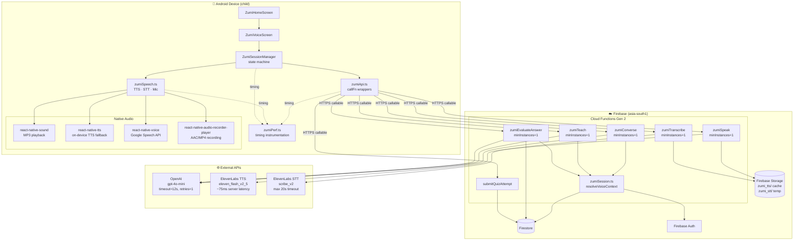
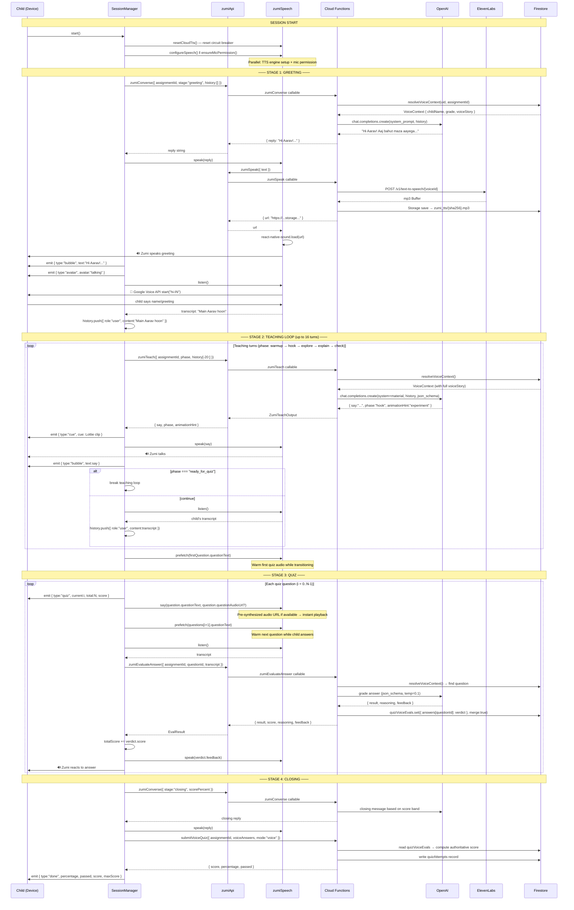
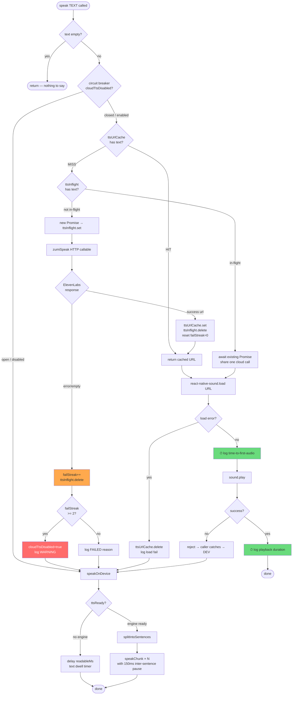
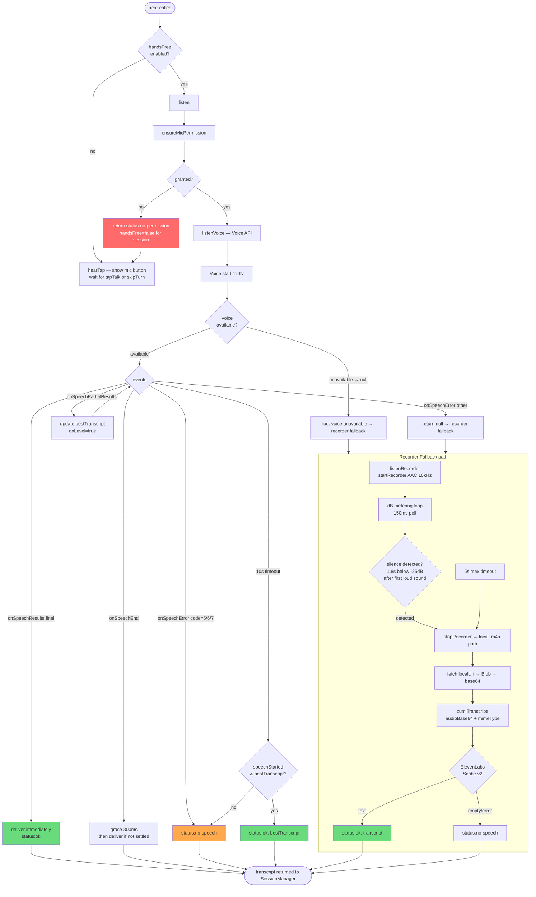
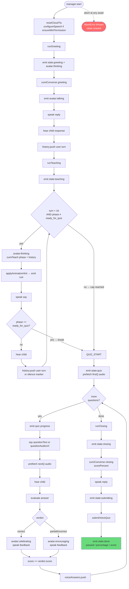
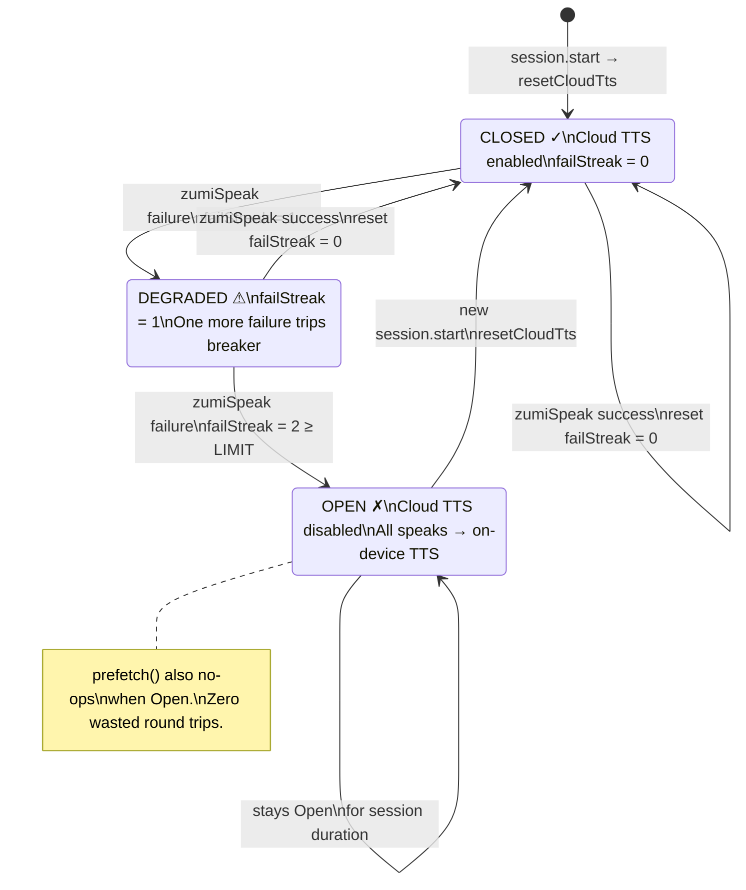
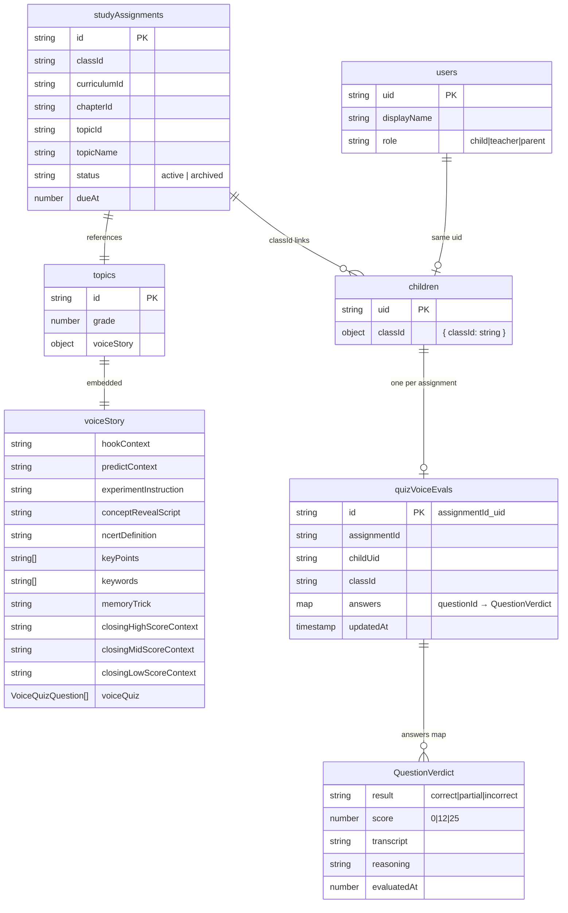
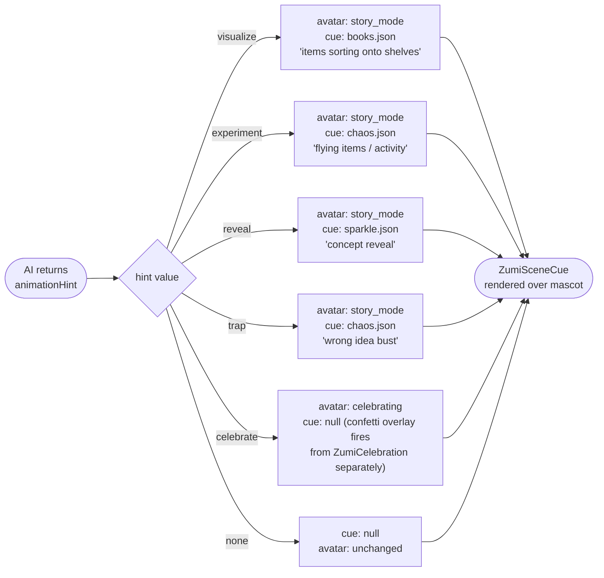

# Zumi AI — Tech Design Document

> Eraser-style system design: every component, every decision, every API contract
> with exact input/output shapes. Paste any Mermaid block into [Eraser](https://eraser.io)
> or the GitHub markdown renderer to visualise it.

---

## 1. System Component Map



---

## 2. Full Session Sequence — Happy Path



---

## 3. TTS Pipeline — Every Decision



---

## 4. STT Pipeline — Every Decision



---

## 5. zumiSpeak Cache Strategy — Server Side

```mermaid
flowchart TD
    A([zumiSpeak called\ntext: string]) --> B[requireAuth + requireRole child]
    B --> C[trim text to 800 chars\nsha256 of voiceId+model+format+speed+text]
    C --> D[Storage.file.getMetadata]

    D --> E{file exists?}
    E -- 404 / error = MISS --> F[ElevenLabs TTS\nPOST /v1/text-to-speech/{voiceId}]
    E -- exists = HIT --> G{has\nfirebaseStorageDownloadToken?}

    G -- yes --> H[return existing download URL]
    G -- no → token lost --> I[mint new UUID token\nfile.setMetadata]
    I --> H

    F --> J{HTTP 200?}
    J -- no → 402 quota/plan\nor 4xx/5xx --> K[throw HttpsError internal\nclient falls back to on-device TTS]
    J -- yes mp3 Buffer --> L[generate UUID token\nStorage.file.save\ncacheControl: immutable 1yr]
    L --> M[return download URL]

    H --> OUT([{ url: string }])
    M --> OUT

    style K fill:#ff6b6b,color:#fff
    style H fill:#69db7c
    style M fill:#69db7c
```

---

## 6. Authorization Chain — Every Callable

```mermaid
flowchart TD
    REQ([Incoming HTTPS callable request]) --> A[requireAuth\ncheck Firebase ID token]
    A --> B{token valid?}
    B -- invalid/missing --> ERR1[throw unauthenticated]
    B -- valid --> C[requireRole uid 'child']
    C --> D{users/{uid}.role\n=== 'child'?}
    D -- no --> ERR2[throw permission-denied]
    D -- yes --> E[resolveVoiceContext\nuid, assignmentId]

    E --> F[load studyAssignments/{assignmentId}]
    F --> G{exists AND\nstatus=active?}
    G -- no --> ERR3[throw not-found\nor failed-precondition]
    G -- yes --> H[load children/{uid}]

    H --> I{children.classId\n=== assignment.classId?}
    I -- no --> ERR4[throw permission-denied\n'only your own class']
    I -- yes --> J[load curriculum/.../topics/{topicId}]

    J --> K{topic exists\nAND voiceStory present\nAND voiceQuiz array?}
    K -- no --> ERR5[throw not-found\nor failed-precondition]
    K -- yes --> L[load users/{uid}.displayName\nfallback: Auth.getUser displayName]

    L --> M([VoiceContext returned\nto callable handler])

    ERR1 & ERR2 & ERR3 & ERR4 & ERR5 --> STOP([HTTP 4xx to client])

    style ERR1 fill:#ff6b6b,color:#fff
    style ERR2 fill:#ff6b6b,color:#fff
    style ERR3 fill:#ff6b6b,color:#fff
    style ERR4 fill:#ff6b6b,color:#fff
    style ERR5 fill:#ff6b6b,color:#fff
    style M fill:#69db7c
```

---

## 7. Teaching Phase State Machine

```mermaid
stateDiagram-v2
    [*] --> warmup : session start

    warmup : WARMUP\nGreet child, ask name/mood\n1 short turn only
    hook : HOOK\nReal-life mystery or story\nBuild suspense + drama
    explore : EXPLORE\nMake child guess + do experiment\nChild does the thinking
    explain : EXPLAIN\nConcept reveal + keywords\nMemory trick delivered
    check : CHECK\nLight comprehension check\nNot a lecture
    ready_for_quiz : READY_FOR_QUIZ\nConcept understood ✓\nMemory trick heard ✓

    warmup --> hook : goal met: child engaged
    hook --> explore : goal met: hook landed
    explore --> explain : goal met: child guessed / tried
    explain --> check : goal met: concept + trick delivered
    check --> ready_for_quiz : goal met: child understands

    warmup --> hook : AI failure → auto-advance
    hook --> explore : AI failure → auto-advance
    explore --> explain : AI failure → auto-advance
    explain --> check : AI failure → auto-advance
    check --> ready_for_quiz : AI failure → auto-advance

    ready_for_quiz --> [*] : quiz begins

    note right of warmup : Decision: AI director decides\nwhen to advance.\nClient never advances unilaterally.
    note right of ready_for_quiz : Hard cap: 16 turns max.\nIf never reached,\nfinal turn auto-breaks loop.
```

---

## 8. Quiz Evaluation Decision Tree

```mermaid
flowchart TD
    A([zumiEvaluateAnswer called]) --> B{transcript\nempty string?}

    B -- yes → short-circuit --> SC["return {\n  result: 'incorrect',\n  score: 0,\n  feedback: 'Arre mujhe sunai nahi diya'\n}"]

    B -- no --> C[build prompt:\nquestionText + expectedConcepts\n+ correctIndicator + childTranscript]

    C --> D[OpenAI chat.completions\njson_schema strict\ntemp=0.1 max_tokens=120]

    D --> E{response\nparseable JSON?}

    E -- yes --> F{result field\nvalid enum?}
    F -- correct/partial --> G[use AI result]
    F -- anything else --> H[default to 'incorrect']

    G & H --> SCORE

    E -- no / throws --> KEYWORD[keywordFallback\nlowercase includes any expectedConcept?]

    KEYWORD --> KW_RESULT{any concept\nfound?}
    KW_RESULT -- yes --> CORRECT2[result: 'correct']
    KW_RESULT -- no --> WRONG2[result: 'incorrect']
    CORRECT2 & WRONG2 --> SCORE

    SCORE["scoreForVerdict:\ncorrect → 25\npartial → 12\nincorrect → 0"]

    SCORE --> PERSIST[Firestore merge-write\nquizVoiceEvals/{assignmentId}_{uid}\n.answers.{questionId} = verdict]

    PERSIST --> RETURN(["{ result, score, reasoning, feedback }\nreturned to client"])

    style SC fill:#ffa94d
    style KEYWORD fill:#ffa94d
    style RETURN fill:#69db7c
```

---

## 9. Session Manager Event Loop



---

## 10. Circuit Breaker State Machine



---

## 11. Firestore Data Flow



---

## 12. Complete API Contracts

### 12.1 `zumiConverse`

| | |
|---|---|
| **Endpoint** | Firebase HTTPS Callable `zumiConverse` |
| **Region** | `asia-south1` |
| **minInstances** | `1` (always warm) |
| **Auth** | Firebase ID token required; `role === 'child'` required |

**Request**
```typescript
{
  assignmentId: string;          // Firestore studyAssignments doc ID
  stage: "greeting" | "closing"; // Which bookend stage
  history?: Array<{              // Prior chat turns (trimmed to last 8)
    role: "user" | "assistant";
    content: string;             // Max 500 chars per turn
  }>;
  scorePercent?: number;         // 0–100; only used for "closing" stage
}
```

**Response (success)**
```typescript
{
  reply: string;  // 2–3 Hinglish sentences ending with a question
}
```

**Error responses**
| Code | Condition |
|---|---|
| `unauthenticated` | No/invalid Firebase ID token |
| `permission-denied` | User is not a `child`, or not in assignment's class |
| `invalid-argument` | `stage` not in `["greeting","closing"]` |
| `not-found` | Assignment or topic does not exist |
| `failed-precondition` | Assignment not `active`, or topic has no `voiceStory` |

**OpenAI call config**
```
model:       gpt-4o-mini
max_tokens:  200
temperature: 0.85
format:      plain text (no json_schema)
timeout:     12 000 ms
retries:     1
```

**Fallback**: On any AI failure the function returns `{ reply: <canned Hinglish line> }` — never throws so the session always continues.

---

### 12.2 `zumiTeach`

| | |
|---|---|
| **Endpoint** | Firebase HTTPS Callable `zumiTeach` |
| **Region** | `asia-south1` |
| **minInstances** | `1` |
| **Auth** | Firebase ID token; `role === 'child'` |

**Request**
```typescript
{
  assignmentId: string;
  phase: "warmup" | "hook" | "explore" | "explain" | "check" | "ready_for_quiz";
  history?: Array<{
    role: "user" | "assistant";
    content: string;    // Max 500 chars per turn; trimmed to last 20 turns
  }>;
}
```

**Response (success)**
```typescript
{
  say:           string;         // Zumi's next spoken line (1–3 sentences)
  phase:         "warmup" | "hook" | "explore" | "explain" | "check" | "ready_for_quiz";
  animationHint: "none" | "experiment" | "visualize" | "reveal" | "celebrate" | "trap";
}
```

**Error responses** — same as `zumiConverse` plus:
| Code | Condition |
|---|---|
| `invalid-argument` | `phase` not a valid TeachPhase value |

**OpenAI call config**
```
model:           gpt-4o-mini
max_tokens:      220
temperature:     0.9
response_format: { type: "json_schema", json_schema: TEACH_SCHEMA }
format:          strict JSON — { say, phase, animationHint }
timeout:         12 000 ms
retries:         1
```

**JSON Schema enforced by OpenAI**
```json
{
  "name": "zumi_turn",
  "strict": true,
  "schema": {
    "type": "object",
    "additionalProperties": false,
    "properties": {
      "say":           { "type": "string" },
      "phase":         { "type": "string", "enum": ["warmup","hook","explore","explain","check","ready_for_quiz"] },
      "animationHint": { "type": "string", "enum": ["none","experiment","visualize","reveal","celebrate","trap"] }
    },
    "required": ["say","phase","animationHint"]
  }
}
```

**Fallback**: On AI failure returns `{ say: <canned line>, phase: nextPhase(currentPhase), animationHint: "none" }` — phase auto-advances so the session never loops.

---

### 12.3 `zumiEvaluateAnswer`

| | |
|---|---|
| **Endpoint** | Firebase HTTPS Callable `zumiEvaluateAnswer` |
| **Region** | `asia-south1` |
| **minInstances** | `1` |
| **Auth** | Firebase ID token; `role === 'child'` |
| **Side effect** | Writes verdict to `quizVoiceEvals/{assignmentId}_{uid}` |

**Request**
```typescript
{
  assignmentId: string;
  questionId:   string;   // Must match a VoiceQuizQuestion in the topic's voiceStory
  transcript:   string;   // Child's spoken answer; max 1 000 chars
}
```

**Response (success)**
```typescript
{
  result:    "correct" | "partial" | "incorrect";
  score:     25 | 12 | 0;          // Locked by verdict
  reasoning: string;               // AI explanation (max 280 chars)
  feedback:  string;               // Spoken Hinglish line for Zumi to say back
}
```

**Short-circuit** (empty transcript):
```typescript
// No AI call made — instant return:
{
  result:    "incorrect",
  score:     0,
  reasoning: "No answer captured.",
  feedback:  "Arre, mujhe sunai nahi diya! Koi baat nahi, agli baar zaroor batana!"
}
```

**Fallback chain**:
```
1. OpenAI returns valid JSON  → use AI result
2. OpenAI returns invalid JSON → parseEval returns null → keywordFallback
3. OpenAI throws              → keywordFallback
   keywordFallback: lowercase(transcript).includes(any expectedConcept) → correct, else incorrect
```

**Firestore write (merge)**:
```
Collection: quizVoiceEvals
Document:   {assignmentId}_{uid}
Fields set (merge:true):
  assignmentId
  childUid
  classId
  answers.{questionId}.result
  answers.{questionId}.score
  answers.{questionId}.transcript
  answers.{questionId}.reasoning
  answers.{questionId}.evaluatedAt
  updatedAt: FieldValue.serverTimestamp()
```

**OpenAI call config**
```
model:           gpt-4o-mini
max_tokens:      120
temperature:     0.1    ← near-deterministic grading
response_format: { type: "json_schema", json_schema: EVAL_SCHEMA }
```

---

### 12.4 `zumiSpeak`

| | |
|---|---|
| **Endpoint** | Firebase HTTPS Callable `zumiSpeak` |
| **Region** | `asia-south1` |
| **minInstances** | `1` |
| **Auth** | Firebase ID token; `role === 'child'` |
| **Cache** | Firebase Storage `zumi_tts/{sha256(voiceId+model+format+speed+text)}.mp3` |

**Request**
```typescript
{
  text: string;   // Spoken line; trimmed to max 800 chars server-side
}
```

**Response (success)**
```typescript
{
  url: string;   // Firebase Storage token URL — directly streamable by react-native-sound
                 // Format: https://firebasestorage.googleapis.com/v0/b/{bucket}/o/{path}?alt=media&token={uuid}
}
```

**Cache key composition**:
```
sha256( voiceId + "|" + model + "|" + outputFormat + "|" + speed + "|" + text )
```

**ElevenLabs call config**
```
endpoint:      POST https://api.elevenlabs.io/v1/text-to-speech/{voiceId}
model_id:      eleven_flash_v2_5
output_format: mp3_44100_64
stability:     0.6
similarity_boost: 0.85
style:         0.0
use_speaker_boost: true
speed:         0.88   (default; env-tunable via ELEVENLABS_VOICE_SPEED)
timeout:       15 000 ms
retries:       2 (one retry on failure)
```

**Voice defaults**:
```
ELEVENLABS_VOICE_ID default: EXAVITQu4vr4xnSDxMaL  (Sarah — free premade)
⚠ Library voices require paid plan → use premade voices on free accounts
```

**Storage save config**:
```
resumable:    false
contentType:  audio/mpeg
cacheControl: public, max-age=31536000, immutable
metadata.firebaseStorageDownloadTokens: <uuid>
```

---

### 12.5 `zumiTranscribe`

| | |
|---|---|
| **Endpoint** | Firebase HTTPS Callable `zumiTranscribe` |
| **Region** | `asia-south1` |
| **minInstances** | `1` |
| **Auth** | Firebase ID token; `role === 'child'` |

**Request — fast path (base64 inline)**
```typescript
{
  audioBase64: string;       // Base64-encoded audio bytes (preferred)
  mimeType?:   string;       // Default: "audio/mp4"
}
```

**Request — legacy path (Storage)**
```typescript
{
  storagePath: string;       // Must start with "zumi_stt/{callerUid}/"
                             // Path traversal (..) rejected with permission-denied
}
```

**Response (success)**
```typescript
{
  transcript: string;   // Transcribed text; '' if nothing heard or on any error
}
```

**Path selection**:
```
if audioBase64 present AND non-empty:
  → decode Buffer
  → if bytes > 5 MB: return { transcript: '' }
  → transcribe(bytes, mimeType)   ← ElevenLabs Scribe
else:
  → validate storagePath prefix
  → Storage.file.download()
  → transcribe(bytes, 'audio/mp4')
  → Storage.file.delete()   ← cleanup temp upload
```

**ElevenLabs STT config**:
```
endpoint:  POST https://api.elevenlabs.io/v1/speech-to-text
model_id:  scribe_v2
format:    multipart/form-data (hand-built — no DOM FormData)
timeout:   20 000 ms   (longer — audio data transfer)
retries:   0           (one-shot; audio is already uploaded)
max size:  5 MB
```

**Never throws to caller**: Any transcription failure returns `{ transcript: '' }` — the session treats that as "no answer" and re-prompts or skips.

---

### 12.6 `submitVoiceQuiz`

| | |
|---|---|
| **Endpoint** | Firebase HTTPS Callable `submitQuizAttempt` |
| **Region** | `asia-south1` |
| **Auth** | Firebase ID token; `role === 'child'` |
| **Source of truth** | Reads from `quizVoiceEvals` (server-written) — client score ignored |

**Request**
```typescript
{
  assignmentId: string;
  answers:      [];            // Ignored for voice mode (server reads evals)
  mode:         "voice";
  voiceAnswers: Array<{
    questionId: string;
    transcript: string;
  }>;
}
```

**Response (success)**
```typescript
{
  score:      number;    // Authoritative total from quizVoiceEvals
  total:      number;    // Max possible score
  percentage: number;    // 0–100
  passed:     boolean;   // percentage >= 60
}
```

---

## 13. OpenAI Prompt Architecture

### System Prompt — `converse()`

```
Tu Zumi hai -- {childName} ka pyaara AI dost. Wo class {grade} mein hai.
Hamesha Hinglish (Roman script) mein baat kar, max 2-3 chhote simple sentences.
Warm, playful aur encouraging reh. Kabhi daanto mat. Koi emoji ya markdown mat use kar.
Current goal: {context}

→ context for "greeting":
  "Greet {childName} warmly by name and start a genuine get-to-know-you chat...
   Ask their name and how their day is going.
   Do NOT mention any lesson, story, or experiment yet."

→ context for "closing":
  "Wrap up the session warmly. {closingHighScoreContext | closingMidScoreContext | closingLowScoreContext}"
```

### System Prompt — `teachTurn()` (condensed structure)

```
[Identity]   Tu Zumi hai — {grade} bachche ka AI dost. {nameClause}
[Format]     Hinglish Roman script, 1-3 sentences, EXACTLY 1 question per turn, no emoji
[Hook rule]  Pehle second se baandh ke rakho — suspense, mystery, "guess karo!"
[Goal]       Stealth teach — child discovers concept herself, never feels studied
[Reaction]   Har baar child ki EXACT baat pe react karo, fir aage badho
[Freedom]    Content below = KNOWLEDGE ONLY — create own examples/jokes/stories

[Topic material injected]
TOPIC: {topicName}
- Real-life hook idea:       {hookContext}
- Guess prompt:              {predictContext}
- Experiment:                {experimentInstruction}
- Concept to reveal:         {conceptRevealScript}
- NCERT definition:          {ncertDefinition}
- Key points:                {keyPoints[].join(' | ')}
- Keywords to slip in:       {keywords[].join(', ')}
- Memory trick:              {memoryTrick}

[Phase discipline]
Current phase: {phase}
warmup(1 turn) → hook → explore → explain → check → ready_for_quiz
Advance only when phase goal met. ready_for_quiz ONLY after concept+trick delivered.

[Animation guide]
"visualize" = groups/classification, "experiment" = hands-on messy activity,
"reveal" = big concept reveal, "celebrate" = child did great,
"trap" = bust a wrong idea playfully, "none" = just talk

[Output] Always JSON: { say, phase, animationHint }
```

### Eval Prompt — `evaluateAnswer()`

```
A class {grade} child named {childName} was asked (Hinglish): "{questionText}".
Concepts a good answer includes: {JSON.stringify(expectedConcepts)}.
What counts as correct: "{correctIndicator}".
The child said: "{transcript}".
Be lenient with spelling, Hinglish, child phrasing — judge the IDEA not the words.
For "feedback": react to what child ACTUALLY said. If wrong: gently acknowledge,
never scold, give the correct idea simply. If correct: celebrate.
Return JSON { result, reasoning, feedback }.
```

---

## 14. AnimationHint → Screen Mapping



---

## 15. Latency Budget (Measured)

```mermaid
gantt
    title One Zumi turn end-to-end (cloud voice WORKING — target state)
    dateFormat X
    axisFormat %Lms

    section AI Text
    zumiTeach (OpenAI gpt-4o-mini)  :a1, 0, 2800

    section TTS
    zumiSpeak (cache HIT — instant)  :a2, 2800, 2850
    react-native-sound load (TTFA)   :a3, 2850, 3350

    section Audio
    Zumi speaks (2-3 sentences ~4s)  :a4, 3350, 7350

    section STT
    Google Voice API (streaming)     :a5, 7350, 9350

    section AI Total
    Child waits: AI→spoken = ~3.3s   :crit, 0, 3350
```

```mermaid
gantt
    title One Zumi turn (cloud voice FAILING — degraded fallback observed)
    dateFormat X
    axisFormat %Lms

    section AI Text
    zumiTeach (OpenAI)               :a1, 0, 2800

    section TTS (FAILING)
    zumiSpeak cloud FAIL + timeout   :crit, 2800, 4600
    on-device TTS engine speak       :crit, 4600, 13500

    section Audio
    (on-device TTS included above)   :a4, 4600, 13500

    section STT
    Recorder fallback + Scribe       :a5, 13500, 20100

    section Child waits
    AI→spoken TOTAL = ~13.5s SLOW   :crit, 0, 13500
```





---

## 16. Key Architectural Decisions

| Decision | Choice | Reason | Trade-off |
|---|---|---|---|
| API key storage | Firebase Secrets, server-only | Child app never holds keys | Adds cloud-function hop for every AI/speech call |
| AI model | gpt-4o-mini | Fast, cheap, Hinglish support, JSON structured output | Less capable than GPT-4o; acceptable for grade 1–6 topics |
| TTS voice | ElevenLabs Flash v2.5 | ~75ms server latency, 32 langs incl. Hindi | Paid plan required for library voices |
| TTS cache | Firebase Storage, sha256 key, immutable | Repeated lines are free and instant | Cache grows unbounded; manual GCS purge needed on voice change |
| STT primary | @react-native-voice (Google) | Streaming, near-instant, no upload latency | May be missing on OEM devices (no Google Speech APK) |
| STT fallback | Record → base64 → ElevenLabs Scribe | Device-independent, accurate Hinglish | ~6–7s latency total |
| Scoring authority | Server writes verdicts, reads at submit | Client cannot inflate score | Extra Firestore writes per question |
| Session manager | Framework-agnostic event emitter | Decoupled from React, fully testable | Screen must map every event type |
| Teaching phases | AI director decides advancement | Natural conversation pacing | AI failures auto-advance (no infinite loops) |
| Circuit breaker | 2-failure threshold, session-scoped | Prevents wasted cloud RTT when TTS is broken | Doesn't auto-recover mid-session |
| minInstances=1 | zumiConverse, zumiTeach, zumiEvaluateAnswer, zumiSpeak, zumiTranscribe | Warm instances = no cold-start penalty | Higher idle cost (~5 functions always running) |
| Parallel session start | configureSpeech ‖ ensureMicPermission | Saves ~300ms session startup | Minor complexity |
| Prefetch next line | Fire-and-forget during current speech | Overlaps synthesis with audio playback | Wasted synth if child skips question |
| History windowing | Last 8 turns (converse), last 20 turns (teach) | Keeps context within token budget | Very old turns forgotten |
